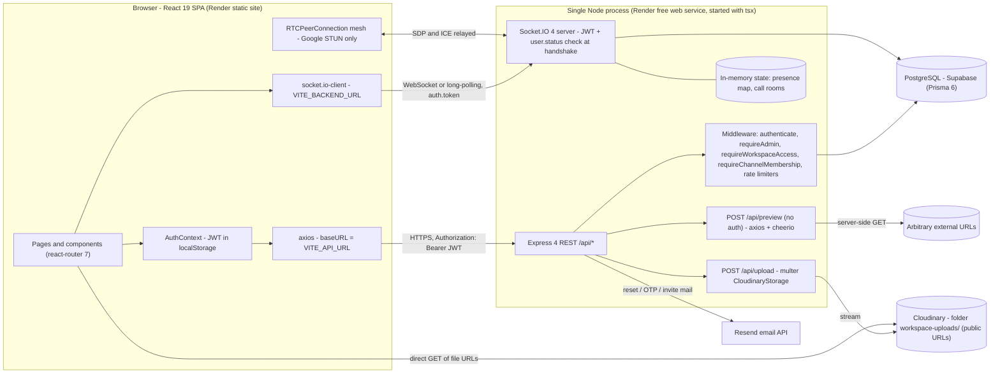
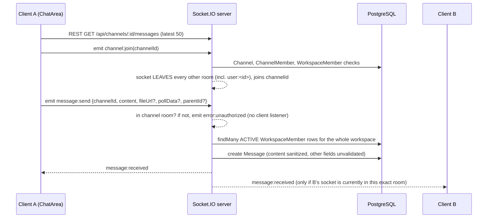
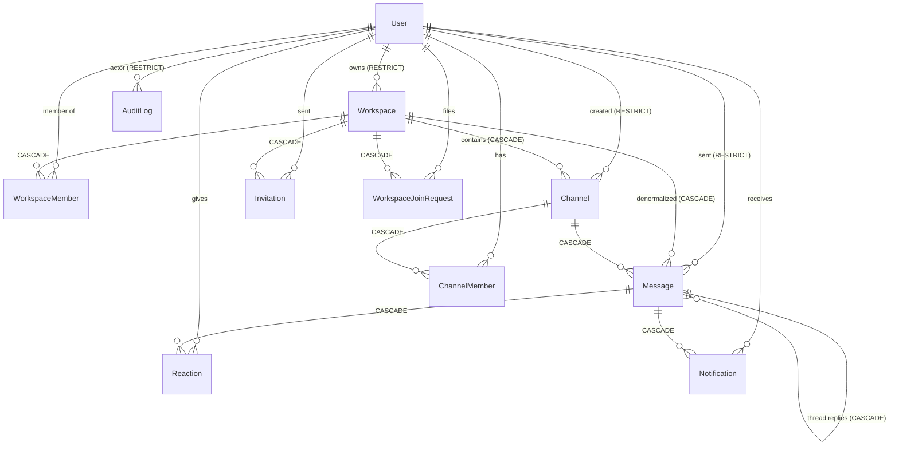

# Entire Analysis — Slick (Slack Clone) 

This file is the single cumulative audit log for this repository. Each audit is appended as its own dated section; earlier sections are never rewritten.

---

# Audit 2026-11-04 — Full Read-Only Technical, Security & Production-Readiness Audit

| Item | Value |
|---|---|
| Audit date | 2026-11-04 |
| Commit audited | `75e54a5fa4917c2e3114ae3bd92d92193c41fc24` (`main`, in sync with `origin/main`) |
| Scope | Entire repository: `backend/`, `frontend/`, `.github/`, `render.yaml`, Prisma schema + 17 migrations, scripts, root docs |
| Method | Line-by-line reading of all hand-written source (~4.8k backend LOC, ~0.7k test LOC, ~7.9k frontend LOC), code-path tracing, lockfile `npm audit`, public GitHub Actions results for the audited commit |
| Not done (by rule) | No dependency install, no local build/test, no DB connection, no requests to the deployed Render services, no file changes other than creating this report |
| Evidence levels used | **CI-verified** (exercised by the green CI test suite) · **Code-traced** (followed through the code end-to-end, not executed) · **Inferred** (depends on runtime/platform behaviour not observable here) |

> Secret handling: no secret values appear in this report. Where a file contains a hardcoded credential, only its location is given.

---

## 1. Executive Summary

**Slick** is a Slack-style team chat app: a React 19 + Vite SPA and a single-process Node/Express 4 + Socket.IO 4 backend, with PostgreSQL (Supabase) via Prisma 6, Cloudinary file storage, Resend email, and peer-to-peer WebRTC calls. It's deployed as two Render free-tier services from `render.yaml`. CI on GitHub Actions runs type-check, build and 36 backend integration tests, and is green on the audited commit.

**What works well**
- A modular, well-commented backend: routes → controllers → services, with shared middleware.
- Real (not simulated) Socket.IO messaging. Message HTML is sanitized on the server and again in the browser.
- Cursor-paginated message history with a matching compound index, plus virtualized rendering.
- Workspace tenancy with membership checks on most REST routes and on `channel:join`.
- Transactions for multi-step creates, and an admin panel with an audit log.

**What blocks production**
1. **Critical — token-type confusion (SEC-01).** Workspace invite-link JWTs are signed with the same secret as login JWTs, and `authenticate` accepts any valid JWT. Any user can create a workspace, generate an invite link, and use that token as a session token. With no `id` in the token, Prisma ignores the `undefined` filters, so lists return *everyone's* data: every DM in the Default Workspace, every invitation (with its token), and every workspace and channel. Chained with SEC-03, any user can **read any DM** in the Default Workspace.
2. **Critical (conditional) — platform-admin credentials committed to a public repo** (`backend/reset.ts`, SEC-02). This is a full admin takeover if production was seeded with that script and the password was never rotated.
3. **High — unauthenticated SSRF** on `POST /api/preview` (SEC-04).
4. **Functional blocker — DM conversations cannot be opened in the UI** (BUG-01). The DMs page and Home DM counter are always empty.
5. **Real-time defects.**
   - `channel:join` removes the socket from every other room, including its personal `user:<id>` room. As a result, ban-kicks, "added to channel" notifications, unread badges and call signaling after a channel switch all fail (RT-01).
   - There is no reconnection recovery, and failed sends are dropped silently (RT-02).
6. **Password reset is broken in production.** The reset link is hardcoded to localhost, and Resend's test sender only delivers to the account owner (BUG-02).

**Overall health:** solid foundation for a student or portfolio-grade project, but **not production-ready**. Estimated production readiness is **≈ 42 %** (method in §Final Assessment). Go-live is **blocked** until the Critical/High items in Phase 1 are fixed.

---

## 2. Project Identity and Technology Stack

| Layer | Technology (resolved version from lockfile) | Evidence |
|---|---|---|
| Product name | "Slick" / "Slick Workspace" (repo: `SaideepGopale/Slack-Clone`, **public**) | `README.md`, `utils/mailer.ts:13`, GitHub API |
| Languages | TypeScript (backend + frontend), SQL (migrations), small JS/MJS scripts | `git ls-files`: 79 `.ts`, 46 `.tsx`, 17 `.sql` |
| Frontend framework | React 19.2.6, react-dom 19.2.6, React Router 7.18.1 (`createBrowserRouter`) | `frontend/package-lock.json`, `src/routes/router.tsx` |
| Frontend build | Vite 6.4.2, `@vitejs/plugin-react` 5, TypeScript 5.8.3 (`tsc && vite build`) | `frontend/package.json` |
| Styling / UI | Tailwind CSS 4.3.0 (CSS-first `@theme` in `index.css`), lucide-react icons, `motion` 12 animations, react-toastify. **No component library**; components are hand-rolled | `frontend/src/index.css`, components |
| Rich text | TipTap 3.28 (StarterKit, TextAlign, Placeholder) | `components/chat/RichTextEditor.tsx` |
| Other FE libs | react-virtuoso (virtualized message list), emoji-picker-react, recharts (admin charts), DOMPurify, date-fns, axios, socket.io-client 4.8.3 | `frontend/package.json` |
| State management | React Context only: `AuthContext` (session) and `WorkspaceContext` (per-workspace data + socket). No Redux, Zustand or React Query | `src/contexts/AuthContext.tsx`, `src/pages/workspace/WorkspaceContext.tsx` |
| Backend framework | Node.js (CI: 20; local: 22.14), Express 4.22.2, Socket.IO 4.8.3, ESM (`"type":"module"`), run via `tsx` 4.22 in production | `backend/package.json`, `render.yaml:21` |
| Database / ORM | PostgreSQL (Supabase in prod; Postgres 16 in CI), Prisma 6.19.3 (`prisma-client-js`) | `backend/prisma/schema.prisma`, `render.yaml:26-32`, `.github/workflows/ci.yml` |
| Auth | Custom JWT (jsonwebtoken 9.0.3, HS256, 7-day expiry), bcryptjs 3 (cost 12), Bearer header, token in `localStorage` | `modules/auth/auth.service.ts:23-24`, `AuthContext.tsx:67,183` |
| File storage | Cloudinary v2 SDK via a custom multer `StorageEngine` (streams uploads, never touches disk) | `modules/uploads/upload.middleware.ts` |
| Email | Resend HTTP API (switched from Gmail SMTP because Render blocks SMTP), test sender `onboarding@resend.dev` | `utils/mailer.ts` |
| Calls | Native WebRTC `RTCPeerConnection` full mesh, Socket.IO signaling, Google public STUN only (no TURN) | `components/chat/CallOverlay.tsx:31-32`, `sockets/calls.handlers.ts` |
| Link previews | Server-side `axios.get(url)` + cheerio OpenGraph scrape | `backend/app.ts:79-99` |
| Rate limiting | express-rate-limit 8.6.0 (in-memory store) on signup/OTP/login only | `middleware/rateLimit.middleware.ts` |
| Sanitization | sanitize-html 2.17.6 (server), DOMPurify 3.4.12 (client) | `lib/sanitize.ts`, `frontend/src/lib/sanitizeHtml.ts` |
| Testing | Vitest 3.2.7 + Supertest 7 integration tests against real Postgres (backend only). **No frontend tests** | `backend/vitest.config.ts`, `backend/tests/` |
| Package manager | npm (lockfile v3), two independent packages (no workspaces/monorepo tool) | `*/package-lock.json` |
| CI | GitHub Actions: backend (`npm ci`, `tsc --noEmit`, `tsc`, `vitest` with Postgres service), frontend (`npm ci`, `tsc --noEmit`, `vite build`) | `.github/workflows/ci.yml` |
| Deployment | Render Blueprint: backend = free Node web service, frontend = static site with SPA rewrite. No Docker | `render.yaml` |

---

## 3. Architecture Overview

### 3.1 Verified component diagram



### 3.2 Message flow as implemented (and where it breaks)



### 3.3 Communication, API and flows

| Concern | Actual implementation |
|---|---|
| FE→BE | axios with a global `baseURL` (`lib/api.ts`) and a global `Authorization` header set by `AuthContext`. Vite dev proxy forwards `/api` and `/uploads` to `localhost:4000` (`vite.config.ts`) |
| API structure / versioning | Flat `/api/*` resources (`auth`, `channels`, `messages`, `users`, `invitations`, `workspaces`, `admin`, `upload`, `preview`, `health`). **No versioning** (`/v1`), no OpenAPI spec. 54 REST endpoints + 1 static mount |
| Authentication flow | `POST /api/auth/login` or `/signup` → bcrypt check → JWT `{id, username, role}` (7 d) → stored in `localStorage` → `GET /api/auth/me` on every app load → Socket.IO handshake sends `auth.token`. **No refresh tokens, no revocation, no cookies** |
| Authorization | Three role systems: `User.role` (USER/ADMIN, platform admin, re-checked in DB by `requireAdmin`), `WorkspaceMember.role` (ADMIN/MEMBER, checked inside services), `ChannelMember.role` (free-text string, stored but **never used for authorization**). The Default Workspace (`isDefault`) bypasses the membership check in `requireWorkspaceAccess` |
| Real-time | Rooms: `user:<id>` (joined on connect), `<channelId>` (one at a time, see RT-01), `thread_<messageId>`, `call:<channelId>`. Membership is checked by DB on `channel:join`; later events trust room membership |
| File upload | Browser → `POST /api/upload` (multer, 25 MB cap, MIME allow-list) → streamed to Cloudinary → returns `secure_url` → client sends the URL inside `message:send`. Downloads are direct public Cloudinary URLs (no auth) |
| Background jobs / queues | **None.** No workers, cron, or queue. Emails are sent inline during the request |
| Error handling | Controllers use `try/catch → next(err)` → `errorHandler` returns `{error}` with `err.status`. Async middleware has no error handling (BE-01). Process-level `unhandledRejection`/`uncaughtException` handlers log and continue (`server.ts:21-26`) |
| Logging | `console.*` only (95 call sites), no request logging, no correlation IDs, no error tracking/metrics |
| External services | Supabase Postgres, Cloudinary (upload + Admin API listing), Resend, Google STUN, arbitrary third-party sites (link previews) |

### 3.4 Database relationships (Prisma models)



---

## 4. Repository Structure

```
Slack-Clone/                          (179 tracked files; working tree clean)
├── .github/workflows/ci.yml          CI: backend lint+build+test (Postgres 16), frontend lint+build
├── render.yaml                       Render blueprint (backend web service + frontend static site)
├── README.md                         OUTDATED (EmailJS, Gmail, port 3000, backend/routes/, backend/.env.example)
├── 16 root *.md / *.txt docs         Historical status docs (June 2026) claiming "PRODUCTION READY"; describe
│                                     ZegoCloud, React 18, EmailJS etc. which no longer match the code
├── backend/
│   ├── server.ts, app.ts             HTTP + Socket.IO bootstrap; Express app, CORS, /api/preview, /api/health
│   ├── config/env.ts                 Required env vars (exits if JWT/Cloudinary missing)
│   ├── middleware/                   auth, admin, workspace, channelAccess, rateLimit, error
│   ├── modules/{auth,channels,messages,users,workspaces,invitations,admin,uploads}/   routes/controller/service
│   ├── sockets/                      index (handshake), channels, messages, presence, calls, admin, registry
│   ├── lib/                          prisma singleton, otp, sanitize, auditLog, reactionSummary
│   ├── lib/generated/prisma/         UNUSED committed Prisma client incl. a 20 MB Windows engine binary
│   ├── utils/                        mailer (Resend), csv
│   ├── prisma/schema.prisma          10 models, 4 enums
│   ├── prisma/migrations/            15 migrations (baseline 2026-07-21 → join requests 2026-07-27)
│   ├── prisma/migrations_archived_*  pre-baseline history (archived)
│   ├── tests/                        4 Vitest+Supertest integration suites (36 cases)
│   └── seed.ts, seed.mjs, reset.ts, reset-to-general-channel.ts, cleanup-orphan-user-channels.ts,
│       set-default-workspace.ts, setup_dm_test.ts     one-off/dev scripts (some destructive, some stale)
└── frontend/
    ├── vite.config.ts, index.html, .env.example, verify_dm_fix.mjs (ad-hoc Playwright script, not CI)
    └── src/
        ├── routes/ (router, ProtectedRoute)   contexts/AuthContext   hooks/useSocket   lib/ (api, admin, sanitizeHtml)
        ├── pages/auth/ (Login, InviteHandler, JoinWorkspace)   pages/workspace/ (Layout, Context, 8 route pages)
        ├── pages/admin/AdminPage
        └── components/{auth,chat,layout,sidebar,admin}/   27 components (ChatArea 1,004 LOC, CallOverlay 679 LOC)
```

**No `backend/.env.example` exists** (README and `.gitignore` reference one).

---

## 5. Complete Feature Inventory

Status key: **1** Fully implemented & verified · **2** Partially implemented · **3** UI-only / placeholder · **4** Backend-only · **5** Broken / incomplete · **6** Not implemented

| # | Feature | Status | Verification | Evidence & notes |
|---|---|---|---|---|
| 1 | Registration (direct email + password) | **1** | CI-verified | `POST /api/auth/signup` (`auth.service.ts:82-117`), auto-joins the Default Workspace and General; tests in `tests/auth.test.ts`. **No email verification on this path** (SEC-08) |
| 2 | Login / session restore | **1** | CI-verified | `login` (`auth.service.ts:229-253`) blocks SUSPENDED/BANNED; `/me` on load (`AuthContext.tsx:116-142`) |
| 3 | Email verification (OTP) | **4** | CI-verified (backend) | `/signup-request` and `/verify-otp` are fully tested with HMAC-hashed OTPs, but **no UI calls them** (`AuthContext` helpers unused by `AuthForm.tsx`). Delivery depends on Resend's test sender (BUG-02) |
| 4 | Forgot / reset password | **5** | Code-traced | Link hardcoded to `http://localhost:5174` (`auth.service.ts:272`), so it can't work outside one dev machine. Resend's test sender rejects non-owner recipients, so the request 500s. No rate limit, no password-length check on reset |
| 5 | User profiles & settings | **3** | Code-traced | "Profile Settings", "Preferences", "Add Birthdate/Phone" are dead buttons (`Header.tsx:165-192`). No profile/avatar/rename endpoint exists |
| 6 | Workspaces (create/list/switch/delete, Default Workspace) | **1** | CI-verified | `workspaces.service.ts`, `WorkspaceSwitcher.tsx`; creation, access denial and active-workspace tests |
| 7 | Channels & membership | **2** | CI-verified (create/list), code-traced (rest) | Create/list/join/add-member/delete work. **Missing:** private channels, leave, rename/edit, archive, remove member, member list. Delete is platform-admin only; DM guard missing (SEC-03) |
| 8 | Direct messages (1:1) | **5** | Code-traced | Backend DM creation, listing and messaging work, but the UI cannot open a DM conversation (BUG-01). The DMs page and Home counter read from a list that excludes DMs (FE-02) |
| 9 | Group DMs (multi-person) | **6** | — | DMs are strictly 2-person (`dm.service.ts:49-62`) |
| 10 | Message edit / delete | **2** | Code-traced | Owner-only via socket (`messages.handlers.ts:210-234`), real-time. No "edited" marker or `editedAt`, no ack/rollback, deleting a parent silently cascades its replies, files aren't removed from Cloudinary. No tests |
| 11 | Reactions | **1** | CI-verified | `POST /api/messages/:id/reactions` toggle + `message:reaction:updated` broadcast; test in `messages.test.ts` |
| 12 | Threads | **2** | CI-verified (fetch), code-traced (live) | Fetch is tested. Live replies use a thread room. Defects: cross-channel `parentId` IDOR (SEC-05), thread panel ignores deletes/edits (RT-09), no pagination |
| 13 | Message search | **4** | Code-traced | `GET /api/channels/:id/search` exists, but no UI calls it. The header search box is unwired (`Header.tsx:67-71`). Admin global search **works** (MessageModeration) |
| 14 | File sharing / attachments / voice notes | **2** | Code-traced | Upload → Cloudinary works, with progress bars. Defects: client-supplied `fileUrl` accepted as-is (SEC-09), public URLs, no inline image preview, thread replies can't attach files, no tests |
| 15 | Voice / video calls + screen share | **2** | Code-traced | Real WebRTC mesh with server-side signaling authorization. No TURN (fails behind strict NAT). Ringing only reaches users currently viewing that channel. Mesh doesn't scale. DM calls impossible (BUG-01) |
| 16 | Notifications (mentions, replies, unread) | **5 / 6** | Code-traced | `Notification` table is unused (schema-only). No @mentions. Unread badges structurally broken (RT-01). No browser/push notifications |
| 17 | Presence / online status | **2** | Code-traced | Real, in-memory, multi-tab aware. Leaks across tenants (SEC-10). Custom status is not persisted, and the Sidebar checks a `busy` value that is never sent (RT-11) |
| 18 | Typing indicators | **1** | Code-traced | Room-scoped, `volatile`, authorization-gated (`messages.handlers.ts:51-59`). Not throttled (RT-13) |
| 19 | Invitations — reusable link + admin approval | **1** | CI-verified | `invite-link`, `/join`, `/requests` approve/reject; 12 tests |
| 20 | Invitations — per-email | **5** | Code-traced | Backend endpoints still live, but no UI creates them and email delivery fails (BUG-02). Directory still lists old ones. Tokens never expire |
| 21 | Workspace administration | **2** | Code-traced | Delete workspace, generate link and approve requests exist. No member removal, role change, rename or settings |
| 22 | Platform admin panel (stats, analytics, users, channels, moderation, files, audit log, broadcast, CSV export) | **2** | CI-verified (gating, broadcast) | Mostly functional. `deleteUser` fails for workspace owners (BE-03). Admin socket handlers are never called by the UI (dead) |
| 23 | Roles & permissions | **2** | Code-traced | Platform and workspace roles are enforced. Channel roles are unused. Platform admins are force-redirected away from chat (`ProtectedRoute.tsx:19`) |
| 24 | Search & filtering (directory, admin) | **2** | Code-traced | Client-side text filters work. Directory status/sort dropdowns are UI-only (`Directory.tsx:300-308`) |
| 25 | Pinned messages | **1** | Code-traced | `message:pin` with authorization; pinned bar (it shows raw HTML text, FE-07) |
| 26 | Polls (`/poll` slash command) | **2** | Code-traced | Works, but votes have a lost-update race (RT-05) and are client-forgeable (SEC-09) |
| 27 | Link previews | **2** | Code-traced | Works through the SSRF-vulnerable endpoint (SEC-04) |
| 28 | Rich-text composer | **1** | Code-traced | TipTap bold/italic/strike/align, sanitized on both server and client |
| 29 | Responsive / mobile UI | **2** | Code-traced | A mobile sidebar drawer exists. Message actions are hover-only, and the thread panel's 320 px minimum width crowds phones (FE-08) |
| 30 | Dark mode / theming | **6** | Code-traced | No toggle; only 6 stray `dark:` classes (FE-09) |
| 31 | Accessibility | **6** | Code-traced | Zero `aria-*` or `role` attributes in the frontend (FE-06) |

---

## 6. Frontend Audit

### 6.1 Routes

| Route | Component | Guard | Notes |
|---|---|---|---|
| `/login`, `/signup` | `LoginPage` → `AuthForm` | none | Also consumes `?inviteToken` / `?joinToken` after auth |
| `/reset-password` | `ResetPassword` | none | Reachable only via the broken reset link (BUG-02) |
| `/invite/:token` | `InviteHandler` | none | Legacy email-invite traffic controller |
| `/join-workspace` | `JoinWorkspacePage` | none | Redirects to `/login?joinToken=` |
| `/admin` | `AdminPage` | `ProtectedRoute requireAdmin` | Platform admins are **always** redirected here |
| `/` | `WorkspaceRedirect` | `ProtectedRoute` | Picks last-active or first workspace |
| `/:workspaceId/{home,dms,activity,directory,more,c/:channelId}` | `WorkspaceLayout` + pages | `ProtectedRoute` | `c/:channelId` cannot render DMs (BUG-01) |
| `*` | `Navigate /` | — | — |

Positive: loading screen during auth, guarded routes, `channelsLoading` race guard, virtualized message list with infinite scroll, toasts for errors, empty states in chat, DMs, activity and directory.

### 6.2 Findings

| ID | Sev | Location | Observed behaviour & evidence | Recommended correction |
|---|---|---|---|---|
| FE-01 | **Critical** | `frontend/src/pages/workspace/ChannelPage.tsx:10,16-22`; `WorkspaceLayout.tsx:102-114,260-277` | **DMs cannot be opened.** `ChannelPage` looks the channel up only in `channels`, which the backend builds with `isDM:false` (`channels.service.ts:53-59`). `dms` is not exposed in `WorkspaceContext`. `startDM` navigates to `/c/<dmId>`, which renders "Select a channel or teammate". The Sidebar DM highlight never matches either. (See BUG-01) | Expose `dms` in context and resolve the channel from `[...channels, ...dms]`, or fetch `GET /api/channels/:id` when it's not found locally; add an E2E test |
| FE-02 | High | `components/layout/DMsView.tsx:14`; `HomeView.tsx:16`; `pages/workspace/DMsPage.tsx:7-12` | DMs page and Home "Direct Messages" count filter `channels` for `isDM`, which is always empty, so they always show "No messages yet" / 0 | Pass `dms` from context |
| FE-03 | High | `pages/workspace/WorkspaceLayout.tsx:219-225` | Unread badges depend on `message:received` for non-current channels, which the socket never receives (RT-01). In practice only the last-joined channel can ever show a badge | Fix RT-01 (subscribe to all member channels or a per-user fan-out room) |
| FE-04 | Medium | `Header.tsx:57-59,67-71,84-86,162,165-192`; `MoreView.tsx:25-33`; `DMsView.tsx:24-29,80-82`; `Directory.tsx:300-308,335,339,351,353,499-505`; `WorkspaceLayout.tsx:227` | **Dead/placeholder UI:**<br>• Header: global search input, "Recent activity", "Help", "Profile Settings", "Preferences", "Add Birthdate/Phone", plus a hardcoded placeholder email fallback<br>• MoreView: Preferences, Privacy, Connections and Help do nothing<br>• Directory: "User Groups" and "External" tabs, filter selects, the More/Mail buttons, and hardcoded "Software Engineer" / "Active User" labels<br>• WorkspaceLayout: listener for `channel:created`, which the server never emits | Remove or hide the placeholders and the dead listener, or implement them; mark unfinished items "Coming soon" |
| FE-05 | Medium | `Sidebar.tsx:67-84,247-253`; `Directory.tsx:386-402`; `Header.tsx:75-82` | **UI/permission mismatch:**<br>• Channel-delete trash icons are shown to every user, but the backend requires a platform admin, and platform admins can't reach this UI at all, so it's effectively unusable<br>• "Invite People" is shown to everyone; non-admins get a 403<br>• "Join" is shown for channels the user has already joined<br>• People lists every user on the platform | Render actions by `myRole`/membership; let workspace admins and creators delete channels (BE-06) |
| FE-06 | Medium | All components (0 `aria-*`, 0 `role=`); `ChatArea.tsx:650` | **Accessibility:**<br>• Icon-only buttons rely on `title`<br>• Message actions are `hidden group-hover:flex`, so keyboard and touch users can't reach them<br>• Modals have no focus trap, Escape handling or `role="dialog"`<br>• Clickable `div`s (Sidebar DM rows, Directory rows) aren't focusable<br>• Low-contrast `violet-300/60` text on `violet-950` | Add aria-labels, `button` semantics, `:focus-within` actions, a dialog primitive, and contrast checks; add axe in CI |
| FE-07 | Medium | `ChatArea.tsx:553,772`; `ActivityView.tsx:100` | Raw HTML shown as text: the pinned bar and Activity feed display `<p>…</p>`. URL extraction runs on HTML, so the trailing `</p>` corrupts link-preview URLs | Strip tags (or use the editor's `getText`) for previews; extract URLs from text nodes |
| FE-08 | Medium | `ThreadPanel.tsx:156`; `ChatArea.tsx:650`; `WorkspaceSwitcher.tsx:50` | Mobile: the thread panel opens side-by-side at `min-w-[320px]`, crushing the chat on phones. Actions are hover-only. The 68 px workspace rail is always visible | Show the thread as a full-screen sheet below `md`; add a tap/long-press action menu |
| FE-09 | Low | `WorkspaceLayout.tsx` (5 `dark:`), `ChannelPage.tsx` (1); `index.css:10-12` | Under OS dark mode a few containers turn dark while chat stays white. There's no theme toggle, and two token systems coexist (legacy `--color-slack-*` and the violet theme) | Either remove the `dark:` classes or implement a proper theme with tokens |
| FE-10 | Low | `ChatArea.tsx:717-721`; `ThreadPanel.tsx:160` | "N Members Online" shows the global online count. Header shows `#` for DMs, and the thread panel shows `#channelName` | Compute online count among channel members; DM-aware header |
| FE-11 | Low | `AdminDashboard.tsx:33`, `UserManagement.tsx:46`, `ChannelManagement.tsx:34,65,79-80` | Each admin tab opens its own socket. `socket.off('error')` removes every error listener. `admin:channel:list:updated` is only emitted by a socket handler the UI never calls, so the listener is dead | One shared admin socket provider; broadcast list updates from the REST delete |
| FE-12 | Low | `ChatArea.tsx` (1,004 LOC), `CallOverlay.tsx` (679), `Directory.tsx` (518); `Sidebar.tsx:31` (`any` props) | Very large multi-concern components; widespread `any`; duplicated message rendering in `ChatArea` and `ThreadPanel` | Extract `MessageItem`, `Composer` and hooks (`useChannelMessages`); type the props |
| FE-13 | Low | `Sidebar.tsx:70-82`; `Directory.tsx:185-187`; `WorkspaceSwitcher.tsx:42` | `alert()`/`confirm()` and `window.location.reload()` after deletes | Toasts + confirm modal + state update |
| FE-14 | Low | whole app (0 dynamic imports) | No code splitting: recharts, emoji-picker, TipTap and motion all ship to every user, including the admin bundle | `React.lazy` for `/admin`, `CallOverlay`, emoji pickers |
| FE-15 | Low | `ChatArea.tsx:464,586-606` | Images aren't previewed inline. Any `fileType` containing `webm` is treated as audio, so videos render as voice notes | Branch on `image/`, `video/`, `audio/` MIME prefixes |
| FE-16 | Low | `useSocket.ts`; `ChannelPage.tsx:16-22`; `WorkspaceLayout.tsx:82-99` | No connection-status UI. "Initialising real-time…" never shows because the socket object exists before it connects. Channel loading shows the "Select a channel" placeholder. Fetch errors only reach `console.error` | Connection banner (connecting / offline / reconnecting); skeleton while `channelsLoading`; visible error states |
| FE-17 | Low | `AuthForm.tsx:228-229`; `ResetPassword.tsx:28` | Signup's "Full Name" field is stored as the **unique** `username`, so two people with the same name can't register. Validation is only HTML `required`/`type=email` plus a 6-character minimum | Separate display name from a unique handle; client and server schema validation |
| FE-18 | Low | `components/layout/Directory.tsx:20-33,177-178` | A hardcoded 4-digit client-side "admin OTP" gates channel deletion. It's in the public bundle, so it's pure theatre (the backend `requireAdmin` is the real gate). See SEC-16 | Remove it; rely on server authorization + confirm dialog |

---

## 7. Backend Audit

### 7.1 Endpoint inventory (54 REST + 1 static)

| Mount | Endpoints (auth = `authenticate`) |
|---|---|
| `/api/auth` | `POST /signup` (limiter), `POST /signup-request` (limiter), `POST /verify-otp` (limiter), `POST /login` (limiter), `GET /me` (auth), `POST /forgot-password` (**no limiter**), `POST /reset-password` (**no limiter**) |
| `/api/channels` | `GET /` (auth, **not workspace-scoped**), `POST /` (auth + workspace), `GET /admin/all` (admin), `POST /dm` (auth), `GET /all?workspaceId` (auth), `DELETE /:id` (admin), `POST /:id/join` (auth), `GET /:channelId/addable-members` (auth), `POST /:channelId/members` (auth), `GET /:id/messages` (auth + membership), `GET /:id/search` (auth + membership) |
| `/api/messages` | `GET /:messageId/thread` (auth), `POST /:messageId/reactions` (auth) |
| `/api/users` | `GET /` (auth, **all users platform-wide**), `PATCH /me/active-workspace` (auth + workspace) |
| `/api/invitations` | `GET /:token` (**public**), `POST /accept/:token` (auth), `GET /` (auth), `POST /` (auth) |
| `/api/workspaces` | `GET /`, `POST /`, `POST /join`, `GET /:id/channels` (+workspace), `GET /:id/dms` (+workspace), `POST /:id/invites`, `GET /:id/invite-link`, `GET /:id/requests`, `PUT /:id/requests/:requestId`, `DELETE /:id` (all auth; admin checks inside services) |
| `/api/admin` (all `authenticate + requireAdmin`) | `GET /stats`, `/analytics`, `/audit-logs`, `/export/users`, `/export/channels`, `/messages/search`, `DELETE /messages/:id`, `GET /files`, `DELETE /files/:publicId`, `POST /users/:id/ban`, `PATCH /users/:id/status`, `PATCH /users/:id/role`, `POST /users/:id/force-reset`, `DELETE /users/:id`, `POST /broadcast` |
| misc | `POST /api/upload` (auth), `GET /api/health` (public), `POST /api/preview` (**public**), static `GET /uploads/*` (**public**, legacy local dir) |

**Socket.IO client→server events (20):** `channel:join`, `typing:start|stop`, `thread:join|leave`, `message:send|edit|delete|pin`, `poll:vote`, `user:status`, `call:initiate`, `webrtc:join|offer|answer|ice-candidate|leave`, `admin:channel:deleted`, `admin:user:kick`, `admin:refresh:channels` (the last three have no UI callers).

### 7.2 Findings

| ID | Sev | Location | Observed behaviour & evidence | Recommended correction |
|---|---|---|---|---|
| BE-01 | High | `backend/middleware/admin.middleware.ts:25-29`; `workspace.middleware.ts:27-56`; `channelAccess.middleware.ts:12-24`; `server.ts:21-26` | Async Express 4 middleware has no `try/catch`. Any DB error or Prisma validation error (e.g. a token without `id`, SEC-01) becomes an unhandled rejection. Express 4 doesn't catch it, the process handler swallows it, and **the request never gets a response** (hangs until client timeout) | Wrap in an async handler or upgrade to Express 5 (native promise support); fail closed with 500/401 |
| BE-02 | High | `modules/auth/auth.service.ts:269-274`; `utils/mailer.ts:13,93-121` | Reset link hardcoded to `http://localhost:5174/reset-password` (Vite runs on 5173; production uses `APP_URL`). The `onboarding@resend.dev` test sender only delivers to the Resend account owner, so `sendResetPasswordEmail` throws for everyone else and forgot-password, admin force-reset, OTP and invite emails return 500 (**Inferred** from Resend's documented test-sender restriction + code) | Build the link from `APP_URL`; verify a sending domain in Resend; queue emails with retries; show a generic success message |
| BE-03 | Medium | `modules/admin/admin.service.ts:265-286`; `prisma/schema.prisma:84-89` | `deleteUser` reassigns messages, channels and audit logs to a sentinel but **not `Workspace.ownerId`** (RESTRICT FK), so deleting any workspace owner fails with an FK error / 500. It also doesn't disconnect the user's sockets | Reassign `ownerId` (sentinel or another admin) inside the transaction; `kickUserSockets` after delete |
| BE-04 | Medium | all controllers; `channels.controller.ts:59-69`; `auth.service.ts:82-96`; `channels.service.ts:115-139`; `messages.controller.ts:42-47` | Ad-hoc validation only:<br>• Non-string body values hit Prisma and 500<br>• No username length/charset limit; channel description and emoji length unbounded<br>• `POST /api/channels/dm` without `targetUserId` makes Prisma drop the filter: it returns an arbitrary existing DM of the caller, or 500s on create | Schema validation (zod) per route, with typed DTOs and consistent 400s |
| BE-05 | Medium | `channels/dm.service.ts:31-65`; `auth.service.ts:93-104`; `messages.service.ts:203-211`; `workspaces.service.ts:45-51` | Check-then-act races:<br>• Concurrent DM creation produces duplicate DMs (no unique key)<br>• Concurrent signup hits P2002 → 500 instead of 400<br>• Concurrent reaction toggle hits P2002 → 500<br>• Slug loop TOCTOU hits P2002 → 500 | Unique constraints (e.g. a `dmKey` column) + upsert/`ON CONFLICT`; map P2002 → 409 |
| BE-06 | Medium | `channels.routes.ts:26`; `ProtectedRoute.tsx:19`; schema `ChannelMember.role` | Permission model gaps:<br>• Only platform admins can delete channels; workspace admins and creators can't<br>• No endpoints to remove workspace members or change roles<br>• Channel roles are never enforced<br>• Platform admins are locked out of chat entirely | Define a permission matrix (owner/admin/member per workspace and channel) and enforce it in one policy module |
| BE-07 | Medium | `channels.service.ts:37-43,100-108`; `ActivityView.tsx:20` | `GET /api/channels` isn't workspace-scoped, so Activity mixes all workspaces. `listPublicChannels` requires a real `WorkspaceMember` row even for the Default Workspace that `requireWorkspaceAccess` bypasses (inconsistent) | Scope `/api/channels` by workspace; one consistent access helper |
| BE-08 | Low | `auth.middleware.ts:16-19`; `AuthContext.tsx:145-158`; `uploads/message.routes.ts:22,46,61` | Invalid or expired JWT returns **403**, but the frontend only logs out on 401, so a token that expires mid-session yields a stream of 403s. Upload errors use `{success,message}` while everything else uses `{error}` | 401 for authentication failures; one error envelope (`{error:{code,message}}`) |
| BE-09 | Low | 7 service files | The `HttpError` class is duplicated in every service | One shared `lib/httpError.ts` |
| BE-10 | Low | `modules/uploads/storage.service.ts`; `sockets/admin.handlers.ts`; `invitations.routes.ts:21-22`; auth OTP routes | Dead or legacy code: unused disk-based multer config (still creates `uploads/` at boot and is served publicly), admin socket handlers with no UI caller, email-invite creation with no UI, OTP flow with no UI | Delete, or feature-flag clearly |
| BE-11 | Low | `app.ts:38-47` | Public `/api/health` reveals config state ("DATABASE_URL not set") | Return generic status; detailed checks behind auth |
| BE-12 | Low | 95 `console.*` sites; `auth.middleware.ts:18` | No structured logging, request IDs or error tracking. Every bad JWT is logged | pino + pino-http, Sentry, log levels |
| BE-13 | Low | `backend/package.json:25` | Depends on the npm `crypto` placeholder package (deprecated; Node's built-in is what's actually used) | Remove the dependency |
| BE-14 | Low | `package.json:8`; `render.yaml:13-21` | `npm start` (`node dist/server.js`) is broken because of extensionless ESM imports, so production runs TypeScript through `tsx` | Use a bundler (tsup/esbuild) or `moduleResolution: nodenext` with `.js` extensions; run compiled JS |

Positives: transactions around workspace/channel creation, signup and join approval; a P2002-tolerant invitation accept; DB re-check of admin role on every admin request; server-side HTML sanitization with a strict allow-list; best-effort audit logging; JSON body limit of 1 MB.

---

## 8. Database Audit

### 8.1 Model summary

| Model | PK | Unique | Indexes | FKs / cascade |
|---|---|---|---|---|
| User | uuid | `username`, `email` (case-sensitive) | — | `lastActiveWorkspaceId` → Workspace SET NULL |
| Workspace | uuid | `slug` | — | `ownerId` → User **RESTRICT** |
| WorkspaceMember | uuid | (userId, workspaceId) | workspaceId | User CASCADE, Workspace CASCADE |
| WorkspaceJoinRequest | uuid | (userId, workspaceId) | (workspaceId, status) | CASCADE both |
| Channel | uuid | — | workspaceId | `createdBy` → User RESTRICT; Workspace CASCADE |
| ChannelMember | uuid | (userId, channelId) | channelId | CASCADE both |
| Message | uuid | — | (channelId, createdAt desc, id desc); (workspaceId, createdAt desc) | Channel CASCADE, Workspace CASCADE, sender RESTRICT, parent CASCADE |
| Reaction | uuid | (userId, messageId, emoji) | messageId | CASCADE both |
| Invitation | uuid | `token` (uuid default) | workspaceId, inviterId | inviter CASCADE, Workspace CASCADE |
| OTPVerification | uuid | `email` | expiresAt | — |
| AuditLog | uuid | — | createdAt | actor RESTRICT |
| Notification | uuid | — | (userId, isRead, createdAt desc) | CASCADE both — **unused by code** |

Migration history: 15 forward migrations from a re-created baseline (`20260721004143_baseline`) to `20260727065054_add_workspace_join_requests`, plus an archived pre-baseline folder. The schema comment at `schema.prisma:277-280` documents earlier **drift**: two migrations applied to the live DB never reached the repo, which is how the `mentions` column got there. `prisma migrate deploy` runs on every production boot (`render.yaml:21`).

### 8.2 Findings

| ID | Sev | Location | Observed behaviour & evidence | Recommended correction |
|---|---|---|---|---|
| DB-01 | Medium | `schema.prisma` Message; `messages.service.ts:13-23,116-120`; `messages.handlers.ts:173` | **No index on `Message.parentId`**, yet every history page computes `_count.replies` (`WHERE parentId IN …`), `getThread` filters by it, and each reply runs a `count`. These become sequential scans as the table grows | `@@index([parentId, createdAt])` |
| DB-02 | Medium | schema | No index on `Message.senderId`, `Channel.createdBy` or `AuditLog.actorId` (used by user deletion and future "my messages" queries) | Add indexes |
| DB-03 | Medium | `dm.service.ts:31-65`; `channels.service.ts:113-131`; lookups of `name:'General'` in `auth.service.ts:54`, `invitations.service.ts:145,245,310` | No uniqueness for DM pairs and no `(workspaceId, lower(name))` uniqueness for channels. The critical "General" channel is found by exact name everywhere (fragile: a rename or manual edit breaks signup/joins) | `Workspace.generalChannelId` FK, unique DM key, unique channel name per workspace |
| DB-04 | Medium | `schema.prisma:34-35`; `auth.service.ts` | Email and username uniqueness is case-sensitive and input isn't normalized, so `A@x.com` and `a@x.com` become two accounts. Invitation email matching is case-sensitive too | Lower-case on write + `citext` or a unique index on `lower(email)` |
| DB-05 | Medium (ops) | `backend/reset.ts`, `reset-to-general-channel.ts`, `cleanup-orphan-user-channels.ts`, `seed.ts`, `seed.mjs` | Destructive scripts have **no environment guard or confirmation**: `reset.ts` purges every table, `reset-to-general-channel.ts` deletes every non-DM channel. The seed scripts are stale (they create channels without the required `workspaceId`) and would fail | Guard with `NODE_ENV !== 'production'` + explicit `--yes`; fix or delete stale seeds; move to `scripts/` |
| DB-06 | Low | `schema.prisma:83` | "At most one `isDefault` workspace" isn't enforced | Partial unique index via a raw SQL migration |
| DB-07 | Low | `schema.prisma:194-211` | `Invitation.status` is free text; there's no `expiresAt`, so invitations never expire | Enum + `expiresAt`, checked on read and accept |
| DB-08 | Low | `schema.prisma:280,318-339,345,348` | Unused or vestigial: `Notification`, `Message.mentions`, `ChannelMember.isDM`, `ChannelMember.role` (not used for authorization) | Implement or drop |
| DB-09 | Low | `schema.prisma:274-276` | Hard deletes only; deleting a parent cascades all replies; no `editedAt`/`deletedAt` | Soft delete + "message deleted" tombstone; `editedAt` |
| DB-10 | Low | `messages.service.ts:128-136,141-154` | Search is `ILIKE '%q%'` on HTML content: no index, and it matches markup (e.g. "strong") | Store a plain-text column + `pg_trgm` or `tsvector` index |
| DB-11 | Info | `schema.prisma:256-268` | Denormalized `Message.workspaceId` relies on app code (2 write paths) to stay consistent | DB trigger or check constraint, or derive it in a single repository function |
| DB-12 | Low | migration `20260721010000_add_role_and_reactions/migration.sql:33` | A historical data migration granted ADMIN to any email matching `%admin@%` | Review existing `role = ADMIN` accounts in production |

**N+1 patterns:** the backend uses Prisma `include` (batched), so there is no server-side N+1. The frontend `ActivityView.tsx:26-31` makes **one HTTP request per channel** (client-side N+1).

---

## 9. Authentication and Authorization Audit

| Area | Finding |
|---|---|
| Password hashing | bcryptjs, cost 12 — good. The 6-character minimum is weak; reset has no length check (SEC-12) |
| JWT | HS256 via `JWT_SECRET` (Render `generateValue: true`), 7-day expiry. **No token type, audience or issuer claims** (SEC-01). No refresh, rotation or revocation. Role in the JWT is used for UI only (good) |
| Session storage | `localStorage` (XSS-exfiltratable) with no CSP (SEC-13). No cookies, so CSRF isn't applicable |
| Status enforcement | Checked only at login and the socket handshake, **not** in `authenticate`. Banned users keep REST access for up to 7 days (SEC-06) |
| Admin authorization | `requireAdmin` re-queries `User.role` on every request (good, CI-verified) |
| Workspace authorization | `requireWorkspaceAccess` for path/body `workspaceId`; inside services for invites, requests and delete. The Default Workspace bypass grants access with no membership row (the main amplifier of SEC-01) |
| Channel authorization | `requireChannelMembership` on history and search (CI-verified). `joinChannel`/`addChannelMember` don't exclude DMs (SEC-03) |
| Socket authorization | Handshake verifies JWT + ACTIVE status. Events trust room membership. `message:send` re-checks workspace membership + ACTIVE for sender and receivers (good). `parentId` is unchecked (SEC-05) |
| Account enumeration | Distinct messages on forgot-password, signup duplicate, and the public invitation lookup (SEC-11) |
| Privilege escalation | No direct path to the ADMIN role found. Indirect takeover via committed credentials (SEC-02) and impersonation of invitees via unverified signup (SEC-08) |

---

## 10. Real-Time Communication Audit

**Verdict: real-time is genuinely implemented** with Socket.IO (not polling or simulation), with DB-verified room joins, persisted messages, and real WebRTC signaling. But the room model and the lack of reconnection handling make it unreliable.

| Aspect | Status |
|---|---|
| Connection lifecycle | One socket per `WorkspaceLayout` (and one per admin tab). `reconnectionAttempts: 5`, then it gives up permanently (`useSocket.ts:15`). On `io server disconnect` the client reconnects at once, which undoes the kick; the handshake then rejects banned users |
| Auth at connection | JWT verified + `User.status === ACTIVE` (`sockets/index.ts:31-43`). The async callback has no `try/catch` (RT-12) |
| Room membership | `channel:join` checks ChannelMember + WorkspaceMember, then **leaves all other rooms** (RT-01) |
| Broadcasting | `message:send` creates the row first, then emits to verified active members in the room (persist-then-broadcast, good) |
| Persistence | Every message is persisted before broadcast. Typing indicators are volatile by design |
| Reconnection | **No recovery** (RT-02) |
| Duplicates | `handleMessage` dedupes by `id` (`ChatArea.tsx:144-147`); no client message IDs or acks (RT-04) |
| Typing | Genuine, room-scoped, `volatile` |
| Presence | Genuine, in-memory, per-user socket set (multi-tab correct), but global across tenants and not persisted |
| Multi-tab | Each tab has its own socket; messages and reactions sync to any tab in the same room. No read-state sync (no read state exists) |
| Event authorization | Room check on typing/send/edit/delete/pin/poll/thread; DB checks on calls. `parentId` and `user:status` payloads are unvalidated |
| Failure handling | Server handlers `try/catch` + `console.error`. Unauthorized events emit `error:unauthorized`, which **no client listens to** |

| ID | Sev | Location | Observed behaviour & evidence | Recommended correction |
|---|---|---|---|---|
| RT-01 | **High** | `backend/sockets/channels.handlers.ts:41-44`; `registry.ts:19-21,39-41`; `calls.handlers.ts:100` | On every `channel:join` the socket leaves **all** rooms except its own id, including `user:<id>` (joined at `sockets/index.ts:50`), `call:<channelId>` and `thread_*`. As a result:<br>(a) `kickUserSockets` does nothing, so admin ban/kick doesn't disconnect anyone<br>(b) `channel:member_added` is never delivered<br>(c) unread badges and DM alerts can't work, because only one channel room is ever subscribed<br>(d) switching channel mid-call drops the user's signaling (`isActiveInCall` → false) | Don't leave rooms. On connect, join every channel the user belongs to (or route fan-out through `user:<id>` rooms). Track the "current channel" client-side. Leave rooms only on membership revocation |
| RT-02 | **High** | `frontend/src/hooks/useSocket.ts:11-35`; `ChatArea.tsx:129,265-273`; `sockets/messages.handlers.ts:39-43` | No `connect`/`reconnect` handler re-emits `channel:join`, so after any network blip, server restart or Render cold start the socket is in no room: no live messages, and every `message:send` is rejected with `error:unauthorized`, which nothing listens for, so **messages are silently lost**. History missed during the disconnect is never back-filled. After 5 attempts the client stops reconnecting for good | Re-join + fetch-since-last-id on `connect`; infinite reconnection with backoff; a connection banner; handle `error:unauthorized`; Socket.IO connection-state recovery |
| RT-03 | Medium | `ChatArea.tsx:123-130` | History is fetched *before* joining the room, so messages sent in that gap are never shown | Join first (with ack), then fetch; or fetch `after=<lastId>` once joined |
| RT-04 | Medium | `messages.handlers.ts:82`; `ChatArea.tsx:265-284`; `ThreadPanel.tsx:99-107` | No ack, retry or client-generated id for `message:send`. The composer clears even when the send fails. No pending/failed state | Emit with ack + `clientId`; optimistic pending row; server idempotency on `clientId` |
| RT-05 | Medium | `messages.handlers.ts:182-207` | Poll votes do a read-modify-write on a JSON column, so concurrent votes overwrite each other (lost updates) | `PollVote` table with unique (pollId, userId), or `SELECT … FOR UPDATE` in a transaction |
| RT-06 | Medium | `messages.handlers.ts:103-107,147-162` | Every message queries **all** ACTIVE members of the workspace and iterates **all** connected sockets: O(workspace size + connections) per message. The Default Workspace contains every user | Check only the sender (cached); rely on room membership with eviction on revocation events |
| RT-07 | Medium | `presence.handlers.ts:21`; `calls.handlers.ts:32`; `messages.handlers.ts:147` | Presence, call rooms and receiver verification are process-local, so the app can't run more than one instance, and a restart wipes presence | `@socket.io/redis-adapter` + Redis presence (or Supabase Realtime); `socket.data` instead of ad-hoc properties |
| RT-08 | Medium | `calls.handlers.ts:75-92` (`socket.to(channelId)`); `CallOverlay.tsx:31-32` | Ringing reaches only sockets currently in that channel room. No TURN server, so calls fail behind symmetric NAT or corporate firewalls. Full mesh tops out at ~4-6 users. `callerName` is client-supplied and spoofable | Ring via `user:<id>` rooms of channel members; add TURN (coturn/Twilio/Cloudflare); use the server-side username; consider an SFU (LiveKit/mediasoup) for groups |
| RT-09 | Low | `ThreadPanel.tsx:76-77` | The thread panel ignores `message:deleted`/`message:updated`; deleting a reply doesn't update the reply count | Listen and update; emit a count update on delete |
| RT-10 | Low | `ChatArea.tsx:370-386` | Edit and pin update the UI optimistically with no rollback when the server silently rejects | Ack-based confirmation |
| RT-11 | Low | `Header.tsx:32-44`; `Sidebar.tsx:95,299` | Header sends `active`/`away`/`in_meeting`; Sidebar checks `busy`, so the busy indicator never appears. Status isn't persisted and resets on reconnect | Shared status enum; persist on `User` |
| RT-12 | Low | `sockets/index.ts:34-42` | The async handshake callback has no `try/catch`; a DB error or malformed payload hangs the connection | `try/catch` → `next(err)` |
| RT-13 | Low | `ChatArea.tsx:939-944` | `typing:start` is emitted on every keystroke | Throttle (e.g. once per 2 s) |

---

## 11. Security Findings

Severity reflects exploitability by an **ordinary registered user** unless stated otherwise. All findings are **code-traced**; none were exploited against a live system.

### SEC-01 — Critical — JWT token-type confusion: invite-link tokens accepted as session tokens

- **Files / functions:** `backend/middleware/auth.middleware.ts:10-24` (`authenticate`: `req.user = decoded`, no shape/type check); `backend/modules/invitations/invitations.service.ts:197-209` (`getWorkspaceInviteLink` signs `{workspaceId}` with the **same** `JWT_SECRET`, 7 d).
  - Sinks:
    - `backend/middleware/workspace.middleware.ts:41-43` — Default Workspace bypass
    - `backend/modules/channels/channels.service.ts:68-82` (`listDMsForWorkspace`), `:37-43` (`listChannelsForUser`)
    - `backend/modules/invitations/invitations.service.ts:17-18` (`listInvitations`)
    - `backend/modules/workspaces/workspaces.service.ts:86-105` (`listWorkspacesForUser`)
- **Observed behaviour:**
  - Any user can create their own workspace (becoming its ADMIN) and call `GET /api/workspaces/:id/invite-link`. The returned token passes `jwt.verify` in `authenticate`, giving a request whose `req.user.id` is `undefined`.
  - Prisma treats an `undefined` filter value as "no filter" (`strictUndefinedChecks` isn't enabled in `schema.prisma`), so:
    - `GET /api/workspaces/<defaultId>/dms` → **every DM in the Default Workspace**, with both participants
    - `GET /api/invitations` → **every invitation on the platform, including its secret token and invitee email**
    - `GET /api/workspaces` and `GET /api/channels` → every workspace and every public channel with member usernames, across all tenants
- **Chains:**
  - (a) Pass a DM id from the list to `POST /api/channels/:dmId/join` (SEC-03), then `GET /api/channels/:dmId/messages` to **read any private DM** and subscribe to it live.
  - (b) For a pending invitation whose email has no account yet: direct signup with that email (no verification, SEC-08), then `POST /api/invitations/accept/:token` to **join a private workspace**.
- **Evidence:** code paths above. Prisma's undefined-means-omitted semantics are documented behaviour. The socket handshake isn't exploitable this way: `findUnique({id: undefined})` throws, and the connection just hangs.
- **Correction:**
  - Add `typ`/`aud` claims ("session" vs "workspace-invite") and sign invite tokens with a separate secret.
  - In `authenticate` and the socket middleware, require `typ === 'session'` and a string `id`, then load the user (checking status, which also fixes SEC-06).
  - Rotate `JWT_SECRET` after deploying, which invalidates all outstanding sessions and links.
  - Add regression tests. Consider enabling Prisma `strictUndefinedChecks`.

### SEC-02 — Critical (conditional) — Platform-admin credentials committed to a public repository

- **Files:** `backend/reset.ts:28-31` (fixed admin email, username and **plaintext password constant**, also printed to the console at `:138`); `backend/seed.ts:22-34` and `seed.mjs:23-34` (known demo passwords; these scripts are stale).
- **Observed behaviour:** `reset.ts` creates the Default Workspace owner with `role: 'ADMIN'` using that password. The repository is **public** (confirmed via the GitHub API). If any deployed database was seeded with this script and the password was never changed, anyone can sign in as platform admin: ban or delete users, read any non-DM channel, broadcast, export all user emails. `frontend/src/lib/admin.ts:3-8` refers to a DB reset that created such an admin, which suggests the script has been used.
- **Evidence:** file contents (value intentionally omitted). Production usage **unverified**: I did not log in or connect to production.
- **Correction:** today, check whether that account exists in production; if so, rotate its password or disable it, and review the audit log. Make the script read credentials from env or prompt for them, refuse to run when `NODE_ENV=production`, and remove the hardcoded secrets (history rewrite optional, since the value must be considered burned).

### SEC-03 — High (Critical when chained with SEC-01) — DM channels can be joined or extended by non-participants

- **Files / functions:** `backend/modules/channels/channels.service.ts:181-199` (`joinChannel`), `:239-279` (`addChannelMember`); routes `POST /api/channels/:id/join`, `POST /api/channels/:channelId/members`.
- **Observed behaviour:** neither function checks `channel.isDM`.
  - Any member of the DM's workspace who knows a DM id can add themselves to it and read its full history.
  - Any DM participant can add a third person. The UI hides "Add People" in DMs (`ChatArea.tsx:725`), but that's only a UI guard.
- **Correction:** reject `isDM` channels in both functions (and in `listAddableMembers`). Add a "private channel" concept with explicit invites. Add negative tests.

### SEC-04 — High — Unauthenticated server-side request forgery (SSRF) in link previews

- **File / route:** `backend/app.ts:79-99`, `POST /api/preview`.
- **Observed behaviour:**
  - No `authenticate`, no URL scheme/host validation, no private-IP blocking.
  - axios follows redirects, and the response size is unbounded (default `maxContentLength`), with a 5 s timeout.
  - Anyone on the internet can make the backend fetch internal or metadata addresses and read back `<title>`/OpenGraph tags, or stream large bodies into memory (DoS).
- **Correction:** require auth + a rate limit; allow only `http(s)`; resolve DNS and block private/link-local/loopback ranges (re-check after redirects, or disable them); cap the response at ~1 MB and accept only `text/html`; cache results; or use a hardened preview service.

### SEC-05 — High — `parentId` IDOR in `message:send`: read any message by id and inject replies into foreign threads

- **Files:** `backend/sockets/messages.handlers.ts:7-10` (`senderInclude` includes `parent` with content), `:82-136` (`parentId: data.parentId` unchecked), `:171-175`; `backend/modules/messages/messages.service.ts:105-126` (`getThread` returns replies regardless of their channel).
- **Observed behaviour:**
  - A member of channel A sends `message:send {channelId: A, parentId: <message in any other channel or workspace>}`. The reply is created, and the `message:received` broadcast to A **includes the full parent message**.
  - The reply is also pushed to the foreign `thread_<parentId>` room and appears when that thread is opened in the other tenant. This requires knowing a message UUID.
- **Correction:** load the parent and require `parent.channelId === data.channelId` and `parent.parentId === null`; don't include parent content in the broadcast; filter `getThread` replies by `channelId`.

### SEC-06 — High — Banned or suspended users keep full REST access until their JWT expires (≤ 7 days)

- **Files:** `backend/middleware/auth.middleware.ts:10-24`; `auth.service.ts:23-24`; status only checked in `login` and `sockets/index.ts:37-38`; real-time kick broken (RT-01).
- **Observed behaviour:** a banned user can still read channel history, upload files, react, create channels/workspaces/DMs and generate invite links through the API.
- **Correction:** check `status` in `authenticate` (cache for ~30-60 s), or use short-lived access tokens + refresh tokens with revocation (`tokenVersion` on `User`).

### SEC-07 — High — Rate limiting is keyed to the proxy IP on Render; reset endpoints and sockets unthrottled

- **Files:** `backend/app.ts` (no `app.set('trust proxy', …)`); `middleware/rateLimit.middleware.ts:18-67`; `modules/auth/auth.routes.ts:28-29`.
- **Observed behaviour (Inferred from platform behaviour):** behind Render's proxy, `req.ip` is the proxy address, so users share limiter buckets. Ten failed logins in 15 minutes from anyone can lock out *everyone* routed through that proxy IP, while per-attacker limits become meaningless. `forgot-password` and `reset-password` have no limiter at all (email bombing, token guessing). Socket events have none (message flooding). The in-memory store is reset on restart and not shared across instances.
- **Correction:** `app.set('trust proxy', 1)` (with the matching hop count); add limiters to forgot/reset/upload/preview/invite-link; per-socket token buckets; a Redis store once horizontally scaled.

### SEC-08 — High — Email ownership is never verified on the active signup path

- **Files:** `modules/auth/auth.routes.ts:16-22`; `components/auth/AuthForm.tsx:40`; `invitations.service.ts:139-143`.
- **Observed behaviour:** anyone can register any email address. `acceptInvitation`'s "email must match" check is therefore no proof of identity (see the SEC-01 chain b), and attackers can squat on colleagues' addresses. The OTP flow exists but is unused.
- **Correction:** fix email delivery (verified domain) and re-enable `/signup-request` + `/verify-otp`, or mark accounts `emailVerified=false` and block invite acceptance and sensitive actions until verified.

### SEC-09 – SEC-23 (Medium / Low)

| ID | Sev | Location | Observed behaviour & evidence | Recommended correction |
|---|---|---|---|---|
| SEC-09 | Medium | `sockets/messages.handlers.ts:125-130`; `ChatArea.tsx:565-605` | `fileUrl`, `fileName`, `fileType` and `pollData` are stored verbatim from the client: arbitrary external links or tracking `src` URLs, spoofed file names and types, polls created with pre-filled fake votes, malformed `pollData`. (React 19 blocks `javascript:` hrefs, which limits direct script execution) | Accept only `https://res.cloudinary.com/<cloud>/…/workspace-uploads/` URLs (or return an upload id and resolve it server-side); validate poll shape; always start votes empty |
| SEC-10 | Medium | `modules/users/users.service.ts:3-4` (`GET /api/users`); `sockets/presence.handlers.ts:51,56,59,67,77` | Every authenticated user can list **all users platform-wide**. Presence (`presence:init`, `user:online/offline`), arbitrary `user:status` strings and `admin:stats:onlineCount` are broadcast to every socket across all tenants | Scope users and presence to workspaces the viewer shares; validate the status enum; send admin stats only to an admin room |
| SEC-11 | Medium | `auth.service.ts:93-96,234-236,276-287`; `invitations.service.ts:95-118` | Account enumeration: forgot-password returns different messages for existing and missing accounts; signup says "already exists"; login only runs bcrypt for existing users (timing); the public invite lookup returns the email + `isExistingUser` | Uniform responses; a dummy bcrypt compare; rate limits; minimize the public invite payload |
| SEC-12 | Medium | `auth.service.ts:89,132,289-307`; `ResetPassword.tsx:28` | 6-character minimum password, no breach/strength check; `resetPassword` has no server-side length check; emails aren't normalized (DB-04) | 10-12+ character minimum + zxcvbn or a HIBP check, enforced server-side on every path |
| SEC-13 | Medium | `AuthContext.tsx:67,183`; no `helmet`; `render.yaml` (no headers) | JWT stored in `localStorage`; no CSP, HSTS, X-Frame-Options or Referrer-Policy on either service, so any XSS means token theft | `helmet` on the API; static-site headers (CSP with `connect-src` limited to the API/Cloudinary); consider an httpOnly refresh cookie |
| SEC-14 | Medium | `uploads/upload.middleware.ts:35-55`; `app.ts:36`; `messages.handlers.ts:231` | Allows `image/svg+xml` (scriptable) and `application/octet-stream` (anything). Cloudinary URLs are public, permanent and not tied to a channel. No per-user quota or rate limit. Deleting a message leaves the file. Legacy `/uploads` static dir is served without auth | Drop SVG/octet-stream (or force download / `fl_attachment`); signed or authenticated delivery for private content; quotas; delete files with their message; remove the static mount |
| SEC-15 | Medium | `backend/package-lock.json`, `frontend/package-lock.json` | `npm audit --package-lock-only`: **backend 25** (3 critical, 16 high, 4 moderate, 2 low); **frontend 44** (1 critical, 15 high, 28 moderate). Runtime-relevant examples: socket.io-parser / engine.io / ws memory-exhaustion DoS, multer and body-parser DoS, axios prototype-pollution gadgets, sanitize-html XSS advisories, DOMPurify (critical; the affected IN_PLACE mode isn't used here), prosemirror-view paste XSS, react-router. The backend "critical" vitest/tinypool items are dev-only. All report a fix available | Upgrade in a dedicated PR (`npm audit fix` and targeted bumps, Express 5 eval), re-run CI; add Dependabot/Renovate |
| SEC-16 | Low | `frontend/src/components/layout/Directory.tsx:20-33,177-178` | Hardcoded 4-digit "admin OTP" in the client bundle gates channel deletion (security theatre) | Remove it |
| SEC-17 | Low | `sockets/index.ts:15-21`; `messages.handlers.ts:82` | No per-socket rate limits; `maxHttpBufferSize` defaults to 1 MB; message content length unbounded | Content length cap (e.g. 4-8 KB of text); lower the buffer size; event throttling |
| SEC-18 | Low | `backend/app.ts:18-33` | Production CORS also allows `http://localhost:5173` and requests with no origin | Production allow-list from env only (Bearer auth keeps impact low) |
| SEC-19 | Low | `backend/utils/csv.ts:6-15` | CSV export doesn't neutralize formula prefixes (`= + - @`), so a username like `=HYPERLINK(...)` executes in Excel | Prefix risky cells with `'` |
| SEC-20 | Low | migration `20260721010000…:33` | Historical backfill granted ADMIN to any `%admin@%` email | Audit production ADMIN accounts |
| SEC-21 | Low | `admin.service.ts:294-318`; `fileStorage.service.ts:37-88,123-131` | Contradicts the stated "admins can't touch DMs" policy: admins can broadcast into DMs, list DM attachments (with sender) and delete DM messages via file cleanup | Apply the `isDM` exclusion consistently |
| SEC-22 | Low | `utils/mailer.ts:33-44` | User-controlled `workspaceName` is interpolated unescaped into invite email HTML | HTML-escape template variables |
| SEC-23 | Info | `schema.prisma:194-211`; `invitations.service.ts:182-191` | Email invitations never expire; reusable invite-link JWTs can't be revoked except by rotating the global secret | Store invite links in the DB with expiry and revocation |

**Checked and not found:** SQL injection (Prisma parameterizes; the single `$queryRaw` template is parameterized), NoSQL injection (n/a), stored XSS in message bodies (strict server allow-list + client DOMPurify), CSRF (no cookie auth), committed `.env` files or real credentials other than SEC-02 (history scan: the earlier `.env.example` contents were placeholders).

---

## 12. Testing Results

| Metric | Result |
|---|---|
| Test framework | Vitest 3.2.7 + Supertest (backend integration, real Postgres, single fork, `prisma migrate deploy` in `beforeAll`) |
| Total test cases | **36** — `tests/workspace-channel.test.ts` 18, `tests/auth.test.ts` 9, `tests/admin.test.ts` 6, `tests/messages.test.ts` 3 |
| Executed locally | **No.** `node_modules` is absent, installing is prohibited for this audit, and the suite requires a disposable Postgres database |
| CI result for audited commit | GitHub Actions run `30246225910` on `75e54a5` (2026-07-27): **backend** `npm ci` ✓, `npm run lint` (tsc --noEmit) ✓, `npm run build` (tsc) ✓, `npm test` ✓; **frontend** `npm ci` ✓, `npm run lint` ✓, `npm run build` (tsc + vite) ✓ |
| Passed / failed / skipped | Test step succeeded, so **36 passed / 0 failed is inferred** (per-test logs need authenticated access). **0 skipped**: no `.skip`, `.only` or `.todo` in the code |
| Coverage | Not configured (no coverage provider or script) |
| Type-check | Passing in CI (both packages, `strict: true`) |
| Lint | "lint" is only `tsc --noEmit`; **no ESLint configured** |
| Formatting | **No Prettier/formatter configured**; inconsistent indentation (e.g. `frontend/vite.config.ts`) |
| Flaky tests | None known; serialized execution reduces risk. Tests depend on `Date.now()`-unique names (fine) |
| Ad-hoc scripts | `frontend/verify_dm_fix.mjs` (Playwright, hardcoded scratch paths and test credentials, not in CI); `backend/setup_dm_test.ts` (brute-forces OTP hashes using a hardcoded dev secret). Neither is a real test |

**Critical coverage gaps:**
- All Socket.IO handlers: send, edit, delete, pin, poll, typing, thread, presence, calls, admin.
- Uploads and the preview endpoint.
- Password reset.
- Admin user actions (ban, role, delete, force-reset, files, CSV).
- Negative authorization tests: DM join, cross-channel `parentId`, token-type confusion, banned-user REST access.
- Invitation email flow.
- Any frontend unit or component test; any E2E test (login → channel → message → DM → thread).

---

## 13. Performance and Scalability

| Area | Assessment |
|---|---|
| Frontend bundle | **Not measured** (no build artifacts; building is impossible without installing deps). Single bundle, zero dynamic imports; heavy dependencies (recharts, emoji-picker-react, TipTap/ProseMirror, motion) are shipped to every user. Historical docs mention a > 500 KB chunk warning |
| Message history | Good: cursor pagination (50 default / 100 max) on a matching compound index, `take+1` for `hasMore`, react-virtuoso with `firstItemIndex` prepend. Missing `parentId` index for reply counts (DB-01) |
| Threads | Unpaginated (`getThread`) |
| Admin endpoints | `/api/admin/stats` returns **all users** unpaginated; Cloudinary listing capped at 500 per type, no paging |
| API patterns | ActivityView makes one HTTP request per channel (N+1); `/api/workspaces` is fetched by three components independently (Sidebar, WorkspaceSwitcher, WorkspaceRedirect); no HTTP caching or ETags |
| Real-time hot path | `message:send` does a full-workspace member query + iterates every connected socket (RT-06), the main scaling bottleneck since the Default Workspace contains every user |
| Search | `ILIKE` scans (DB-10) |
| File storage | Direct streaming to Cloudinary (no disk, good); public URLs; no cleanup, so storage grows forever |
| Memory | In-memory presence/call maps (small); `/api/preview` can buffer arbitrarily large responses (SEC-04) |
| Caching | None (no Redis, no in-process cache; admin role re-queried per request, which is acceptable) |
| Background processing | None. Emails are sent inline in requests; a slow Resend call blocks the request |
| Horizontal scaling | **Not ready:** in-memory presence, call rooms and rate-limit store; local socket registry iteration; no Redis adapter (RT-07) |

Realistic improvements, in order:
1. Fix the per-message membership query (RT-06).
2. Add the `parentId` index.
3. Server-side "recent activity" endpoint (replaces the N+1).
4. Code-split admin, calls and emoji.
5. Redis adapter + presence once a second instance is needed.
6. FTS/trigram search.
7. Email queue.

---

## 14. Deployment Readiness

| Item | Finding |
|---|---|
| Hosting | Render Blueprint (`render.yaml`): `slack-clone-backend` (Node web service, **free plan**, rootDir `backend`) and `slack-clone-frontend` (static site, SPA rewrite `/* → /index.html`). Database on Supabase (session pooler). The suffixed `onrender.com` URLs are hardcoded in `render.yaml:40-41,71-74` |
| Backend build / start | Build: `npm ci --include=dev && npm run build` (tsc as a type-check gate). Start: `npm run db:deploy && npx tsx server.ts` (migrations on every boot; TypeScript executed by `tsx`) |
| Frontend build | `npm ci && npm run build` → `dist/` |
| Required env vars (names only) | **Backend:** `DATABASE_URL`, `JWT_SECRET`, `CLOUDINARY_CLOUD_NAME`, `CLOUDINARY_API_KEY`, `CLOUDINARY_API_SECRET` (the process exits if JWT/Cloudinary are missing), `APP_URL`, `NODE_ENV`, `PORT` (default 3000; the dev proxy expects 4000), `RESEND_API_KEY` (optional; OTP signup fails without it). **Frontend (build-time):** `VITE_API_URL`, `VITE_BACKEND_URL` |
| Docker | None (no Dockerfile or compose) |
| Database | PostgreSQL 14+ (uses `gen_random_uuid()` in migrations; CI uses 16) |
| Redis | Not used; **required** for multi-instance (Socket.IO adapter, presence, rate limiting) |
| WebSocket compatibility | Render supports WebSockets; Socket.IO falls back to polling. A free instance spins down after ~15 min idle (~1 min cold start), and the client gives up after 5 reconnect attempts (RT-02) |
| Storage | Cloudinary (required; uploads fail without it); local `uploads/` dir is ephemeral and legacy |
| Health check | `GET /api/health` (DB `SELECT 1`), configured as `healthCheckPath` |
| Logging / monitoring | Console only; no APM, error tracking, uptime alerts or log retention beyond Render defaults |
| Process management | No graceful shutdown (no SIGTERM handler to close sockets or the Prisma pool); unhandled rejections are swallowed (`server.ts:21-26`) |
| Config gaps | Hardcoded localhost reset URL (BUG-02); no `trust proxy` (SEC-07); no `backend/.env.example`; README describes a different setup (EmailJS, Gmail, port 3000); a single `APP_URL` drives CORS, invites and socket CORS; JWT rotation would also kill every invite link |
| Free-tier limitations (Inferred, typical published limits) | **Render free:** spin-down on idle, cold starts, limited monthly instance hours, ephemeral disk, outbound SMTP blocked (noted in code). **Supabase free:** project pauses after ~1 week of inactivity, ~500 MB DB, pooled connection limits. **Cloudinary free:** monthly credit cap. **Resend free:** daily/monthly send caps; test sender delivers only to the account owner |

---

## 15. Git and Working Tree Status

| Item | State (observed, nothing changed) |
|---|---|
| Path | `/Users/samarthdattatraykarale/Slack-Clone` (same inode as `/Users/samarthdattatraykarale/slack-clone`, a case-insensitive alias) |
| Current branch | `main`, tracking `origin/main`, not ahead or behind (as of the last local fetch; no fetch performed) |
| HEAD | `75e54a5fa4917c2e3114ae3bd92d92193c41fc24` — "fix: File Storage admin page now reads from Cloudinary instead of stale local disk" (2026-07-27) |
| Commits | 36 on `main` (first 2026-04-24). Authors: Samarth Karale 25, AbhijeetKul 4, Saideep Gopale 3, Saideep 2, vaishnavigopale22 2 |
| Recent work (2026-07-24 → 07-27) | Direct signup; reusable invite links + join-request approval; admin broadcast; last-active workspace; Resend migration; Supabase; Render deploy fixes; sender-only edit/delete buttons |
| Modified tracked files | **None** |
| Untracked files | **None** before this audit (this report is now the only untracked file) |
| Ignored files present | **None** (no `node_modules/`, `.env`, `dist/`, `backend/uploads/`) |
| Stashes | **None** |
| Local branches | `main` only |
| Remote branches | `origin/Dev-saideep`, `origin/dev-sam`, `origin/development`: each has **0 commits not in `main`** (fully merged, stale) |
| Uncommitted / experimental work | None in the working tree. Experimental or one-off artifacts *committed* to main: `frontend/verify_dm_fix.mjs`, `backend/setup_dm_test.ts`, `reset*.ts`, `cleanup-orphan-user-channels.ts`, `set-default-workspace.ts`, stale `seed.ts`/`seed.mjs`, unused `backend/lib/generated/` (incl. a 20 MB `.dll.node`), 16 outdated status docs |

---

## 16. Critical Bugs and Blockers

| ID | Severity | Summary | Location | Fix |
|---|---|---|---|---|
| BUG-01 | **Critical (functional)** | DM conversations can't be opened; DMs page always empty | FE-01, FE-02 | Expose `dms` in context; resolve channel from both lists |
| BUG-02 | **High** | Password reset (and all email) broken in production | `auth.service.ts:272`; `mailer.ts:13` (BE-02) | `APP_URL`-based link; verified Resend domain |
| BUG-03 | **High** | `channel:join` evicts sockets from their user, call and thread rooms, so kicks, member-added events, unread counts and call signaling fail | `sockets/channels.handlers.ts:41-44` (RT-01) | Don't leave rooms |
| BUG-04 | **High** | No reconnection recovery; sends after a reconnect are silently dropped | `useSocket.ts`, `ChatArea.tsx:129` (RT-02) | Re-join + backfill on `connect`; surface errors |
| BUG-05 | **High** | Async middleware errors hang requests | BE-01 | Async wrapper / Express 5 |
| BUG-06 | Medium | Deleting a workspace owner fails (FK) | BE-03 | Reassign `ownerId` |
| BUG-07 | Medium | Messages sent between history fetch and room join are lost | RT-03 | Join-then-fetch |
| BUG-08 | Medium | Concurrent poll votes lost | RT-05 | Vote table / row lock |
| BUG-09 | Medium | Duplicate DMs / P2002 500s under concurrency | BE-05 | Unique keys + upsert |
| BUG-10 | Low | Raw HTML visible in pinned bar and Activity; broken URL previews | FE-07 | Strip tags |
| BUG-11 | Low | Busy status indicator never shows | RT-11 | Shared enum |
| BUG-12 | Low | `npm start` broken; seed scripts broken | BE-14, DB-05 | Bundle the build; fix or delete seeds |

Security blockers for go-live: **SEC-01, SEC-02, SEC-03, SEC-04, SEC-05, SEC-06, SEC-07, SEC-08** (see §11).

---

## 17. Missing Features

Expected for a Slack-like product but absent or placeholder:

- **Messaging:**
  - Working DMs (BUG-01) and group DMs
  - @mentions + mention notifications (`mentions` column unused)
  - Notification inbox (`Notification` table unused), browser/push notifications, read receipts / last-read markers, working unread badges
  - "Edited" indicator, message deletion tombstones
  - Drafts, scheduled messages
  - Message search UI (backend endpoint exists), search across channels/files/people
  - Inline image/video previews, file gallery per channel
  - Code blocks/markdown, link unfurl caching
- **Channels:** private channels, leave channel, rename/edit topic/description, archive, member list, remove member, channel-level roles, channel deletion by workspace admins/owners.
- **Workspace:** member management (remove, change role), rename/settings, transfer ownership, revocable invite links, invitation expiry.
- **Users:** profile (display name vs handle, avatar, title, timezone), preferences, persisted custom status, notification settings, dark mode, change password (logged-in), email change, account deletion (self-service), 2FA.
- **Calls:** TURN, ringing via user rooms, call history, SFU for groups.
- **Platform:** email delivery on a verified domain, admin access to chat (admins are locked out), audit of workspace-level actions, data export per workspace, rate limiting across all endpoints, observability.

---

## 18. Technical Debt

1. **Stale documentation.** 16 root status docs (June 2026) claim "PRODUCTION READY" and describe removed tech (ZegoCloud, EmailJS, React 18, Gmail). README setup instructions are wrong (ports, env names, nonexistent `backend/routes/` and `backend/.env.example`). Consolidate into one accurate README + `docs/`.
2. **Committed junk:** unused `backend/lib/generated/` Prisma client with a 20 MB Windows engine binary; ad-hoc test scripts with hardcoded credentials/paths; stale seeds.
3. **Dead code paths:** disk multer config, admin socket handlers, email-invite creation, OTP flow, `channel:created` listener, `admin:channel:list:updated` listener, `temp-` id filter in `ChatArea`.
4. **Three overlapping role systems**, with one unused for authorization.
5. **No shared validation layer**, a duplicated `HttpError`, and inconsistent error envelopes and status codes.
6. **Giant components** (`ChatArea` 1,004 LOC) and duplicated message rendering; `any` in Sidebar, Directory and the admin panels.
7. **Two design-token systems** in CSS; mixed Hindi/English comments (fine for the team, but inconsistent for external contributors).
8. **Production runs TypeScript via `tsx`**; the compiled output is unusable.
9. **No ESLint/Prettier**, no frontend tests, no coverage, no Dependabot.
10. **"General" channel identified by name string** across 4 services.
11. **Express 4 async ergonomics** (manual `try/catch` everywhere; middleware unprotected).
12. **69 dependency advisories** pending upgrade.

---

## 19. Prioritized Recommendations

| Priority | Recommendation | Addresses | Effort |
|---|---|---|---|
| P0 (today, ops) | Check production for the `reset.ts` admin account; rotate or disable it; review the audit log; rotate `JWT_SECRET` after the SEC-01 fix ships | SEC-02, SEC-01 | Hours |
| P0 | Typed tokens + payload validation + user/status check in `authenticate` and the socket handshake; separate invite-link secret; regression tests | SEC-01, SEC-06 | 0.5-1 day |
| P0 | Reject `isDM` in `joinChannel`, `addChannelMember` and `listAddableMembers`; validate `parentId` belongs to the same channel; filter `getThread` replies by channel | SEC-03, SEC-05 | 0.5 day |
| P0 | Authenticate + harden `/api/preview` (scheme/IP allow-list, no redirects, size cap) | SEC-04 | 0.5 day |
| P1 | `trust proxy`, limiters on forgot/reset/upload/preview/invite, per-socket throttling, content length caps | SEC-07, SEC-17 | 0.5 day |
| P1 | Fix DM rendering (context + `ChannelPage`) and the DMs/Home views | BUG-01 | 0.5 day |
| P1 | Rework the socket room model (no `leave all`; join all member channels; user-room fan-out) and add reconnection recovery (re-join, backfill, acks, connection banner) | RT-01, RT-02, RT-03, RT-04 | 2-3 days |
| P1 | Async middleware safety (Express 5 or wrapper), 401 vs 403, error envelope | BE-01, BE-08 | 0.5 day |
| P1 | Email: verified Resend domain, `APP_URL` reset link, re-enable OTP verification | BUG-02, SEC-08 | 0.5-1 day + DNS |
| P2 | Validate attachment URLs and poll payloads; poll vote table; upload type tightening and quotas | SEC-09, SEC-14, RT-05 | 1-2 days |
| P2 | Scope `/api/users`, presence and `/api/channels` to workspaces; uniform auth responses; password policy; email normalization | SEC-10, SEC-11, SEC-12, DB-04 | 1-2 days |
| P2 | Dependency upgrade PR + Dependabot | SEC-15 | 1 day |
| P2 | Indexes (`parentId`, `senderId`, `createdBy`, `actorId`), unique DM key, `generalChannelId`, fix `deleteUser` owner reassignment | DB-01..03, BE-03 | 1 day |
| P3 | Socket + E2E test suites, ESLint/Prettier, coverage gates | §12 | 3-5 days |
| P3 | Remove dead UI or implement it; accessibility pass; mobile thread sheet | FE-04..08 | 3-5 days |
| P3 | Observability (pino, Sentry, uptime), graceful shutdown, compiled build, README rewrite | §14, §18 | 2 days |

---

## 20. Suggested Development Roadmap

> Planning only; nothing below has been started.

**Phase 1 — Critical bugs & security (≈ 1-1.5 weeks)**
- P0 ops check + secret rotation (SEC-02).
- Auth hardening: typed tokens, status check, separate invite secret (SEC-01, SEC-06).
- DM and thread authorization guards (SEC-03, SEC-05).
- SSRF fix (SEC-04).
- Proxy-aware rate limiting + missing limiters (SEC-07).
- Async error safety (BE-01).
- DM rendering fix (BUG-01).
- Email delivery + reset link + email verification (BUG-02, SEC-08).
- Exit criteria: negative-authorization tests for each fix in CI; zero open Critical/High security findings.

**Phase 2 — Core messaging reliability (≈ 1-2 weeks)**
- Socket room model rework (RT-01).
- Reconnection recovery + backfill + acks + client ids (RT-02, RT-03, RT-04).
- Connection-status UI.
- Attachment/poll validation and the poll vote table (SEC-09, RT-05).
- Remove the per-message full-workspace query (RT-06).
- Unique DM key and P2002 handling (BE-05).
- Socket integration test suite (send, edit, delete, thread, reconnect).
- Exit criteria: messages survive disconnects in automated tests; no silent drops.

**Phase 3 — Missing collaboration features (≈ 2-4 weeks)**
- Working unread counts + last-read markers; @mentions + `Notification` inbox; browser notifications.
- Message search UI.
- Private channels, leave/rename/archive, channel member list and removal.
- Workspace member management and role changes; channel deletion by workspace admins.
- Profiles (display name, avatar), persisted status.
- Edited indicator / delete tombstones; inline image/video previews.
- Calls: ring via user rooms, TURN.

**Phase 4 — UI/UX improvements (≈ 1-2 weeks)**
- Remove or implement placeholder UI (FE-04); permission-aware actions (FE-05).
- Accessibility pass + axe in CI (FE-06).
- Mobile thread sheet and touch actions (FE-08).
- HTML-to-text previews (FE-07).
- Single design-token system, optional dark mode (FE-09).
- Component decomposition of ChatArea/Directory (FE-12); replace `alert`/`reload` (FE-13).

**Phase 5 — Performance & scalability (≈ 1-2 weeks)**
- Indexes (DB-01, DB-02); trigram/FTS search (DB-10).
- Server-side activity feed (replaces the N+1); pagination for admin lists and threads.
- Code splitting (FE-14).
- Redis adapter + presence + rate-limit store (RT-07); SFU evaluation for group calls.
- Cloudinary lifecycle cleanup.
- Load test the socket hot path.

**Phase 6 — Production readiness & deployment (≈ 1 week)**
- Paid or always-on instances (or keep-alive) and Supabase plan review.
- Compiled build instead of `tsx`; graceful shutdown; migrations as a separate release step.
- Security headers/CSP on both services.
- Structured logging + Sentry + uptime alerts.
- `backend/.env.example`, accurate README/runbook; archive the stale status docs.
- Dependabot, ESLint/Prettier, coverage thresholds, E2E smoke test on deploy.
- Backup/restore drill for Supabase; production-guarded admin scripts.

---

## Final Assessment

### Overall project health

**Fair: a good foundation with serious gaps.** Code organization, commenting, tenancy design intent, sanitization, pagination and CI are better than typical for a project at this stage. However:
- Two Critical and six High security issues are open.
- The core DM feature is broken in the UI.
- The real-time layer loses messages on reconnect and breaks several features through its room handling.

The app is suitable for demos with trusted users, **not** for real users or untrusted traffic.

### Production readiness: **≈ 42 %**

**Method:** weighted scoring across six dimensions. Each score (0-100) reflects the share of production expectations met, judged from the findings above. **Gate rule:** any open Critical finding blocks go-live regardless of the score.

| Dimension | Weight | Score | Basis |
|---|---|---|---|
| Core functionality | 25 % | 55 | Channels, threads, reactions, uploads, workspaces, invite links, admin work; DMs, notifications/unread, search UI, profiles and password reset are broken or missing |
| Security | 25 % | 25 | 2 Critical + 6 High open; good hashing and sanitization |
| Real-time reliability | 15 % | 40 | Genuine Socket.IO with authorization at join; room eviction bug, no reconnect recovery, silent drops |
| Testing & quality | 10 % | 45 | CI green, 36 integration tests, strict type-check; no socket, frontend or E2E tests, no lint/format |
| Performance & scalability | 10 % | 45 | Good pagination and indexes; O(N) per-message work; single instance only |
| Deployment & operations | 15 % | 50 | Blueprint, CI, health check, migrations; free tier, no monitoring, hardcoded URLs, `tsx` in prod, stale docs |
| **Weighted total** | 100 % | **42.5** | 13.75 + 6.25 + 6.0 + 4.5 + 4.5 + 7.5 |

### Top 10 priority issues

1. **SEC-01 (Critical):** invite-link JWT accepted as a session token; exposes all Default-Workspace DMs, all invitation tokens, and all tenants' workspaces and channels.
2. **SEC-02 (Critical, conditional):** platform-admin password committed in public `backend/reset.ts`.
3. **SEC-03 (High, Critical in chain):** non-participants can join or extend DMs (`joinChannel`/`addChannelMember`).
4. **SEC-04 (High):** unauthenticated SSRF in `POST /api/preview`.
5. **BUG-01 (Critical functional):** DM conversations can't be opened; DMs page always empty.
6. **RT-01 (High):** `channel:join` leaves all rooms, breaking ban-kick, member-added events, unread badges and call signaling.
7. **SEC-06 (High):** banned/suspended users keep REST access for up to 7 days.
8. **SEC-05 (High):** `parentId` IDOR lets a user read any message by id and inject into foreign threads.
9. **RT-02 (High):** no reconnection recovery; messages silently lost after reconnect.
10. **SEC-07 / BUG-02 (High):** rate limiting keyed to the proxy IP, reset endpoints unthrottled; password reset/email broken in production.

### Recommended first development task

**"Session-token hardening" (SEC-01 + SEC-06)**, a single small PR:
- `getWorkspaceInviteLink` / `requestToJoinWorkspace` (`invitations.service.ts`): sign and verify with a separate secret (`INVITE_LINK_SECRET`) and a `typ: 'workspace-invite'` claim.
- `signToken` (`auth.service.ts`): add `typ: 'session'`.
- `authenticate` (`middleware/auth.middleware.ts`) and the socket handshake (`sockets/index.ts`):
  - require `typ === 'session'` and a string `id`;
  - load the user and reject if missing or not ACTIVE (short in-memory cache is fine);
  - return 401 on failure;
  - wrap in `try/catch`.
- Tests:
  - an invite-link token used as Bearer gets 401 on `/api/invitations`, `/api/workspaces/:default/dms` and `/api/channels`;
  - a banned user's token gets 401;
  - existing suites still pass.
- After deploy: rotate `JWT_SECRET`.
- Immediately follow with the DM/`parentId` guards (SEC-03, SEC-05).

In parallel, an operational task (not code): verify and rotate the `reset.ts` admin account in production (SEC-02).

### Exact commands and checks performed

All commands were read-only. File reading was also done with the editor's Read tool (`cat -n`-equivalent) on every source, config, test, migration, script and doc file listed in §4.

```
# Location / identity
pwd; ls -la; stat -f "%i" /Users/samarthdattatraykarale/Slack-Clone /Users/samarthdattatraykarale/slack-clone
which node npm npx tsc; node --version; npm --version

# Git state (no fetch, no checkout, no modification)
git status --porcelain=v1 --ignored
git branch -a -vv; git rev-parse HEAD; git stash list; git remote -v
git log --oneline -40; git rev-list --count HEAD
git rev-list --left-right --count main...origin/{Dev-saideep,dev-sam,development}
git log -1 --format=... origin/<branch>; git shortlog -sn --all; git log --reverse ...
git ls-files | ... | xargs wc -l          # structure and line counts

# Source inspection
cat -n <file> (backend: config, app, server, middleware/*, modules/*/*, sockets/*, lib/*, utils/*,
       prisma/schema.prisma, prisma/migrations/*/migration.sql, tests/*, scripts; frontend: package.json,
       configs, src/** ; root: README.md, render.yaml, .github/workflows/ci.yml, .gitignore, docs heads)
grep -rn <patterns> backend frontend/src   # Notification/mentions usage, dead listeners, aria/dark usage,
       # trust proxy/helmet/maxHttpBufferSize, admin socket callers, OTP helper callers, strictUndefinedChecks,
       # authenticate payload validation, ChatArea/DM wiring, error:unauthorized listeners
du -sh backend/lib/generated; ls -la backend/lib/generated/prisma

# Secret hygiene (values redacted in output; only locations/classification printed)
git grep -nIE "<credential patterns>" -- . (lockfiles excluded) | sed (redact)
git log --all --diff-filter=A --name-only | grep .env
git log --all -p -G"<credential patterns>" | grep COMMIT/+++ lines
git show <commit>:.env.example | awk (classify placeholder vs real, redact)

# Dependency inspection (no install; lockfile-only)
python3 -I -c "<read package-lock.json resolved versions>"
cd backend  && npm audit --package-lock-only --json | python3 -I -c "<summarize>"
cd frontend && npm audit --package-lock-only --json | python3 -I -c "<summarize>"

# CI evidence (public, unauthenticated, read-only GitHub API)
gh auth status; gh run list ...            # failed: gh not authenticated
curl -s https://api.github.com/repos/SaideepGopale/Slack-Clone/actions/runs?per_page=8
curl -s https://api.github.com/repos/SaideepGopale/Slack-Clone/actions/runs?head_sha=75e54a5...
curl -s https://api.github.com/repos/SaideepGopale/Slack-Clone/actions/runs/30246225910/jobs
curl -s https://api.github.com/repos/SaideepGopale/Slack-Clone

# Post-check
git status --porcelain | wc -l             # 0 before creating this report
```

**Deliberately not run:** `npm install`/`npm ci`, `tsc`, `vite build`, `vitest`, any `prisma` command, any seed/reset script, any DB connection, any request to the deployed Render frontend/backend (including `/api/health`, which would query the production DB), any exploit attempt.

### Confirmation of no modification

- **No source files, configuration, package manifests, lockfiles, environment files, migrations or scripts were created, modified, moved or deleted.** The only file created is this report, `entireanalysis.md`, which did not previously exist.
- **No dependencies were installed, removed or upgraded.** `npm audit --package-lock-only` reads lockfiles only. It may touch npm's user-level cache outside the repository.
- **No database was connected to, migrated, seeded or modified.**
- **Git history, branches, refs, stashes and the index were not modified.** No fetch, commit, push, checkout, reset, clean or stash was performed.
- **No deployment settings or services were changed or contacted.** Render, Supabase, Cloudinary and Resend were not accessed. Only GitHub's public read-only API was queried for CI results.

*End of audit 2026-11-04.*

---

# SmartConnect Transformation — Progress Log

Started 2026-11-04 from commit `75e54a5`. Nothing is committed, pushed or deployed. All work sits uncommitted in the working tree on `main`.

## T.1 Scope rules in force

- **Frozen (not touched):** login, registration, admin login/authentication, admin and user credentials, password hashes, JWT secrets and signing configuration, session creation, password reset, account verification, existing accounts. Verified per batch with `git diff` on `backend/middleware/{auth,admin,rateLimit}.middleware.ts`, `backend/modules/{auth,admin}/`, `backend/config/`, `backend/lib/otp.ts`, `backend/utils/mailer.ts`, `backend/reset.ts`, seeds, `frontend/src/contexts/AuthContext.tsx`, `frontend/src/components/auth/`, `frontend/src/pages/auth/`, `frontend/src/routes/`, `render.yaml`, and the Socket.IO `io.use` handshake. All have **zero diffs**.
- **Database:** only additive migrations. No resets, drops, data deletion, or production connections. Tests run against a disposable PostgreSQL 16 cluster on `localhost:55432`, created in the session scratchpad.

## T.2 Security items that need explicit approval (frozen authentication scope)

These are **not** implemented. Each needs a change to frozen authentication code or configuration.

| # | Finding | Required change (frozen area) | Mitigation already in place (Batch 1, outside frozen code) | Residual risk until approved |
|---|---|---|---|---|
| A1 | SEC-01 token-type confusion | `authenticate` and the socket handshake should require a session token type and a string `id`, and load the user | Invite links are no longer JWTs (DB-backed opaque tokens). All collaboration routes and socket connections now require a concrete user id (`requireSessionUser`, `sockets/index.ts` connection guard). Tests prove identity-less JWTs get 401 on every collaboration list route | Invite JWTs issued **before** deploy (≤7-day lifetime) still pass `authenticate`. They reach no collaboration data: admin routes throw (hang, no data), and `/api/auth/me` returns 500. Deleted users' JWTs also stay valid until expiry |
| A2 | SEC-06 banned/suspended users keep REST access | Status check in `authenticate`, or short-lived tokens + revocation | Real-time kick now works (RT-01 fixed, test-proven). `message:send` re-checks ACTIVE status. Receivers are re-verified per message | A banned user can still read channel history / call REST endpoints until the JWT expires (≤7 days) |
| A3 | SEC-07 rate limiting keyed to proxy IP | `app.set('trust proxy', 1)` changes the frozen login limiter's keying | The new preview limiter is keyed by user id | Login limiter buckets are shared behind Render's proxy |
| A4 | SEC-02 admin password committed in `backend/reset.ts` (public repo) | Rotate or disable the production admin account if it was seeded this way (owner action) | — | Possible full admin takeover if that account exists in production unchanged |
| A5 | SEC-08 / BUG-02 email verification and password reset | Verified Resend domain; reset link built from `APP_URL` | — | Reset emails broken; email ownership unverified |
| A6 | SEC-11 / SEC-12 enumeration and password policy | Uniform auth responses; stronger policy | — | Unchanged |
| A7 | BE-01 for `requireAdmin` | Async error handling in admin auth middleware | Collaboration middlewares are guarded by `requireSessionUser` first | Admin requests hang on DB errors |

## T.3 SmartConnect feature implementation matrix

Status: ✅ done & tested · 🟡 partial · ❌ missing. Batch = where remaining work is planned (§T.4).

| Area (spec §) | Capability | Status after Batch 1 | Code | Batch |
|---|---|---|---|---|
| §4 Org/Workspace | Organizations | ❌ no model | — | 3 |
| | Workspaces create / list / switch / delete | ✅ (pre-existing, CI-tested) | `modules/workspaces` | — |
| | Workspace rename/settings, visibility, member management, role changes | ❌ | — | 3 |
| | Workspace isolation | 🟡 REST + socket guards hardened (SEC-01/03/05); people directory and presence still global (SEC-10) | `middleware/identity`, `workspace.middleware` | 2 |
| §5 Projects/Channels | Projects | ❌ no model | — | 3 |
| | Public channels: create, join, add member, pins | ✅ | `modules/channels` | — |
| | Private / announcement channels, edit, topic, archive, leave, remove member, channel roles | ❌ | — | 3 |
| | Unread indicators | 🟡 real-time per session (fixed by RT-01); not persisted (no last-read) | `WorkspaceLayout.tsx` | 2 |
| | Notification preferences per channel | ❌ | — | 4 |
| §6 Messaging | Persist-before-broadcast, real-time delivery to all subscribed channels | ✅ | `sockets/messages.handlers.ts` | — |
| | Duplicate prevention (clientId idempotency), retry, delivery/failure states | ✅ | `Message.clientId`, `ChatArea.tsx`, `ThreadPanel.tsx` | — |
| | Reconnect: subscriptions restored + missed-message backfill | ✅ | `subscribeToMemberChannels`, `?after=` | — |
| | Multi-tab | ✅ per-socket subscriptions; per-user rooms preserved | `sockets/channelAccess.ts` | — |
| | Ordering | ✅ server `(createdAt,id)` order; client merge by the same key | `lib/messages.ts` | — |
| | Thread parent validation, edit/delete ownership, payload validation | ✅ | `lib/messageInput.ts` | — |
| | Edit, delete, reactions, threads, pins, polls (race-free), typing | ✅ | — | — |
| | Read receipts / last-read positions | ❌ | — | 2 |
| | Forwarding, code blocks, mentions, @channel/@everyone | ❌ | — | 4 |
| | Link previews (SSRF-safe) | ✅ | `modules/preview` | — |
| §7 DMs | Open DM, recent list, last-message preview, sorting, unread badge, online status, new conversation | ✅ (BUG-01 fixed) | `DMsView.tsx`, `ChannelPage.tsx`, `listDMsForWorkspace` | — |
| | DM privacy (no join/add by others) | ✅ | `assertNotDirectMessage` | — |
| | Group conversations, member management, details panel, mute, DM search | ❌ | — | 2 / 4 / 5 |
| §8 Meetings | 1:1 / group calls (P2P mesh, STUN only) | 🟡 ringing now reaches every channel member (RT-01 side effect) | `calls.handlers.ts`, `CallOverlay.tsx` | 7 (SFU needs approval) |
| §9 Files | Upload with progress, type/size validation, attachment URLs restricted to our Cloudinary folder | 🟡 | `upload.middleware.ts`, `isTrustedUploadUrl` | 6 |
| | Private / signed delivery, file browser, previews, deletion cleanup | ❌ | — | 6 |
| §10 Notifications | All | ❌ (`Notification` table unused) | — | 4 |
| §11 Search | Global permission-scoped search | ❌ (per-channel API only) | — | 5 |
| §12 UI/UX | Connection banner, DM page, loading/empty/error states for chat | 🟡 | `WorkspaceLayout.tsx` | 8 |
| | Themes, design system, accessibility, responsive, dead buttons | ❌ | — | 8 |
| §13 Admin in-app | Workspace/project/channel administration, invitation management, audit | 🟡 platform admin panel exists | `modules/admin` (frozen login only) | 3 / 8 |
| §16 Performance | Per-message membership cost bounded by room size; `parentId` index | ✅ | — | — |
| | Redis / multi-instance | ❌ | — | 9 |
| §17 Testing | Backend API + authorization + socket suites; frontend component tests; CI runs both | ✅ infrastructure in place | `backend/tests`, `frontend/src/**/*.test.*` | every batch |

## T.4 Prioritized execution plan

| Batch | Theme | Key deliverables | External dependencies / approvals |
|---|---|---|---|
| **1** | Messaging security & reliability core; DM experience | **Done** (see §T.5) | none |
| 2 | Read state & conversations | `ChannelMember.lastReadMessageId/lastReadAt`, unread-count API + mark-read, persistent badges, read receipts in DMs; group DMs (3+ participants) with member management; workspace-scoped people directory & presence (SEC-10); socket eviction on membership revocation | none |
| 3 | Hierarchy & permissions | Organization → Workspace → Project → Channel (additive migrations with backfill: one org per existing workspace owner, one default project per workspace); private / announcement channels; channel edit/topic/archive/leave/remove; workspace rename/settings/members/roles; central permission policy module; channel deletion by workspace admins | none |
| 4 | Notifications & mentions | Mention parsing (`@user`, `@channel`, `@everyone` with permission checks), Notification writes + real-time push, notification center (mark read / all read, history), per-channel and per-DM mute/preferences, invitation & meeting notifications | none (email optional, frozen infra untouched) |
| 5 | Search | Plain-text column + `pg_trgm`/FTS indexes (additive, backfilled), global search API scoped to authorized channels/DMs, filters (date / sender / channel / project), pagination, UI | none |
| 6 | Files | Attachment model with ownership; authenticated or signed delivery (Cloudinary authenticated assets or a streaming proxy); channel/workspace file browser; inline image/video/PDF preview; deletion cleanup; drop SVG/octet-stream | Cloudinary plan features to confirm |
| 7 | Meetings | SFU-based meetings (LiveKit recommended), meeting entities/links, host controls, device selection, quality indicators, recovery | **Requires approval:** LiveKit Cloud (usage-billed) vs self-hosted LiveKit (needs a VM with UDP ports, not Render free tier), plus TURN |
| 8 | UI/UX | Design system, light/dark themes, accessibility (aria, focus, keyboard), responsive thread/actions, remove/implement placeholders (FE-04), code splitting | none |
| 9 | Scale & production | Redis adapter + presence + rate-limit store, compiled build instead of `tsx`, graceful shutdown, structured logging/Sentry, dependency upgrades (SEC-15) | Redis provider (e.g. Upstash/Render Key Value) — cost approval |

## T.5 Batch 1 — Messaging security & reliability core, DM experience (2026-11-04/05)

### Features completed

**Reliable send pipeline (`message:send`):**
- Full server-side validation.
- Ack responses.
- Idempotency via a client-generated `clientId`: concurrent and sequential retries produce exactly one row and one broadcast.
- Persist → verified broadcast → ack.
- Optimistic "Sending…" rows on the client, failure state with Retry/Discard, and late successes reconciled automatically.

**Subscriptions and recovery:**
- Every socket subscribes to all channels it is authorized for on connect and on every reconnect (`subscriptions:ready`).
- The client backfills missed messages via `GET /api/channels/:id/messages?after=<id>`, and falls back to reloading the latest page when the gap exceeds 100 messages.
- Thread panels re-join their room after a reconnect.
- The client reconnects forever with backoff (was: 5 attempts, then gave up).
- A connection-status banner shows connecting, reconnecting and offline states.

**DM experience:**
- DMs open in the chat view.
- Recent-conversation list with last-message preview (HTML stripped server-side), sorting by activity, unread badges, presence, search, and a New message button.
- New DMs appear instantly for the recipient (`dm:created`) and both participants are subscribed at once.
- DM-aware chat header.

**Unread counts:** real-time for every channel and DM (previously only possible for the last-joined channel).

**Thread panel:** idempotent replies with retry, live edit and delete of replies, and the panel closes when its parent is deleted.

**Polls:** votes serialized with a row lock (no lost updates); polls always start with server-assigned options and zero votes.

**Edit / pin:** optimistic with rollback on server rejection; errors shown to the user.

**Link previews:** authenticated, rate-limited, SSRF-safe, cached.

**Invite links:** DB-backed, opaque, reusable, expirable and revocable tokens; legacy JWT links honoured verify-only until they expire.

**Typing indicators:** throttled to one event per 2 s; your own typing is no longer shown in your other tabs.

### Bugs and audit findings fixed

| Finding | Fix | Proof |
|---|---|---|
| SEC-01 (mitigated in collaboration scope) | `requireSessionUser` on all collaboration routes; socket connection guard; invite links no longer JWTs | `collaboration-security.test.ts` › identity-less tokens (5 tests) |
| SEC-03 DM join/extend | `assertNotDirectMessage` in `joinChannel`, `addChannelMember`, `listAddableMembers` | › direct-message privacy (3) |
| SEC-04 SSRF | `modules/preview/*`: auth, scheme/port/credential checks, IP block list (IPv4, IPv6, mapped forms), connect-time DNS validation, manual redirect re-validation, 1 MB / 5 s caps | › link previews (3) |
| SEC-05 `parentId` IDOR | Parent must be a top-level message in the same channel; parent content never broadcast; `getThread` filters by channel | › thread scoping; `realtime.test.ts` › rejects thread replies… |
| SEC-09 unvalidated attachments/polls | `lib/messageInput.ts`: Cloudinary-folder URL allow-list, MIME/name sanitizing, poll normalization, length caps | `realtime.test.ts` › validates attachments, polls and content |
| RT-01 room eviction | `channel:join` never leaves rooms; connect-time subscription; REST paths subscribe sockets via `subscribeUserToChannel` | › channel:join never drops… and admin kicks still reach the socket |
| RT-02 / RT-03 / RT-04 reconnection, gap, acks | See features above | › restores subscriptions…; › idempotent per clientId |
| RT-05 poll race | `SELECT … FOR UPDATE` inside a transaction | › serializes concurrent poll votes |
| RT-06 per-message O(workspace) query | Receiver verification bounded to room members | (covered by delivery tests) |
| RT-09 thread panel ignores edits/deletes | `thread:message_updated` / `thread:message_deleted` events | frontend build + manual code review |
| RT-13 typing per keystroke | Throttled | — |
| BUG-01 / FE-01 / FE-02 DMs unopenable, DM page empty | `findConversation`, `dms` in context, `DMsView` rewrite | `ChannelPage.test.tsx`, `DMsView.test.tsx` |
| FE-07 raw HTML in pinned bar / broken URL extraction | `htmlToText`, `extractUrls` | `messages.test.ts` |
| FE-10 misleading "N Members Online" | Channel description or DM presence shown instead | — |
| DB-01 missing `parentId` index | `@@index([parentId, createdAt])` | migration |
| BE-04 (partial) `POST /api/channels/dm` without target returned an arbitrary DM | `findOrCreateDM` validates the target (UUID, exists, not self) | › DM creation and listing |

### Database migration (additive only)

`backend/prisma/migrations/20261104120000_batch1_invite_links_idempotent_messages/migration.sql`:
- `Message.clientId TEXT NULL` + unique `(senderId, clientId)` (NULLs distinct, so existing rows are unaffected);
- index `Message(parentId, createdAt)`;
- new table `WorkspaceInviteLink` (FKs cascade from Workspace and User).

No data is modified. Render's existing `startCommand` (`npm run db:deploy`) would apply it on the next deploy (none performed).

### Dependency changes (dev only, documented)

- `backend`: `socket.io-client` **4.8.3** (exact, matches the server; for socket tests).
- `frontend`: `vitest` **4.1.12** (outside the advisory range flagged in §11, supports Node 20 and Vite 6), `jsdom` 26.1.0, `@testing-library/react` 16.3.3, `@testing-library/dom` 10.4.1, `@testing-library/jest-dom` 6.9.1. Script added: `"test": "vitest run"`.
- The frontend lockfile diff is purely additive (81 new dev packages; 0 removed or re-versioned). `npm ci` with the repo's npm 10.9 verified. npm 10.9's arborist crashes when *adding* vitest 4 (optional-peer bug), so vitest was added with npm 11 via `npx` and the lockfile re-synced with npm 10.
- CI: `.github/workflows/ci.yml` frontend job now runs `npm test`.

### Files changed

- **Backend modified:** `app.ts`, `lib/sanitize.ts`, `modules/channels/{channels.controller,channels.routes,channels.service,dm.service}.ts`, `modules/invitations/{invitations.controller,invitations.routes,invitations.service}.ts`, `modules/messages/{messages.controller,messages.routes,messages.service}.ts`, `modules/uploads/message.routes.ts`, `modules/users/users.routes.ts`, `modules/workspaces/{workspaces.controller,workspaces.routes}.ts`, `sockets/{channelAccess,channels.handlers,index,messages.handlers,registry}.ts`, `prisma/schema.prisma`, `package.json`, `package-lock.json`.
- **Backend added:** `lib/messageInput.ts`, `middleware/identity.middleware.ts`, `modules/preview/{safeFetch,preview.service,preview.routes}.ts`, `sockets/ack.ts`, the migration above, `tests/{collab-helpers,collaboration-security.test,realtime.test}.ts`.
- **Frontend modified:** `components/chat/{ChatArea,ThreadPanel}.tsx`, `components/layout/{DMsView,Directory,HomeView}.tsx`, `hooks/useSocket.ts`, `pages/workspace/{ChannelPage,DMsPage,HomePage,WorkspaceContext,WorkspaceLayout}.tsx`, `types.ts`, `package.json`, `package-lock.json`.
- **Frontend added:** `lib/messages.ts`, `vitest.config.ts`, `src/test/setup.ts`, `lib/messages.test.ts`, `components/layout/DMsView.test.tsx`, `pages/workspace/ChannelPage.test.tsx`, `hooks/useConnectionStatus.test.ts`.
- **Repo:** `.github/workflows/ci.yml`.

### Tests and checks executed

| Check | Result |
|---|---|
| Baseline before changes | backend 36/36 ✓, `tsc` ✓ both, frontend build ✓ |
| Backend `npm run lint` (tsc) / `npm run build` | ✓ / ✓ |
| Backend `npm test` (scratch Postgres 16) | **63 tests** (36 pre-existing + 16 security + 11 real-time). Four consecutive full runs **63/63 ✓**. One earlier run had a single 15 s timeout in the pre-existing admin-broadcast test, while a frontend build and test job ran in parallel (bcrypt cost-12 under CPU contention); not reproduced in four isolated runs. Treat as a load-sensitive timeout worth watching |
| Frontend `npm run lint` (tsc) / `npm test` / `npm run build` | ✓ / **15/15 ✓** / ✓ (bundle 1,949.7 kB, 574.6 kB gzip; +12 kB) |
| Live server boot as in production (`npx tsx server.ts`, `NODE_ENV=production`) | `/api/health` connected; `POST /api/preview` without auth → 401; Socket.IO handshake OK |
| Frozen-scope verification | `git diff` on all frozen files: none changed |

**Spec critical scenarios covered:**

| # | Scenario | Status |
|---|---|---|
| 1 | Cross-organization access | ✅ (workspace level; organizations arrive in Batch 3) |
| 2 | DM privacy | ✅ |
| 3 | Unauthorized channel subscribe / post | ✅ |
| 4 | Unauthorized parent id | ✅ |
| 5 | Reconnect restores subscriptions | ✅ |
| 6 | No duplicate on retry | ✅ |
| 7 | File URLs can't bypass permissions | 🟡 (attachment URLs restricted; private delivery in Batch 6) |
| 8 | Notification preferences | ❌ (Batch 4) |
| 9 | Meetings reject unauthorized participants | 🟡 (existing `verifyCallAccess`; meeting suite in Batch 7) |
| 10 | Login / admin behaviour unchanged | ✅ (claims and shape regression test + untouched files) |

### Remaining issues after Batch 1

- Approval items A1–A7 (§T.2).
- No browser-driven E2E test yet (no browser automation in this environment); the UI flows are covered by component tests + socket integration tests.
- Unread counts reset on reload until Batch 2 persists last-read state.
- The People directory and presence are still platform-wide (SEC-10).
- Calls now ring every channel member who is online (intended for small channels; meeting design in Batch 7).
- Dependency advisories (SEC-15) are unchanged apart from the dev tooling above.

### Next recommended batch

**Batch 2 — Read state & conversations:**
- persistent last-read positions, an unread API and read receipts;
- group DMs;
- workspace-scoped directory and presence;
- socket eviction on membership revocation.

It needs no frozen-scope changes and no external services.

## T.6 Batch 2 — Persistent collaboration & workspace presence (2026-11-05)

Scope as requested:
1. Persistent unread state and last-read positions.
2. Read receipts.
3. Group DMs.
4. Workspace People directory and profiles.
5. Workspace-scoped presence.
6. Immediate revocation when a member is removed.

Batch 3 and meetings were not started. Nothing is committed, pushed or deployed.

### Requirement status

| # | Requirement | Status | How |
|---|---|---|---|
| 1 | Persistent unread state & last-read positions (channels and DMs) | ✅ | `ChannelMember.lastReadAt` / `lastReadMessageId`. Unread = top-level messages from others after the pointer, inside the member's history window, capped at 100. `GET /api/workspaces/:id/unread`, `POST /api/channels/:id/read`. **Monotonic, atomic** conditional UPDATE (a stale tab/device can never move it back). `read:updated` pushed to every tab/device of the reader. Client re-syncs on load, reconnect and tab focus. A "New messages" divider sits at the position the user had when opening |
| 2 | Read receipts with privacy & authorization | ✅ | Derived from the same per-member pointer, so a duplicate receipt is impossible by construction. **Direct conversations only** (never channels). Per-user opt-out in `UserProfile.readReceiptsEnabled`, **reciprocal** (opting out also hides others' receipts). Masked by the viewer's history window. Live `receipt:updated` only to participants who share receipts, and only when the position actually advanced. UI: "Seen" / "Seen by A, B" under your latest message |
| 3 | Group DMs (creation, membership, history, real time) | ✅ | `Channel.isGroupDM` (always also `isDM`, so all existing DM protections apply). 3–9 participants, all workspace members; same people → same conversation. Any participant can add people (**prior history hidden by default**, shared only on request via `ChannelMember.historyFrom`). Anyone can leave; only the creator removes others; participants can rename. `dm:created`, `conversation:updated` and `conversation:removed` events; history window enforced on **every** read path (history, cursor/backfill, search, thread, reactions, reply, pin, vote, thread join, DM-list preview, receipts) |
| 4 | Workspace People directory with search & profiles | ✅ | `GET /api/workspaces/:id/members` (server-side search, cursor pagination, presence) and `GET …/members/:userId` (title, bio, time zone, role, owner flag, channels in common). `UserProfile` table (never the `User` auth row) with `GET/PATCH /api/users/me/profile`. Directory "People" tab rewritten; the dead "Profile Settings" / "Preferences" buttons now open a real settings dialog |
| 5 | Workspace-scoped presence | ✅ | Sockets join `ws:<workspaceId>` rooms; presence events go only to rooms of workspaces the subject belongs to; `presence:init` contains only people sharing a workspace; runtime join/leave updates both sides. Statuses validated (`active`/`away`/`in_meeting`). The online counter goes only to platform admins, who keep the global view through `presence:admins` (admin UI unchanged). `GET /api/users` is now limited to people sharing a workspace (closes SEC-10) |
| 6 | Immediate room cleanup & access revocation on removal | ✅ (limitations below) | New operations: remove workspace member (admin; owner-only for admins; owner protected), leave workspace, leave channel, remove channel member (channel/workspace admin), remove/leave group DM, plus existing workspace deletion. Each one (a) deletes the membership rows in one transaction, (b) **evicts every live socket of the user** from the affected channel, thread and call rooms (`sockets/revocation.ts`) and presence rooms, (c) emits `workspace:removed` / `conversation:removed` so the UI navigates away, and (d) relies on per-request DB checks so the **next API call is already denied**. No authentication code or token was touched |

### Additional findings fixed during the batch

| Finding | Fix | Proof |
|---|---|---|
| **Read-position leak (found in self-review before release):** channel/DM listings, the DM creation response, add-member responses and `dm:created` payloads included full `ChannelMember` rows, i.e. every member's `lastReadAt` / `lastReadMessageId` / `historyFrom`, which bypassed the receipt opt-out | Explicit safe member projection (`userId`, `role`, `{id, username}`) in `channels.service`, `dm.service`, `groupDMs.service`, `members.routes`, `addChannelMember` | `read-state.test.ts` › read-position privacy; **mutation-checked**: the test fails when the old include is restored |
| SEC-10 cross-tenant user list and presence | See requirements 4–5 | `members-presence.test.ts`, `read-state.test.ts` |
| RT-11 status mismatch (busy indicator never shown) | Sidebar maps `in_meeting` → busy; server validates statuses | `members-presence.test.ts` (invalid status ignored) |
| BE-01 for collaboration middleware | `requireWorkspaceAccess` and `requireChannelMembership` fail closed (`next(err)`) instead of hanging | — |
| `GET /api/channels/:id/messages`, search, thread and reactions only checked ChannelMember (not workspace membership) | All use `getChannelAccess` (channel + workspace + history window, one query) | removal tests (403 after removal) |
| Migration timezone hazard: `DEFAULT CURRENT_TIMESTAMP` fills existing rows in the **DB session time zone**, while Prisma stores UTC (local cluster is Asia/Kolkata → +5:30 would have hidden new messages from unread counts for hours) | Migration backfills `lastReadAt` explicitly with `NOW() AT TIME ZONE 'UTC'`; raw SQL compares column-to-column and never binds JS Dates | verified Prisma UTC writes against `SHOW timezone` |
| Intermittent backend test failures seen since Batch 1 (`socket hang up`) | Root cause: Node ≥ 19 keep-alive on `http.globalAgent` + supertest's per-request ephemeral servers reusing a freed port with a stale pooled socket. Test-only fix in `tests/setup.ts` (non-pooled agent) | 1 failure in 3 runs before the fix; 5/5 full runs green after |

### Migration (additive, backward-compatible)

`backend/prisma/migrations/20261105090000_batch2_read_state_group_dms_profiles/migration.sql`:
- `Channel.isGroupDM BOOLEAN NOT NULL DEFAULT false`.
- `ChannelMember.lastReadAt TIMESTAMP(3) NOT NULL DEFAULT CURRENT_TIMESTAMP`, `lastReadMessageId TEXT NULL`, `historyFrom TIMESTAMP(3) NULL`, followed by `UPDATE "ChannelMember" SET "lastReadAt" = (NOW() AT TIME ZONE 'UTC')`.
- New table `UserProfile` (PK/FK `userId` → `User`, cascade).

Nothing is dropped and no existing column is modified. The `User` table is not altered (no `ALTER TABLE "User"`). The one data write sets only the new column. Effect: at deploy time every existing membership starts "caught up" (no historical unread flood). Render's `startCommand` (`npm run db:deploy`) would apply it on the next deploy (none performed).

### API and real-time surface added

**REST:**
- `GET /api/workspaces/:id/unread`
- `POST /api/channels/:id/read`
- `GET /api/channels/:id/read-receipts`
- `GET|PATCH /api/users/me/profile`
- `POST /api/workspaces/:id/group-dms`
- `GET|POST /api/channels/:id/participants`
- `DELETE /api/channels/:id/participants/:userId`
- `PATCH /api/channels/:id/conversation`
- `GET /api/workspaces/:id/members[/:userId]`
- `DELETE /api/workspaces/:id/members/:userId`
- `POST /api/workspaces/:id/leave`
- `POST /api/channels/:id/leave`
- `DELETE /api/channels/:id/members/:userId`

All sit behind `requireSessionUser` and the appropriate workspace/channel membership guard, with per-user rate limits on writes.

**Socket events (server → client):**
- `read:updated`
- `receipt:updated`
- `conversation:updated`
- `conversation:removed`
- `workspace:removed`
- presence events (`presence:init`, `user:online`, `user:offline`): names unchanged, now workspace-scoped.

### Files changed in Batch 2

- **Backend new:**
  - `middleware/userRateLimit.middleware.ts`
  - `modules/readState/{readState.service,readState.routes}.ts`
  - `modules/groupDMs/{groupDMs.service,groupDMs.routes}.ts`
  - `modules/members/{members.service,members.routes}.ts`
  - `sockets/revocation.ts`
  - the migration above
  - `tests/{socket-harness,read-state.test,group-dms.test,members-presence.test}.ts`
- **Backend modified:**
  - `app.ts`
  - `lib/auditLog.ts` (two new audit action names)
  - `middleware/{channelAccess,workspace}.middleware.ts`
  - `modules/channels/{channels.controller,channels.service,dm.service}.ts`
  - `modules/invitations/invitations.controller.ts`
  - `modules/messages/{messages.controller,messages.service}.ts`
  - `modules/users/{users.controller,users.routes,users.service}.ts`
  - `modules/workspaces/{workspaces.controller,workspaces.service}.ts`
  - `prisma/schema.prisma`
  - `sockets/{calls.handlers,channelAccess,messages.handlers,presence.handlers,registry}.ts`
  - `tests/setup.ts`
- **Frontend new:**
  - `components/ui/Modal.tsx`
  - `components/people/{MemberPicker,PeopleDirectory,ProfileModal}.tsx`
  - `components/conversations/{NewConversationModal,ConversationDetailsModal}.tsx`
  - `components/profile/ProfileSettingsModal.tsx`
  - `lib/{unread,receipts}.ts`
  - tests `lib/{unread,receipts}.test.ts`, `components/conversations/conversations.test.tsx`, `components/people/people.test.tsx`
- **Frontend modified:**
  - `components/chat/ChatArea.tsx`
  - `components/layout/{Directory,DMsView,DMsView.test,Header}.tsx`
  - `components/sidebar/Sidebar.tsx`
  - `pages/workspace/{ChannelPage.test,DMsPage,WorkspaceContext,WorkspaceLayout}.tsx`
  - `types.ts`
- **No dependency changes** in Batch 2.

### Tests and checks

| Check | Result |
|---|---|
| Backend `tsc --noEmit` / `npm run build` | ✓ / ✓ |
| Backend tests (scratch Postgres 16) | **92 tests in 9 files**: 63 Batch 0/1 + 29 new (`read-state` 12, `group-dms` 8, `members-presence` 9). **5 consecutive full runs: 92/92** |
| New real-socket coverage | Multi-device `read:updated`; receipt delivery and opt-out; group DM fan-out; removal stops delivery, sends and subscriptions; presence isolation across workspaces; admin global view; online counter admin-only; workspace deletion recomputes presence |
| Frontend `tsc` / `npm test` / `npm run build` | ✓ / **36/36** (8 files: +2 lib suites, +2 component suites, +1 DMsView group test) / ✓ (bundle 1,978.7 kB, 582.7 kB gzip; +29 kB) |
| Production-mode boot (`npx tsx server.ts`) | `/api/health` connected; all new routes return 401 without a session |
| Frozen scope | `git diff` empty for every auth/admin/credential/deploy file, `sockets/admin.handlers.ts`, `frontend/src/components/admin`; handshake untouched; no `ALTER TABLE "User"` |

### Remaining limitations (honest list)

1. **Default workspace:** membership there cannot be removed. `requireWorkspaceAccess` grants every account access to the default workspace by design, so a removal would revoke nothing; the API refuses with 400 and the UI hides the action.
2. **Single process:** revocation and presence operate on the local Socket.IO adapter. A multi-instance deployment needs the Redis adapter (`fetchSockets` / `socketsLeave`). Planned for Batch 9.
3. **Frozen authentication:** a removed user's JWT stays valid (by instruction), but every protected collaboration route re-checks membership in the DB per request, so removal is effective immediately for collaboration data. Banned-user REST access (A2) is unchanged and still awaits approval.
4. **New approval item A8:** `sockets/admin.handlers.ts` (`admin:refresh:channels`, frozen admin file, no UI caller) still returns full `ChannelMember` rows, including read positions, to platform admins. Fix: the same safe projection. Not changed without approval.
5. **1:1 DMs after workspace removal:** the DM row is kept so the other participant keeps their history; the removed user can no longer access it.
6. **Product-level gaps:**
   - Unread counts are capped at 100 (shown as "99+").
   - Thread replies don't affect channel unread counts (thread/mention notifications are Batch 4).
   - Custom presence status isn't persisted.
   - Channel member removal has an API but no channel-member management UI yet (Batch 3).
   - `GET /api/channels` (legacy, not workspace-scoped) is unchanged.
7. **No browser-driven E2E:** UI flows are covered by component tests plus real-socket integration tests.

### Next recommended batch

**Batch 3 — Hierarchy & permissions:**
- Organization → Workspace → Project → Channel (additive migrations with backfill);
- private and announcement channels;
- channel edit/topic/archive and the channel-member management UI (the APIs from Batch 2 are ready);
- workspace rename/settings/role changes;
- one central permission-policy module.

No frozen-scope change or external service is required. Also pending owner decisions: approval items A1–A8.

## T.7 Batch 3 — Workspace hierarchy & permissions

### T.7.A Sub-batch A — discovery (2026-11-05)

Discovery and the implementation matrix were presented and approved (report in the conversation, no code changes). All eight recommended decisions were approved:

1. One organization per existing workspace; the Default Organization uses implicit membership (frozen signup only creates workspace memberships).
2. Projects are optional; existing channels stay at workspace level; General and DMs never belong to a project.
3. `ChannelMember.role` stays a text column; legacy `'admin'` means Channel Owner; `'moderator'` is added; no data rewrite.
4. Announcement channels: only channel owners/moderators and workspace admins post top-level messages; everyone can reply in threads and react.
5. Organization/workspace admins manage private channel settings, membership and permissions, but never read private content unless they are channel members.
6. Batch 3 UI is light-only on shared style tokens; dark mode belongs to the UI batch.
7. Channel names are unique per workspace in application logic only (no DB unique index).
8. Platform-admin visibility of private channels is accepted as existing superuser behaviour → **approval item A9** (frozen admin functionality not modified).

Sequencing: the policy-module skeleton is created in B and extended in C/D; E consolidates legacy checks and adds the exhaustive permission matrix.

### T.7.B Sub-batch B — Organization/workspace hierarchy + policy skeleton (2026-11-05)

#### Implemented

| Capability | Implementation |
|---|---|
| **Organization model** | `Organization` (name, slug, `isDefault`) and `OrganizationMember` (OWNER/ADMIN/MEMBER, unique per org+user). Ownership is a role row, not a column, so the frozen admin delete-user flow can never be blocked by an organization FK |
| **Hierarchy** | `Workspace.organizationId` (nullable, `ON DELETE SET NULL`). Organization → Workspace → Channel. Projects (between workspace and channel) come in Sub-batch C |
| **Mapping of existing data** | Every existing workspace got its own organization (same name, same slug). The Default Workspace's organization is named "Default Organization" (`isDefault=true`). Workspace owner → OWNER, workspace ADMIN → ADMIN, other members → MEMBER. All workspace, channel, membership and message IDs and rows are unchanged |
| **Implicit membership** | Organization role resolution: explicit row, else a member of any of its workspaces = MEMBER, else Default Organization = MEMBER for every account. Frozen signup therefore needs no change |
| **Orphan safety** | A workspace created without an organization (e.g. by the frozen `reset.ts`) is given one lazily on first listing (`ensureWorkspaceOrganization`, race-safe via a conditional update) |
| **Organization management** | `GET/POST /api/organizations`, `GET/PATCH /api/organizations/:id`, `GET /api/organizations/:id/members` (explicit and derived members, search, cursor pagination), `PATCH …/members/:userId` (ADMIN⇄MEMBER, OWNER only), `DELETE …/members/:userId` (detaches from every workspace of the organization with Batch 2 revocation; refused for workspace owners and in the Default Organization) |
| **Workspace creation** | `POST /api/workspaces { name, organizationId? }`. Inside an existing organization it requires org OWNER/ADMIN; without `organizationId` a new organization is created with the creator as OWNER (previous behaviour preserved) |
| **Workspace listing / switching data** | `GET /api/workspaces` now also returns `organization {id,name,isDefault}`, `organizationRole`, `isOwner`, `capabilities.canManage` (additive fields) |
| **Workspace settings** | `GET /api/workspaces/:id/settings`, `PATCH /api/workspaces/:id { name, description, channelCreationPolicy }` |
| **Workspace roles** | `PATCH /api/workspaces/:id/members/:userId { role }`. Workspace owner or organization OWNER/ADMIN only; never the owner, never yourself |
| **Workspace authorization** | `channelCreationPolicy` (MEMBERS/ADMINS) enforced on `POST /api/channels`. Organization managers can manage settings/roles of workspaces they're not in, while every content route still requires membership (tested) |
| **Membership upkeep** | Accepted invites and approved join requests add an organization MEMBER row. Leaving or being removed from the last workspace of an organization drops a plain MEMBER row (explicit OWNER/ADMIN rows are kept) |
| **Real time** | `workspace:updated` and `workspace:member_updated` go to the workspace room; `organization:updated` and `organization:member_updated` go to the organization audience (its workspace rooms ∪ explicit members); `organization:removed` plus per-workspace `workspace:removed` with full Batch 2 revocation on organization removal. Outsiders receive nothing (tested) |
| **Audit** | `CREATE_ORGANIZATION`, `UPDATE_ORGANIZATION`, `CHANGE_ORGANIZATION_ROLE`, `REMOVE_ORGANIZATION_MEMBER`, `UPDATE_WORKSPACE_SETTINGS`, `CHANGE_WORKSPACE_ROLE` (the admin audit viewer renders unknown actions generically; no admin UI change) |

#### Permission architecture (skeleton)

- `backend/lib/policy/policy.ts`: pure functions over an *actor* (`canOrganization`, `canWorkspace`, `assert*`) plus target-specific rules (`canRemoveWorkspaceMember`, `canChangeWorkspaceRole`, `canChangeOrganizationRole`, `canRemoveOrganizationMember`). No database access, so it is unit-testable.
- `backend/lib/policy/context.ts`: resolves the caller's effective roles in one query (`loadOrganizationActor`, `loadWorkspaceActor`).
- **Three separate role systems:** organization (`OrganizationMember.role`), workspace (`Workspace.ownerId` + `WorkspaceMember.role`), and platform (`User.role`, frozen, never consulted by the policy).
- **Inheritance:** organization OWNER/ADMIN ⇒ management of every workspace in the organization, never content access.
- **Error semantics:** non-members of an organization get **404** (existence isn't revealed); members lacking a permission get **403**.
- **Using the policy now:** organizations, workspace settings, workspace role changes, channel creation.
- **Still inline, consolidated in E:** invites/links/join requests, workspace deletion, Batch 2 member removal, channel membership.

#### Migration (additive, backward-compatible)

`backend/prisma/migrations/20261105150000_batch3b_organizations_workspace_settings/migration.sql`:
- **Schema:**
  - new enums `OrganizationRole`, `ChannelCreationPolicy`;
  - new tables `Organization` and `OrganizationMember` (FKs cascade from organization/user);
  - `Workspace` gets `organizationId TEXT NULL` (FK SET NULL, indexed), `description TEXT NULL`, `channelCreationPolicy NOT NULL DEFAULT 'MEMBERS'`.
- **Backfill:** a materialized CTE mapping workspace → fresh organization id, then owner → OWNER, then workspace roles (`ON CONFLICT DO NOTHING`). Idempotent (only workspaces without an organization). UTC timestamps.
- **No existing column is modified, nothing is dropped, `User` is not altered.**

Verified on the scratch DB (864 workspaces, 1,791 workspace memberships, 1,135 channels, 2,349 messages accumulated by earlier test runs, one workspace temporarily flagged default):

| Check | Result |
|---|---|
| Organizations created | 864, one per workspace, none shared |
| Workspaces without an organization | 0 |
| Organization roles | 1,791 rows; 0 owners missing OWNER; 0 workspace admins left as MEMBER; 0 workspace members without an organization row |
| Default Organization | Named correctly, `isDefault=true` |
| Existing data | Checksums of `Workspace`, `Channel` and `WorkspaceMember` **identical** before/after |
| Idempotency | Re-running the backfill changes nothing |

#### Tests

| Check | Result |
|---|---|
| `tests/policy.test.ts` (no DB) | **26 tests.** Literal expected-value matrices: 5 organization actor states × 6 actions, 16 workspace × organization role combinations × 7 checks (both channel-creation policies), and all target-specific rules |
| `tests/organizations.test.ts` (API + real sockets) | **15 tests.** Hierarchy creation/listing; workspace creation inside organizations; cross-organization isolation (404s, not listed); rename with scoped broadcast; explicit and derived member listing with search; role rules; organization removal with revocation across two workspaces; owner/admin/workspace-owner protections; settings validation and scoped broadcast; channel-creation policy; workspace role rules and broadcast; organization managers managing a workspace without content access (REST, socket and channel creation all denied); membership upkeep on join/leave; lazy organization for an orphaned workspace; Default Organization implicit membership; previous workspace-creation behaviour unchanged |
| Mutation check | Making `organization.view` allow everyone makes both the integration isolation test and the matrix test fail; restored |
| Backend `tsc` / build | ✓ / ✓ |
| Backend full suite | **133/133 in 3 consecutive runs** (92 previous + 41 new) |
| Frontend `tsc` / tests / build | ✓ / **36/36** / ✓ (no frontend changes in B; identical bundle) |
| Production-mode boot | health connected; all new routes 401 without a session |
| Frozen scope | `git diff` empty for every login/registration/admin/credential/JWT/deploy file and `sockets/admin.handlers.ts`; handshake untouched; no `ALTER TABLE "User"` |

#### Files changed in Sub-batch B

- **Backend new:**
  - `lib/httpError.ts`, `lib/slug.ts`
  - `lib/policy/{policy,context,index}.ts`
  - `modules/organizations/{organizations.service,organizations.routes}.ts`
  - `modules/members/members.realtime.ts` (shared detach/revocation, extracted from `members.routes.ts`)
  - the migration above
  - `tests/{policy,organizations}.test.ts`
- **Backend modified:**
  - `prisma/schema.prisma`, `app.ts`
  - `lib/auditLog.ts` (new action/target names)
  - `modules/workspaces/{workspaces.service,workspaces.controller,workspaces.routes}.ts`
  - `modules/members/{members.service,members.routes}.ts`
  - `modules/invitations/invitations.controller.ts`
  - `modules/channels/channels.controller.ts`
  - `sockets/{registry,presence.handlers}.ts`
- **Frontend:** none. **Dependencies:** none.

#### Security findings (Sub-batch B)

- ✅ Cross-organization isolation enforced and mutation-checked. Organization managers' management rights never imply content access (REST, socket and channel-creation paths tested).
- ✅ Owners can't be removed or demoted; admins can't remove admins; workspace owners can't be removed from their organization; the Default Organization's implicit membership can't be revoked.
- ✅ Per-user rate limits on all new endpoints; organization payloads carry only id/name/slug/isDefault.
- ⚠ **Inconsistency until E:** older inline checks (invites/links/join requests, workspace deletion, Batch 2 member removal) still only consider workspace roles, so organization admins can't yet perform those actions on workspaces where they aren't workspace admins. That's safe (more restrictive), but inconsistent with the inheritance rule; E consolidates.
- ⚠ **A9 (recorded, not changed):** the platform admin panel (frozen) can list all non-DM channels and search their messages; once private channels exist (D) this includes private channels.
- ⚠ The workspace list's `_count.channels` counts all channels; it must exclude invisible private channels when they arrive (D).

#### Remaining limitations

- Ownership transfer (organization and workspace) is not implemented.
- Organizations can't be deleted; an organization whose last workspace is deleted remains, empty.
- Organization invitations without a workspace are not implemented; people join organizations through workspaces.
- `workspace:updated` reaches the workspace room only; organization managers who aren't members see changes on their next fetch.
- No frontend for organizations/settings/roles yet (Sub-batch F).
- The lazy organization attach is race-safe by construction (conditional update + rollback) but not concurrency-tested.
- Single-process real-time (Redis in Batch 9).

#### Next step

**Sub-batch C — Project management.** It has not been started and awaits your go-ahead.

### T.7.C Sub-batch C — Project management (2026-11-05)

Hierarchy now: Organization → Workspace → **Project (optional)** → Channel. Backend only; the UI comes in Sub-batch F, as for B.

#### Implemented

**Data model** (additive; see Migration):
- `Project`: `workspaceId` (cascade with the workspace), `name`, `description`, `visibility` PUBLIC|PRIVATE, `archivedAt`/`archivedById`, `createdById`, timestamps.
- `ProjectMember` (`role` OWNER|MEMBER, unique per project and user).
- Nullable `Channel.projectId`.
- Projects are archived, never hard-deleted.

**Policy** (`lib/policy`, extended, no parallel permission system):
- `ProjectActor` plus `loadProjectActor`.
- `canProject` / `assertProject` cover these actions:
  - `project.view`, `project.update`, `project.archive` (archive and restore), `project.join`;
  - `project.manageMembers`, `project.transferOwnership`, `project.manageChannels`, `project.createChannel`.
- Target rules: `canRemoveProjectMember`, `canTransferProjectOwnership`, `canLeaveProject`, `canManageChannelPlacement`, `projectAllowsChannelAccess`.
- New workspace actions: `workspace.viewProjects`, `workspace.createProject`.
- Query scopes (`lib/policy/scopes.ts`) mirror the rules in SQL. Listings re-check each row with `canProject`.

| Who | Public project | Private project |
|---|---|---|
| Project OWNER | everything | everything except join |
| Project MEMBER | view, join (no-op), create channels, leave | view, create channels, leave |
| Workspace member, not in project | view, join | **nothing — 404, existence hidden** |
| Workspace OWNER/ADMIN, organization OWNER/ADMIN ("managers") | view and manage (update, archive, members, ownership, channel placement) | same: management metadata only, no content, no channel creation |
| Outsider / organization MEMBER only | nothing | nothing |

Further rules:
- Archived projects are read-only: everything except view and restore answers 409.
- A project role counts only while the user belongs to the workspace, so a stale row grants nothing.

**API** (`modules/projects`, mounted at `/api`, per-user rate limits; the policy decides, no `requireWorkspaceAccess`):
- `GET|POST /workspaces/:id/projects`: list with `status=active|archived|all`, `q`, cursor and `limit`; create (the creator becomes OWNER in the same statement).
- `GET|PATCH /projects/:id`; `POST /projects/:id/archive|restore` (both idempotent).
- `POST /projects/:id/join|leave`.
- `GET|POST /projects/:id/members`; `PATCH|DELETE /projects/:id/members/:userId`.
- `GET|POST /projects/:id/channels`; `DELETE /projects/:id/channels/:channelId`.
- `POST /api/channels` accepts an optional `projectId` (same workspace and `project.createChannel` required).

**Ownership:**
- Each project has exactly one OWNER. `PATCH …/members/:userId {role:'OWNER'}` transfers ownership: the target must be an existing MEMBER, and the previous owner becomes a MEMBER. This runs in one transaction under a project row lock. The concurrent-transfer test always ends with one owner.
- Demoting the owner, removing the owner and an owner leaving are all refused ("transfer ownership first").
- Removing someone from the workspace (removal, leaving, organization removal) deletes their project memberships. A departing OWNER leaves the project ownerless; managers can assign a new owner.

**Channel placement:**
- Existing channels stay at workspace level (`projectId` NULL) until moved explicitly.
- A move needs project-side power (owner or manager) **and** channel-side power (channel owner = legacy `'admin'`, or a manager).
- Rules for a move:
  - same workspace only (a foreign channel is indistinguishable from a missing one: 404);
  - General, DMs and group DMs never move (400);
  - one project at a time (409);
  - archived projects accept nothing (409).
- Channel ids and memberships are never changed (asserted byte-for-byte in tests).

**Private projects and their channels:**
- A channel inside a PRIVATE project is reachable only by project members. This is enforced in `getChannelAccess`, the single content primitive, so it covers every REST and socket path, and also in:
  - socket subscriptions;
  - channel listings, the browse list (`/channels/all`) and unread state;
  - the "shared channels" on member profiles, and the workspace channel count.
- Rules that keep this invariant true without silently changing memberships:
  - moving a channel into a private project, or switching a project PUBLIC → PRIVATE, is refused (409, with a count) while non-project-members are in its channels;
  - only project members can join, be added to, or be offered as "addable" for its channels;
  - removing someone from a private project also removes them from its channels and evicts their sockets immediately.
- Concurrency: a fixed lock order (channel row, then project row) keeps these checks consistent under concurrency (`modules/projects/projectGuards.ts`).

**Real-time** (`projects.realtime.ts`; the audience mirrors `project.view`):
- PUBLIC → the `ws:<id>` room plus organization managers.
- PRIVATE → project members plus workspace owner/admins plus organization managers only.
- Events: `project:created`, `project:updated`, `project:removed` (sent when a project turns private, to workspace members outside the new audience), `project:member_added`/`_removed`/`_updated`, `project:channel_added`/`_removed`, and `channel:project_changed` (to the channel room).
- Broadcast payloads carry no per-viewer fields.

**Audit actions:** `CREATE_PROJECT`, `UPDATE_PROJECT`, `ARCHIVE_PROJECT`, `RESTORE_PROJECT`, `ADD_PROJECT_MEMBER`, `REMOVE_PROJECT_MEMBER`, `TRANSFER_PROJECT_OWNERSHIP`, `MOVE_CHANNEL_TO_PROJECT`, `MOVE_CHANNEL_TO_WORKSPACE`.

#### Migration `20261105200000_batch3c_projects`

- **Additive only:** 2 enums, 2 tables, 1 nullable column (`Channel.projectId`, FK `ON DELETE SET NULL`), indexes and FKs. No UPDATE, DELETE or DROP, and no backfill.
- The new FKs use CASCADE/SET NULL, so the frozen admin delete-user flow needs no change.
- **Scratch verification:**
  - checksums of 12 existing tables (row count + md5 of every row; original columns only for `Channel`) were identical before and after;
  - all 1,719 existing channels have `projectId` NULL;
  - re-running `migrate deploy` is a no-op;
  - `migrate diff` between the database and the schema is empty.
- Applied only to the scratch database.

#### Tests

- **Policy matrix:** 26 → 57 tests (literal expected values for 18 project-actor combinations × 8 actions, plus workspace project actions, target rules and assertion status codes).
- **New `projects.test.ts`, 20 tests:**
  - CRUD and lifecycle: validation, search and pagination, edit, archive/restore;
  - visibility: private projects 404 on every endpoint and the name never leaks; public projects discoverable and joinable; PUBLIC → PRIVATE guard;
  - membership and ownership: add/remove/validation, single-owner transfer including a concurrent transfer, leave rules, workspace removal;
  - channel association: id and memberships preserved, General/DM/group DM refused, two-sided authority, private-project guard, creating a channel inside a project;
  - cross-workspace isolation;
  - organization managers without content access;
  - stale rows grant nothing (REST, unread, profile, socket subscription and send);
  - unauthenticated requests;
  - real-time: exact audiences, immediate room revocation on removal, `channel:project_changed`.
- **Mutation checks:** 12 guards were removed one at a time; each time the matching test failed, and each file was restored.
- **Totals:**
  - backend: **185/185 in 4 consecutive runs** (after the harness fix below);
  - frontend: 36/36 tests;
  - tsc (backend and frontend) and both builds pass;
  - production-mode boot smoke test passes.
- **Test-harness flake found and fixed (pre-existing, not app code):**
  - Symptom: full runs had about a 50 % chance of one random failure in an unrelated older suite — 401 with a valid token, 404 on `/api/auth/login`, or `Parse Error: Expected HTTP/`.
  - Instrumentation caught the failing request answered by a **VS Code helper process** listening on `127.0.0.1:64317`.
  - Cause: macOS allocates ephemeral ports sequentially, and supertest's `request(app)` listens on the wildcard address but connects to `127.0.0.1`. The kernel may give the wildcard listener a port that another local process already holds on `127.0.0.1`, and the request then reaches that process.
  - Reproduced deterministically: 40 of 40 colliding allocations were answered by the foreign listener with the wildcard bind, 0 of 40 with an explicit loopback bind.
  - Fix (test-only, `tests/setup.ts`): a wildcard ephemeral listen is bound to `127.0.0.1`.
  - Regression test `tests/test-harness.test.ts`: fails 3/3 without the fix, passes 3/3 with it.
  - It surfaced now because C's request-heavy suite sweeps through more of the port range per run.
- **Frozen files:** none differ from HEAD (auth, admin, auth/admin middleware, config, server, deployment files; the socket `io.use` handshake is unchanged).

#### Changed files (Sub-batch C)

- **New:**
  - `prisma/migrations/20261105200000_batch3c_projects/migration.sql`
  - `lib/policy/scopes.ts`
  - `modules/projects/{projects.service,projects.routes,projects.realtime,projects.views,projectGuards}.ts`
  - `tests/projects.test.ts`
  - `tests/test-harness.test.ts`
- **Modified:**
  - `prisma/schema.prisma`
  - `lib/policy/{policy,context,index}.ts`
  - `lib/auditLog.ts`
  - `app.ts`
  - `sockets/channelAccess.ts`
  - `modules/channels/{channels.service,channels.controller}.ts`
  - `modules/members/{members.service,members.realtime}.ts`
  - `modules/readState/readState.service.ts`
  - `modules/workspaces/workspaces.service.ts`
  - `tests/policy.test.ts`
  - `tests/setup.ts` (harness fix)
- **Frontend:** none. **Dependencies:** none.

#### Security findings (Sub-batch C)

- ✅ Private project metadata is never exposed to unauthorized users. Every project endpoint answers the same `404 Project not found.` for missing and invisible projects; list scopes and cursors can't be used as an oracle; project names are deliberately **not** unique per workspace, because a uniqueness error would reveal a private project's name.
- ✅ Private-project channels are enforced in the single access primitive plus every listing (defense in depth, mutation-checked).
- ✅ Managers manage but never gain content access (decision 5), and can't create channels inside private projects.
- ✅ Single-owner invariant held under concurrency; no self-escalation (only the owner or managers transfer; plain members can't change roles).
- ⚠ **Ownerless projects:** when an OWNER leaves the workspace, or their account is deleted by the (frozen) admin flow, the project has no owner until a manager assigns one. It's still fully manageable by managers.
- ⚠ **A9 still applies:** the frozen platform admin channel list and search include channels of private projects.
- ⚠ Legacy inline checks (channel member add/remove, invites, workspace deletion) still ignore organization-manager inheritance until E.

#### Remaining limitations

- No frontend for projects yet (Sub-batch F). Clients can listen to the new events, but none do yet.
- Archiving a project freezes the project (metadata, membership, channel placement, new channels) but **not** the messaging inside its channels. Channel archive/read-only arrives with channel management in D and will reuse one mechanism.
- Public-project membership doesn't grant or change channel memberships; private-project removal does (by design, documented above).
- Projects can't be hard-deleted (only with their workspace); a channel can't move directly between projects (move it to the workspace first).
- `GET /projects/:id/channels` is unpaginated. Workspace channel-name uniqueness (decision 7, D) must stay scoped so it can't reveal private-project channel names.
- Single-process real-time (Redis in Batch 9).

#### Next step

**Sub-batch D — Channel types and management** (public/private/announcement channels, moderator role, edit/topic/archive). It has not been started and awaits your go-ahead.

### T.7.D Sub-batch D — Advanced channel management (2026-11-05)

Backend complete, plus the minimum frontend integration (full UI polish, organization switcher and project sidebar remain in F).

#### Implemented

**Channel types.** Two orthogonal settings, so "announcement" can be public or private:
- `Channel.visibility`:
  - PUBLIC is discoverable and joinable by workspace members, subject to project access (C);
  - PRIVATE is visible to its members only, joined by invitation only.
- `Channel.isAnnouncement`: only the owner, moderators and workspace admins who are members post top-level messages; every member can reply in threads and react.
- The API also reports `type` = `ANNOUNCEMENT` | `PUBLIC` | `PRIVATE`.
- Existing channels are untouched: PUBLIC, open-posting, active.
- General keeps its name, type and active state forever (the frozen signup flow looks it up by name). Its topic and description can be edited.
- DMs and group DMs never get channel settings (400 for participants, 404 for others; join/add stay 403 as before).

**Roles** (the `ChannelMember.role` text column is preserved, decision 3):
- `admin` = Channel Owner, `moderator`, `member`; any unknown value counts as member. No data is rewritten.

| | Owner | Moderator | Member | Workspace/org manager* |
|---|---|---|---|---|
| View metadata / members | ✓ | ✓ | ✓ (public: any workspace member) | ✓ (also private) |
| Read / post / reply / react | ✓ | ✓ | ✓ (announcement: no top-level posts) | only as a channel member |
| Edit topic, description, icon | ✓ | ✓ | – | ✓ |
| Rename, change type, announcement mode | ✓ | – | – | ✓ |
| Archive / restore | ✓ | – | – | ✓ |
| Add members | ✓ | ✓ | public channels only | ✓ (never themselves into a private channel) |
| Remove members | ✓ | plain members only | – | ✓ |
| Change roles / transfer ownership | ✓ | – | – | ✓ |

\* Workspace owner/ADMIN and organization OWNER/ADMIN, as in C. Management never grants content access (decision 5).

Further rules:
- Nobody changes their own role (no self-escalation).
- The owner's role only changes by **transfer**: the target becomes the only owner and previous owners become moderators, in one locked transaction.
- The owner can't be removed, and can only leave after transferring (unless they're the last member).

**Archiving:**
- Archived channels are read-only for everyone: no posts, replies, edits, deletes, pins, poll votes or reactions.
- No joins or adds, and no setting changes.
- They leave normal discovery, but `?archived=true` lists them and members' own channel lists keep them, so history stays reachable.
- History and search keep working; members can still leave or be removed.
- Nothing is deleted. Audit actions `ARCHIVE_CHANNEL` / `RESTORE_CHANNEL`; restore by the owner or managers.

**Privacy-aware name uniqueness** (decision 7, application logic, no DB index):
- A strictly unique name across all channels would make every "name taken" error an existence oracle for hidden channels. So a name is taken only by a channel **the requester is allowed to see** (case-insensitive, archived names included).
- Hidden private channels and private-project channels never block a name and are never mentioned. The error only echoes the requester's own input.
- The check re-runs whenever a channel becomes more visible: rename, private → public, leaving a private project, a project going public.
- A per-workspace advisory lock makes concurrent creates safe (exactly one of 4 concurrent same-name creates succeeds).

**Enforcement points** (`backend/lib/policy` is the single source):
- New `lib/policy/channel.ts`:
  - `ChannelActor`, `canChannel`, `assertChannel` (404 invisible / 409 archived / 403);
  - `canChannelContent`;
  - target rules (`canRemoveChannelMember`, `canChangeChannelRole`, `canAddChannelMember`, `canLeaveChannel`);
  - `normalizeChannelRole`, `isGeneralChannelName`.
- `loadChannelActor` and the scopes `discoverableChannelsWhere` / `visibleChannelsWhere`.
- **Sockets:** `message:send` (top-level vs reply), `message:edit`, `message:delete`, `message:pin` and `poll:vote` all check content rules against fresh DB state, never room membership alone.
- **REST:** reactions.
- **Channel service:** create, join, add, addable-members, browse list, workspace channel counts.
- **Projects (C):**
  - moving archived channels is refused;
  - project channel lists and counts omit private channels the viewer can't see;
  - a private channel's placement is announced only to its members.

**API** (rate-limited; the policy decides, no membership middleware, so managers can manage channels they're not in):
- `POST /api/channels` now also takes `visibility`, `isAnnouncement`, `topic`.
- `GET /api/channels/:id/details` returns metadata, the caller's role and its capabilities.
- `PATCH /api/channels/:id`; `POST /api/channels/:id/archive|restore`.
- `GET /api/channels/:id/members?q=&cursor=&limit=` returns usernames and roles only (no read positions, no emails).
- `PATCH /api/channels/:id/members/:userId {role}` (`admin` = transfer ownership).
- Existing endpoints moved onto the policy: join, add, addable-members, remove (now possible for managers who aren't members), leave, and `GET /api/channels/all` (adds `?archived=true`, `type`, `isMember`, `memberCount`).

**Real-time** (`channelManagement.realtime.ts`; audiences mirror `channel.view`):
- `channel:updated` covers name, topic, description, type, announcement and archive changes. Recipients:
  - PRIVATE channel → members plus managers;
  - public channel in a private project → project members plus managers;
  - other public channels → the workspace room plus organization managers.
- `channel:removed` goes to people who lost visibility when a channel turned private.
- `channel:members_changed` (added / removed / role) goes to channel members plus managers.
- Removal reuses the Batch 2 immediate revocation (`conversation:removed`, room eviction).
- No channel-creation broadcast (the old frontend `channel:created` listener would push it into sidebars).

**Frontend (minimum integration):**
- Create dialog: Public/Private choice plus an announcement toggle.
- New `ChannelSettingsModal`: about/type, archive/restore, member search, role select, make-owner, remove — all driven by server capabilities.
- `ChatArea`: type badges and topic in the header, a Settings button, add/leave gated by capabilities, and the composer (and thread replies) replaced by a notice when posting isn't allowed.
- Sidebar: lock icon; archived channels hidden unless open.
- Directory: real type badges; no join offer on private channels; "Joined" for members.
- Live `channel:updated` handling.

#### Migration `20261105230000_batch3d_channel_management`

- **Additive only:**
  - enum `ChannelVisibility`;
  - `Channel.visibility` (default PUBLIC), `isAnnouncement` (default false), `topic`, `archivedAt`, `archivedById` (FK `ON DELETE SET NULL`).
- Constant defaults are metadata-only on PG 11+. No UPDATE, DELETE or DROP.
- **Scratch verification:**
  - checksums identical before and after for 14 tables, including all 7,959 `ChannelMember` rows (roles admin=3,443 / member=4,516 unchanged), 361 DMs, 204 group DMs and 128 project links (`Channel` checksum over original columns plus `projectId`);
  - 3,816/3,816 channels are PUBLIC, open-posting, active and without a topic;
  - re-running `migrate deploy` is a no-op; the DB-vs-schema diff is empty.
- Applied only to the scratch DB.

#### Tests

- **Policy matrix:** 57 → 82 tests.
  - Channel matrix: 19 literal actor situations × 13 actions.
  - Target rules, content rules, legacy role normalization, assertion status codes.
- **New `tests/channels.test.ts`, 14 tests:**
  - types and defaults;
  - public discovery vs private isolation on every surface (details, members, join, settings, messages, search, unread, browse, counts — hidden answers identical to a non-existent channel);
  - managers without content access;
  - private-project channel isolation;
  - announcement rules over real sockets and REST;
  - membership and role management incl. moderator limits, owner protection, transfer and self-escalation;
  - settings and General protection;
  - archive/restore across every write path;
  - duplicate-name privacy and concurrency;
  - cross-workspace isolation;
  - DMs and group DMs unaffected;
  - socket-event privacy (private / public / public → private);
  - immediate revocation.
- **Frontend:** 36 → 41 tests (composer rules, sidebar visibility, settings dialog for owner vs member, create-type body).
- **Mutation testing:** 16 safeguards broken one at a time.
  - The first pass found one real test gap (moderator removing a moderator); an assertion was added and the mutation is now caught.
  - One mutation (join-while-archived) survived because the check exists twice (policy pre-check plus row-locked re-check). Removing both fails the integration test, and the policy layer alone fails the unit matrix.
  - Final: all 16 caught.
- **Flaky test found and fixed in D's own suite:** one verification run failed because the member-search assertion searched a 6-character username prefix (`user_` + one hex digit), which matches other random test usernames about 1 time in 16. The test now searches the unique 8-character suffix, upper-cased, which also covers case-insensitive search. Product code was not changed.
- **Totals:** backend **224/224 in 3 consecutive clean runs**; frontend 41/41; tsc (backend and frontend) and both builds pass; production-mode boot smoke test passes; frozen files unchanged vs HEAD.

#### Changed files (Sub-batch D)

- **Backend new:**
  - `prisma/migrations/20261105230000_batch3d_channel_management/migration.sql`
  - `lib/policy/channel.ts`
  - `modules/channels/{channelNames,channelManagement.service,channelManagement.realtime}.ts`
  - `tests/channels.test.ts`
- **Backend modified:**
  - `prisma/schema.prisma`
  - `lib/policy/{context,scopes,index}.ts`
  - `lib/auditLog.ts`
  - `sockets/{channelAccess,messages.handlers}.ts`
  - `modules/messages/messages.service.ts`
  - `modules/channels/{channels.service,channels.controller,channels.routes}.ts`
  - `modules/members/{members.service,members.routes}.ts`
  - `modules/projects/{projects.service,projects.realtime,projects.views,projectGuards}.ts`
  - `modules/workspaces/workspaces.service.ts`
  - `tests/policy.test.ts`
- **Frontend new:**
  - `src/lib/channels.ts`
  - `src/components/chat/ChannelSettingsModal.tsx`
  - `src/components/chat/channels.test.tsx`
- **Frontend modified:**
  - `src/types.ts`
  - `src/components/sidebar/{CreateChannelModal,Sidebar}.tsx`
  - `src/components/chat/{ChatArea,ThreadPanel}.tsx`
  - `src/components/layout/Directory.tsx`
  - `src/pages/workspace/WorkspaceLayout.tsx`
- **Dependencies:** none.

#### Security findings (Sub-batch D)

- ✅ Private channels never leak their name, metadata or content to non-members: every endpoint answers like a missing channel, and listings, counts, project channel lists, unread, search, events and duplicate-name errors are all scoped.
- ✅ Announcement and archive rules are enforced server-side on every write path (sockets and REST), against fresh DB state.
- ✅ No self-escalation; moderators can't touch moderators or the owner; single-owner transfer under a row lock.
- ✅ Managers manage but never read: no content access, can't self-add to private channels (decision 5).
- ⚠ **A9 (extended, not changed — frozen admin):** the platform admin channel list, message search and channel delete include private channels.
- ⚠ **A10 (new, not changed — frozen admin):** the admin broadcast (`BROADCAST_MESSAGE`) posts into any channel, bypassing announcement and archive rules.
- ⚠ Older inline checks outside D's scope still await E's consolidation (invites, links, join requests, workspace deletion).

#### Remaining limitations

- By design, channels the requester can't see may share a name (the only leak-free form of uniqueness). Legacy duplicates already in the data are not rewritten.
- Audio/video calls and typing indicators aren't blocked in archived channels (not content). Moderators can't delete other people's messages (moderation tools later).
- Member lists are ordered by username (roles shown, not grouped).
- Channels can become ownerless (owner left the workspace or account deleted); managers can assign a new owner.
- Creating a public channel isn't pushed live to other people's browse lists (refreshed when opened).
- Minimal frontend: no archived-channels browser, no private-channel admin console, no dark theme (F).
- Single-process real-time (Redis in Batch 9).

#### Approval items (owner decision needed)

- A1–A8 as recorded earlier.
- A9 (extended): platform-admin visibility of private channels.
- A10: admin broadcast bypasses announcement and archive restrictions.

#### Next step

**Sub-batch E — consolidate the remaining legacy authorization checks onto `lib/policy` and add the exhaustive cross-module permission matrix.** It has not been started and awaits your go-ahead.

### T.7.E Sub-batch E — Legacy permission consolidation and cross-module matrix (2026-11-05)

Every remaining inline authorization check in scope now goes through `backend/lib/policy`. No parallel system, no migration, no protected file touched.

#### Legacy checks found and consolidated

| Area | Before (inline) | Now (lib/policy) |
|---|---|---|
| Email invitations (create) | `WorkspaceMember.role === 'ADMIN'` only | `workspace.manageInvitations` = workspace OWNER/ADMIN **+ organization OWNER/ADMIN** |
| Invite link (get) | same inline ADMIN check | `workspace.manageInvitations`; new `DELETE …/invite-link` revokes all active links |
| Join requests (list / approve / reject) | same inline ADMIN check | `workspace.manageInvitations`; decisions are atomic (conditional update); request id validated; approval always grants MEMBER |
| Invitation acceptance | exact-case email equality | `invitationAcceptanceDenial` (state, inviter still entitled, case-insensitive email, account active); atomic single use |
| Invitation list (`GET /api/invitations`) | every invitation the caller ever sent, with tokens | only workspaces the caller can **still** manage |
| Workspace deletion | owner **or any workspace ADMIN** | `workspace.delete` = workspace OWNER or organization OWNER/ADMIN; never the Default Workspace |
| Workspace member removal | owner or workspace ADMIN; membership middleware | `workspace.removeMember` + `canRemoveWorkspaceMember` (org inheritance); no membership middleware |
| Member directory and profiles | membership middleware | `workspace.viewMembers` (members + organization managers) |
| `requireWorkspaceAccess` (tenant gate) | inline `WorkspaceMember` lookup + default bypass | `loadWorkspaceActor` + `canWorkspace('workspace.view')`, same status codes and messages |
| Group DM participant removal | inline creator check | `canRemoveGroupDMParticipant` |

#### Policy changes

- **Workspace actions:** `workspace.viewMembers`, `workspace.manageInvitations`, `workspace.delete`.
- **New `lib/policy/invitation.ts`:**
  - `invitationState` (pending / accepted / revoked / expired; **14-day TTL from `createdAt`**, so no schema change — fixes audit DB-07);
  - `normalizeEmail` (fixes DB-04 for invitations);
  - `invitationAcceptanceDenial`;
  - `canJoinWorkspaces` (only ACTIVE accounts request, accept or get approved).
- **Channel policy:** `canRemoveGroupDMParticipant`.
- **Workspace list:** now returns `capabilities.canDelete` and `canManageInvitations`.

#### New endpoints

All rate-limited; the same per-user limits now also apply to the existing invite, link, join and request routes, which had none (audit).

- `GET /api/workspaces/:id/invitations` — managers; state and expiry, **never tokens**.
- `DELETE /api/workspaces/:id/invitations/:invitationId` — revoke a pending invitation.
- `DELETE /api/workspaces/:id/invite-link` — revoke every active invite link.
- `GET /api/invitations?workspaceId=` — optional filter.

New audit actions: `CREATE_INVITATION`, `REVOKE_INVITATION`, `REVOKE_INVITE_LINKS`, `APPROVE_JOIN_REQUEST`, `REJECT_JOIN_REQUEST`.

#### Behaviour changes to review

1. **Workspace ADMINs can no longer delete a workspace** (owner-level only). Deletion is irreversible and admins can't even remove each other. Reverting is one line in `canWorkspace` ('workspace.delete'). The UI now hides the button using `capabilities.canDelete`.
2. **Organization OWNER/ADMINs gain** invitations, links, join requests, the member directory and member removal in their workspaces. This is the inheritance rule (decision 5) that B recorded as "inconsistent until E".
3. **Invitations expire 14 days after creation.** Older pending invitations in existing data become expired; nothing is rewritten, the state is computed.
4. **Invitations sent by someone who has since lost invite rights** (removed, demoted, account deleted) stop working.
5. **Suspended or banned accounts** can't accept invitations, request to join, or be approved.
6. **Frontend (alignment only):** the sidebar delete action uses `canDelete`; the Directory labels expired and revoked invitations instead of calling them "Accepted".

#### Cross-module permission matrix (`tests/permission-matrix.test.ts`, 11 tests)

**Shared world:**
- An organization with OWNER, an explicit ADMIN, and an implicit MEMBER (via a second workspace).
- A workspace with OWNER, ADMIN and MEMBERs.
- A public and a private project (OWNER, MEMBER).
- Public, private and announcement channels (owner, moderator, member).
- A member removed through the API, an unrelated outsider, a BANNED account and a "pawn" target.

**REST matrix:** 22 actions × 12 actors, expected statuses written literally (destructive "allowed" cells are covered by dedicated tests on throwaway resources). Actions:
- invite by email, get invite link, list join requests, list invitations;
- view and update workspace settings, member directory, delete workspace;
- change a workspace role (no-op), remove a member;
- unread (content gate), create a channel, create a project;
- view public / private project, change a private-project role (no-op);
- view public / private channel, read a private channel, change a private-channel role (no-op);
- add an outsider to a private channel (authorized → 400 vs denied → 403/404);
- archive a private channel.
- The 404-vs-403 privacy rule is asserted per cell, and hidden names never appear in responses.

**Dedicated tests:**
- workspace deletion (owner and org admin allowed, workspace ADMIN denied);
- org-admin member removal with immediate socket revocation;
- invitations: case-insensitive binding, MEMBER-only, single use, a duplicate accept by the same person is a harmless success, expiry, revocation, the inviter losing rights, banned invitee, token-free manager list, cross-workspace refusal;
- concurrent case-variant duplicate accounts racing for one invitation (exactly one gets in);
- invite links and join requests: org-admin flow, MEMBER-only approval despite a client-supplied role, link revocation, banned or suspended requesters, cross-workspace request ids, concurrent APPROVE/REJECT resolving exactly once;
- socket matrix: announcement posting per role, the removed member's rooms gone, managers never posting into private channels, banned accounts refused at the (unchanged) handshake.

**Policy unit tests:** 82 → 100 (literal matrix of the three new workspace actions across 14 workspace × organization role combinations plus the Default Workspace; invitation lifecycle and acceptance order; account-status and group-DM rules).

**Mutation testing:** 17 safeguards were broken one at a time; **all 17 are caught** (each file restored, tsc re-checked):
- E1 any member manages invitations;
- E2 workspace ADMIN deletes;
- E3 demoted inviter's invitations still work;
- E4 invitations never expire;
- E5 any account accepts;
- E6 banned account accepts;
- E7 banned account requests to join;
- E8 suspended account approved;
- E9 demoted admin still lists invite tokens;
- E10 removal ignores org inheritance;
- E11 workspace gate bypassed;
- E12 manager list exposes tokens;
- E13 cross-workspace request approval;
- E14 member directory open to all;
- E15 link revocation a no-op;
- E16 anyone removes group-DM participants;
- E17 invitation not single-use (caught by the concurrent case-variant test).

**Environment finding during verification:** the first mutation batch and two matrix runs reported timeouts ("10 skipped", a 1,058 s test, a 30 s setup-hook timeout). `pmset` logs show they coincided exactly with macOS sleep/wake cycles (for example, runs ending at 18:52:13 and 19:07:54, right after 18:52:12 and 19:07:51 wakes). Nothing was wrong in the code or the database (no open sessions or locks afterwards). All affected runs were repeated under `caffeinate -i`. The E2 target was also corrected (the first attempt matched an identical line in `changeMemberRole`).

#### Tests and exact results

- Backend: **253/253 in 3 consecutive full runs** (15 files; ~5 min each, kept awake with `caffeinate -i`).
- `permission-matrix.test.ts` alone: 11/11 in 3 consecutive runs (about 17 s each).
- Frontend: 41/41.
- tsc (backend and frontend): pass. Production builds (backend `tsc`, frontend `vite build`): pass.
- Production-mode boot smoke test: boots, `/api/health` 200, every new and changed authenticated route returns 401 without a session, the public token lookup returns 404 for an unknown token, no errors logged.

#### Migration and data-safety evidence

- **No migration.** `prisma/migrations` still ends at `20261105230000_batch3d_channel_management`. `prisma migrate diff` (scratch DB vs schema) is empty, and `schema.prisma` was not edited in E.
- Revocation reuses the free-text `Invitation.status` value `'revoked'`; expiry is computed. No existing row is updated, deleted or rewritten by the code paths added here, except the user-triggered state changes themselves (accept / revoke / approve / reject).

#### Protected-file verification

`git diff HEAD --name-only` for `backend/modules/auth`, `backend/modules/admin`, `backend/middleware/{auth,admin}.middleware.ts`, `backend/config`, `backend/server.ts`, `backend/utils`, `backend/sockets/admin.handlers.ts`, the deployment files, `frontend/src/{pages/auth,components/admin,components/auth,contexts}`:
- **none changed.**
- `backend/sockets/index.ts` differs from HEAD only by Batch 1's post-handshake connection guard (file last modified 2026-11-04). The `io.use` handshake is untouched, and E did not modify the file.
- JWT issuance and validation are untouched. The legacy JWT invite-link branch in `invitations.service.ts` (verify-only) was left as is.

#### Remaining limitations and approval items

- **A1–A10 unchanged** (not resolved by touching protected code).
- Related to **A5 / SEC-08:** invitation acceptance trusts the account's email address, and the direct signup path doesn't verify email ownership. Someone who registers an unclaimed invitee address could accept that invitation. E narrows the window (14-day expiry, revocation, inviter-validity, banned-account checks); the root fix (verified email) is in the frozen auth area.
- Related to **A6 / SEC-11:** the public invitation lookup still reports `isExistingUser` (account enumeration for whoever holds the token). Unchanged: the frontend relies on it for login-vs-signup routing.
- Related to **A1:** the verify-only legacy JWT invite-link branch can be deleted 7 days after the Batch 1 replacement is deployed, as its code comment says (not yet deployed).
- Out of scope, recorded:
  - `GET /api/users` and profile endpoints (already scoped to shared workspaces in Batch 2);
  - upload/preview (session-only endpoints);
  - platform-admin routes (frozen).
- Invitation emails stored before E keep their original case; matching is case-insensitive either way.
- Single-process real-time (Redis in Batch 9).

#### Next step

**Sub-batch F — frontend for organizations, projects and channel management (incl. the light theme tokens).** It has not been started and awaits your go-ahead.

## T.8 Sub-batch F — Frontend product experience

### T.8.F0 Frontend readiness audit (2026-11-05, read-only)

Scope: `frontend/src` (63 source files, about 11.3k lines) against the backend completed in Batches 1–3E. No source, config, dependency or database change was made. The only write is this appended section.

#### 1. Architecture map

- **Stack:**
  - React 19, Vite 6, Tailwind 4 (CSS-first `@theme`), react-router 7 (`createBrowserRouter`);
  - axios (global `baseURL` from `VITE_API_URL`), socket.io-client 4.8;
  - TipTap editor, react-virtuoso, motion, react-toastify, emoji-picker-react, DOMPurify, recharts (admin only).
- **Shell:** `main.tsx` (StrictMode, suppresses benign WebSocket rejections) → `App` (AuthProvider + RouterProvider + ToastContainer).
- **Routes:** `/login`, `/signup`, `/reset-password`, `/invite/:token`, `/join-workspace` (auth area, frozen), `/admin` (frozen), `/` (WorkspaceRedirect), and `/:workspaceId` (WorkspaceLayout) → `index` (General), `home`, `dms`, `activity`, `directory`, `more`, `c/:channelId`. There are **no routes** for organizations, projects, workspace settings, search or archived channels; unknown paths redirect to `/`.
- **State:** no data-fetching library or cache.
  - `WorkspaceLayout.tsx` (543 lines) is the de-facto store: channels, DMs, read state, presence, users, calls and most socket listeners, exposed through `WorkspaceContext`.
  - Every other view fetches for itself; `GET /api/workspaces` alone is fetched separately by four components (WorkspaceRedirect, WorkspaceSwitcher, Sidebar, PeopleDirectory).
- **Real-time:** `hooks/useSocket.ts` (connection + status). Listeners live in WorkspaceLayout, ChatArea, ThreadPanel and CallOverlay.
- **Component areas:**
  - `layout/`: Header, HomeView, DMsView, ActivityView, Directory, MoreView, InviteMemberModal;
  - `sidebar/`: Sidebar, WorkspaceSwitcher, Create{Channel,Workspace}Modal, DeleteWorkspaceModal;
  - `chat/`: ChatArea, ThreadPanel, ChannelSettingsModal, AddMemberModal, RichTextEditor, LinkPreview, CallOverlay;
  - `conversations/`, `people/`, `profile/`;
  - `ui/Modal` (the only shared primitive);
  - `admin/*`, `auth/*` (frozen).
  - Pure logic lives in `lib/{channels,messages,unread,receipts,sanitizeHtml,api,admin}.ts`.
- **Size hotspots:** ChatArea 1,462 lines, CallOverlay 679, WorkspaceLayout 543, Directory 487, Sidebar 416.

#### 2. Feature status

| # | Area | Status | Notes |
|---|---|---|---|
| 1 | Architecture / routing | Partial | Workspace-scoped routes only; `WorkspaceIndex` renders a blank screen when the user has no channel in the workspace |
| 2 | Workspace & organization navigation | Partial | Flat workspace rail (Default pinned); no organization grouping or switcher |
| 3 | Workspace create / switch / settings | Partial | Create ✓ (no organization choice), switch ✓ (ends calls), leave ✓, delete ✓ (gated by capabilities); **rename, description and channel-creation policy UI missing**; `workspace:updated` not handled |
| 4 | Organizations (create, select, members, roles) | **Missing** | 7 endpoints (B), no UI at all |
| 5 | Projects (CRUD, membership, archive, channels) | **Missing** | 14 endpoints (C), no UI; no `project:*` listeners |
| 6 | Channel create / edit / types / topic / description | Complete (minimal, D) | No project choice when creating |
| 7 | Channel settings, roles, membership, archived channels | Partial | Settings modal ✓ (D); **no archived-channel browser** (`?archived=true` unused); no move-to-project; a platform-admin-only channel **delete action is shown to every user** (Sidebar, Directory) |
| 8 | DMs and group DMs | Complete | Create, participants, rename, leave, history window |
| 9 | People directory, presence, profiles | Partial | Directory, profile view/settings and presence ✓; **workspace role change UI missing** (B endpoint); organization managers who aren't members can't use the directory (its capability is derived from their own membership); custom status not persisted (backend) |
| 10 | Unread, receipts, threads, notifications | Partial | Unread ✓, DM receipts ✓, threads ✓ (desktop); **no notification API** (Notification model unused); the Activity view is a client-side aggregate (see §4) |
| 11 | Responsive / mobile | Partial | Sidebar drawer below `md` ✓; the thread panel is fixed beside the chat (`w-[30%] min-w-[320px]`), unusable on phones; crowded header |
| 12 | Design system / theme | Partial | See §5 |
| 13 | Loading / empty / error / denied / confirm states | Partial | Spinners in 24 files; ad-hoc empty states; errors mix toast, `role="alert"` and `alert()`; confirmations use native `window.confirm`/`alert` (12 sites); one full `window.location.reload()` |
| 14 | API integration | Partial | See §3; 30 of the 60+ collaboration endpoints are unused |
| 15 | Tests / browser testing | Partial | Vitest + Testing Library, 9 files / 41 tests; **no E2E**; a committed ad-hoc Playwright script (`frontend/verify_dm_fix.mjs`) with throwaway test credentials and a machine-specific path, while `playwright` is in no `package.json` |

#### 3. Backend endpoint → frontend mapping (collaboration API; auth and admin frozen and excluded)

| Endpoint | Used by | Status |
|---|---|---|
| `GET /api/workspaces` | WorkspaceRedirect, WorkspaceSwitcher, Sidebar, PeopleDirectory | ✓ (fetched 4×; organization fields and capabilities mostly unused) |
| `POST /api/workspaces` | CreateWorkspaceModal | ✓ (no `organizationId`) |
| `POST /api/workspaces/join` | LoginPage (frozen) | ✓ |
| `GET /api/workspaces/:id/{channels,dms,unread}` | WorkspaceLayout | ✓ |
| `GET /api/workspaces/:id/settings`, `PATCH /api/workspaces/:id` | — | **Missing** |
| `DELETE /api/workspaces/:id` | DeleteWorkspaceModal | ✓ |
| `POST /api/workspaces/:id/invites`, `POST /api/invitations` | — | **Missing** (no email-invite UI) |
| `GET /api/workspaces/:id/invitations`, `DELETE …/invitations/:id`, `DELETE …/invite-link` | — | **Missing** (E) |
| `GET /api/workspaces/:id/invite-link` | InviteMemberModal | ✓ (shown to everyone; non-managers get a 403 message) |
| `GET/PUT /api/workspaces/:id/requests[/:id]` | Directory › Join Requests | ✓ (tab visible to all, disabled only after a 403) |
| `GET /api/invitations` | Directory › Invitations | ✓ (uses tokens to copy links) |
| `GET /api/invitations/:token`, `POST /api/invitations/accept/:token` | InviteHandler, LoginPage (auth area) | ✓ (shows the server's error text, so E's expired/revoked states surface) |
| `GET /api/workspaces/:id/members[/:userId]` | PeopleDirectory, ProfileModal | ✓ |
| `PATCH /api/workspaces/:id/members/:userId` (role) | — | **Missing** |
| `DELETE /api/workspaces/:id/members/:userId`, `POST …/leave` | ProfileModal, Sidebar | ✓ |
| `POST /api/workspaces/:id/group-dms`, participants / conversation routes | NewConversationModal, ConversationDetailsModal | ✓ |
| `/api/organizations` (7 routes) | — | **Missing** |
| `/api/workspaces/:id/projects`, `/api/projects/*` (14 routes) | — | **Missing** |
| `GET /api/channels` (legacy, all workspaces) | ActivityView | ⚠ cross-workspace + N+1 |
| `POST /api/channels` | CreateChannelModal | ✓ (no `projectId`) |
| `GET /api/channels/all` | Directory › Channels | Partial (no `?archived=true`) |
| `POST /api/channels/dm`, `POST /api/channels/:id/join` | WorkspaceLayout, Directory | ✓ |
| `GET /api/channels/:id/{details,members}`, `PATCH /api/channels/:id`, archive/restore, `PATCH/DELETE …/members/:userId` | ChatArea, ChannelSettingsModal | ✓ (D) |
| `GET …/addable-members`, `POST …/members` | AddMemberModal | ✓ |
| `POST /api/channels/:id/leave` | ChatArea | ✓ |
| `DELETE /api/channels/:id` (platform admin) | admin ChannelManagement ✓; **Sidebar, Directory ✗** (wrong audience) | ⚠ |
| `GET /api/channels/:id/messages`, `GET /api/messages/:id/thread`, `POST /api/messages/:id/reactions` | ChatArea, ThreadPanel | ✓ |
| `GET /api/channels/:id/search` | — | **Missing** (in-channel search) |
| `POST /api/channels/:id/read`, `GET …/read-receipts` | WorkspaceLayout, ChatArea | ✓ |
| `GET /api/users`, `GET/PATCH /api/users/me/profile`, `PATCH /api/users/me/active-workspace` | WorkspaceLayout, ProfileSettingsModal | ✓ |
| `POST /api/preview`, `POST /api/upload` | LinkPreview, ChatArea | ✓ |

**Socket events:**
- Emitted by the server but **not handled**: `workspace:updated`, `workspace:member_updated`, every `organization:*`, every `project:*`, `channel:removed`, `channel:project_changed`.
- Dead listener: `channel:created` (nothing emits it; it would insert any payload into the sidebar).

#### 4. UX and navigation gaps

1. No organization layer anywhere in navigation, and no project layer (the sidebar shows only Channels and DMs).
2. No settings surface. The workspace menu tells non-managers that "only workspace admins can manage settings", but no settings exist for admins either.
3. **Dead or placeholder controls:**
   - header search box (no handler);
   - "Recent activity" and "Help" buttons;
   - More › Preferences, Privacy & Permissions, Connections, Help Center (no-ops);
   - Directory tabs "User Groups" and "External";
   - profile menu rows "Add Birthdate / Phone";
   - a hard-coded fallback e-mail shown when `user.email` is missing.
4. **Activity view:** loads the legacy cross-workspace `GET /api/channels` and then one messages request per channel. Messages from other workspaces appear in this workspace's feed, and the request count grows with channels.
5. Archived channels drop out of the sidebar and can't be found again except by URL.
6. Threads on mobile; no in-channel search; no project choice on channel creation.
7. The "Invite People" and "Join Requests" entry points are shown to everyone and fail only after the request.
8. A blank screen when a workspace has no reachable channel (`WorkspaceIndex` returns `null`).
9. Stale UI after a workspace rename, role change or project change (missing listeners; duplicated `/api/workspaces` state).
10. Native browser dialogs for confirmations (inconsistent and inaccessible); one forced page reload after a channel delete.

#### 5. Design system and theme

- **Tokens:**
  - `@theme` violet scale plus 3 surface and 3 border tokens (used about 314×);
  - a legacy `:root` `--color-slack-*` set (37 uses);
  - about 49 raw hex colours in components (header gradient `#350d36/#4a154b`, avatar orange);
  - body background, text and `*` border colour hard-coded in CSS.
- **Typography:** Inter and JetBrains Mono loaded at runtime from Google Fonts (an external request on every load).
- **Primitives:** only `ui/Modal` (accessible: dialog role, labelled, Escape, focus restore). Buttons, inputs, badges, tabs and menus are repeated long class strings. `CreateChannelModal`, `CreateWorkspaceModal` and `DeleteWorkspaceModal` predate `Modal` and use their own overlays (no dialog semantics).
- **Theme:** light-only. `dark:` appears 10 times, in one file. This matches approved decision 6 (light-only with shared tokens in Batch 3; dark mode later).
- **Icons:** lucide-react, consistent.
- **Recommendation:** semantic tokens (`surface / text / muted / accent / danger / border / focus`) mapped to the violet scale, plus a small set of primitives (Button, IconButton, Field, Badge, Tabs, Menu, ConfirmDialog, EmptyState, ErrorState, Spinner). No new dependencies; migrate area by area as phases touch them.

#### 6. Security- and permission-related UI gaps

The backend enforces everything (Batches 1–3E); these are misleading-UI and hygiene issues, not bypasses.

| Severity | Gap |
|---|---|
| Medium | Channel delete (trash icon, titled "Delete Project") is shown to every user in the Sidebar and Directory. It calls the platform-admin-only `DELETE /api/channels/:id`, then shows `alert()` and forces a page reload. The Sidebar also adds a manual `Authorization` header from `localStorage` |
| Medium | The Activity view mixes data across workspaces (the user's own data, but outside the active tenant context; links resolve under the wrong workspace) |
| Medium | Dead `channel:created` listener appends any received payload to the sidebar (latent injection point if anything ever emits it) |
| Low | "Invite People", "Join Requests" and the settings hint are capability-blind (`capabilities.canManageInvitations` / `canManage` exist but are unused) |
| Low | The people directory's manage capability is derived client-side from the viewer's own membership role, so organization managers are excluded; the server-side `canManage` should drive it |
| Low | Placeholder personal data in the profile menu (fallback e-mail literal) |
| Low | `frontend/verify_dm_fix.mjs` is committed with throwaway test credentials and an absolute scratch path |
| Info (frozen) | The session token is kept in `localStorage` (auth area, approval items A1–A7) — not touched |

#### 7. Recommended implementation sequence

- **F1 — Foundations (no visible feature change).**
  - Semantic tokens; shared UI primitives incl. `ConfirmDialog` / `EmptyState` / `ErrorState`.
  - A typed API layer (`lib/api/<module>.ts`).
  - One workspaces provider (single `/api/workspaces` source with capabilities; handles `workspace:updated` / `workspace:member_updated` / `workspace:removed`).
  - Remove the dead `channel:created` listener; route skeleton.
- **F2 — Organizations and workspace administration.**
  - Organization grouping/switcher; create a workspace inside an organization; organization page (rename, members, roles, removal).
  - Workspace settings (name, description, channel-creation policy); workspace roles.
  - Invitation management (send email invite, list without tokens, revoke, revoke links); capability-driven Invite / Join Requests.
  - `organization:*` / `workspace:*` live updates.
- **F3 — Projects.**
  - Sidebar Projects section; project browser (search, active/archived).
  - Create, edit, archive/restore; members, ownership transfer, join/leave.
  - Project channels (create inside, move in/out); `project:*` and `channel:project_changed` handling.
- **F4 — Channel experience completion.**
  - Archived-channel browser and read-only view; directory with types, joined and private markers.
  - Remove the misplaced delete actions (keep them in `/admin`).
  - In-channel message search (`GET /api/channels/:id/search`); `channel:removed` handling; capability-gated Add People.
- **F5 — Responsive, states and accessibility.**
  - Full-screen thread on mobile; header compaction.
  - Consistent loading / empty / error / denied states; native dialogs replaced; legacy overlays moved onto `Modal`.
  - Focus and keyboard behaviour for menus and tabs; blank-index empty state.
  - Workspace-scoped Activity view without N+1; dead placeholder controls hidden or wired.
- **F6 — Theme consolidation, polish and regression.**
  - Migrate the legacy `slack-*` tokens and raw hex to semantic tokens (light theme).
  - Visual consistency pass; full regression; E2E smoke if approved (see below); documentation.

#### 8. Files likely to be modified per phase

The frozen area is never touched: `components/auth/*`, `pages/auth/*` (LoginPage, InviteHandler, JoinWorkspacePage), `contexts/AuthContext.tsx`, `routes/ProtectedRoute.tsx`, `components/admin/*`, `pages/admin/*`, `lib/admin.ts`.

- **F1**
  - New: `src/components/ui/{Button,IconButton,Field,Badge,Tabs,Menu,ConfirmDialog,EmptyState,ErrorState,Spinner}.tsx`, `src/lib/api/{http,workspaces,organizations,projects,channels,invitations}.ts`, `src/pages/workspace/WorkspacesProvider.tsx`, `src/components/ui/ui.test.tsx`.
  - Modified: `src/index.css`, `src/types.ts`, `src/routes/router.tsx` (route skeleton only), `src/pages/workspace/{WorkspaceLayout,WorkspaceContext,WorkspaceRedirect}.tsx`, `src/components/sidebar/{Sidebar,WorkspaceSwitcher}.tsx`, `src/components/people/PeopleDirectory.tsx`.
- **F2**
  - New: `src/pages/organization/{OrganizationPage,OrganizationMembers}.tsx`, `src/pages/workspace/settings/{WorkspaceSettingsPage,GeneralSettings,MembersSettings,InvitationsSettings}.tsx`, `src/components/organizations/{OrganizationSwitcher,CreateOrganizationModal}.tsx`, tests `organizations.test.tsx`, `settings.test.tsx`.
  - Modified: `routes/router.tsx`, `components/sidebar/{WorkspaceSwitcher,Sidebar,CreateWorkspaceModal}.tsx`, `components/layout/{Header,InviteMemberModal,Directory}.tsx`, `components/people/{ProfileModal,PeopleDirectory}.tsx`, `pages/workspace/WorkspaceLayout.tsx`, `types.ts`.
- **F3**
  - New: `src/pages/workspace/{ProjectsPage,ProjectPage}.tsx`, `src/components/projects/{ProjectList,CreateProjectModal,ProjectSettingsModal,ProjectMembers,MoveChannelModal}.tsx`, `src/lib/projects.ts`, test `projects.test.tsx`.
  - Modified: `routes/router.tsx`, `components/sidebar/{Sidebar,CreateChannelModal}.tsx`, `components/chat/{ChatArea,ChannelSettingsModal}.tsx`, `pages/workspace/{WorkspaceLayout,WorkspaceContext}.tsx`, `types.ts`.
- **F4**
  - New: `src/components/chat/ChannelSearchPanel.tsx`.
  - Modified: `components/layout/Directory.tsx`, `components/sidebar/Sidebar.tsx`, `components/chat/{ChatArea,ChannelSettingsModal,AddMemberModal}.tsx`, `pages/workspace/WorkspaceLayout.tsx`, `lib/channels.ts`; tests in `components/chat/channels.test.tsx`, `pages/workspace/ChannelPage.test.tsx`.
- **F5**
  - Modified: `components/chat/ThreadPanel.tsx`, `components/layout/{Header,MoreView,ActivityView,HomeView,DMsView}.tsx`, `pages/workspace/WorkspaceIndex.tsx`, `components/sidebar/{CreateChannelModal,CreateWorkspaceModal,DeleteWorkspaceModal}.tsx` (onto `ui/Modal`); new test `components/layout/layout.test.tsx`.
- **F6**
  - Modified: `src/index.css` and the components still using `slack-*`/hex (HomeView, Directory, ActivityView, Header, WorkspaceLayout loading screen, Sidebar).
  - Optional `frontend/e2e/*` (only with an approved dev dependency).

#### 9. Regression risks and testing strategy

**Risks:**
- `WorkspaceLayout` / `ChatArea` are central and large. Listener leaks or double subscriptions, read-state regressions (Batch 2), DM ordering and call teardown are the main hazards.
- Capability-driven visibility can hide working actions if a field is missing (always keep a safe fallback).
- New routes must not collide with `/:workspaceId/c/:channelId`, the `*` redirect, or ProtectedRoute's admin redirect.
- StrictMode double effects (duplicate fetches or accepts).
- Socket handlers must keep filtering by `workspaceId`.
- Existing tests query by role and text, so copy and markup changes ripple.
- Mobile drawer and thread layout.

**Strategy, per phase:**
- Run the existing 41 frontend tests, the 253 backend tests (they confirm the API is unchanged), tsc and both builds.
- New components get Testing Library tests with axios mocked and request bodies asserted.
- Socket reducers are extracted into pure `lib/*` functions and unit-tested (the `unread` / `receipts` pattern).
- Accessibility assertions (roles, labels, focus) for dialogs, menus and tabs.
- Production-mode boot smoke test.
- A browser E2E smoke (login → organization → project → channel → archive) is recommended, but needs an approved dev dependency (`@playwright/test`).

#### Decisions needed before F1

1. **E2E tooling:** approve `@playwright/test` as a dev dependency? Without it, F relies on Testing Library plus the backend socket integration suites.
2. **Header search:** no global search API exists (planned Batch 5). Hide it, or turn it into in-channel search?
3. **Notifications:** no backend API; confirm they stay out of F.
4. **Placeholder controls:** remove them, or keep them as clearly marked "coming soon"?
5. **Theme:** confirm F stays light-only (decision 6) with semantic tokens prepared for a later dark theme.
6. **Cleanup:** may `frontend/verify_dm_fix.mjs` be deleted in F1?

**Next step:** F1 — not started; awaits your review of this audit and the decisions above.

### T.8.F1 Frontend foundations (2026-11-05)

Approved decisions applied:
1. `@playwright/test` added as a dev-only dependency.
2. The header search now searches the open conversation (no global search invented).
3. Notifications excluded.
4. Non-functional placeholders removed.
5. Light theme only, with dark-ready tokens.
6. `verify_dm_fix.mjs` removed once its coverage existed as real E2E assertions.

No backend, schema, auth/session, admin or deployment change.

#### A. Design foundations

- **One token system** (`src/index.css`, Tailwind v4 `@theme`):
  - the existing violet, surface and border scales are kept;
  - new semantic tokens — `brand`, `brand-hover`, `brand-soft`, `brand-muted`, `on-brand`, `fg`, `fg-muted`, `fg-subtle`, `line`, `danger(-hover/-soft)`, `success(-soft)`, `warning(-soft)`, `sidebar`, `focus`;
  - body text, background and the default border colour now come from tokens with the same values.
- Utilities reference CSS variables, so a later dark theme only redefines variables.
- The dead `--color-slack-*` variables were removed. They sat outside `@theme`, so **none of the 28 `*-slack-*` class usages ever produced CSS**; those usages are untouched (no visual change) and listed for the F6 visual pass.
- **Visual identity preserved (CSS build diff before → after):** 0 existing rules changed, 43 rules added (new tokens), 11 removed, all belonging to deleted UI (the fake-OTP modal, the fake profile rows). `--color-fg` = `#111827`, `--color-surface` = `#fff`, `--color-line` = `#e5e7eb` (identical to before).
- **New accessible primitives** in `src/components/ui/`:
  - `Button` / `IconButton` (type="button" default, aria-busy loading, required labels);
  - `Field` / `TextInput` / `TextArea` (label, hint and error wired via aria-describedby and aria-invalid);
  - `Badge`;
  - `Tabs` / `TabPanel` (WAI-ARIA, roving focus, arrows/Home/End);
  - `Menu` (menu button pattern, arrows, Escape returns focus, outside click; never renders empty);
  - `ConfirmDialog` + `useConfirm()` (promise-based, busy state, built on `Modal`);
  - `Spinner` / `LoadingState` / `EmptyState` / `ErrorState`.

#### B. Typed API layer (`src/lib/api/`)

- `http.ts` uses the **default** axios instance, so it inherits the existing `baseURL` and the Authorization header/interceptor installed by the unchanged `AuthContext`.
- `ApiError` (status, data, `isForbidden` / `isNotFound` / `isNetwork`), `toApiError`, `errorMessage`; path segments are encoded.
- Modules: `workspaces`, `channels` (incl. `searchChannelMessages`), `organizations`, `projects` (read endpoints for F2/F3).
- `src/lib/api.ts` moved verbatim to `src/lib/api/config.ts`, so `import './lib/api'` in `main.tsx` keeps applying the same `baseURL`.
- Existing call sites move to the layer as later phases touch them.

#### C. Shared workspace data

- **`WorkspacesProvider`**, mounted once around every authenticated workspace route via a pathless router layout inside the unchanged `ProtectedRoute`.
  - It replaces the four separate `GET /api/workspaces` calls (WorkspaceRedirect, WorkspaceSwitcher, Sidebar, PeopleDirectory).
  - Concurrent loads are de-duplicated (StrictMode-safe).
  - Load errors show a retryable `ErrorState` instead of the misleading "not in a workspace yet".
- **Live updates** (`useWorkspaceLiveUpdates`, pure reducers in `src/lib/workspaces.ts`):
  - `workspace:updated` → rename/description/policy applied in place;
  - `organization:updated` → organization name;
  - `workspace:member_updated` / `organization:member_updated` concerning the signed-in user → refetch (server-computed capabilities);
  - `workspace:removed` → dropped;
  - `organization:removed` → refetch;
  - a refetch on socket reconnect, and once when the open workspace isn't in the list yet.
- Deleting or leaving a workspace removes it from the shared list before navigating. The live event does this too, so the two layers cover each other.
- PeopleDirectory's management rights now come from server capabilities (this also includes organization OWNER/ADMINs).
- **Dead `channel:created` listener removed** (verified: no backend code emits it).
- Channel, DM, unread, presence, thread and call state are untouched (all verified in E2E).

#### D. Route shells (not linked from navigation)

- `/:workspaceId/settings`, `/:workspaceId/organization`, `/:workspaceId/projects`, `/:workspaceId/projects/:projectId` render an honest "isn't available yet" `EmptyState` (`pages/workspace/shells/RouteShells.tsx`).

#### Header search and placeholder removal

- **Header search** (`ChannelSearch`): an ARIA combobox scoped to the open channel or DM, using the existing membership-checked `GET /api/channels/:id/search`.
  - 2-character minimum, debounced, keyboard navigation, HTML rendered as plain text;
  - 403/404 → "Join this channel to search its messages";
  - disabled with an explanation when no conversation is open.
  - Choosing a result scrolls `ChatArea` to the message and highlights it (react-virtuoso `scrollToIndex`, data-relative index verified in the library source). A thread reply opens its parent thread; messages outside the loaded window get an honest hint.
- **Removed (they did nothing):**
  - header "Recent activity" and "Help & Support" buttons;
  - profile-menu "Add Birthdate…" / "Add Phone Number…" rows and the hard-coded fallback e-mail;
  - More › Preferences / Privacy & Permissions / Connections / Help Center;
  - Directory "User Groups" / "External" tabs;
  - Sidebar and Directory **channel delete** (platform-admin-only endpoint; platform admins never see these screens — the Directory version sat behind a hard-coded client-side "OTP" `2121`, `alert()`s and a manual `localStorage` token header);
  - the Sidebar "Only workspace admins can manage settings" hint.
- **Capability-gated** (server `canManageInvitations`): header "Invite People", the Directory invite banner and button, and the Invitations / Join Requests tabs (and their requests).
- Native `confirm()` replaced by `ConfirmDialog` (leave workspace; switching workspaces during a call).
- **Accessibility:** workspace rail is `<nav aria-label="Workspaces">` with `aria-current`; the sidebar Channels / Direct messages groups are labelled; the workspace header menu is keyboard-operable.

#### E. Testing

- **Frontend (Vitest + Testing Library):** 41 → **67 tests, 13 files, all passing.** New:
  - `ui.test.tsx` (9);
  - `lib/api/api.test.ts` (4);
  - `pages/workspace/workspaces.test.tsx` (6 — reducers, single load, StrictMode/concurrent de-duplication, error recovery, live updates incl. listener cleanup);
  - `components/layout/layout.test.tsx` (7 — search scope/debounce/results/focus/errors, header dead controls and invite gating, placeholder removal, route shells).
  - `people.test.tsx` was adapted to the new data source (renders inside the provider with the server's real capability shape); its assertions are unchanged.
- **Browser E2E (Playwright 1.62.0, Chromium 1234 already cached):**
  - `frontend/playwright.config.ts` + `frontend/e2e/{helpers,smoke.spec}.ts`, script `npm run test:e2e`;
  - it requires `E2E_DATABASE_URL` to be a **local** database (it refuses otherwise);
  - it starts its own backend (4100) and Vite (5174), so a dev server on 4000/5173 is never touched;
  - artifacts are git-ignored.
  - **3 flows, all 3 passing in 5 consecutive runs:**
    1. sign up → create workspace → post → sign out → log in → same workspace with history;
    2. create two workspaces → switch via the rail (`aria-current`) → live rename via API reaches the open UI → delete the open workspace lands in the other one;
    3. two browsers: invite + approval → owner sees "Invite People", a plain member doesn't (and no management or placeholder tabs) → live chat → unread badge appears and clears → header search jumps to and highlights the message → DM from People appears under Direct messages and never under Channels (the former `verify_dm_fix.mjs`, now asserted) → audio call rings, is accepted and ended; no uncaught page errors in any flow.
- **Mutation checks: 8 F1 safeguards, all caught.**
  - live rename ignored, search result does nothing, jump not highlighted, management tabs shown to members (E2E);
  - invite shown to everyone, duplicate loads, own role change not refetched (unit).
  - Two survivors were investigated rather than accepted:
    - duplicate-load de-duplication was untested → a StrictMode/concurrency test was added and now catches it;
    - "deleted workspace kept in list" is redundancy: the live `workspace:removed` event also removes it, and removing both layers fails the E2E.
- **Regression:**
  - backend 253/253 (no backend file modified in F1 — none newer than the F1 start marker); backend tsc and build pass;
  - frontend tsc and production build pass;
  - production-mode boot smoke test: backend health 200, protected routes 401 without a session; production frontend bundle served by `vite preview` (`/` and deep links 200).

#### Changed files (F1)

- **New:**
  - `frontend/src/components/ui/{Button,Field,Badge,Tabs,Menu,ConfirmDialog,States}.tsx`, `index.ts`, `ui.test.tsx`
  - `frontend/src/lib/api/{http,config,workspaces,channels,organizations,projects,index}.ts`, `api.test.ts`
  - `frontend/src/lib/{workspaces,messageFocus}.ts`
  - `frontend/src/pages/workspace/WorkspacesProvider.tsx`, `workspaces.test.tsx`, `shells/RouteShells.tsx`
  - `frontend/src/components/layout/ChannelSearch.tsx`, `layout.test.tsx`
  - `frontend/playwright.config.ts`, `frontend/e2e/{helpers,smoke.spec}.ts`
- **Modified:**
  - `frontend/src/index.css`, `frontend/src/types.ts`, `frontend/src/routes/router.tsx`
  - `frontend/src/pages/workspace/{WorkspaceLayout,WorkspaceRedirect}.tsx`
  - `frontend/src/components/layout/{Header,Directory,MoreView}.tsx`
  - `frontend/src/components/sidebar/{Sidebar,WorkspaceSwitcher,DeleteWorkspaceModal}.tsx`
  - `frontend/src/components/people/{PeopleDirectory.tsx,people.test.tsx}`
  - `frontend/src/components/chat/ChatArea.tsx`
  - `frontend/package.json` (dev dependency + `test:e2e` script), `frontend/package-lock.json` (purely additive: `@playwright/test`, `playwright`, `playwright-core`, optional `fsevents`)
  - root `.gitignore` (Playwright artifacts)
- **Moved / removed:** `frontend/src/lib/api.ts` → `frontend/src/lib/api/config.ts` (content unchanged); `frontend/verify_dm_fix.mjs` deleted.

#### Protected-file integrity

`git diff HEAD` shows no change to any of:
- `frontend/src/{components/auth,pages/auth,contexts,components/admin,pages/admin}`, `routes/ProtectedRoute.tsx`, `lib/admin.ts`, `vite.config.ts`;
- `backend/modules/{auth,admin}`, `backend/middleware/{auth,admin}.middleware.ts`, `backend/config`, `backend/server.ts`, `backend/utils`, `backend/sockets/admin.handlers.ts`;
- deployment files.

`frontend/src/hooks/useSocket.ts` differs from HEAD only by Batch 1's `useConnectionStatus` (last modified 2026-11-04, before F1). Nothing was staged; a `git mv` staging side effect during the `lib/api` move was immediately unstaged (index back to 0 staged entries).

#### Remaining limitations

- Most existing call sites still use axios directly; they move to `lib/api` as F2–F5 touch them.
- The 28 broken `*-slack-*` classes, the remaining raw hex colours, and the legacy custom overlays (CreateChannel / CreateWorkspace / DeleteWorkspace modals) are left for F5/F6.
- The header search covers one conversation at a time (no global search API); results older than the loaded window can't be jumped to yet.
- The Activity view's cross-workspace data and N+1 fetching are unchanged (F5).
- E2E covers Chromium only and needs a local scratch database; it isn't wired into CI yet (CI would need a Postgres service).
- `npm audit` reports pre-existing issues in production dependencies (not introduced by Playwright, which is dev-only).

#### Next step

**F2 — organizations and workspace administration.** It has not been started and awaits your review of F1.

### T.8.F2 Organization and workspace administration UI (2026-11-05)

The organization and workspace administration backend (Batch 3/B and E) is now fully exposed in the frontend. No backend, API, schema, auth/session, admin or deployment change. No dependency change.

#### Where it lives (routing decision)

All administration pages render **inside the current workspace's layout**, under `/:workspaceId/…`:
- That layout already holds the socket (live updates) and the navigation.
- The pages call **only management endpoints**: settings, members, invitations, organizations.
- So an organization admin can manage another workspace of the organization **without being a member and without loading its channels or messages**. The backend content gate (`requireWorkspaceAccess`) is never involved, and nothing private is fetched.

| Route | Page |
|---|---|
| `/:workspaceId/settings` | Settings of the current workspace (replaces the F1 shell) |
| `/:workspaceId/organization` | Redirects to the current workspace's organization (replaces the F1 shell) |
| `/:workspaceId/organizations` | My organizations + "New organization" |
| `/:workspaceId/organizations/:organizationId` | Organization: Workspaces / Members / Settings |
| `/:workspaceId/organizations/:organizationId/workspaces/:managedWorkspaceId` | Manage another workspace of the organization (works for organization admins who aren't members) |

The F3 project shells are unchanged.

#### 1. Organizations

- **Switcher:**
  - an "Organizations" button in the workspace rail;
  - a "Switch organization" menu on the organization page;
  - workspace rail grouped per organization;
  - "Organization · name" in the workspace menu;
  - Administration links in More.
- **Overview:** the organization's workspaces.
  - Members see theirs; organization OWNER/ADMINs see all of them, as the server filters.
  - Each workspace shows badges (role / "Not a member" / Default / Current).
  - **Open** appears only for members. **Settings/Manage** appears for members (read-only for plain members) and for organization managers.
- **Create** organization (the creator becomes OWNER) and **rename** (OWNER/ADMIN).
- **Members directory:** explicit members plus those who belong through a workspace ("Via workspace").
  - Debounced server-side search and cursor pagination.
  - E-mail addresses are shown to organization managers only.
- **Role management:** ADMIN ⇄ MEMBER, offered only to the explicit OWNER, never on the owner or yourself.
  - **Removal** detaches the person from every workspace of the organization (stated in the confirmation).
  - Admins may remove members, never admins; the owner may remove admins.
  - Nothing can be removed in the Default Organization; the server additionally refuses workspace owners.
- **Not offered** (the backend doesn't support them): ownership transfer and organization deletion. This is stated in the UI.
- **Errors:**
  - 404 is shown as "Organization not found — it doesn't exist, or you don't have access", identical in both cases;
  - 403 is shown as "You don't have permission";
  - other errors are retryable.

#### 2. Workspace administration

- **Organization-aware creation:** the create dialog offers "New organization" (the previous behaviour) plus the organizations whose server capability allows creating workspaces. The organization page creates directly inside its organization.
- **Settings page** (tabs: General, Members, Invitations, Join requests; the last two only for people who may manage invitations; deep-linkable with `?tab=`):
  - **General:** name (≤ 80), description (≤ 500), channel-creation policy (Everyone / Only admins).
    - Read-only with an explanation unless the server says `canUpdateSettings`.
    - Only changed fields are sent; client validation mirrors the server limits.
    - Server errors are shown without losing the input.
  - "About": organization (linked), owner, member count, created date.
  - **Danger zone:**
    - **Leave** (members other than the owner; never the Default Workspace) with confirmation;
    - **Delete** (workspace OWNER or organization OWNER/ADMIN, never the Default Workspace) in an accessible dialog that requires typing the workspace name.
  - **Members:** search, pagination, role badges, ADMIN ⇄ MEMBER for the workspace owner and organization managers (never the owner or yourself).
    - Removal with confirmation; workspace admins remove members only.
    - E-mail addresses are shown to managers only.
- **Organization admins without membership** see a "Not a member" badge and a notice that the channels and messages are visible only to members. They get the full management tabs, delete, and no leave.
- **After leaving or deleting:**
  - the workspace is removed from the shared list before navigating;
  - for the current workspace, "/" picks the next workspace;
  - for a managed workspace, the user returns to its organization page.
- **New (WorkspaceLayout, one effect):** a URL of a workspace the user doesn't belong to now redirects to "/" with the same neutral message ("You don't have access to that workspace."). This covers a stale link to a deleted or left workspace, or a non-member organization admin typing the URL. Before, it left an empty layout behind.

#### 3. Invitations and join requests

- **Invite by e-mail** (`POST …/invites`), validated client-side, with server errors shown inline.
  - If delivery fails, the UI says so and suggests the invite link; the provider's error text is not shown.
- **Invitation history** (`GET /api/workspaces/:id/invitations`, token-free): Pending / Accepted / Expired / Revoked badges.
  - Filter chips with counts; sender and dates; expiry shown for pending invitations.
  - **Revoke** is offered for pending invitations only, with confirmation.
- **Invite link:** "Copy invite link" (fetched only on demand, with a manual-copy fallback when the clipboard is blocked) and "Revoke all invite links" (confirmation). The copy now states that link users wait for approval; the old text wrongly said they join directly.
- **Join requests:** Approve / Reject (approval always grants MEMBER on the server). E-mails are visible to the managers who decide.
- **Token safety:**
  - the API layer drops the `token` field of the invite-create response (and the raw `emailError`) before any component sees it;
  - **the Directory no longer uses `GET /api/invitations`** (which returns tokens) — its old "copy link" built `/invite/<token>` URLs;
  - no frontend code calls that endpoint any more.
- **The same panels** are used in workspace settings and in the Directory's Invitations / Join Requests tabs (still visible only with the server's `canManageInvitations`).
- The header's "Invite People" dialog is now accessible (ui/Modal) and offers both e-mail and link.

#### 4. Live updates

| Event | Effect |
|---|---|
| `workspace:updated` | Settings page (form follows the change if untouched; if the user is editing, a "Someone else changed these settings" notice offers to load them instead of overwriting), organization workspace list, shared list |
| `workspace:member_updated` | Members list role patched in place; **if it's me**: settings capabilities refetched (controls and tabs appear/disappear live), organization page refetched, shared list refetched (F1) |
| `organization:updated` | Organization page header, switcher, organizations list, settings "About", shared list |
| `organization:member_updated` | Organization members list patched; **if it's me**: organization page capabilities and the organizations list refetched |
| `workspace:removed` | Current workspace: WorkspaceLayout → "/" (F1). Managed workspace page: notice and refetch (an organization admin may still manage it). Organization page: refetched |
| `organization:removed` | Organization and managed pages → organizations list, with a notice |

The backend emits **no events for invitations, join requests, or members joining or leaving**. Those lists refresh after every action and silently when the tab regains focus. The organization page and the settings page also refresh on focus, because `workspace:updated` doesn't reach organization admins who aren't members (Batch 3/B limitation). There are no full-page reloads and no polling.

#### 5. Architecture

- **API layer** (`lib/api`):
  - `organizations.ts`: list, get, create, rename, members (paged), role, remove;
  - `workspaces.ts`: settings shape corrected to the real server shape, members (paged), role, remove;
  - new `invitations.ts`: list, invite, revoke, link, revoke links, join requests, resolve.
- **Permission logic out of components** (`lib/adminAccess.ts`, pure): `workspaceAdminAccess`, member and organization target rules, workspace actions on the organization page, rail grouping.
  - These rules mirror `backend/lib/policy` **only to hide controls that would certainly fail**. Server capabilities win where they exist, and every 403/404 is shown.
- **Hooks:**
  - `useApiQuery` (latest-request-wins, normalized `ApiError`, optional focus refetch);
  - `usePagedSearch` (debounced cursor search);
  - `useSocketEvent` (one listener per socket/event, always removed);
  - `useSwitchWorkspace` / `useLeaveWorkspace` (shared by the rail, the sidebar, the organization page and settings).
- **UI:**
  - F1 primitives throughout (Button, Field, Tabs, Modal, ConfirmDialog, Menu, Badge, states);
  - new `management/{PageFrame, AccessProblem, RoleBadge}`;
  - accessible breadcrumbs, labelled lists and controls, radio fieldset, responsive layouts (actions wrap, tabs scroll).
  - `CreateWorkspaceModal`, `DeleteWorkspaceModal` and `InviteMemberModal` moved from custom overlays to the accessible ui/Modal.
- **Small, contained changes to existing components:**
  - Sidebar: two menu items, shared leave flow;
  - WorkspaceSwitcher: grouping, Organizations button;
  - WorkspaceLayout: the one redirect effect;
  - Directory: shared panels.

#### Security verification

| Requirement | How it holds |
|---|---|
| Backend is the authority | Every action is a server call; UI rules only hide controls; 403/404 always surface. Tested: a member deep-linking to `?tab=invitations` gets General, and the API answers 403 |
| Organization/workspace boundaries | Cross-organization E2E: an outsider gets "Organization not found" (API 404), no permission on the managed-workspace URL, the workspace name never appears in the page, the organization is absent from their list, and a direct workspace URL bounces back to their own workspace |
| Organization admins manage without content access | E2E: an organization admin (non-member) renames/edits and deletes a workspace from the organization page; `GET …/channels` returns 403 for them; **zero** requests to that workspace's channels/DMs/unread were made by their browser. Unit test asserts the same for the admin page |
| Private information | Admin pages fetch no channel/project/message data; 404 is rendered as "not found or no access" (indistinguishable); e-mail addresses only for managers |
| No invitation tokens | Create-response token stripped in the API layer (unit-tested); manager listing is token-free (E2E asserts the network JSON has no `token`); the page HTML never contains the created token (E2E); the token-bearing `GET /api/invitations` is no longer called anywhere |
| Sensitive account information | No token/session/localStorage/Authorization handling in any F2 file (grep-verified); emails limited to managers |

#### Tests and exact results

- **Frontend (Vitest):** 67 → **105 tests in 16 files, all passing.** New:
  - `lib/adminAccess.test.ts` (12) — the access matrix for member / workspace ADMIN / OWNER / organization admin without membership / Default Workspace; target rules; server capabilities winning;
  - `components/workspaceAdmin/workspaceAdmin.test.tsx` (12) — read-only member, admin editing with only changed fields sent, validation and server errors, live updates without overwriting edits, live capability refetch, organization admin managing and deleting without content calls, 404/403 privacy rendering, members role/removal rules, invitations (all states, filter, revoke, e-mail invite without token), link copy and revoke-all, join requests;
  - `pages/organization/organization.test.tsx` (12) — 404 privacy, owner/admin/member views, roles and removal, rename, live rename/demotion/removal, switcher, organizations list and creation, organization-aware workspace creation, rail grouping;
  - `lib/api/api.test.ts` (+2) — token and provider-error stripping, paging and path encoding.
  - Existing tests were adapted only where a component changed:
    - the F1 shell test now covers the two remaining (F3) shells;
    - the smoke E2E delete step now types the name the new dialog requires.
- **Browser E2E (Playwright):** 3 → **6 flows, 6/6 passing in 3 consecutive full runs on the final code** (about 50 s each; plus 3 earlier consecutive 6/6 runs before the last fixes). New `e2e/admin.spec.ts`:
  1. organization creation → workspace created inside it → rail grouping → settings rename/description/policy, applied live in the rail → organization overview;
  2. invite by e-mail (token never in the page or listing) → revoke → copy invite link → join request approved in the UI → plain member gets read-only settings and no management tabs → promoted and demoted **live** in the other browser → removed and immediately taken out → revoke all links invalidates the copied link;
  3. organization role change in the UI → organization admin manages a workspace they're not in (edit, invitations tab) with zero content requests and API 403 on content → cross-organization isolation (404 / no permission / name never shown / not listed / URL bounce) → deletion from the organization page returns them to it, and the owner inside the deleted workspace lands in her other workspace → the organization admin leaves a workspace from its settings, returns to the organization page, and it now shows "Not a member" but stays manageable.
- **Mutation checks: 20 F2 safeguards, all caught** (each restored afterwards).
  - Unit (18):
    - token reaching callers;
    - invite result rendered;
    - workspace ADMIN may delete;
    - admins remove admins;
    - owner's role editable;
    - non-members can open content;
    - own role change not refetched;
    - live update overwrites edits;
    - 404 shown as 403;
    - organization e-mails shown to members;
    - admin page loads content;
    - revoke-all skips the API;
    - unchanged fields sent;
    - organization Settings tab for everyone;
    - management tabs for plain members;
    - organization role select for non-owners;
    - revoke offered for non-pending invitations.
  - E2E (2): stale/non-member workspace URL not redirected; settings page ignoring my live role change.
  - **One survivor was investigated rather than accepted:** "API layer passes the token through" survived, because the UI's own guard hid it. An API-layer test was added and now catches it.
- **Regression:** backend **253/253** (15 files, 304 s, kept awake with `caffeinate -i`). No backend file was modified in F2: none is newer than the F2 start marker.
- **Type checks and builds:** frontend `tsc` ✓, `vite build` ✓ (JS 2.00 → 2.04 MB; CSS rule set: 26 rules of removed UI out, 26 new utilities in, no existing rule changed); backend `tsc` ✓ and build ✓.
- **Production-mode boot smoke** (`NODE_ENV=production`, started with the deployed command `npx tsx server.ts` from `render.yaml`):
  - `/api/health` 200 `{"database":"connected"}`;
  - all 21 endpoints the F2 UI calls return 401 without a session;
  - the production bundle served by `vite preview` returns 200 for `/` and the new deep links (`/x/organizations`, `/x/organizations/o/workspaces/w`, `/x/settings?tab=invitations`, `/x/organization`).
  - Recorded, not changed: the unused `npm start` script (`node dist/server.js`) fails with `ERR_MODULE_NOT_FOUND` (extensionless ESM imports). This is pre-existing and identical at HEAD; deployment doesn't use it.
- **Visual check:** the organizations list, organization page, organization members, workspace settings, invitations and delete dialog were screenshotted at 1280×800 and 390×844 and reviewed. Layouts wrap; the tab rows scroll horizontally on phones.

#### Changed files (F2)

- **New:**
  - `frontend/src/lib/api/invitations.ts`, `frontend/src/lib/adminAccess.ts` (+ test)
  - `frontend/src/hooks/{useApiQuery,usePagedSearch,useSocketEvent}.ts`
  - `frontend/src/components/management/{PageFrame,AccessProblem,RoleBadge}.tsx`
  - `frontend/src/components/organizations/{CreateOrganizationModal,OrganizationSwitcher,OrganizationMembersPanel,OrganizationWorkspacesPanel,OrganizationSettingsPanel}.tsx`
  - `frontend/src/components/workspaceAdmin/{WorkspaceAdmin,GeneralSettingsPanel,WorkspaceMembersPanel,InvitationsPanel,JoinRequestsPanel}.tsx` (+ `workspaceAdmin.test.tsx`)
  - `frontend/src/pages/organization/{OrganizationsPage,OrganizationPage,ManagedWorkspacePage,OrganizationRedirect}.tsx` (+ `organization.test.tsx`)
  - `frontend/src/pages/workspace/settings/WorkspaceSettingsPage.tsx`, `frontend/src/pages/workspace/useWorkspaceActions.ts`
  - `frontend/src/test/adminHarness.tsx` (test-only fake backend/socket)
  - `frontend/e2e/admin.spec.ts`
- **Modified:**
  - `frontend/src/lib/api/{organizations,workspaces,index,api.test}.ts`
  - `frontend/src/routes/router.tsx`
  - `frontend/src/pages/workspace/{WorkspaceLayout.tsx,shells/RouteShells.tsx}`
  - `frontend/src/components/sidebar/{Sidebar,WorkspaceSwitcher,CreateWorkspaceModal,DeleteWorkspaceModal}.tsx`
  - `frontend/src/components/layout/{Directory,InviteMemberModal,MoreView,layout.test}.tsx`
  - `frontend/e2e/smoke.spec.ts` (delete step types the name)
- **Unchanged:** every backend file (none newer than the F2 start), `package.json`, the lockfiles and all configuration.

#### Protected-file integrity

- No file under the protected areas was modified during F2. A find against the F2 start marker returns nothing for:
  - `frontend/src/{components/auth,pages/auth,contexts,components/admin,pages/admin}`, `routes/ProtectedRoute.tsx`, `lib/admin.ts`, `hooks/useSocket.ts`, `vite.config.ts`;
  - `backend/{modules/auth,modules/admin,middleware/auth|admin.middleware.ts,config,server.ts,utils,sockets/admin.handlers.ts,prisma}`;
  - `.github` and the deployment files.
- `git diff HEAD` in those paths shows only the earlier approved batches: `schema.prisma` and the five untracked migrations (Batches 1–3D, last modified 2026-11-05 14:24), and `useSocket.ts` (Batch 1, 2026-11-04).
- Git state: HEAD `75e54a5`, nothing staged, no stashes. Every pre-existing working-tree entry is still present (porcelain 124 → 137 entries; only F2 additions).

#### Remaining limitations

- **No backend events** for invitations, join requests, or members joining or leaving. These lists refresh after actions and on focus, not instantly in other browsers. `workspace:updated` still doesn't reach non-member organization admins (Batch 3/B), so their pages refresh on focus.
- **Ownership transfer and organization deletion** are not available (backend). The UI says so rather than offering them.
- **If invitation e-mail delivery fails**, the manager can't copy that invitation's link, by design, because its token is never exposed. The shareable invite link is the fallback.
- **The shareable invite link** (a join token by design) is shown only to managers, only on request. Its users still need approval.
- **The organization member endpoint returns e-mail addresses to every organization member;** the UI shows them only to managers (a server-side restriction would be a backend change).
- **The Default Organization's member list** includes everyone who is in the Default Workspace (backend behaviour, already visible through that workspace's directory).
- **Workspace removal of a member** is reflected in other managers' open lists on focus (no room event).
- **Approval items A1–A10 remain unresolved and untouched** (frozen areas). Related to F2: invitation acceptance still trusts unverified e-mail addresses (A5/SEC-08) and the public invite lookup reports `isExistingUser` (A6).
- **E2E:** Chromium only, needs a local scratch database, not yet wired into CI.

#### Next step

**F3 — projects UI.** It has not been started and awaits your review of F2.


## T.9 Complete application forensic audit (2026-11-09, read-only)

**Scope.** The whole repository at `/Users/samarthdattatraykarale/slack-clone` (the same directory as `Slack-Clone`): backend, frontend, database layer, real time, security, tests, builds and the local environment.
- Git: HEAD `75e54a5` = `origin/main`, plus 138 uncommitted working-tree entries.
- Running services at audit time: backend on :3000 (PID 19773), Vite on :5174 (PID 35662), Docker `smartconnect-postgres` (healthy, 127.0.0.1:15432), database `slack_clone_dev`, role `slack_clone_user`. Port 5173 is held by an unrelated project (`agro-rental-platform`, PID 86364).

**Method.**
1. **Signup root cause:** the lead auditor investigated it with safe live checks (GET requests only, and SQL in sessions forced to `default_transaction_read_only=on`).
2. **Safe checks run:** tests, type checks and builds that don't write to a database. Builds were written to scratch folders, so `frontend/dist` and `backend/dist` were not touched.
3. **Static review:** five parallel read-only reviewers (frontend, backend API, database/Prisma, Socket.IO, security) inspected the code.
4. **Re-verification:** every Critical and High finding and selected Medium ones were re-checked by the lead auditor against the source (marked ✔).

**Safety record.**
- No project file was created, modified, moved or deleted, except this append to `entireanalysis.md`.
- No migration was run. No database write was made. No Docker or container change. No dependency change. No Git state change (read-only commands used `--no-optional-locks`).
- One disposable PostgreSQL 16 cluster was created in the session scratchpad for a privilege probe. The probe ran in a transaction that was rolled back, and the cluster was then stopped and deleted.

**Legend.**
- **Class:** C = Confirmed (deterministic from code/config, measured, or observed); L = Likely; P = Potential risk; M = Missing functionality; Cos = Cosmetic/UI.
- **✔** = re-verified by the lead auditor.
- **Prot.** = protected area (auth / admin / database / config); changes need explicit approval.
- **IDs:** new IDs use the `FA-` prefix so they don't collide with earlier audit IDs (SEC-xx, DB-xx, BUG-xx, A1–A10).
- **Paths** are relative to the repository root unless noted.

### 1. Executive summary

- **Signup HTTP 500, root cause confirmed.**
  - `frontend/vite.config.ts` proxies `/api` and `/uploads` to `http://localhost:4000`, but the backend listens on **:3000**.
  - Vite's proxy fails with ECONNREFUSED and answers **500 with an empty `text/plain` body**. It logs the error in the *Vite* terminal, which is why the backend terminal shows nothing.
  - Two further blockers wait behind it:
    - `slack_clone_dev` has **0 tables** (21 pending migrations).
    - Those migrations **cannot be applied by `slack_clone_user`**, because the baseline's `CREATE SCHEMA IF NOT EXISTS "public"` needs database-level CREATE. This was empirically confirmed on PostgreSQL 16.
- **Locally the application is non-functional end to end.**
  - Every REST call, `/uploads` and Socket.IO target port 4000.
  - Invite and join links point to `APP_URL=http://localhost:5173`, which is a different project.
- **Code health is better than the runtime state.**
  - Frontend: 105/105 tests, type check clean, production build OK.
  - Backend: type check clean, compiles, DB-free policy tests 100/100.
  - Not run, because they write to a database:
    - backend integration tests (14 files, 153 tests);
    - Playwright E2E (6 flows).
  - As configured today, `npm test` in `backend/` would **migrate and write into `slack_clone_dev`**.
- **142 new findings:**

  | Class | Count | Breakdown |
  |---|---|---|
  | Confirmed | 91 | 5 Critical, 12 High, 29 Medium, 43 Low, 2 Info |
  | Likely bugs | 11 | |
  | Potential risks | 27 | |
  | Missing functionality | 7 | |
  | Cosmetic | 6 | |

  - All ten known approval items **A1–A10 are still present**.
  - The missing-features inventory lists **19** features.
- **Most important.** For the full list of blockers see §13.
  - **FA-RT-01 (Critical):** any user in a call can make another user's in-call client stream microphone and camera to them, across tenants.
  - **FA-SEC-01 (Critical):** `origin/main` = HEAD contains **none** of the Batch 1–3 / F1–F2 fixes, so a deployment from the repository runs the originally audited vulnerable code.
  - **FA-SEC-02 (High):** one unauthenticated request can block the Node event loop for about 14 minutes (e-mail regex ReDoS).
  - **FA-SEC-03 (High):** any account can harvest every user's e-mail through the Default Workspace/Organization directories.
  - **FA-SEC-04 (High):** one-click forged POSTs (for example an admin ban) via the login page's `inviteToken` parameter.
  - **FA-RT-02 (High):** remote crash of every online channel member via `call:initiate`.
  - **FA-RT-03 (High):** deleted users stay connected.
  - **FA-FE-01–04 (High):** message actions unreachable on touch devices; drafts and attachments leak into the next conversation; thread panels mix threads; dialogs sit under the header.
- **Production readiness: about 42%, No-Go** (rubric in §13).

### 2. Current application health

| Component | State | Evidence |
|---|---|---|
| Backend process | ✅ Running (`tsx watch server.ts`) on :3000 | `lsof`: PID 19773, cwd `backend/`; startup line "Backend running on http://localhost:3000" (`backend/server.ts:31-32`) |
| Backend health | ✅ `GET http://localhost:3000/api/health` → 200 `{"database":"connected"}` | Health runs `SELECT 1` (`backend/app.ts:42-51`) |
| PostgreSQL | ✅ Container healthy. ❌ `slack_clone_dev` empty | `docker ps`: Up (healthy), 127.0.0.1:15432. Read-only SQL: 0 tables in `public`; `"User"` and `_prisma_migrations` absent |
| DB role | ❌ Cannot run the baseline migration | `slack_clone_user`: not superuser, no CREATEDB, no CREATE on database, CREATE on schema `public` only. Database owner `smartconnect_admin` |
| Frontend dev server | ✅ SPA served on :5174. ❌ API, uploads and sockets unreachable | `GET :5174/` → 200; `GET :5174/api/health` and `GET :5174/uploads/x` → 500, empty body; `useSocket.ts:10` defaults to `:4000` |
| Local URL config | ❌ `APP_URL=http://localhost:5173` | That port serves an unrelated project; invite and join links (`invitations.service.ts:105, 284`) open the wrong app |
| Migrations | ❌ 21 pending | 16 committed and 5 untracked (`20261104120000_batch1…` through `20261105230000_batch3d…`) |
| Git / release | ⚠ HEAD `75e54a5` = `origin/main`; 138 uncommitted entries | All Batch 1–3 and F1–F2 work, plus 5 migrations, exists only in the working tree (see FA-SEC-01) |
| Secrets hygiene | ⚠ `backend/.slack-db-password` (64 bytes, mode 600, created 2026-11-09 21:27) | Untracked and **not** git-ignored (`git check-ignore` finds no rule). `backend/.env` and `frontend/.env` are ignored and were never committed |
| Tests and builds | ✅ The safe subset passes (§9) | Integration and E2E suites not run (they write to a database) |
| Dependencies | ⚠ `npm audit` on production dependencies | backend: 20 advisories (1 critical, 15 high); frontend: 38 (1 critical, 10 high). Exploitability not assessed |

### 3. Immediate signup HTTP 500 — root cause (CONFIRMED)

**Conclusion.** The browser's 500 for `POST /api/auth/signup` is **produced by Vite's dev proxy, not by the backend**. Two further blockers will surface in order once each earlier one is fixed.

| ID | Sev | Class | Layer | Evidence |
|---|---|---|---|---|
| **FA-SIG-1** ✔ | Critical | C | Frontend dev proxy and socket target the wrong port | `frontend/vite.config.ts:17-24` proxies `/api` (line 19) and `/uploads` (line 23) to `http://localhost:4000`. The backend listens on `PORT=3000` (`backend/.env:2`; default in `backend/config/env.ts:11`; `backend/server.ts:31`). Nothing listens on :4000. Live: `GET :5174/api/health` → **500, `Content-Type: text/plain`, 0-byte body**, while `GET :3000/api/health` → 200. The Socket.IO target `frontend/src/hooks/useSocket.ts:10` also defaults to `:4000`. **Impact:** every API call (signup, login, everything), every `/uploads` file and real time fail locally. **Prot.:** config; `useSocket.ts` is protected session code. |
| **FA-SIG-2** ✔ | Critical | C | Database not initialised (environment) | Read-only SQL on `slack_clone_dev`: 0 tables. Once FA-SIG-1 is fixed, `auth.service.ts:93` `prisma.user.findFirst` throws Prisma **P2021** (table does not exist). `errorHandler` (`backend/middleware/error.middleware.ts:10-15`) will **log it** and return a **non-empty JSON 500**. **Prot.:** database. |
| **FA-SIG-3** ✔ (= FA-DB-01) | Critical | C | Migrations can't be applied by the configured role | `backend/prisma/migrations/20260721004143_baseline/migration.sql:2` is `CREATE SCHEMA IF NOT EXISTS "public";`. `slack_clone_user` lacks CREATE on the database. On a disposable PG16 cluster, a role with exactly those privileges got `ERROR: permission denied for database …` for that statement, because PostgreSQL checks the database privilege before the IF NOT EXISTS short-circuit; `CREATE TABLE` in `public` worked. **Prot.:** database. |
| **FA-SIG-4** ✔ | Medium | C | `APP_URL` mismatch | `backend/.env:3` `APP_URL=http://localhost:5173` is used for e-mail invitation links (`invitations.service.ts:105`), join links (`:284`) and the production CORS allowlist (`app.ts:22`). In this environment 5173 is a different application. **Prot.:** config. |

**Execution path (static trace plus live checks):**
1. **Form:** `frontend/src/components/auth/AuthForm.tsx:28-49` `handleSubmit` → `signup(username, email, password)` (line 40).
2. **API client:** `frontend/src/contexts/AuthContext.tsx:201-209` → `axios.post('/api/auth/signup', …)`, a relative URL. Base URL: `axios.defaults.baseURL = import.meta.env.VITE_API_URL ?? ''` (`frontend/src/lib/api/config.ts:12`). No `frontend/.env` exists (only `.env.example`, whose guidance is to leave it unset locally), so the request goes to `http://localhost:5174`.
3. **Vite dev server:** on 5174 because 5173 was taken; `vite.config.ts:16` asks for 5173 without `strictPort`. The `/api` proxy (`vite.config.ts:18-21`) targets `http://localhost:4000` → **ECONNREFUSED**.
4. **Vite proxy error handler:** `frontend/node_modules/vite/dist/node/chunks/dep-Dq2t6Dq0.js:34739-34752` (Vite 6.4.2) logs `http proxy error: /api/auth/signup` plus the stack **in the Vite terminal**, then `res.writeHead(500, {'Content-Type': 'text/plain'}).end()`. That is exactly the observed empty 500.
5. **Frontend display:** `AuthForm.tsx:44` uses `err.response?.data?.error`, falling back to "Authentication failed". The frontend does not transform or hide the error; there is simply no body to show.
6. **Not reached today:** Express `app.ts:53` → `auth.routes.ts:22` (`directSignupLimiter`, `signupHandler`) → `auth.controller.ts:5-11` (`try/catch → next(err)`; errors are not swallowed) → `auth.service.ts:82-117` `signup()`:
   - validation at :83-91;
   - `user.findFirst` at :93;
   - bcrypt at :98;
   - transaction at :100-104, which creates the `User` and calls `joinGeneralChannel` (:36-71).

**Answers to the ten questions:**
1. **Source file:** `backend/modules/auth/auth.routes.ts:22` → `auth.controller.ts:5` `signupHandler` → `auth.service.ts:82` `signup`. Today the request never reaches them.
2. **Function that executes:** `signup()` by design. Today only Vite's proxy error handler runs.
3. **Tables and columns required:**
   - `User`: findFirst, create, update of `lastActiveWorkspaceId`.
   - `Workspace`: findUnique on slug `default`.
   - `WorkspaceMember`: upsert.
   - `Channel`: findFirst for `General`.
   - `ChannelMember`: upsert.
   - Prisma selects every scalar, so the columns from **all 21** migrations are needed (for example `Channel.visibility` from batch3d and `ChannelMember.lastReadAt` from batch2).
   - `Organization` and `Project` must exist as FK targets.
4. **Present in the fresh database?** **No.** 0 tables.
5. **Are the 21 pending migrations responsible?** For the missing tables, **yes**: that is FA-SIG-2, the second failure. They are not the cause of today's 500 (FA-SIG-1).
6. **Is the baseline consistent with `schema.prisma`?** **Yes, structurally.** A static replay of all 21 migrations matches all 18 models and 9 enums with zero drift (§6). The baseline is incompatible with the dev role's privileges (FA-SIG-3).
7. **Is the handler swallowing errors?** **No.** `next(err)` reaches `errorHandler`, which runs `console.error` for every 5xx.
8. **Why does the backend terminal show no error?** The request never reaches Express; Vite logs the proxy error in the frontend terminal.
9. **Does the frontend hide the server error?** No transformation happens. It shows the generic fallback because the body is empty.
10. **Precise root cause:** the dev-proxy port (`:4000`) doesn't match the backend port (`:3000`), and no `VITE_API_URL` overrides it.

**Fix order (not implemented):**
1. Align the ports (proxy and socket default, or the backend `PORT`).
2. Grant `slack_clone_user` CREATE on `slack_clone_dev`. The database owner has to do this, or use an equivalent documented procedure.
3. Run `prisma migrate deploy`, not `migrate dev`, which needs CREATEDB for a shadow database. If a failed baseline row is recorded first, clear it with `prisma migrate resolve --rolled-back 20260721004143_baseline` (expected Prisma behaviour; not executed).
4. Optionally run a non-destructive bootstrap of the Default Workspace and `General` (FA-DB-02).
5. Re-test.

### 4. Frontend findings

**Counts:** 32 confirmed (4 High, 9 Medium, 19 Low), 4 likely, 3 missing functionality, 4 cosmetic.

Paths are relative to `frontend/src`. IDs FA-FE-23, 30, 43 and 44 were merged into FA-RT-02, §10, FA-SEC-22 and FA-SEC-10.

| ID | Sev | Class | Category | Location — component/function | Evidence | Impact | Expected → fix direction | Deps | Prot. |
|---|---|---|---|---|---|---|---|---|---|
| FA-FE-01 ✔ | High | C | Mobile / a11y | `components/chat/ChatArea.tsx:1031` (renderMessageUI toolbar); `components/sidebar/Sidebar.tsx:253, 322` ("+" buttons) | Toolbar is `hidden group-hover:flex group-focus-within:flex`; the compiled CSS wraps it in `@media(hover:hover)`. "+" buttons are `opacity-0 group-hover:opacity-100` with no focus style | On phones and tablets, React/Pin/Reply-in-thread/Edit/Delete never appear. Keyboard users only get them through focus-within. The "+" buttons are invisible on touch | Actions reachable by touch and keyboard → per-message "More actions" button or a `(hover:none)` fallback; focus-visible styles | — | none |
| FA-FE-02 ✔ | High | C | State / privacy | `pages/workspace/ChannelPage.tsx:36-41`; `ChatArea.tsx:194-198` | ChatArea is not keyed per conversation. The reset effect clears only typing, active thread and reaction picker; the editor draft, staged `fileData`, emoji picker and recording persist | A draft or attachment prepared in one conversation is shown in, and can be sent to, the next conversation | Per-conversation composer → `key={channel.id}` or reset / per-channel drafts | — | none |
| FA-FE-03 ✔ | High | C | Threads | `components/chat/ThreadPanel.tsx:70-82`; `ChatArea.tsx:1486-1493` | ThreadPanel is not keyed; the load effect merges the new thread's replies into the previous `replies` state | Switching threads shows the previous thread's replies and counts; a reply draft can be posted to the wrong thread | Isolated thread state → `key={messageId}` or reset on change | — | none |
| FA-FE-04 ✔ | High | C (main) / L (sidebar) | Dialog layering | `pages/workspace/WorkspaceLayout.tsx:533-538, 559`; `components/layout/Header.tsx:54`; `Sidebar.tsx:202-209, 406-418` | Overlays render in place, without a portal. `<main>` is `relative z-10` and Header is `z-[100]`. The drawer uses the CSS `translate` property (compiled `.translate-x-0{…translate:…}`), which makes it the containing block for `position:fixed` | The header stays undimmed and clickable above dialogs (visible in the F2 screenshot of the delete dialog, 2026-11-06). Sidebar-opened dialogs are probably confined to the sidebar column | Dialogs above all chrome → `createPortal(…, document.body)` | — | none |
| FA-FE-05 | Medium | C | Resilience | `routes/router.tsx:25-91`; `App.tsx:7-14` | No `errorElement` or ErrorBoundary anywhere | Any render error replaces the app with React Router's default error page; makes FA-RT-02 worse | Graceful errors → root and layout `errorElement`, plus a boundary around message rows | — | none |
| FA-FE-08 ✔ | Medium | C | Real time / unread | `pages/workspace/WorkspaceLayout.tsx:314-342`; `Sidebar.tsx:92-98` | Sockets are in every workspace's channel rooms; `handleNewMessage` doesn't filter by workspace; an unknown channel triggers `fetchDMs()` before the thread check | The Activity badge counts other workspaces' messages; one extra `GET …/dms` per foreign message (request storm). Same as RT-09 | Ignore `msg.workspaceId !== workspaceId` | — | none |
| FA-FE-09 | Medium | C | Rich text | `components/chat/RichTextEditor.tsx:74`; `lib/sanitizeHtml.ts:9-10`; `backend/lib/sanitize.ts:11-14` | The editor (StarterKit, headings off) enables lists, quotes, code and links; both sanitizers allow only `p/strong/em/s/br` | Formatting is silently stripped after sending; URLs never become links | Align editor extensions and allowlists (or widen both, including a safe `<a>`) | — | none |
| FA-FE-11 | Medium | C | Rendering | `components/layout/ActivityView.tsx:100`; `components/admin/MessageModeration.tsx:129` | Stored message HTML is printed as text | Literal `<p>…</p>` in Activity and in moderation | Render `htmlToText(content)` | — | admin (moderation) |
| FA-FE-12 | Medium | C | A11y | `components/layout/Header.tsx:81-86` | The account avatar is a `div onClick` | Keyboard and screen-reader users can't open profile settings or the status picker | Use a button or ui/Menu | — | none |
| FA-FE-13 | Medium | C | A11y | `Sidebar.tsx:347-375` | DM rows are `div onClick`; the presence dot has no text | DMs can't be opened from the keyboard; presence isn't announced | Use buttons with accessible names that include presence | — | none |
| FA-FE-15 | Medium | C | Loading state | `ChatArea.tsx:1259-1262` | The empty check ignores `messagesLoaded` | "No messages yet — say hello!" flashes while loading and hides load failures | Spinner until loaded; error state with retry | — | none |
| FA-FE-16 | Medium | C | Empty/error state | `pages/workspace/WorkspaceIndex.tsx:16-17`; `WorkspaceLayout.tsx:123-129` | A failed channel fetch is only logged; the index returns `null` | Blank pane with no message and no retry | Channels error and empty states | — | none |
| FA-FE-17 | Medium | C | Directory | `components/layout/Directory.tsx:24, 83-90`; `Sidebar.tsx:99` | After a join, local `isMember` isn't updated; errors go to the console only; the "People" nav item opens the Channels tab | Stale "Join" buttons, silent failures, wrong default tab | Update state and navigate; default to the People tab | — | none |
| FA-FE-18 | Low | C | Errors | `WorkspaceLayout.tsx:156-167`; `components/conversations/NewConversationModal.tsx:33-35` | `startDM` swallows every error | A failed DM start closes the modal silently | Rethrow and show the error | — | none |
| FA-FE-19 | Low | C | Duplicate calls | `WorkspaceLayout.tsx:504`; `components/layout/ChannelSearch.tsx:49-82` | A new `searchScope` object is created on every render and the effect depends on it | Re-searches on every presence or unread event; the debounce is starved | Depend on `scope?.id` / memoize | — | none |
| FA-FE-20 | Low | C | Link previews | `components/chat/LinkPreview.tsx:16-32` | No cache; Virtuoso remounts rows while scrolling | Exceeds the backend's 30/min limit, so previews disappear on 429 | Cache by URL, including failures | — | none |
| FA-FE-21 | Low | C | Presence UI | `Header.tsx:23-51`; `Sidebar.tsx:106-107, 342-344` | The user's own status is local state that ignores the snapshot; "away" is not displayed | The header says "Active" while others see Away; away users show green | Read your own status from presence; display away | — | none |
| FA-FE-22 | Low | C (L for camera) | Calls UI | `components/chat/CallOverlay.tsx:235, 352, 489-522` | `connected` is set only on the first remote track | The caller sits behind "Connecting…"; a remote camera turned off probably shows a black tile | Mark connected on join; signal camera state | — | none |
| FA-FE-24 | Low | C | Wasted request | `WorkspaceLayout.tsx:241-243` | `GET /api/users` on every workspace switch; result unused; no `.catch` | Extra request, and an unhandled rejection when it fails | Remove it | — | none |
| FA-FE-25 | Low | C | Threads | `ThreadPanel.tsx:81, 231-321` | Load errors are only logged; replies have no edit/delete/react/attach | Silent failures; replies can't be corrected | Error state and a reply action menu | — | none |
| FA-FE-26 | Low | C | Onboarding | `pages/workspace/WorkspaceRedirect.tsx:32-37`; `components/sidebar/CreateWorkspaceModal.tsx` | The no-workspace screen forces the modal open with a no-op close; there is no sign-out | A new user can't cancel, sign out or switch account | Hide Cancel; add Sign out | — | none |
| FA-FE-27 | Low | C | Permissions UX | `Sidebar.tsx:251-257` | "Create a channel" ignores `channelCreationPolicy` and the user's role | Members of ADMINS-only workspaces fill in the form and then get a server error | Gate on capability | — | none |
| FA-FE-28 | Low | C | Error states | `Directory.tsx:42-52`; `components/chat/AddMemberModal.tsx:32-37`; `ActivityView.tsx:38-71` | Failures render as empty states | A failure is indistinguishable from an empty list | ErrorState with retry | — | none |
| FA-FE-31 | Low | C | A11y | `ChatArea.tsx:884, 1355-1361`; `components/layout/HomeView.tsx:95-107`; `ActivityView.tsx:75-85` | Clickable `div`s | Poll voting and the Home and Activity cards can't be used from the keyboard | Use buttons | — | none |
| FA-FE-32 | Low | C | A11y | `ChatArea.tsx:1252`; `Sidebar.tsx:113-152, 241-249`; `Directory.tsx:143-144`; `components/auth/AuthForm.tsx:139-145` | Unlabelled icon buttons; a button nested inside `role=button` | Controls are announced as just "button" | Labels; separate the nested controls | — | auth (AuthForm) |
| FA-FE-33 | Low | C | A11y | `components/ui/Modal.tsx:24-38` | Tab isn't trapped; the background isn't inert | Keyboard focus escapes `aria-modal` dialogs | Focus trap / `inert` | — | none |
| FA-FE-34 | Low | C | Destructive actions | `ChatArea.tsx:1074-1083`; `components/conversations/ConversationDetailsModal.tsx:163-212`; `Sidebar.tsx:146-152` | Delete message, remove participant, leave group and sign out have no confirmation | Irreversible actions are one click away | useConfirm | — | none |
| FA-FE-35 | Low | C | Attachments | `ChatArea.tsx:822, 960-980` | `fileType.includes('webm')` takes the voice-note path; no image or video previews | `.webm` videos render as audio; no inline media | Check MIME prefixes; add previews | — | none |
| FA-FE-36 | Low | C | Group DMs | `ConversationDetailsModal.tsx:75-85` | Participants are added one sequential POST at a time; a partial failure isn't reloaded | Inconsistent list; duplicate-add errors on retry | Reload after any attempt | — | none |
| FA-FE-38 | Low | C | UX | `ChatArea.tsx:1091, 1258, 1336` | Pickers ignore outside clicks and Escape | Pickers stay open | Close on outside pointer-down and Escape | — | none |
| FA-FE-41 | Low | C | Admin UI | `components/admin/AdminLayout.tsx:52-55, 139-144`; `AdminDashboard.tsx:33`; `ChannelManagement.tsx:34`; `UserManagement.tsx:46` | "Exit Admin" bounces back (`ProtectedRoute.tsx:19`); "System Active" is static; each admin tab opens its own socket | Exit doesn't work; the health indicator is fake; presence churns | Needs approval (frozen area) | — | admin |
| FA-FE-K2 | Low | C (known) | A11y | `components/sidebar/CreateChannelModal.tsx:69-86`; `components/chat/AddMemberModal.tsx:62-79` | Legacy overlays without dialog semantics or close labels | Inaccessible dialogs | Migrate to ui/Modal | — | none |
| FA-FE-06 | Medium | L | Races | `ChatArea.tsx:346-367, 374-386, 780-786` | Older pages, send acks and channel details are applied without checking the open channel | After a fast switch, A's messages, cursor or capabilities can appear in B (same as RT-18) | Guard by channelId (keying fixes most of it) | FA-FE-02 | none |
| FA-FE-07 | Medium | L | Races | `WorkspaceLayout.tsx:116-142, 186-191, 232-244` | No request guard on channel, DM and read-state fetches | The previous workspace's lists can show; redirect to the wrong General | Request token / AbortController | — | none |
| FA-FE-14 | Medium | L | Responsive | `ThreadPanel.tsx:262`; `ChatArea.tsx:1094-1190` | Thread panel is `w-[30%] min-w-[320px] shrink-0`; header has 5–6 fixed buttons | On phones the chat column collapses and header actions are clipped | Full-screen thread below `md`; overflow menu | — | none |
| FA-FE-37 | Low | L | Races | `components/chat/ChannelSettingsModal.tsx:37-52` | Debounced member search without a request guard | Results for an older query can appear | Request id | — | none |
| FA-FE-10 | Medium | M | Calls | `WorkspaceLayout.tsx:300-304, 480-490`; `CallOverlay.tsx:638-679`; `backend/sockets/calls.handlers.ts:77-93` | Only `call:initiate` → `call:incoming` exists; Decline is local; no cancel, timeout or ended event; the banner doesn't name the conversation | The banner keeps ringing after the caller hangs up; the caller never learns of a decline; cross-workspace binding | Decline/cancel/timeout events, conversation name, bind the call to its own workspace | — | none |
| FA-FE-42 | Low | M | Navigation | `routes/ProtectedRoute.tsx:15`; `pages/auth/LoginPage.tsx:90-93` | No `state.from` | Deep links are lost after sign-in | Needs approval | — | auth |
| FA-FE-45 | Info | M | Meetings | `Header.tsx:38-51, 134-144` | No meeting-link or scheduling UI; "In Meeting" is set by hand | Feature absent | Product decision | — | none |
| FA-FE-29 | Low | Cos | Labels | `Directory.tsx:163, 235`; `HomeView.tsx:94-106` | "Workspace Project" / "Public Space" on every channel card | Misleading labels | Derive from visibility, project and archived state | — | none |
| FA-FE-39 | Low | Cos | Animations | 12 uses, e.g. `CreateChannelModal.tsx:70`, `AuthForm.tsx:84` | `animate-in`, `zoom-in-95`, `slide-in-*` without the plugin | Entry animations never run | Use the defined `animate-*` classes | — | partly auth/admin |
| FA-FE-40 | Low | Cos | Branding | `frontend/index.html:6`; `AuthForm.tsx:121, 187`; `WorkspaceLayout.tsx:518` | "Slack — Smart Chat App" / "Slick" / "SmartConnect" | Inconsistent brand; third-party trademark in the tab title | One product name | — | partly auth |
| FA-FE-K1 | Low | Cos (known) | Theme | 33 `*-slack-*` uses (HomeView, Directory, ActivityView, MoreView, `WorkspaceLayout.tsx:537`); raw hex on 30 lines; `dark:` on 5 | Classes generate no CSS; colours outside the tokens | Visual inconsistency (planned for F6) | Migrate to tokens | — | none |

### 5. Backend API findings

**Counts:** 14 confirmed (1 High, 5 Medium, 8 Low), 3 likely, 1 potential, 2 cosmetic.

- **Security-primary backend issues** are in §8: e-mail exposure, rate limits, uploads, invitation e-mail injection and admin delete paths.
- **Coverage:** every frontend `/api` call (about 85) maps to an existing route and method, so **no frontend call targets a missing endpoint**. Backend routes the frontend doesn't use: most of `/api/projects/*`, `GET /channels/:id/participants`, `/admin/export/channels`, and the legacy `/api/invitations` GET/POST.

**Endpoint inventory** (reviewer-produced, condensed).
- **Auth:** S = session user (`requireSessionUser`), A = `authenticate` only, P = public, Adm = platform admin.
- **WA** = `requireWorkspaceAccess` (`workspace.view`).
- **Rate limit:** uN = per user per minute; ip = per IP.

| Method | Path | Auth | Authorization | Validation | Rate limit |
|---|---|---|---|---|---|
| GET | /api/health | P | — | — | — |
| GET | /uploads/* | P | — | — | — (static, unauthenticated) |
| POST | /api/auth/signup, /signup-request, /verify-otp, /login | P | — | presence, e-mail regex (ReDoS: FA-SEC-02), password ≥6 | ip 10/5/15/10 per 15m |
| GET | /api/auth/me | A | self | — | — |
| POST | /api/auth/forgot-password, /reset-password | P | reset JWT (secret + hash) | presence only | **none** |
| GET/POST | /api/channels | S | own memberships / WA + `workspace.createChannel` (+ project) | lengths, enums | — / **none** |
| GET, DELETE | /api/channels/admin/all, /api/channels/:id | S+Adm | platform admin | — | — |
| POST | /api/channels/dm | S | shared workspace (new DMs only, FA-BE-04) | UUID | **none** |
| GET | /api/channels/all | S | explicit member + discoverable scope | workspaceId, archived | — |
| POST | /api/channels/:id/join | S | member + `channel.join` | — | **none** |
| GET/POST | /api/channels/:channelId/addable-members, /members | S | `channel.addMembers` | UUID | **none** (returns e-mails, FA-SEC-03) |
| GET/PATCH | /api/channels/:id/details, /api/channels/:id | S | `channel.view` (404) / `updateInfo` or `updateSettings` | lengths, enums | u120 / u30 |
| POST | /api/channels/:id/archive, /restore, /leave | S | `channel.archive` / member | — | u30 |
| GET/PATCH/DELETE | /api/channels/:id/members[/:userId] | S | `channel.view` / `changeRoles` / `removeMembers` | q, limit, cursor, role, UUID | u120 / u30 |
| GET | /api/channels/:id/messages, /search | S | channel membership + history window | cursor/after (`limit` not integer-checked) | **none** |
| POST, GET | /api/channels/:id/read, /read-receipts | S | membership; DMs reciprocal | messageId UUID in channel | u240 / — |
| GET/POST/DELETE/PATCH | /api/channels/:id/participants[/:userId], /conversation | S | membership, group-DM rules | UUIDs, ≤9 people, name ≤80 | u60 |
| GET, POST | /api/messages/:messageId/thread, /reactions | S | inline `getChannelAccess` (+ content policy) | emoji: non-empty string only (FA-BE-06) | **none** |
| GET, PATCH | /api/users, /api/users/me/active-workspace, /me/profile | S | shared workspace / WA / self | lengths, timezone | — / u30 |
| GET | /api/invitations/:token | P | — | token present | **none** (`isExistingUser`: A6) |
| POST | /api/invitations/accept/:token | S | e-mail match, inviter still manager, account active | — | u30 |
| GET/POST | /api/invitations (legacy) | S | own invitations / `manageInvitations` | e-mail | — / u30 (returns tokens: FA-SEC-14) |
| GET/DELETE/POST/PATCH | /api/admin/* (stats, analytics, audit-logs, exports, messages, files, users/:id/{ban,status,role,force-reset}, broadcast) | A+Adm | platform admin | partial | **none** (A7, A9, A10) |
| POST | /api/upload | S | — | MIME allowlist, 25 MB | **none** |
| GET/POST | /api/workspaces | S | own + Default / `organization.createWorkspace` | name ≤80, orgId UUID | — / **none** |
| POST | /api/workspaces/join | S | link valid, account active | token ≤2048 | u20 |
| GET | /api/workspaces/:id/channels, /dms, /unread | S | WA | — | — (full rosters: FA-PERF-02) |
| POST | /api/workspaces/:id/group-dms | S | WA + explicit members | 3–9 UUIDs | u60 |
| POST/GET/DELETE | /api/workspaces/:id/invites, /invitations[/:id], /invite-link | S | `manageInvitations` | e-mail, UUID | u30 / — |
| GET/PUT | /api/workspaces/:id/requests[/:requestId] | S | `manageInvitations` | action enum, UUID | — / u30 |
| DELETE, GET, PATCH | /api/workspaces/:id, /settings | S | `workspace.delete` / `viewSettings` / `updateSettings` | name, description, enum | — / u30 |
| GET/PATCH/DELETE | /api/workspaces/:id/members[/:userId] | S | `viewMembers` / `changeMemberRole` / `removeMember` + target rules | q, limit (fraction possible), UUID | u120 / u30 |
| POST | /api/workspaces/:id/leave | S | WA; owner refused | — | u30 |
| GET/POST/PATCH/DELETE | /api/workspaces/:id/projects, /api/projects/:projectId/** (archive, restore, join, leave, members, channels) | S | `lib/policy` project rules (404 for private) | lengths, enums, UUIDs, cursors | u120 / u30 |
| GET/POST/PATCH/DELETE | /api/organizations[/:id[/members[/:userId]]] | S | `organization.*` (404 for outsiders) | name ≤80, q, role, UUID | u120 / u30 |
| POST | /api/preview | S | — | URL ≤2048 + SSRF guard | u30 |

| ID | Sev | Class | Category | Location — function | Evidence | Impact | Expected → fix direction | Deps | Prot. |
|---|---|---|---|---|---|---|---|---|---|
| FA-BE-01 ✔ | High | C | Account recovery | `backend/modules/auth/auth.service.ts:269-274` `issuePasswordReset` | Link hard-coded to `http://localhost:5174/reset-password?token=…&id=…`, ignoring `APP_URL` | Self-service and admin-forced password reset broken in every non-local environment (locally it only works by accident) | `${APP_URL}/reset-password` | approval | auth |
| FA-BE-02 ✔ | Medium | C | Admin / data integrity | `backend/modules/admin/admin.service.ts:265-286` `deleteUser`; `prisma/schema.prisma:146`; migration `20260721085550…:34` | Reassigns messages, channels and audit logs, but not `Workspace.ownerId` (`ON DELETE RESTRICT`) | Deleting any workspace owner fails with a 500 and raw Prisma text; see also FA-RT-03 | Reassign or transfer ownership first, or return 409 | FA-MISS-03 | admin |
| FA-BE-03 | Medium | C | Error handling | `backend/middleware/error.middleware.ts:3-15` (:15); `backend/lib/prisma.ts` | 5xx responses return `err.message`; no Prisma error mapping | Internal, Prisma and provider details leak; races and FK failures surface as 500 | Generic 5xx; P2002→409, P2025→404, P2003→409 | — | none |
| FA-BE-04 ✔ | Medium | C | Tenant isolation | `backend/modules/channels/dm.service.ts:59-69` `findOrCreateDM`; `channels.controller.ts:98-123` | The existing-DM lookup has no workspace filter and no current-membership check | DMs open in the wrong workspace; after a removal the pair can never DM again (403); likely re-subscribes the removed user to the old DM room | Scope DMs per shared or preferred workspace and check current membership | — | none |
| FA-BE-05 | Medium | C | Identity | `auth.service.ts:93, 101, 234, 279`; `lib/policy/invitation.ts:46`; `schema.prisma:74` | Exact-case e-mail in signup, login and forgot-password; case-sensitive unique index; invitations compare case-insensitively | Case-variant duplicate accounts; a case-variant account can accept an invitation; login needs exact case | Canonical e-mail → normalise and add a unique index on `lower(email)` (migration) | approval | auth, database |
| FA-BE-06 ✔ | Medium | C | Validation / abuse | `backend/modules/messages/messages.controller.ts:44-54` `toggleReactionHandler`; `messages.service.ts:236-269`; `messages.routes.ts:22` | `emoji` is only checked to be a non-empty string; no cap per message; no rate limit; every toggle rebroadcasts the full list | Storage and bandwidth amplification; UI spoofing (also RT-10) | ≤32 chars / emoji pattern, cap on distinct reactions, rate limit | — | none |
| FA-BE-07 | Low | C | 403 vs 404 | `backend/middleware/workspace.middleware.ts:49-51`; `lib/policy/policy.ts:161-163`; `channels.service.ts:333-338`; `messages.service.ts:150-153, 244-247`; `members.service.ts:184-202` | 403 for existing workspaces, messages and memberships vs 404 for missing ones | Existence oracle, limited by UUID ids (same as SEC-NEW-17) | Uniform 404 for non-members | — | none |
| FA-BE-10 | Low | C | Error handling | `channels.routes.ts:54-79`; `members.routes.ts:65-121`; `projects.routes.ts:41-45`; `organizations.routes.ts:55-63` | Real-time fan-out is awaited after the commit inside the same try | 500 although the change was saved | Fire and forget, with logging | — | none |
| FA-BE-12 | Low | C | Atomicity / queries | `messages.service.ts:159-163`; `invitations.service.ts:59, 385-393`; `organizations.service.ts:107-113, 381-389`; `workspaces.controller.ts:30-34` | Loop queries; unbounded `findMany`; organization removal detaches workspaces one by one with no transaction | Latency grows with data; partial removal on failure | Batch, paginate, one transaction | — | admin part |
| FA-BE-13 | Low | C | Information leak | `invitations.service.ts:109-121`; `backend/modules/uploads/message.routes.ts:40-62` | `emailError: emailErr.message`; raw Cloudinary and multer messages | E-mail provider and storage details exposed | Generic client messages; detailed server logs | — | none |
| FA-BE-15 ✔ | Low | C | Auth contract | `backend/middleware/auth.middleware.ts:16-20`; `frontend/src/contexts/AuthContext.tsx:146-158` | Invalid or expired JWT → 403; the client logs out only on 401 | An expired session shows "forbidden" everywhere until reload | Return 401 | approval | auth |
| FA-BE-16 | Low | C | Validation | `auth.service.ts:82-96, 289-305`; `backend/lib/otp.ts:28-29`; `admin.service.ts:294-298` | No username length or charset check; reset has no minimum length; a non-string password or OTP gives 500; broadcast has no length cap | Junk usernames, 1-character reset passwords, 500s | Shared validators | approval | auth/admin |
| FA-BE-17 | Low | C | Consistency | `lib/policy/context.ts:72` vs `channels.service.ts:199-204`, `sockets/channelAccess.ts:70-76`; `auth.service.ts:37` (slug) vs `isDefault`; exact `'General'` look-ups (`auth.service.ts:54-56`, `invitations.service.ts:204-206, 359-361, 436-438`) | "Default workspace" is defined two ways (slug vs flag); General is matched case-sensitively; nothing guarantees a single default | Latent: an implicit member passes the gate but gets 403 on join; several defaults are possible | Single helpers; `generalChannelId`; partial unique index on `isDefault` | FA-DB-02/03 | partly auth |
| FA-BE-20 | Low | C (known) | Build / runtime | `backend/package.json:8`; compiled `server.js` imports `./app` | `npm start` → `ERR_MODULE_NOT_FOUND`. Deployment uses `npx tsx server.ts` (`render.yaml:21`) | Production runs TypeScript through development tooling | Emit `.js` extensions or bundle | — | deployment |
| FA-BE-08 | Low | L | Pagination | `members.service.ts:38`; `organizations.service.ts:282`; `messages.controller.ts:11` | A fractional `limit` reaches Prisma `take`; a bad cursor is silently ignored | Probably 500 for `limit=2.5` (not executed); a bad cursor restarts at page 1 | Integer parsing; 400 for a bad cursor | — | none |
| FA-BE-09 | Low | L | Concurrency | `channels.service.ts:403-431`; `messages.service.ts:253-261`; `groupDMs.service.ts:76-139`; `dm.service.ts:59-86`; `workspaces.service.ts:70-87` | Check-then-act; no unique key on DM pairs | Double clicks → 500 (P2002/P2025); duplicate DMs; group DMs above 9 | Catch/upsert, advisory lock or unique pair key | — | none |
| FA-BE-11 | Low | L | Read state | `backend/modules/readState/readState.service.ts:86-93` `markRead` | An explicit messageId may be a thread reply | The read pointer jumps past unread top-level messages | Filter `parentId: null` | — | none |
| FA-BE-18 | Info | P | Process | `backend/server.ts:21-26` | Logs `uncaughtException` and keeps running | The process may continue in a corrupted state | Exit under a supervisor | — | server.ts |
| FA-BE-14 | Low | Cos | API consistency | `app.ts:26-37, 96`; `error.middleware.ts:4`; `invitations.service.ts:111-126, 262-285` | Mixed `{error}` / `{success,message}` / `{message}`; a CORS rejection becomes 500; unknown `/api` routes get HTML 404s; conflicts return 400; `GET …/invite-link` writes a row | Client complexity and misleading monitoring | One JSON envelope, JSON 404, 409 for conflicts | — | none |
| FA-BE-19 | Info | Cos | Dead code | `invitations.routes.ts:24-25`; `admin.routes.ts:38` | Legacy duplicate routes not used by the frontend | Maintenance burden | Deprecate and remove | — | admin part |

### 6. Database and Prisma findings

**Verdict on fresh-database initialisation.**
- **Structure:** applying the 21 migrations in order to an empty database is expected to produce `schema.prisma` **exactly**. A static replay matched all 18 models and 9 enums (columns, types, nullability, defaults, PKs, unique and index names, index sort order, FKs and their actions) with **zero drift**.
  - All DDL is unconditional; data backfills are no-ops on empty tables.
  - The only non-additive steps are consistent within the chain: FK drop/re-add (`20260721020000:2,5,11,14`), index replacement (`20260721040000:2,5`) and the `isBanned` drop after backfill (`20260721060848:9,12`).
  - No `CREATE EXTENSION`. `gen_random_uuid()` needs PostgreSQL ≥13.
- **Apply:** the chain is **not expected to apply as `slack_clone_user`** (FA-DB-01). Even after a successful apply the database holds **no Default Workspace, `General` channel or admin** (FA-DB-02).
- **Caveat:** the 2026-11-04 superuser replay from an empty database predates batch2–3d. The later "empty diff" checks ran on databases migrated step by step.
- **Signup column map:**
  - **User:** baseline:5-14, plus `role` (`20260721010000:2`), `status` (`20260721060848:2`) and `lastActiveWorkspaceId` (`20260724094423:2`).
  - **Workspace:** `20260721085550:5-13`, plus `isDefault` (`20260722060258:2`) and organizationId, description and channelCreationPolicy (`batch3b:5, 8-10`).
  - **WorkspaceMember:** `20260721085550:16-25`.
  - **Channel:** baseline:29-39, plus icon (`054107`), workspaceId (`085550:44, 78`), isGroupDM (`batch2:2`), projectId (`batch3c:18`) and visibility/isAnnouncement/topic/archivedAt/archivedById (`batch3d:15-22`).
  - **ChannelMember:** baseline:61-71, plus lastReadAt, lastReadMessageId and historyFrom (`batch2:5-7`).
- **Raw SQL:** 9 call sites, all tagged templates or `Prisma.sql`. No `*Unsafe` call; no injection vector.

**Counts:** 7 confirmed (1 Critical, 2 High, 2 Medium, 1 Low, 1 Info), 2 likely, 10 potential, 1 missing.

| ID | Sev | Class | Category | Location | Evidence | Impact | Expected → fix direction | Deps | Prot. |
|---|---|---|---|---|---|---|---|---|---|
| FA-DB-01 ✔ (= FA-SIG-3) | Critical | C | Migration privileges | `backend/prisma/migrations/20260721004143_baseline/migration.sql:1-2`; `render.yaml:21`; `backend/tests/setup.ts:48` | `CREATE SCHEMA IF NOT EXISTS "public"` needs database CREATE, checked before IF NOT EXISTS (probe ✔). The dev role lacks it | `migrate deploy` stops at the first statement, so 0 tables. Prisma is then expected to record a failed baseline and refuse further deploys (P3009) until `migrate resolve --rolled-back` | Grant database CREATE to the app role, or apply the baseline body via an approved procedure. Don't edit an applied migration (checksum). Don't migrate as a different owner, because later ALTERs by the app role would fail | DBA action | database |
| FA-DB-02 ✔ | High | C | Bootstrap data | `20260721085550:52-75`; `20260722060258:2`; `auth.service.ts:36-71` | On an empty database nothing creates a `default` workspace, sets `isDefault=true`, creates `General` or creates an ADMIN. `joinGeneralChannel` logs and returns `null`. The only tool that does this (`reset.ts`) is destructive and has hard-coded credentials (A4) | Signup works, but users land in "You're not in a workspace yet"; there is no shared workspace and no platform admin | Non-destructive bootstrap with credentials taken from env | approval (auth/admin) | auth, database |
| FA-DB-03 ✔ | High | C | Tenant capture | `backend/modules/workspaces/workspaces.service.ts:31, 44-73` `createWorkspace`; `backend/lib/slug.ts:1-6`; `auth.service.ts:37` | `'default'` is not reserved. Any workspace named "Default" gets slug `default` when none exists, and signup finds the Default Workspace **by slug** | On a database without a Default Workspace (**the dev database today**), the first user to create "Default" captures every later signup: those users become members, and the owner can list their e-mails. The workspace also can't be deleted (slug guard at `:258`) | Reserve the slug; key signup on a uniquely-indexed `isDefault` | — | none (slug); auth if the look-up changes |
| FA-DB-04 ✔ | Medium | C | Test hazard | `backend/tests/setup.ts:42-48`; `tests/*.test.ts` import `../app`; `backend/config/env.ts:1-3` | Test files load `config/env`, whose `dotenv.config()` sets `DATABASE_URL` from `backend/.env` before `beforeAll` runs `npx prisma migrate deploy`. The Prisma CLI also reads `.env`. Tests never clean up | `npm test` in `backend/` targets **`slack_clone_dev`**: it migrates it (or leaves a failed migration record, given FA-DB-01) and writes test users, workspaces and messages | Require a dedicated `TEST_DATABASE_URL` and refuse non-local or non-test database names (as `playwright.config.ts` already does) | — | database |
| FA-DB-07 ✔ | Medium | C | Destructive script | `backend/reset-to-general-channel.ts:26, 45-47, 70`; hint at `auth.service.ts:61` | Deletes every non-DM channel in every workspace, then creates `General` without the required `workspaceId`; stray `z` on line 70. Root scripts are outside `tsconfig.json` `include` (line 15), so this is never type-checked | If run (the signup error log recommends it), it can wipe channels and messages and leave every workspace without General | Delete it or rewrite it per workspace in a transaction; fix the log hint | — | none (hint: auth) |
| FA-DB-08 ✔ | Low | C | Broken seeds | `backend/seed.ts:37-43`; `backend/seed.mjs:39-45` | Creates a lowercase `general` channel without `workspaceId`, after creating users with hard-coded passwords (present at `seed.ts:19-34`; values not reproduced) | Leaves partial data with known passwords; can't seed the dev database | Delete, or rewrite transactionally with env credentials | — | auth (frozen) |
| FA-DB-20 ✔ | Info | C | Repo hygiene | `backend/lib/generated/prisma/*` (9 tracked files, including a 21 MB `query_engine-windows.dll.node`) | A stale client from the initial commit; nothing outside it imports it; it sits inside `lib/**/*.ts` | Repo bloat and confusion | `git rm` | — | none |
| FA-DB-05 | Medium | L | Release coupling | 5 untracked migration directories; modified `schema.prisma` and services | Code depends on batch2–3d columns (Prisma selects all scalars; raw SQL uses lastReadAt, historyFrom, projectId, archivedAt, visibility) | A commit or deploy without these directories fails at runtime with P2022 on most channel and member queries | Commit the migrations with the schema and the code | FA-SEC-01 | database |
| FA-DB-06 | Medium | L | Duplicate defaults | `backend/reset.ts:52-66`; `organizations.service.ts:55-104, 155-186` | The purge leaves Organization rows behind (FK SET NULL); a later lazy attach creates a second `isDefault` organization | After a reset there are two Default Organizations, both implicit for every user | Purge organizations, or clean up orphans | — | auth (frozen tooling) |
| FA-DB-09 | Low | P | Admin delete | `admin.service.ts:274`; `schema.prisma:462`; `backend/lib/messageInput.ts:31` | Reassigning a deleted user's messages to the sentinel can collide on unique `(senderId, clientId)` | A second deletion with a shared clientId aborts (P2002) | Set `clientId: null` on reassignment | — | admin |
| FA-DB-10 | Low | P | Integrity | `schema.prisma:349, 507, 529` | `Invitation.status`, `Notification.type` and `ChannelMember.role` are free text without CHECK constraints | Unknown values silently become `revoked` or `member` | Enum or CHECK | — | database |
| FA-DB-12 | Low | P | Design | `schema.prisma:391, 446`; `workspaces.service.ts:273` | DMs are workspace-scoped and cascade with the workspace; replies cascade with their parent | Deleting a workspace erases DMs between people who share other workspaces | Confirm intent, or decouple | — | none |
| FA-DB-13 | Low | P | Tooling | `backend/package.json:11` | `db:migrate` = `prisma migrate dev` (needs a shadow DB, i.e. CREATEDB) | Fails with the dev role; can offer a destructive reset on drift | Use `db:deploy` on shared databases; configure a shadow DB | — | none |
| FA-DB-14 | Low | P | Deploy locks (production) | `batch1:25, 28`; `batch2:14` | Non-`CONCURRENTLY` index builds on `Message`; full-table `UPDATE` on `ChannelMember` | Writes blocked while the production deploy runs; no effect on a fresh database | Accept, or run out-of-band | FA-SEC-01 | database |
| FA-DB-15 | Low | P | Analytics | `admin.service.ts:35-38, 52-58` | `date_trunc` on UTC-naive columns compared with server-local midnight | Wrong daily buckets when the time zone isn't UTC | Use UTC throughout | — | admin |
| FA-DB-16 | Low | P | Script safety | `backend/cleanup-orphan-user-channels.ts:36-65` | `--delete` removes public channels whose names match usernames, in every workspace | Legitimate channels deleted on a name collision | Narrow the scope; confirm per row | — | none |
| FA-DB-17 | Info | P | Historical data | `20260721010000:33` | Backfill gave ADMIN to e-mails matching `%admin@%`; a no-op on fresh databases | Production ADMIN accounts may need review | Review `role=ADMIN` rows | — | database |
| FA-DB-18 | Info | P | Dead schema | `schema.prisma:451, 494-520, 526` | Nothing writes `Notification`; `Message.mentions` is unused; `ChannelMember.isDM` is never true | Dead surface | Implement or drop | FA-MISS-02 | database |
| FA-DB-19 | Info | P | Integrity | `schema.prisma:535`; `batch2:7` | `lastReadMessageId` has no FK | A stale id after deletes (harmless for counts) | Accept, or FK with SET NULL | — | database |
| FA-DB-11 | Low | M | Retention | `schema.prisma:328-343`; `auth.service.ts:151-155` | Expired `OTPVerification` rows are never purged | Bcrypt hash, e-mail and username of abandoned signups kept forever | Periodic cleanup | — | auth |

(Merged elsewhere: e-mail case-insensitive uniqueness → FA-BE-05; DM pair uniqueness → FA-BE-09; General/isDefault helpers → FA-BE-17; `reset.ts` credentials → A4; secret file → FA-SEC-12; dev JWT secret → FA-SEC-15; indexes and search → FA-PERF-05 to 07.)

### 7. Real-time / Socket.IO findings

**Counts:** 14 confirmed (1 Critical, 2 High, 4 Medium, 7 Low), 1 likely, 2 potential, 3 missing.

**Client → server events** (authorization is the main concern):

| Event | Server check | Gap |
|---|---|---|
| `channel:join` | UUID + `getChannelAccess` | — |
| `typing:start` / `typing:stop` | Room fast path or DB check | No rate limit |
| `thread:join` / `thread:leave` | UUID, top-level parent, access + history | — |
| `message:send` | Full input validation, membership/workspace/status re-check, content policy, `clientId` idempotency | No rate limit |
| `message:edit` / `message:delete` | Owner only + policy | — |
| `message:pin` / `poll:vote` | `canActOnMessage` + policy (vote takes a row lock) | — |
| `user:status` | Whitelist | No rate limit |
| `call:initiate` | `verifyCallAccess` | `callerName` and `callType` relayed unvalidated (FA-RT-02) |
| `webrtc:join` | `verifyCallAccess` | — |
| `webrtc:offer` / `webrtc:answer` / `webrtc:ice-candidate` | Sender must be in its own call room | **`to` may be any room** (FA-RT-01) |
| `webrtc:leave` | — | — |
| `admin:*` (frozen) | `isAdminUser` | `admin:channel:deleted` uses a global `io.emit` |

**Server → client:**
- Events go to `user:<id>` and `ws:<id>`, channel, thread and call rooms. New messages are filtered per socket.
- `message:updated`, reactions and thread events go to the whole room (FA-RT-05).
- These have **no client listeners**: `channel:removed`, `channel:project_changed`, every `project:*`, `admin:user:kicked`, `admin:channels:list`.

| ID | Sev | Class | Category | Location — handler | Evidence | Impact | Expected → fix direction | Deps | Prot. |
|---|---|---|---|---|---|---|---|---|---|
| FA-RT-01 ✔ | Critical | C (code-traced; not executed) | Broken access control / covert media capture | `backend/sockets/calls.handlers.ts:139-175` (`io.to(data.to)` at :146, :159, :174); `frontend/src/components/chat/CallOverlay.tsx:201-215, 281-292` | The relay checks only that the **sender** is in some call (`isActiveInCall(data.channelId)`). `to` is any room: `user:<id>`, `ws:<id>`, a channel id or a socket id. The client's `handleOffer` accepts any `from`, attaches the local mic/camera tracks and auto-answers | Any user in any call (trivial to start in their own channel) can pull live audio/video from anyone currently in a call, **across tenants**. Also allows relaying events of about 1 MB into arbitrary rooms (flooding) | Only relay to sockets in `callRooms[channelId]` and validate payload shape and size. Client: ignore senders not in the participant set | — | none |
| FA-RT-02 ✔ | High | C (code-traced) | Input validation / client DoS / spoofing | `calls.handlers.ts:77-92`; `CallOverlay.tsx:653, 660` (IncomingCallBanner); `WorkspaceLayout.tsx:300-304` | `callerName` and `callType` are relayed exactly as sent. The banner does `callerName[0]?.toUpperCase()` and renders `{callerName}`. No error boundary (FA-FE-05) | Any channel member (General = the whole workspace) can crash every online member's app with a `null` or object `callerName`, repeatedly, and can ring under any display name ("IT Support") | Use the server-side username; whitelist `callType`; render defensively | FA-FE-05 | none |
| FA-RT-03 ✔ | High | C | Revocation | `admin.service.ts:265-286` `deleteUser` (kick only at :220 for ban/status) | Delete does not call `kickUserSockets`, `revokeChannelAccess` or presence removal | A deleted user's open sockets keep receiving workspace, organization, channel and call events (including edited content), keep appearing online and can keep emitting typing or status | Kick sockets and clean up presence on delete | — | admin |
| FA-RT-04 | Medium | C | Admin boundary | `backend/sockets/presence.handlers.ts:56-61, 75-102`; `admin.service.ts:239-251` | The `presence:admins` room and `isAdmin` are set only at connect | A demoted admin keeps receiving every tenant's presence until they reconnect | Move sockets in and out of the room on role change | — | admin |
| FA-RT-05 | Medium | C | History window | `backend/sockets/messages.handlers.ts:245, 297, 328-329, 386`; `registry.ts:84-86`; `groupDMs.service.ts:137` | Group-DM members added without history get `historyFrom=now`, but `message:updated` (full row) and thread events go to the whole room | They receive the content of pre-join messages when those are edited, pinned or voted on, plus replies they can't open | Filter per socket by `historyFrom` | — | none |
| FA-RT-07 | Medium | C | Session lifetime | `backend/sockets/index.ts:32-44`; `frontend/src/hooks/useSocket.ts:10-27`; `AuthContext.tsx:146-153` | JWT checked only at handshake; `exp` not enforced on live sockets; fixed `auth.token`; a rejected reconnect destroys the socket and only logs | Sockets outlive token expiry, password reset and logout in another tab. After expiry, real time is dead forever ("Reconnecting…") with no re-login | Disconnect at `exp`; client re-auths or logs out on auth errors | FA-BE-15 | auth |
| FA-RT-08 | Medium | C | Delivery | `ChatArea.tsx:99, 216, 374-386`; `WorkspaceLayout.tsx:515-516`; socket.io-client `socket.js:287-295` | `socket.timeout(10s).emit('message:send')`: on timeout the library drops the buffered packet; nothing resends on reconnect; failed rows are lost on channel switch | Messages written offline for more than 10 s are never sent unless the user presses Retry; the banner "will be delivered when you reconnect" is false | Auto-resend pending rows on `subscriptions:ready` (safe via `clientId`); keep pending rows per channel; fix the banner text | — | none |
| FA-RT-09 | Low | C | Reconnect | `ChatArea.tsx:254-269`; `ThreadPanel.tsx:106-115` | The backfill fetches only `after: last.id` | Edits, deletes (including moderation), pins and reactions made while offline never show; deleted content stays on screen | Refetch the window, or use update/tombstone cursors | — | none |
| FA-RT-10 | Low | C | Typing | `ChatArea.tsx:299-305`; `messages.handlers.ts:108-121` | No expiry timer; no stop on disconnect; stop events are volatile | "X is typing…" can stick | Expire after about 5 s client-side; emit stop on disconnect | — | none |
| FA-RT-11 | Low | C | Call lifecycle | `CallOverlay.tsx:329-362, 638-644`; `calls.handlers.ts:181-185` | `webrtc:join` is sent once with no rejoin; no self-call check; no workspace check | Users silently drop out of calls after a reconnect; your own other tabs ring; calls from other workspaces bind to the wrong workspace (see FA-FE-10) | Rejoin on `subscriptions:ready`; ignore self; scope to workspace | FA-FE-10 | none |
| FA-RT-12 ✔ | Low | C | Error handling | `backend/sockets/index.ts:35-43`; `index.ts:67-69`; `presence.handlers.ts:111` | The async `jwt.verify` callback awaits Prisma without try/catch; subscription failure is only logged | A DB error or an id-less token leaves the socket hanging (about 45 s) or half-subscribed (no messages, appears offline) | `try/catch → next(err)`; disconnect on subscribe failure | A1 | auth |
| FA-RT-14 | Low | C | Moderation propagation | `backend/modules/admin/admin.controller.ts:58-69, 85`; `registry.ts:50-52`; `ThreadPanel.tsx:94-103` | Admin deletes emit only `message:deleted` | Moderated replies stay visible in open threads | Also emit the thread delete and reply-count events | — | admin |
| FA-RT-15 | Low | C | Privacy | `backend/modules/readState/readState.service.ts:181-195` `receiptRecipients` | 1:1 DM rows survive leaving a workspace; no membership filter | Ex-members still get `receipt:updated` for those DMs | Filter by current membership | — | none |
| FA-RT-18 | Low | C | Presence | `presence.handlers.ts:86-133`; `Header.tsx:38-50`; admin tabs | Offline is immediate (no grace period); status resets to active; one socket per admin tab | Offline/online flapping; "away" silently reverts | Grace period; persist status; one socket | — | partly admin |
| FA-RT-19 | Low | L | Rooms | `messages.handlers.ts:64-69` | Eviction leaves every `thread_*` room | Live updates lost for threads in other channels | Leave only the affected threads | — | none |
| FA-RT-17 | Low | P | Race | `backend/sockets/channelAccess.ts:138-164`; `presence.handlers.ts:74-84` | Rooms are joined after an async read; a concurrent removal can be missed | A removed member keeps receiving room events until reconnect | Re-check after joining, or reconcile | — | none |
| FA-RT-20 | Info | P | Policy | `calls.handlers.ts:55-68` `verifyCallAccess` | No archived or content-policy check | Calls possible in archived (read-only) channels | Apply channel policy | — | none |
| FA-RT-06 | Medium | M | Abuse protection | `backend/sockets/*` (only `io.use` at `index.ts:32`) | No per-socket or per-user event limits; default 1 MB `maxHttpBufferSize` | Message, typing, ring and status floods; DB load | `socket.use` token bucket; smaller payload caps | — | auth |
| FA-RT-13 | Low | M | Channel deletion | `channels.controller.ts:125-132`; `channels.service.ts:309-318`; `admin.handlers.ts:42-44` (frozen) | No `channel:removed` / `conversation:removed`; no room or call teardown; the admin socket path uses global `io.emit` | Stale sidebars; calls continue; channel ids broadcast platform-wide | Notify members, revoke rooms, scope the event | FA-SEC-20 | admin |
| FA-RT-16 | Low | M | Multi-tab sync | `channels.controller.ts:52, 134-141`; `WorkspaceLayout.tsx:316-321`; `projects.realtime.ts` | Create and join only call `socketsJoin`; `channel:removed`, `project:*` and `channel:project_changed` have no listeners | Other tabs don't show new or joined channels; emitted events are wasted | Notify your own room; add listeners | FA-MISS-04 | none |

**Known items, re-checked:**
- **Single process:** no adapter. Message fan-out iterates local `adapter.rooms`, so **adding a Redis adapter alone won't fix multi-instance delivery** (`messages.handlers.ts:43-70`, `revocation.ts:22-29`, in-process `callRooms`).
- **Missing events:** none for invitations, join requests or membership joins/leaves. `workspace:updated` and `workspace:member_updated` reach only the workspace room.
- **A2 on sockets:** ban and suspend kick sockets and the handshake re-checks status, but delete does not (FA-RT-03).

### 8. Security findings

**Counts:** 14 confirmed (1 Critical, 3 High, 5 Medium, 4 Low, 1 Info), 1 likely, 8 potential. FA-RT-01, FA-RT-02 and FA-RT-03 in §7 are also security findings.

| ID | Sev | Class | Category | Location | Evidence | Impact | Expected → fix direction | Deps | Prot. |
|---|---|---|---|---|---|---|---|---|---|
| FA-SEC-01 ✔ | Critical | C | Release state (A05) | git: HEAD `75e54a5` = `origin/main`; `HEAD:backend/app.ts:79`; `lib/policy/`, `modules/preview/`, `middleware/identity.middleware.ts` untracked | HEAD still has the unauthenticated `app.post('/api/preview', …)` and the original invite-JWT flow; every Batch 1–3 and F1–F2 fix exists only in the working tree | Any deployment from the repository (render.yaml) runs the originally audited vulnerabilities (§11 SEC-01, 03, 04, 05, 09, 10), e.g. unauthenticated SSRF and cross-tenant reads | Review → commit (with migrations) → deploy; rotate `JWT_SECRET` and the A4 admin credential at release | FA-DB-05 | none (process) |
| FA-SEC-02 ✔ | High | C (measured in isolation) | DoS / ReDoS (API4) | `backend/modules/auth/auth.service.ts:26` (used at :86 signup, :129 signup-request); `backend/modules/invitations/invitations.service.ts:22` (used at :82, before the length check at :82-83) | `/^[^\s@]+@[^\s@]+\.[^\s@]+$/` on input of unbounded length (body limit 1 MB, `app.ts:39`). Measured on input `a@` + `.`×n + `@`: 3.8 / 12.1 / 50.1 / 202.5 ms for n = 2k / 4k / 8k / 16k (quadratic) | One unauthenticated request can block the single event loop for an estimated **~14 minutes** (n ≈ 1M), taking down the whole service | Cap length (≤254) before matching; use a linear validator | — | auth (signup); none (invitations) |
| FA-SEC-03 ✔ | High | C | Excessive data exposure (API3) | `backend/modules/members/members.service.ts:37-84` (e-mail search :50-53, returned :75), `:86-126`; `backend/modules/organizations/organizations.service.ts:275-326`; `backend/modules/channels/channels.service.ts:369-388`; `lib/policy/context.ts:72`; signup membership `auth.service.ts:43-47` | Every account is a member of the Default Workspace and an implicit member of the Default Organization; these directories return `email` and accept an e-mail-substring `q` (100 per page, 120/min) | Any self-registered, unverified account can harvest every user's e-mail platform-wide and use the search as an e-mail-existence oracle. Reopens SEC-10. (The F2 UI hides e-mails from non-managers, but the API returns them) | E-mails for managers and self only; no e-mail search for others; don't treat the defaults as a global directory | — | none |
| FA-SEC-04 ✔ | High | C (code-traced) | Client-side path traversal → forged authenticated POST (CSRF-equivalent) | `frontend/src/pages/auth/LoginPage.tsx:42, 56-66`; `frontend/src/pages/auth/InviteHandler.tsx:56-75` | ``axios.post(`/api/invitations/accept/${inviteToken}`)`` uses the raw query value, fires automatically for a signed-in user, and carries the Bearer header. `?inviteToken=../../admin/users/<id>/ban` resolves to `POST /api/admin/users/<id>/ban` (`admin.routes.ts:38`) | One click makes an admin ban any user; makes users leave workspaces, archive channels, join or leave projects (any body-less POST) | `encodeURIComponent` and validate the token format before use | approval | auth (frontend) |
| FA-SEC-05 ✔ | Medium | C | HTML injection in e-mail / spam relay | `backend/utils/mailer.ts:31-36` `sendInviteEmail`; `invitations.service.ts:85-108`; `workspaces.routes.ts:32` | The workspace name (any user, ≤80 chars) goes unescaped into the subject and HTML; 30 invitations/min per user to any address | Phishing and spam from the app's sending domain once a verified domain is used (currently limited by the Resend test sender) | Escape template values; daily invite caps | — | utils (protected) |
| FA-SEC-06 | Medium | C | Missing rate limits | `backend/modules/uploads/message.routes.ts:21`; `workspaces.routes.ts:31-32, 39-40`; `channels.routes.ts:23-33`; `messages.routes.ts:10-22`; `invitations.routes.ts:17, 24`; `auth.routes.ts:28-29` | No limiter on uploads (25 MB to Cloudinary), reactions, workspace/channel/DM creation, history and search, the public invite lookup, forgot-password and reset-password | Cloudinary cost and quota abuse, row spam, e-mail bombing through forgot-password, expensive scans | `userRateLimit` on all writes and heavy reads; per-account/IP limits on forgot/reset | A3 | partly auth |
| FA-SEC-09 | Medium | C | Session management | `auth.service.ts:23-24, 289-306`; `auth.middleware.ts:16-21` | A reset replaces only the hash; 7-day JWTs have no version or `iat` check | An attacker keeps access after the victim resets their password | `tokenVersion` / `passwordChangedAt` claim | approval | auth, database |
| FA-SEC-10 | Medium | C | Security headers / token storage | `backend/app.ts` (no helmet; `X-Powered-By` on); `render.yaml` (no static headers); `frontend/src/contexts/AuthContext.tsx:67, 183-190, 263-264` | No CSP, HSTS, frame-ancestors or Referrer-Policy; JWT and the full user object in `localStorage` | Any XSS means token theft; clickjacking of admin actions | helmet plus static-site headers; reconsider token storage | approval | auth, deployment |
| FA-SEC-11 | Medium | C | Upload hardening | `backend/modules/uploads/upload.middleware.ts:37, 54, 91-99, 118-122, 192`; `backend/app.ts:40` | SVG and octet-stream allowed; client MIME trusted; any extension kept for raw files; public, permanent Cloudinary URLs; legacy `/uploads` served without auth | Malware and phishing hosting; private-channel files fetchable by URL | Magic-byte sniffing; drop SVG/octet-stream; signed delivery | — | none |
| FA-SEC-14 | Low | C | Token exposure (API) | `invitations.service.ts:52-63, 116-125` | The create response returns `token` and `emailError`; legacy `GET /api/invitations` returns full rows with tokens | Managers' clients receive single-use tokens. Clarification: since F2 the **UI** never shows or uses them, but the API still returns them | Drop tokens and raw errors from responses | — | none |
| FA-SEC-18 | Low | C | CORS | `backend/app.ts:22-37`; `config/env.ts:12`; `backend/sockets/index.ts:16-22` | localhost allowed in production; a missing Origin is allowed; an unset `NODE_ENV` defaults to development, which allows any origin with credentials | Low impact while auth is Bearer-only | Env allowlist only; fail closed | — | config |
| FA-SEC-19 | Low | C | CSV / formula injection | `backend/utils/csv.ts:6-15` | No neutralisation of `= + - @` | Formula execution in admin exports | Prefix risky cells | — | utils, admin |
| FA-SEC-20 | Low | C | Admin boundary | `channels.service.ts:309-318`; `backend/sockets/admin.handlers.ts:32-44`; `backend/modules/admin/fileStorage.service.ts:123-131` | No `isDM` guard on admin deletes; global `io.emit`; `fileUrl contains publicId` substring match | Admins can delete DMs; channel ids broadcast to all tenants; file cleanup can hit the wrong message | DM guards; room-scoped emits; exact URL match | — | admin |
| FA-SEC-21 | Info | C | Privacy | `frontend/src/components/chat/LinkPreview.tsx:53-59`; `backend/modules/preview/preview.service.ts:59` | The og:image is hot-linked from the linked site | Viewers' IP, user agent and read timing leak to that host | Proxy or cache images | — | none |
| FA-SEC-08 | Medium | L | Access control | `backend/modules/groupDMs/groupDMs.service.ts:117-141` (:137) | `shareHistory=true` grants full history regardless of the adder's own window | A no-history participant can add an alternate account with full history and read past messages | Cap the grant at the actor's own window | — | none |
| FA-SEC-07 | Medium | P | Privilege boundary (decision 5) | `backend/modules/channels/channelManagement.service.ts:201-241`; `lib/policy/channel.ts:145-152, 234-236`; `backend/modules/projects/projects.service.ts:312-322, 380-408, 621-649` | Managers can switch a private channel to public and then self-join; `addProjectMember` has no self-target check; project privacy changes and detaches expose content | Workspace/organization managers can read private content despite "manage, never read" (actions are audited) | Block manager self-add and post-flip self-join, or accept explicitly | product decision | none |
| FA-SEC-12 ✔ | Medium | P | Secrets management | `backend/.slack-db-password` (untracked, not ignored); `.gitignore:18-29` | Credential-like file (64 bytes, mode 600); contents not opened. Also, during this audit the dev database password appeared once in the lead auditor's **local** tool output (a redaction filter failed on the quoted `DATABASE_URL`); it is not reproduced anywhere | `git add .` / `-A` would publish it | Move it outside the repo or ignore it; rotate the dev database password if session transcripts are considered sensitive | — | none |
| FA-SEC-13 | Medium | P | Vulnerable dependencies | `backend/package.json`, `frontend/package.json` (`npm audit --omit=dev`) | backend 20 (critical: proxy-addr; high: axios, body-parser, engine.io, multer, socket.io-parser, ws, prisma/@prisma/config, …); frontend 38 (critical: dompurify; high: @tiptap/core, axios, prosemirror-view, react-router, socket.io-parser, ws, …) | Exploitability not assessed. DOMPurify sanitises message HTML, and `proxy-addr` only matters with `trust proxy` (A3) | Upgrade per advisory and re-test | — | none |
| FA-SEC-15 | Low | P | Hard-coded secret / JWT hardening | `backend/setup_dm_test.ts:4` (tracked); `.env.example` at commit 443f4c9; `backend/config/env.ts:5-9`; `jwt.verify` calls | A development JWT secret is a constant, plus a historical example secret; only presence is checked; no `algorithms` pin | Forged tokens in any environment that reuses these values | Delete; enforce entropy; pin HS256 | — | config, auth |
| FA-SEC-16 | Low | P | Allowlist bypass | `backend/lib/messageInput.ts:46-62` `isTrustedUploadUrl` | `startsWith('/<cloud>/') && includes('/workspace-uploads/')` | If Cloudinary fetch delivery is enabled, attacker content can pass as an attachment | Strict path pattern or a server-side upload id | — | none |
| FA-SEC-17 | Low | P | SSRF hardening | `backend/modules/preview/safeFetch.ts:127-141`; `preview.service.ts:64-68` | The axios `timeout` is an idle timeout; "blocked" and DNS-failure answers differ | Slow-drip hosts hold requests open; small internal-DNS oracle | Total deadline (AbortSignal); uniform errors | — | none |
| FA-SEC-22 | Info | P | Defence in depth | `frontend/src/lib/sanitizeHtml.ts:9-20` vs `backend/lib/sanitize.ts:11-24` | The client allows any `style`; legacy rows are not re-validated at render | CSS UI-redress only if a pre-sanitiser row exists | Restrict `style` in a DOMPurify hook | — | none |
| FA-SEC-23 | Info | P | Supply chain / runtime | `backend/package.json:25` (`crypto@1.0.1` placeholder); `render.yaml:21` | Deprecated package; production runs through `npx tsx` | Hygiene | Remove; compile for production | FA-BE-20 | none |

**Known approval items A1–A10.** All are **still present**; none was fixed or touched. Current evidence:

| Item | Status | Current evidence |
|---|---|---|
| A1 Token-type confusion | Still present. Critical as deployed (HEAD mints invite JWTs); Medium in the working tree | `auth.middleware.ts:16-21` and `sockets/index.ts:35-43` (no typ/shape check); legacy verify branch at `invitations.service.ts:319-328` |
| A2 Banned users keep REST access | Still present (High) | No `User.status` check in `authenticate`, `requireSessionUser` or `getChannelAccess` (`channelAccess.ts:52-93`); sockets are kicked only on ban/suspend |
| A3 Trust proxy / login limiter | Still present (High) | No `app.set('trust proxy')`; IP-keyed limiter at `rateLimit.middleware.ts:60-67`; no limiter on forgot/reset |
| A4 Committed admin password | Still present (Critical if the account exists in production) | `reset.ts:28-30` (printed at :138); seed files; in git history. Values not reproduced |
| A5 Unverified e-mail; reset/verification links | Still present (High) | `auth.service.ts:82-117` (no verification) and :272 (localhost reset link, FA-BE-01); `utils/mailer.ts:13` (test sender) |
| A6 Enumeration / password policy | Still present (Medium) | `auth.service.ts:89, 93-96, 132, 234-237, 279-286, 289-305`; `invitations.service.ts:175-183` (`isExistingUser`). FA-SEC-03 adds a new e-mail oracle |
| A7 `requireAdmin` async hang | Still present (Low) | `admin.middleware.ts:25-29` |
| A8 `admin:refresh:channels` full ChannelMember rows | Still present (Low) | `sockets/admin.handlers.ts:89-93` |
| A9 Platform admin sees private channels | Still present (Medium) | `channels.service.ts:186-191, 309-318`; `messages.service.ts:188-201` (global search returns private content) |
| A10 Admin broadcast bypasses rules | Still present (Low) | `admin.service.ts:294-318` (also posts into DMs; no length cap) |

**Controls checked and found adequate (working tree):**
- **SQL injection:** none; all raw SQL is parameterised.
- **Stored XSS:** sanitize-html on send, edit and broadcast, plus DOMPurify on the only two `dangerouslySetInnerHTML` sinks.
- **SSRF guard:** DNS-pinned, re-validated on redirects, size and time caps, per-user limit.
- **Channel, DM and project authorisation:** centralised, with 404 for private resources.
- **Invitations:** invite links use 256-bit tokens with expiry and revocation; e-mail invitation tokens are UUIDv4 with 14-day expiry and atomic single use.
- **Credentials:** OTP is CSPRNG, HMAC'd and timing-safe; reset tokens are bound to the password hash; bcrypt cost 12.
- **Admin role:** re-queried on every request and every admin socket event.
- **Responses:** no password hash in any response.
- **Secrets in git:** no `.env` was ever committed.

### 9. Testing and build findings

**Executed (none of these write to a database or to tracked/untracked project files; build output went to scratch folders):**

| Check | Result |
|---|---|
| Frontend `vitest run` | **105/105 passed** (16 files) |
| Frontend `tsc --noEmit` | **0 errors** |
| Frontend production build (`vite build --outDir <scratch>`) | **OK**. One chunk: JS 2,044.67 kB (603.21 kB gzip), CSS 103.37 kB; chunk-size warning |
| Backend `tsc --noEmit` | **0 errors** |
| Backend build (`tsc --outDir <scratch>`) | **OK**. The compiled `server.js` keeps extensionless ESM imports, so `npm start` stays broken (FA-BE-20) |
| Backend `tests/policy.test.ts` (DB-free; scratch config without `tests/setup.ts`) | **100/100 passed** |
| `npm audit --omit=dev` (backend, frontend) | 20 and 38 advisories (FA-SEC-13) |

**Not executed, and why:**
- **Backend integration tests** (14 files, 153 tests): they need a database and write to it. `tests/setup.ts` also runs `prisma migrate deploy` against whatever `DATABASE_URL` dotenv provides, which today is `slack_clone_dev` (FA-DB-04).
- **Playwright E2E** (6 flows): it starts its own backend and writes to a database.
- **In-place `npm run build`:** it would overwrite `frontend/dist` and `backend/dist`; the scratch-folder builds were used instead.
- **ESLint:** not configured (both `lint` scripts are `tsc --noEmit`).
- **Last recorded results** (historical, T.8.F2, 2026-11-05/06, scratch database): backend 253/253; E2E 6/6 in 3 consecutive runs.

**Counts:** 3 confirmed (Low), 2 potential. FA-DB-04 is listed in §6.

| ID | Sev | Class | Location | Evidence | Impact | Fix direction | Prot. |
|---|---|---|---|---|---|---|---|
| FA-TB-02 ✔ | Low | C | `backend/package.json:15`; `frontend/package.json` (`lint` = `tsc --noEmit`); no `.eslintrc` / `eslint.config.*` | No linter, so no react-hooks, a11y or security lint | Hook-dependency and a11y defects reach review (e.g. FA-FE-19, FA-FE-12) | Add ESLint with react-hooks, jsx-a11y and security rules | none |
| FA-TB-03 ✔ | Low | C | `backend/tsconfig.json:15` | Root scripts (`reset.ts`, `seed.ts`, `reset-to-general-channel.ts`, …) are outside `include` | Broken scripts go unnoticed (stray `z`, missing `workspaceId`) | Include them in a scripts tsconfig, or delete them | none |
| FA-TB-04 | Low | C | `.github/workflows/ci.yml` (modified, uncommitted) | CI uses Node 20 while local is Node 22.14; no E2E job; no `npm audit` or secret scanning; the backend job uses a throwaway Postgres (fine) | Gaps between CI and real usage | Align Node; add E2E with a Postgres service, audit and secret scan | none |
| FA-TB-05 | Info | P | `backend/tests` | No tests for WebRTC signalling authorisation, deletion of workspace owners, or oversized inputs (ReDoS) | The worst findings here were untested | Add regression tests with the fixes | none |
| FA-TB-06 | Info | P | `backend/tests/helpers.ts`, `collab-helpers.ts` | Tests don't clean up their data | Shared test databases accumulate data (the scratch DB reached 864 workspaces) | Truncate per run on a disposable database | none |

### 10. Broken features inventory (current state)

**Environment (local):**
- Signup, login and every API call; file serving (`/uploads`); all real time (Socket.IO). Cause: FA-SIG-1.
- After that fix: signup and everything else, because the database is empty (FA-SIG-2).
- Then migrations fail as `slack_clone_user` (FA-DB-01).
- Invite and join links open the wrong local app (FA-SIG-4).
- Signup on a fresh database lands users in no workspace (FA-DB-02).
- `npm test` would migrate and pollute the dev database (FA-DB-04).

**Functional:**
- **Accounts and admin:**
  - Password reset in non-local environments (FA-BE-01).
  - Admin deletion of any workspace owner (FA-BE-02).
  - Deleted users stay connected (FA-RT-03).
- **Messaging:**
  - Message actions on touch devices (FA-FE-01).
  - Drafts and attachments follow you across conversations (FA-FE-02).
  - Thread panel mixes threads (FA-FE-03).
  - Rich-text formatting stripped after send (FA-FE-09).
  - Activity shows raw HTML (FA-FE-11).
  - Messages written offline beyond 10 s are not sent (FA-RT-08).
  - Unread badge counts other workspaces (FA-FE-08).
- **Navigation and layout:**
  - Dialogs under the header and confined in the sidebar (FA-FE-04).
  - Directory join state and default tab (FA-FE-17).
  - Create channel for members under the ADMINS policy (FA-FE-27).
- **Calls:** no decline, cancel or ringing timeout (FA-FE-10).
- **Scripts and tooling:**
  - `npm start` (FA-BE-20).
  - `seed.ts` / `seed.mjs` (FA-DB-08); `reset-to-general-channel.ts` (FA-DB-07).
- **Admin and auth screens (protected):**
  - "Exit Admin" bounces back (FA-FE-41).
  - "Access Admin Portal" only restyles the form and calls the same login (`AuthForm.tsx:272-276`).
  - Deep links are lost after login (FA-FE-42).

**Dead or non-functional controls** (look interactive, do nothing):
- `ChatArea.tsx:1234-1238`: pinned-message chips (pointer cursor, no handler).
- `Directory.tsx:143-144`: grid/list toggle (`viewMode` never read).
- `Directory.tsx:181-197`: the "Filter" panel's Status and Sort selects are not wired.
- `Directory.tsx:245-250`: "Join" never changes after a successful join.
- `Header.tsx:171-177`: "Preferences" duplicates "Profile Settings".
- `Sidebar.tsx:386-392`: footer avatar (hover effects, no handler).
- `WorkspaceRedirect.tsx:36` / `CreateWorkspaceModal.tsx:95`: Cancel, ✕, Escape and backdrop do nothing.
- `WorkspaceLayout.tsx:488` / `CallOverlay.tsx:669`: "Decline" only hides the banner locally.
- `AdminLayout.tsx:52-55, 139-144`: static "System Active"; "Exit Admin" (admin).
- `AuthForm.tsx:272-276`: "Access Admin Portal" (auth).

### 11. Missing features inventory (19)

| ID | Feature | Notes / related findings |
|---|---|---|
| FA-MISS-01 | Projects UI (F3) | 14 backend endpoints exist; frontend has route shells only |
| FA-MISS-02 | Notifications (mentions, replies, alerts) | `Notification` model has no writers or endpoints (FA-DB-18) |
| FA-MISS-03 | Ownership transfer (workspace and organization) and organization deletion | Owners can't leave, be removed or be deleted (FA-BE-02) |
| FA-MISS-04 | Live updates for invitations, join requests and membership joins/leaves; client listeners for `channel:removed`, `project:*`, `channel:project_changed` | FA-RT-16 |
| FA-MISS-05 | Full call lifecycle: decline, cancel, timeout, ended, rejoin after reconnect, conversation in the banner | FA-FE-10, FA-RT-11 |
| FA-MISS-06 | Workspace-wide / global search | Header search covers only the open conversation |
| FA-MISS-07 | Meetings: external meeting links, scheduling, automatic "in a call" presence | FA-FE-45 |
| FA-MISS-08 | E-mail verification, stronger password policy, uniform auth responses | A5/A6 (approval) |
| FA-MISS-09 | Session revocation (token versioning) and socket re-auth | FA-SEC-09, FA-RT-07 |
| FA-MISS-10 | Inline image and video previews; per-channel file browser | FA-FE-35 |
| FA-MISS-11 | Edit, delete, reactions and attachments for thread replies | FA-FE-25 |
| FA-MISS-12 | Error boundaries and an offline outbox | FA-FE-05, FA-RT-08 |
| FA-MISS-13 | Reproducible dev environment: compose file, documented ports, non-destructive bootstrap/seed | FA-SIG-1/2, FA-DB-02 (no Docker or compose file in the repository) |
| FA-MISS-14 | Socket event rate limiting | FA-RT-06 |
| FA-MISS-15 | Return to the original deep link after login | FA-FE-42 (auth) |
| FA-MISS-16 | Engineering gates: ESLint, E2E in CI, dependency and secret scanning | FA-TB-02, FA-TB-04 |
| FA-MISS-17 | Horizontal scaling (shared adapter and shared state) | FA-PERF-04 |
| FA-MISS-18 | Clean-up of expired OTP rows | FA-DB-11 |
| FA-MISS-19 | Observability: structured logging, error tracking, metrics | No sentry/pino/winston/morgan/OpenTelemetry/prom-client in either package |

### 12. Performance and scalability risks

**Counts:** 4 confirmed (3 Medium, 1 Low), 4 potential.

| ID | Sev | Class | Location | Evidence | Impact | Fix direction |
|---|---|---|---|---|---|---|
| FA-PERF-01 | Medium | C | Frontend bundle | A single 2.04 MB JS chunk (603 kB gzip); no route-level code splitting (admin, calls and editor all included) | Slow first load, especially on mobile | `React.lazy` per route and feature; manual chunks |
| FA-PERF-02 | Medium | C | `channels.service.ts:80-102, 376-387` (`memberInclude`); `users.service.ts:16-23` | Every channel list carries full member rosters; the Default Workspace's General contains every account; addable-members and `listUsers` are unbounded | Payload grows with total users on every sidebar and workspace load | Return counts and the viewer's role; paginate |
| FA-PERF-03 | Medium | C (known) | `frontend/src/components/layout/ActivityView.tsx:20-32` | 1 + N requests (one per channel, across all workspaces) | Slow Activity; request bursts | Server-side activity feed |
| FA-PERF-08 | Low | C | `backend/modules/workspaces/workspaces.service.ts` list path → `ensureOrganizationsForUser` | Runs on every `GET /api/workspaces`, with possible writes | Extra DB work on a hot path | Run on membership change only |
| FA-PERF-04 | Medium | P | `backend/sockets/index.ts:16-22`; `messages.handlers.ts:43-70`; `calls.handlers.ts:28-32`; `render.yaml` (`plan: free`) | Single process; in-memory rooms, presence, `callRooms` and rate limits; Render free plan (sleeps, single instance) | No horizontal scale; state lost on restart; cold starts | Redis adapter plus a fan-out refactor; shared stores; paid instance |
| FA-PERF-05 | Low | P | `schema.prisma` (Channel.createdBy, archivedById; AuditLog.actorId; Workspace.ownerId; User.lastActiveWorkspaceId; WorkspaceInviteLink.createdById; Project.*ById; Notification.messageId) | Unindexed FK columns | Sequential scans on user and workspace deletes and on cascades | Add indexes |
| FA-PERF-06 | Low | P | `messages.service.ts:177, 191`; `fileStorage.service.ts:123` | `ILIKE '%q%'` and `LIKE '%id%'` substring scans | Search degrades as messages grow | pg_trgm or tsvector index; store `publicId` |
| FA-PERF-07 | Low | P | `channels.service.ts:125-135` | `DISTINCT ON` over all DM history for the DM list | DM list cost grows with history | LATERAL subquery with `LIMIT 1` per channel |

(Related: FA-FE-20 link-preview 429 storms, FA-FE-24 unused `/api/users` request, FA-FE-08 cross-workspace `GET …/dms` storm, FA-BE-06 reaction amplification, FA-SEC-02 ReDoS, FA-RT-06 no socket rate limits.)

### 13. Production readiness assessment

| Dimension | Weight | Score | Reasoning |
|---|---|---|---|
| Local / fresh-install environment | 10% | 10/100 | Ports, empty DB, migration privilege, no bootstrap, `APP_URL` (FA-SIG-1–4, FA-DB-01/02) |
| Core collaboration functionality | 20% | 65/100 | Works under tests; High UX defects (FA-FE-01–04); Projects UI missing |
| Organization / workspace / admin features | 10% | 70/100 | F2 complete; no ownership transfer; owners can't be deleted |
| Security | 25% | 25/100 | Critical FA-RT-01 and FA-SEC-01; three new High; A1–A6 open; dependency advisories |
| Reliability / data integrity | 10% | 50/100 | Good idempotency and policy layer; offline-send loss; races; 5xx leakage |
| Testing / CI / quality | 10% | 60/100 | Solid suites (historically 253 + 105 + 6 E2E); no lint; no E2E in CI; unsafe test-DB default |
| Performance / scalability / operations | 10% | 35/100 | Single instance, free plan, 2 MB bundle, unbounded lists, no observability |
| Release management | 5% | 10/100 | 138 uncommitted entries, including 5 migrations; nothing deployed |

**Weighted total ≈ 42%.**

**Verdict: No-Go for production.** Hard blockers:
- FA-RT-01 (covert media capture);
- FA-SEC-01 (deployed code lacks all fixes);
- FA-SEC-02 (single-request DoS);
- FA-SEC-03 (e-mail harvesting);
- FA-SEC-04 (forged POSTs);
- FA-RT-02 and FA-RT-03;
- A1–A5;
- FA-BE-01 (password reset broken);
- an unreleased migration set (FA-DB-05).

### 14. Prioritized remediation roadmap

Dependency-aware. Nothing below has been implemented. Items marked **(approval)** touch protected areas.

1. **Restore local development and the signup path.**
   1. Align ports: Vite proxy and socket default ↔ backend `PORT` (**approval**: `vite.config.ts`, `useSocket.ts`). Set `APP_URL` to the real frontend origin. *(FA-SIG-1, FA-SIG-4)*
   2. Database owner grants `slack_clone_user` CREATE on `slack_clone_dev`, or another approved procedure is used. *(FA-DB-01)*
   3. Run `prisma migrate deploy`, with a documented P3009 recovery. *(FA-SIG-2)*
   4. Re-test signup.
   5. **Before anyone runs backend tests:** dedicated `TEST_DATABASE_URL` with a database-name guard. *(FA-DB-04)*
   6. Protect `backend/.slack-db-password`; rotate the dev DB password if transcripts are sensitive. *(FA-SEC-12)*
2. **Fresh-database initialisation.** Non-destructive bootstrap of the Default Workspace, `isDefault`, General and admin, with credentials from env (**approval**: auth/admin). Reserve the `default` slug. Retire or repair `reset-to-general-channel.ts`, `seed.*` and the stale generated client. *(FA-DB-02, 03, 07, 08, 20)*
3. **Critical application-breaking and security defects.**
   1. WebRTC relay target validation and the client participant check. *(FA-RT-01)*
   2. Length cap before the e-mail regex. *(FA-SEC-02)*
   3. Server-side `callerName` plus error boundaries. *(FA-RT-02, FA-FE-05)*
   4. Kick sockets on user delete. *(FA-RT-03)*
   5. E-mail exposure in directories. *(FA-SEC-03)*
   6. Encode/validate `inviteToken` (**approval**). *(FA-SEC-04)*
   7. Release plan: review and commit the working tree together with its 5 migrations; rotate `JWT_SECRET` and the A4 credential at deploy. *(FA-SEC-01, FA-DB-05)*
4. **Core messaging and collaboration reliability.**
   - Key ChatArea and ThreadPanel per conversation; guard async results. *(FA-FE-02, 03, 06, 07)*
   - Filter cross-workspace messages. *(FA-FE-08)*
   - Offline outbox. *(FA-RT-08)*
   - Reconnect refetch. *(FA-RT-09)*
   - Typing expiry. *(FA-RT-10)*
   - Call lifecycle. *(FA-FE-10, FA-RT-11)*
   - Loading, empty and error states. *(FA-FE-15, 16, 28)*
5. **Organization / workspace / project / channel consistency.**
   - Ownership transfer; then admin delete of owners. *(FA-MISS-03, FA-BE-02)*
   - Workspace-scoped DMs. *(FA-BE-04)*
   - One "default" / "General" definition. *(FA-BE-17)*
   - History-window fan-out. *(FA-RT-05)*
   - Group-DM history grant. *(FA-SEC-08)*
   - Manager private-content decision. *(FA-SEC-07)*
   - Projects UI (F3). *(FA-MISS-01)*
   - Missing real-time events and listeners. *(FA-MISS-04)*
6. **Frontend/backend integration.**
   - Password reset link from `APP_URL` (**approval**). *(FA-BE-01)*
   - 401 vs 403 (**approval**). *(FA-BE-15)*
   - Editor ↔ sanitizer allowlist. *(FA-FE-09)*
   - Activity text rendering. *(FA-FE-11)*
   - Create-channel gating. *(FA-FE-27)*
   - Directory fixes. *(FA-FE-17)*
   - Consistent error envelope and Prisma error mapping. *(FA-BE-03, FA-BE-14)*
7. **Security and authorisation gaps.**
   - Rate limits on REST and sockets. *(FA-SEC-06, FA-RT-06)*
   - Upload hardening. *(FA-SEC-11)*
   - Security headers. *(FA-SEC-10)*
   - E-mail canonicalisation, session revocation and A1–A10 (**approval**). *(FA-BE-05, FA-SEC-09)*
   - Dependency upgrades. *(FA-SEC-13)*
   - Invitation e-mail escaping and caps. *(FA-SEC-05)*
   - Drop tokens from API responses. *(FA-SEC-14)*
   - CORS fail-closed. *(FA-SEC-18)*
   - CSV formula escaping. *(FA-SEC-19)*
8. **Mobile, responsive and UI polish.**
   - Touch-accessible message actions. *(FA-FE-01)*
   - Portal dialogs. *(FA-FE-04)*
   - Responsive thread and header. *(FA-FE-14)*
   - Accessibility fixes. *(FA-FE-12, 13, 31–34)*
   - Theme tokens and `slack-*` classes, branding, animations, dead controls. *(FA-FE-K1, FA-FE-40, FA-FE-39, §10)*
9. **Performance and scalability.**
   - Code splitting. *(FA-PERF-01)*
   - Counts instead of rosters. *(FA-PERF-02)*
   - Activity endpoint. *(FA-PERF-03)*
   - Indexes and search indexes. *(FA-PERF-05–07)*
   - Link-preview cache. *(FA-FE-20)*
   - Shared adapter plus fan-out refactor. *(FA-PERF-04)*
10. **Production readiness.**
    - CI gates: ESLint, E2E with Postgres, audit, secret scan. *(FA-TB-02/04)*
    - Proper production build instead of `tsx`. *(FA-BE-20)*
    - Observability. *(FA-MISS-19)*
    - Staged deploy plan for non-concurrent index builds. *(FA-DB-14)*
    - Instance sizing.
    - Backup and restore drill (not inspectable here).

### 15. Exact files and functions requiring attention

| File | Function / area | Findings | Prot. |
|---|---|---|---|
| `frontend/vite.config.ts` | `server.proxy` (`/api`, `/uploads` → :4000) | FA-SIG-1 | config |
| `frontend/src/hooks/useSocket.ts:10` | `VITE_BACKEND_URL` default `:4000` | FA-SIG-1, FA-RT-07 | auth/session |
| `backend/.env` (lines 2-3, user-managed) | `PORT`, `APP_URL` | FA-SIG-1, FA-SIG-4 | config |
| PostgreSQL `slack_clone_dev` grants | `slack_clone_user` database CREATE | FA-DB-01 | database |
| `backend/tests/setup.ts:42-48` | `beforeAll` migrate | FA-DB-04 | none |
| `backend/sockets/calls.handlers.ts` | `webrtc:offer/answer/ice-candidate` (139-175); `call:initiate` (77-92); `verifyCallAccess` (55-68) | FA-RT-01, 02, 11, 20 | none |
| `frontend/src/components/chat/CallOverlay.tsx` | `handleOffer` (281-292), `createPeerConnection` (201-215), `IncomingCallBanner` (638-660) | FA-RT-01, 02, 11; FA-FE-22 | none |
| `backend/modules/auth/auth.service.ts` | `EMAIL_REGEX` (26), `signup` (82-117), `requestSignupOtp` (125+), `issuePasswordReset` (269-274), `resetPassword` (289-306) | FA-SEC-02, FA-BE-01, FA-BE-05, FA-BE-16, FA-SEC-09, A5, A6 | auth |
| `backend/modules/invitations/invitations.service.ts` | `EMAIL_REGEX` (22), `createInvitation` (77-128), `listInvitations` (52-63), `resolveInviteToken` (319-328) | FA-SEC-02, 05, 14; A1 | none / A1 auth |
| `backend/modules/members/members.service.ts` | `listMembers` (37-84), `getMemberProfile` (86-126) | FA-SEC-03, FA-BE-08 | none |
| `backend/modules/organizations/organizations.service.ts` | `listOrganizationMembers` (275-326), removal (364+) | FA-SEC-03, FA-BE-12 | none |
| `frontend/src/pages/auth/LoginPage.tsx:56-66`; `InviteHandler.tsx:56-75` | invite-token effects | FA-SEC-04 | auth |
| `backend/modules/admin/admin.service.ts` | `deleteUser` (265-286), `toggleUserRole` (239-251), `broadcastMessage` (294-318) | FA-BE-02, FA-RT-03, FA-RT-04, FA-DB-09, A10 | admin |
| `backend/modules/workspaces/workspaces.service.ts` | `createWorkspace` (44-108, slug) | FA-DB-03 | none |
| Git working tree (138 entries; 5 untracked migration directories) | release | FA-SEC-01, FA-DB-05 | process |
| `backend/reset.ts`, `seed.ts`, `seed.mjs`, `reset-to-general-channel.ts`, `setup_dm_test.ts`, `cleanup-orphan-user-channels.ts` | maintenance scripts | A4, FA-DB-06/07/08/16, FA-SEC-15 | partly auth/admin |
| `frontend/src/components/chat/ChatArea.tsx` | renderMessageUI (1031), channel reset (194-198), loadMore/deliver (346-386), empty state (1259-1262), attachments (822, 960-980) | FA-FE-01, 02, 06, 15, 35, 38; FA-RT-08/09 | none |
| `frontend/src/pages/workspace/ChannelPage.tsx:36-41` | ChatArea mount | FA-FE-02 | none |
| `frontend/src/components/chat/ThreadPanel.tsx:70-82` | thread load effect | FA-FE-03, FA-FE-25 | none |
| `frontend/src/pages/workspace/WorkspaceLayout.tsx` | `handleNewMessage` (314-342), fetches (116-244), overlay structure (533-559) | FA-FE-04, 07, 08, 24 | none |
| `frontend/src/routes/router.tsx` | no `errorElement` | FA-FE-05 | none |
| `backend/modules/channels/dm.service.ts:55-86` | `findOrCreateDM` | FA-BE-04, FA-BE-09 | none |
| `backend/middleware/error.middleware.ts` | `errorHandler` | FA-BE-03 | none |
| `backend/sockets/messages.handlers.ts` | edit/pin/vote/reply fan-out (245-386), eviction (64-69) | FA-RT-05, FA-RT-19 | none |
| `backend/sockets/index.ts:32-44` | handshake | FA-RT-07, FA-RT-12, A1 | auth |
| `backend/modules/groupDMs/groupDMs.service.ts:117-141` | `addParticipant` | FA-SEC-08 | none |
| `backend/modules/uploads/upload.middleware.ts`; `backend/app.ts:40` | storage, fileFilter, static `/uploads` | FA-SEC-11 | none |
| `backend/app.ts` | CORS (22-37), headers, `express.json` (39) | FA-SEC-10, FA-SEC-18 | config |
| `backend/utils/mailer.ts:31-36` | `sendInviteEmail` | FA-SEC-05 | utils (protected) |
| `backend/modules/messages/messages.controller.ts:44-54` | `toggleReactionHandler` | FA-BE-06 | none |
| `backend/middleware/auth.middleware.ts:16-20` | `authenticate` | FA-BE-15, A1, A2 | auth |
| `frontend/src/components/sidebar/Sidebar.tsx` | "+" buttons, DM rows, create channel, sign out | FA-FE-01, 13, 27, 34 | none |
| `.gitignore`; `backend/.slack-db-password` | secret file | FA-SEC-12 | none |
| `backend/package.json`, `frontend/package.json` | dependencies, scripts | FA-SEC-13, FA-TB-02, FA-BE-20 | none |

### 16. Unverified findings and limitations

- **Verification level.**
  - **✔ items** were re-verified by the lead auditor against the code. The signup chain, the database state and the privilege behaviour were verified live and safely; the ReDoS growth was measured in an isolated Node process.
  - **Reviewer findings without ✔** come from static code reading with file:line evidence, and some were cross-confirmed by two reviewers (for example FA-RT-01, FA-SEC-03, FA-BE-02, FA-FE-08). They were not executed.
  - **L and P items** are explicitly unverified at runtime.
- **Not executed by design** (they would write data or exploit):
  - backend integration tests; Playwright E2E;
  - any POST to auth endpoints; migrations;
  - an end-to-end WebRTC capture (FA-RT-01); a ReDoS request against the server (FA-SEC-02); a forged-POST attempt (FA-SEC-04).
- **Not inspectable from here:**
  - which commit is actually deployed;
  - production database contents (whether the A4 admin account exists, ADMIN rows from the `%admin@%` backfill);
  - Cloudinary delivery settings (FA-SEC-16);
  - Render plan and headers; backups.
- **Expected but not executed:** Prisma behaviour after a failed baseline (failed `_prisma_migrations` row, P3009); the outcome of a fractional `take` (FA-BE-08).
- **Visual checks:** sidebar-confined dialogs (FA-FE-04 second part) and phone layouts (FA-FE-14) were not visually verified in this audit. The header-above-dialog behaviour is visible in the F2 screenshot (2026-11-06).
- **`npm audit`** reflects the registry advisory data at audit time; applicability to this codebase was not assessed.
- **Scratch environment.**
  - The previous scratch PostgreSQL cluster (used in Batches 1–3 and F1–F2) is no longer usable: the macOS periodic `/tmp` cleaner removed its configuration files after 2026-11-06.
  - A fresh disposable cluster was used only for the rolled-back privilege probe, then deleted.
- **Secret disclosure.** The dev database password appeared once in the lead auditor's local tool output because a redaction filter failed; it is not reproduced in this report (see FA-SEC-12). One reviewer's local tool output also showed the already-known demo credential lines in `backend/seed.ts` (A4); they are not reproduced either.
- **Severity and percentages** are professional judgement. The readiness score uses the rubric in §13.
- **Unchanged during the audit:** no code, configuration, credentials, database, Docker, Git history or deployment state was changed. The only write was this append to `entireanalysis.md`. Scratch artefacts (logs, builds, probe config) are in the session scratchpad.

**Finding totals (new, de-duplicated): 142.**

| | Critical | High | Medium | Low | Info | Total |
|---|---|---|---|---|---|---|
| **Confirmed** | 5 | 12 | 29 | 43 | 2 | **91** |
| **Likely** | – | – | 6 | 5 | – | **11** |
| **Potential risk** | – | – | 4 | 14 | 9 | **27** |
| **Missing functionality** | – | – | 2 | 4 | 1 | **7** |
| **Cosmetic / UI** | – | – | – | 5 | 1 | **6** |

Plus the 10 known approval items A1–A10 (all still present), and the 19-item missing-features inventory (§11, which overlaps the 7 missing-functionality findings).

#### Next step

The audit is complete; nothing has been fixed. Awaiting explicit instructions on which roadmap phase to start (Phase 0 needs your decisions on the port convention and on the database privilege change).


## T.10 P0 — Local development environment recovery (2026-11-09)

**Source of truth:** T.9 (FA-SIG-1 to 4, FA-DB-01, FA-DB-04, FA-SEC-12).

**Outcome.** The local stack works end to end. Frontend `:5174` → backend `:3000` for REST, uploads and Socket.IO. `slack_clone_dev` is initialised by `prisma migrate deploy` with zero schema drift. Signup, login and the workspace dashboard were verified in a headless browser with a disposable account.

**Not touched:**
- No application, authentication, authorisation, admin, invitation or session logic.
- No commit, push, deploy or Docker change.
- No other database or role.

### Task status

| # | Task | Status | Evidence (summary) |
|---|---|---|---|
| 1 | Inspect before changing | ✅ Done | Live ports: backend `:3000` (`npm run dev` → `tsx watch server.ts`), frontend Vite `:5174` (5173 is held by an unrelated project, `agro-rental-platform`). `vite.config.ts` proxied to `:4000`; `useSocket.ts:10` defaulted to `:4000`; `APP_URL=http://localhost:5173`. Inspected: socket server CORS (`*` outside production), app CORS (`[APP_URL, 'http://localhost:5173']`, allow-all outside production), APP_URL consumers (`invitations.service.ts:105, 284`; `app.ts:22`; `sockets/index.ts:18`), schema and the 21 migrations, `.gitignore`, T.9 |
| 2 | Fix the local proxy and socket target | ✅ Done | `/api` and `/uploads` → `http://localhost:3000`; Vite pinned to 5174 (`strictPort`); socket default → `http://localhost:3000`. Socket auth, transports and reconnection settings unchanged |
| 3 | Fix `APP_URL` | ✅ Done | `backend/.env` `APP_URL=http://localhost:5174`. Invite and join links (`invitations.service.ts:105, 284`) now use 5174. The reset link is hard-coded to `http://localhost:5174` (`auth.service.ts:272`, protected); it already matches locally and was **not** changed (FA-BE-01 stays open for other environments) |
| 4 | Protect the database credential | ✅ Done | Exact ignore rule added; the file was never committed; the credential appears in 0 of 36 commits and in no working-tree file; the password was rotated and `.env` updated |
| 5 | Initialise the dev database safely | ✅ Done | Pre-checks passed; one GRANT; `migrate deploy` applied 21/21; status up to date; **no drift** |
| 6 | Test isolation (inspect only) | ✅ Inspected; no change | Minimum safe configuration documented below. `npm test` must still **not** be run |
| 7 | Verify the local application | ✅ Done | Health 200 directly and through the proxy; `/uploads` reaches Express; websocket to `:3000` connects and reconnects; signup 201, login 200, dashboard and messages work |

### Files changed

| File | Change | Tracked? |
|---|---|---|
| `frontend/vite.config.ts` | `server.port` 5173 → **5174**, added **`strictPort: true`**; proxy `'/api'` and `'/uploads'` targets `http://localhost:4000` → **`http://localhost:3000`** (with explanatory comments) | yes (now modified vs HEAD) |
| `frontend/src/hooks/useSocket.ts` | Line 10 default `'http://localhost:4000'` → **`'http://localhost:3000'`** (plus a one-line comment). `auth: { token }`, `transports: ['websocket','polling']`, reconnection (`Infinity`, 1–10 s backoff) unchanged; still one socket per `useSocket` mount | yes (already modified since Batch 1) |
| `.gitignore` | Added an exact rule `backend/.slack-db-password` (with a comment) under "Environment files" | yes |
| `backend/.env` | Line 3 `APP_URL` → `http://localhost:5174`; line 5 password inside `DATABASE_URL` rotated. Every other line byte-identical; mode 600 kept | no (git-ignored) |
| `backend/.slack-db-password` | Synced to the rotated password (it previously held exactly the old `DATABASE_URL` password, verified by hash comparison without printing); mode 600 kept | no (now git-ignored) |

`backend/app.ts`: timestamp only (`touch`, 3 times), used to make `tsx watch` restart the dev server: once to load the new `.env`, twice for reconnection tests. Content verified unchanged by hash.

### Database operations (only `slack_clone_dev`, only `slack_clone_user`)

1. **Pre-checks (read-only session):**
   - `slack_clone_dev` exists and is owned by `smartconnect_admin`.
   - `public` had 0 tables, views, sequences, indexes, types and functions; only the default `plpgsql` extension.
   - No `_prisma_migrations`, no `User`.
   - Cluster databases: `postgres`, `slack_clone_dev`, `smartconnect`. There is **no** `smartconnect_test` in this cluster.
2. **Password rotation:**
   - `ALTER ROLE slack_clone_user PASSWORD '<SCRAM-SHA-256 verifier>'`, executed **as `slack_clone_user` itself** (a role may change its own password).
   - The verifier was computed client-side, so the plaintext never reached the server or its logs. A new 64-character hex password was generated locally and never printed.
   - Verified: the new password logs in; the old password is rejected (`password authentication failed`).
   - `smartconnect_admin` credentials were not touched.
3. **Privilege:** `GRANT CREATE ON DATABASE slack_clone_dev TO slack_clone_user;` (one statement), executed as the owner `smartconnect_admin` through `docker exec smartconnect-postgres psql` over the container's local socket. No password was used or changed; the container was not restarted.

   | Database | CREATE before → after | CONNECT | TEMP |
   |---|---|---|---|
   | slack_clone_dev | **f → t** | t | t |
   | smartconnect | f → f | f | f |
   | postgres | f → f | f | f |

   Role attributes unchanged: superuser = false, createdb = false, createrole = false.
4. **Migrations:** `npx prisma migrate deploy` (from `backend/`): **21 migrations applied, exit 0**, `20260721004143_baseline` through `20261105230000_batch3d_channel_management`. Not used: `migrate dev`, `migrate reset`, `db push`, or any DROP/TRUNCATE.

### Migration verification

| Check | Result |
|---|---|
| `npx prisma migrate status` | "Database schema is up to date!" (21 found), exit 0 |
| `npx prisma validate` | schema valid |
| Drift: `prisma migrate diff --from-schema-datasource prisma/schema.prisma --to-schema-datamodel prisma/schema.prisma --exit-code` | **"No difference detected."** (exit 0) |
| `_prisma_migrations` | 21 rows, all clean (finished, not rolled back, no logs, `applied_steps_count = 1`) |
| Tables | 19 in `public`: the 18 models (AuditLog, Channel, ChannelMember, Invitation, Message, Notification, OTPVerification, Organization, OrganizationMember, Project, ProjectMember, Reaction, User, UserProfile, Workspace, WorkspaceInviteLink, WorkspaceJoinRequest, WorkspaceMember) plus `_prisma_migrations`; all owned by `slack_clone_user` |

### Health, proxy and socket verification

| Check | Result |
|---|---|
| `GET http://localhost:3000/api/health` | **200** `{"database":"connected"}` (with the rotated credentials) |
| `GET http://localhost:5174/api/health` (Vite proxy) | **200** `{"database":"connected"}` (was an empty 500 before P0) |
| `GET http://localhost:5174/uploads/p0-probe.txt` | 404 from **Express** (`X-Powered-By: Express`); the proxy now reaches the backend (was Vite's empty 500) |
| `GET http://localhost:5174/api/workspaces` (no token) | 401 from the backend |
| Socket.IO engine handshake `:3000/socket.io/?EIO=4&transport=polling` | 200 with a session id; upgrades `["websocket"]` |
| Vite-served `src/hooks/useSocket.ts` | contains `http://localhost:3000` |
| Browser websocket (both runs) | `localhost:3000`, `transport=websocket`, Socket.IO connect ack (`40`) received; no connection banner |
| Reconnection (backend restarted mid-session) | A new websocket connected automatically within about 1.9 s; banner cleared; **exactly one live socket** afterwards (other closed sockets: React StrictMode's dev double-mount and the logout/login cycle) |

### Signup, login and dashboard (headless Chromium against the running dev stack; scratch Playwright config, not the repo E2E setup)

- **Run 1 (new disposable account):**
  - `POST /api/auth/signup` → **201**, sent through the proxy (same origin `:5174`).
  - The fresh database has no Default Workspace, so the user correctly lands on "You're not in a workspace yet".
  - Created workspace "P0 Verification …" and landed in its General channel.
  - Message posted before and after a backend restart.
  - Sign out → `POST /api/auth/login` **200** → back in the same workspace, with the message visible.
  - `GET /api/workspaces` through the proxy → 200 and includes the workspace.
  - No page errors.
  - **One `POST /api/channels/<General>/read` returned 500.** Investigation:
    - The same endpoint on the same channel returns **200 JSON** for both request forms against the stable backend (reproduced directly).
    - In run 1 the backend restart was triggered immediately after posting, so the debounced read-marker most likely hit the restart gap and got Vite's proxy refusal.
    - The response body wasn't captured in run 1, so this attribution is strongly evidenced but not proven.
- **Run 2 (same disposable account, instrumented):** login 200, dashboard, messages, restart window instrumented (1.9 s), logout/login. **Passed: zero 5xx responses inside or outside the restart window**, zero page errors.
- **Data written to `slack_clone_dev` by the verification:**
  - 1 user (`p0_mw9j43cj0jumd`, e-mail `@example.test`);
  - 1 organization, 1 workspace ("P0 Verification p0_mw9j43cj0jumd") with its General channel and memberships;
  - 4 messages, plus read state.

  The credentials exist only in a mode-600 file in the session scratchpad. They are not printed or recorded here. The account and workspace can be kept for manual testing or removed later.

### Builds and type checks

- backend `tsc --noEmit`: 0 errors;
- backend build (`tsc --outDir <scratch>`): OK;
- frontend `tsc --noEmit`: 0 errors;
- frontend `vite build --outDir <scratch>`: OK.

`frontend/dist` and `backend/dist` were not touched. No database-writing test suite was run.

### Task 6: minimum safe test-database configuration (for a later task; nothing changed)

- **Why `npm test` is unsafe today** (FA-DB-04):
  - `backend/tests/setup.ts:42-48` runs `npx prisma migrate deploy` against whatever `DATABASE_URL` is set.
  - Test files import `../app`, which loads `config/env.ts`, whose `dotenv.config()` sets `DATABASE_URL` from `backend/.env`. That now points at the **initialised** `slack_clone_dev`, so tests would write users, workspaces and messages into it.
  - Tests never clean up.
- **Minimum safe setup:**
  1. A separate, disposable database, e.g. `slack_clone_test`, created by the database owner, with CREATE granted to a dedicated test role. Not created in P0.
  2. A required `TEST_DATABASE_URL`. At the very top of `tests/setup.ts` (setup files run before test files import `app`), set `process.env.DATABASE_URL = process.env.TEST_DATABASE_URL`. `dotenv` does not override variables that are already set, and the Prisma CLI started by `execSync` inherits that environment.
  3. A guard that refuses to run unless the host is local and the database name ends in `_test`, and never equals `slack_clone_dev`.
  4. Optionally, truncate at start-up, only on that guarded test database.
- **E2E guard gap:** `frontend/playwright.config.ts:15` accepts any *local* database, so `E2E_DATABASE_URL` pointing at `slack_clone_dev` would pass. Add the same database-name guard.
- **E2E port:** E2E's default web port (5174) now equals the pinned dev port. With `reuseExistingServer: false` it fails loudly instead of reusing the dev server. Run E2E with `E2E_WEB_PORT=5175` while the dev server is up.

### Protected areas

Not modified:
- login and signup implementation;
- JWT issuance and validation;
- authentication middleware;
- password handling and the password-reset link;
- admin login and admin functionality;
- authorization policies;
- invitation security logic;
- session handling (the only edit in `useSocket.ts` is the default backend URL literal, which this P0 explicitly approved);
- existing user records.

The `smartconnect` database and the `smartconnect_admin` credentials were not changed. Git: HEAD `75e54a5`, nothing staged, no commit or push. The working tree still has 138 entries: `frontend/vite.config.ts` was added, and `backend/.slack-db-password` left the list because it is now ignored.

### Remaining issues after P0

- **New signups have no shared workspace:** fresh databases have no Default Workspace or General channel (FA-DB-02); the `default` slug is not reserved (FA-DB-03). Users must create a workspace first. **Do not name a workspace "Default"** until FA-DB-03 is fixed.
- **Do not run `npm test` in `backend/`** until the Task 6 isolation is implemented (FA-DB-04).
- **Password reset links** are hard-coded to `http://localhost:5174` (FA-BE-01). Correct locally by coincidence; wrong in every other environment; protected, needs approval.
- **`app.ts:22`** still lists `http://localhost:5173` in the CORS allowlist. Harmless in development (allow-all); part of FA-SEC-18.
- **Database CREATE privilege:** `slack_clone_user` keeps CREATE on `slack_clone_dev`. The remaining migrations don't need it; it can be revoked (`REVOKE CREATE ON DATABASE slack_clone_dev FROM slack_clone_user;` as the owner) if strict least-privilege is preferred. It would be needed again only to re-apply the baseline on a fresh database.
- **Vite `strictPort`:** if port 5174 is busy, Vite now exits with an error instead of moving to another port.
- **Everything else in T.9 is unchanged and still open:** FA-RT-01, FA-SEC-01 to 04, A1–A10, and the rest.

#### Next step

P0 is complete. **P1 has not been started** and awaits explicit instructions.


## T.11 P1-A — Critical call privacy remediation: FA-RT-01 (2026-11-09)

**Scope:** finding **FA-RT-01** only (T.9 §7). No other finding was changed.

**Outcome:** fixed in two independent layers, server and client. Both layers are proven by tests that fail against the old code. Legitimate calls, messaging and reconnection are verified working.

### Investigation: the complete call-signalling flow

| Event | Direction | Authentication / authorisation (before P1-A) | Delivery (before P1-A) |
|---|---|---|---|
| `call:initiate` | C→S, then `call:incoming` S→C | Handshake JWT (`socket.user`); `verifyCallAccess(caller)` = channel member **and** workspace member (`calls.handlers.ts:55-68`) | Channel room minus the caller (members only) |
| `webrtc:join` | C→S; `webrtc:existing-participants` to self, `webrtc:peer-joined` to the call room | `verifyCallAccess(joiner)` | Registers `{socketId, userId, username}` in the in-process `callRooms` map and joins `call:<channelId>` |
| `webrtc:offer` / `webrtc:answer` | C→S, then relayed | Sender must be in the call room and re-pass `verifyCallAccess` | **`io.to(data.to)`: any room the sender named** |
| `webrtc:ice-candidate` | C→S, then relayed | Sender must be in the call room | **`io.to(data.to)`: any room** |
| `webrtc:leave`, `disconnect`, `webrtc:peer-left` | — | — | Removed from `callRooms`; peers notified |

**Client** (`frontend/src/components/chat/CallOverlay.tsx`):
- The overlay mounts only after an explicit **Start audio/video call** (`WorkspaceLayout.startCall`) or **Accept** on the incoming-call banner.
- It then calls `getUserMedia` once (line 331) and emits `webrtc:join`.
- **`handleOffer` accepted an offer from any sender:** it created an `RTCPeerConnection`, attached the live local tracks (`createPeerConnection`, lines 201-215) and answered.
- `handleIceCandidate` buffered candidates from unknown senders without limit.

**Root cause:** there was no recipient validation on the server (`to` could be `user:<id>`, `ws:<id>`, a channel id or any socket), no recipient authorisation, no payload validation, and an auto-answering client.

**Exploit path:** a user who is in *any* call (for example one they started in their own channel) sends a real SDP offer to `user:<victimId>`. A victim who is in a call answers, and their microphone/camera can flow to the attacker, across workspaces. The vulnerable mutation run below (M-SC) reproduced this end to end: the attacker's raw socket received the victim's ICE candidates, including the victim's **host network addresses**.

**Meeting links:** there is **no Google Meet or Zoom meeting-link feature in the codebase** (T.9 FA-FE-45; re-verified by searching for `meet.google`, `zoom.us`, `meeting link`). Such links in messages go through the generic message and link-preview paths, which were not touched.

### Fix

**Server** (`backend/sockets/calls.handlers.ts`). Only the three relay handlers changed, plus small helpers:
- **Recipient restricted to the same call.** `resolveCallPeer` accepts a target only if it is **another socket that is a current participant of the same call**: present in `callRooms[channelId]`, connected, and in the `call:<channelId>` room. Room names, other calls' sockets, the sender itself and stale sockets are dropped.
- **Delivery to one socket.** The signal goes to that one socket object (`target.emit`), never via `io.to(<room>)`.
- **Both ends re-authorised** for offer and answer (`verifyCallAccess` for the sender *and* the recipient's user):
  - a sender who lost access is evicted (existing behaviour);
  - **a recipient who lost access is now evicted instead of receiving.**
  - Both are re-checked after the awaits, in case either side left meanwhile.
- **ICE:** the sender and target must both be current participants of that call (in memory, as before, for performance; each pairing is DB-checked at offer/answer).
- **Payload validation:**
  - only `{type, sdp}` is forwarded for descriptions (type must match; SDP ≤ 100,000 characters);
  - only `{candidate, sdpMid, sdpMLineIndex, usernameFragment}` for ICE (candidate ≤ 4,096 characters, typed fields);
  - ids are bounded strings;
  - extra fields are never relayed.
- **Tagging:** every relayed signal carries `channelId`.
- **Unchanged:** `call:initiate`, `webrtc:join`, `webrtc:leave`, disconnect cleanup, `verifyCallAccess`, the socket handshake.

**Client** (defence in depth):
- New `frontend/src/lib/callSignalling.ts`: `isSignalFromCallPeer(data, channelId, participants)` plus `MAX_PENDING_CANDIDATES = 64`.
- `CallOverlay` `handleOffer`, `handleAnswer` and `handleIceCandidate` now ignore any signal that isn't for this call (`channelId`) **and** from a participant the server announced (`existing-participants` / `peer-joined`). No peer connection is created and no local track is attached for anyone else.
- Buffered ICE per peer is capped.
- **Media acquisition is unchanged:** it still happens only after the user's own Start or Accept. Offers never request media (verified below).

### Files changed (P1-A)

| File | Change |
|---|---|
| `backend/sockets/calls.handlers.ts` | Relay hardening as above (validation helpers, `resolveCallPeer`, shared offer/answer relay, ICE relay); header comment corrected |
| `frontend/src/components/chat/CallOverlay.tsx` | Imports the guard; three one-line guards; bounded ICE buffer; payload types gained `channelId` |
| `frontend/src/lib/callSignalling.ts` | **New:** signal guard and ICE cap |
| `backend/tests/call-signalling.test.ts` | **New:** 7 server security tests (database-free) |
| `frontend/src/components/chat/callSignalling.test.tsx` | **New:** 6 client tests |
| `frontend/e2e/call-security.spec.ts` | **New:** end-to-end security test |
| `frontend/playwright.config.ts` | Test infrastructure: E2E backend `NODE_ENV: 'development'` → `'test'` (see below) |
| `frontend/e2e/admin.spec.ts` | Test infrastructure: fixed a timing race in an F2 assertion (see below); assertion unchanged |

### Tests and results

**New tests:**
- **Backend `tests/call-signalling.test.ts`, 7 tests.** Real Socket.IO server and clients with the production room layout; membership via mocked `prisma` / `isChannelMember` (no database). Covers:
  - legitimate relay with `channelId`;
  - cross-workspace targeting via `user:`, `ws:`, channel, `call:` and socket ids;
  - non-participant members receive nothing;
  - non-joined senders are ignored;
  - recipient and sender re-authorisation (eviction);
  - malformed or oversized payloads dropped and extra fields stripped.
- **Frontend `callSignalling.test.tsx`, 6 tests.** Real `CallOverlay` with mocked WebRTC, media and socket. Covers:
  - media requested once at start and never because of offers;
  - unknown senders, wrong-call and missing-`channelId` signals ignored (0 peer connections, no answer);
  - a legitimate participant answered, with local tracks attached only for them;
  - only announced peers' answers accepted;
  - the ICE buffer capped at 64.
- **E2E `call-security.spec.ts`, 1 test, 4 browsers** (instrumented getUserMedia and RTCPeerConnection):
  1. A starts a real channel call (media only after the click; ringing members request 0 media).
  2. B accepts, and both `RTCPeerConnection`s reach `connected`.
  3. An attacker in another workspace, inside their own authorised call, sends real SDP offers (generated by their own browser) to `user:<A>`, `ws:<A's workspace>`, A's channel and `call:<A's channel>`, using both their own call id and A's.
  4. Result: **nothing leaks back**, no new peer connection on any victim, no extra media request, and the legitimate call stays connected.
  5. The call ends normally.

**Results:**

| Run | Result |
|---|---|
| Backend full suite on an **isolated scratch PostgreSQL** (all 16 files, including the new one) | **260/260** (253 existing + 7 new); 16 of 16 files' migrate steps targeted `p1a_scratch` |
| Backend database-free (`call-signalling` + `policy`) | 107/107 |
| Frontend Vitest | **111/111** (105 existing + 6 new), 17 files |
| Playwright E2E (repo suite on the scratch DB, web port 5175) | **7/7**: admin 3, call-security 1, smoke 3 (live chat; DM call ring, accept, end) |
| Reconnection regression (isolated stack) | Pass: live message → test backend killed and relaunched (**new PID verified**) → both clients reconnected automatically, one live socket each, banner cleared → live message after reconnect; no page errors |
| Type checks | backend `tsc` 0 errors; frontend `tsc` 0 errors |

**Mutation evidence (each file restored afterwards, hash-identical):**

| Mutation | Detected by |
|---|---|
| Server relay reverted to the original `io.to(data.to)` | **5 of 7** server tests fail. Cross-workspace, non-participant, recipient re-auth, payload and tagging all fail. The two checks of pre-existing protections still pass, as expected |
| Client guard removed | The client test "ignores offers, answers and ICE from anyone who is not a participant" fails |
| **Both reverted (the original vulnerability)**, E2E | **E2E fails:** the attacker received the victim's `webrtc:ice-candidate` signals, including host network addresses |
| Server reverted, client guard kept, E2E | E2E passes: the client layer alone blocks the attack |
| Client guard removed, server fix kept, E2E | E2E passes: the server layer alone blocks the attack |

**Required proofs:**
1. **Cross-workspace targeting rejected:** server tests (all room or socket targets) and the E2E test.
2. **Non-channel members and non-participants receive no signalling:** server tests.
3. **Legitimate channel call works:** E2E (A↔B `connected`) and smoke (DM call).
4. **Microphone/camera never activate automatically:** client test (one `getUserMedia`, at start only) and E2E. Ringing members requested 0 media; media requests are unchanged by attacker offers; the bystander never requested media.
5. **Messaging and reconnection still work:** `realtime.test.ts` (11 tests) and the rest of the backend suite, smoke live chat, and the isolated reconnection check.
6. **No protected code modified:** see below.

### Test-infrastructure changes and their root causes (no application or auth code)

- **`playwright.config.ts`, E2E backend `NODE_ENV=test`.**
  - The first full E2E run failed in the smoke specs with "Too many signup attempts". The protected direct-signup limiter allows 10 signups per 15 minutes per IP. The existing specs already used exactly 10, and the new spec adds 4.
  - `NODE_ENV=test` is the repo's existing convention for test runs (`tests/setup.ts`). Its **only** runtime effects are that the IP and per-user rate limiters are skipped (`rateLimit.middleware.ts:12-14`, `userRateLimit.middleware.ts:18`, preview limiter) and that Prisma query logging stops. CORS and socket CORS behave the same for every non-production value.
  - No E2E test asserted rate limiting.
- **`admin.spec.ts`, timing race in an F2 test (my own).**
  - Bob deep-links to `settings?tab=invitations`, which correctly falls back to General, but the parameter stayed in the URL.
  - After his live promotion, if the workspace-list refresh landed before the settings refresh, the page honoured the stale deep link and switched to Invitations, hiding the "Name" field.
  - Screenshots confirmed the promotion itself worked (ADMIN badge and management tabs live).
  - The test now clicks General to clear the parameter first. The assertion is unchanged.
- **`call-security.spec.ts`, StrictMode.** The development build runs React StrictMode (`main.tsx:19`), which mounts the overlay twice, so `getUserMedia` may run twice per explicit start. The assertions check the security property instead: 0 before the action, unchanged by attacker offers, 0 for non-accepting users.
- **Reconnection harness:** a first attempt to restart the test backend through a `tsx watch --include` trigger file produced no observable restart. It was replaced by a supervised relaunch with PID verification.

### Isolation and safety

- **Database-writing suites** ran only against a **disposable PostgreSQL 16 cluster in the session scratchpad** (`p1a_scratch`, port 55436). It was stopped and deleted afterwards.
- **Target confirmed before any write:** `DATABASE_URL=… npx prisma migrate status` (read-only) showed the scratch target, proving the explicit variable takes precedence over `backend/.env`.
- **No real e-mail:** `RESEND_API_KEY` was forced empty for the backend suite.
- **`slack_clone_dev` untouched:** the same counts before and after (1 user, 1 workspace, 1 channel, 4 messages, 21 migrations, same last-message timestamp).
- **Dev backend reloads:** your `tsx watch` server reloaded whenever `calls.handlers.ts` was saved, including briefly during the server mutation checks (it then reloaded with the restored, fixed file). The isolated reconnection test did not touch the dev backend (PID unchanged).

### Protected areas

None of these were modified (verified by modification times since P0 and by git):
- login, signup, JWT, authentication middleware, password handling;
- admin login and admin functionality;
- A1–A10;
- the database schema and migrations;
- the socket handshake (`backend/sockets/index.ts`) and `frontend/src/hooks/useSocket.ts`;
- `backend/config`, `render.yaml`, `.github`.

Meeting-provider configuration doesn't exist. Git: HEAD `75e54a5`, nothing staged; working tree 138 → 142 entries (`CallOverlay.tsx` plus three new files).

### Remaining limitations (not part of FA-RT-01; not changed)

- **FA-RT-02:** `call:initiate` still relays `callerName` and `callType` unvalidated (crash and spoofing risk).
- **FA-RT-03:** deleted users' sockets stay connected. For calls, the new recipient re-authorisation evicts such a user from a call on the next offer or answer involving them.
- **FA-RT-06:** no socket-level rate limiting. WebRTC relays are now restricted to call peers and size-capped, but not throttled.
- **FA-RT-11 / FA-FE-10:** calls have no decline, cancel or timeout signals and no rejoin after reconnect.
- **FA-RT-20:** calls are possible in archived channels.
- **Single process:** `callRooms` and `io.sockets.sockets` are in-process (FA-PERF-04). Multiple instances would need a shared participant registry and adapter-aware targeting.
- **ICE re-checks:** not re-checked against the database per candidate, by design (re-checked per pairing at offer and answer).
- **No TURN server** (STUN only), so calls across restrictive NATs may fail. This is pre-existing; no paid service was introduced.
- **Observed while testing (pre-existing):** the overlay's call effect depends on the `user` object, so if `AuthContext` replaced that object mid-call, the call would restart and re-request media. Not changed.
- **E2E:** runs with `NODE_ENV=test` (limiters off), and must use `E2E_WEB_PORT=5175` while the dev server holds 5174.

#### Next step

P1-A (FA-RT-01) is complete. **No other security finding was started.** Awaiting explicit instructions.

## T.12 P1-B — Real-time security remediation: FA-RT-02 and FA-RT-03 (2026-11-10)

**Scope:** findings **FA-RT-02** and **FA-RT-03** only (T.9 §7). No other finding was changed.

**Outcome:** both are fixed, and each fix is proven by tests that fail against the old code. FA-RT-01's protections are unchanged and were re-verified. Channel and DM calls, explicit media, messaging, presence and reconnection were all verified working.

### FA-RT-02 — Unvalidated caller name and call type in the incoming-call ring

#### Root cause

**Server.** `call:initiate` relayed `data.callerName` and `data.callType` exactly as the client sent them (`backend/sockets/calls.handlers.ts:134-151` before P1-B). It checked only that `channelId` was truthy, plus `verifyCallAccess`. Only `from` was server-derived.

**Client:**
- `WorkspaceLayout.startCall` sent the caller's own name (`user?.username || 'User'`).
- `handleIncomingCall` stored any payload unchecked (`setIncomingCall(data)`).
- `IncomingCallBanner` evaluated `callerName[0]?.toUpperCase()` and rendered `{callerName}` and `{callType}` directly.

**Impact.** Any member of a channel (General is the whole workspace) could do three things:
- **Crash every online member's UI.** A missing or `null` name throws on `callerName[0]`. An object name, or an object call type, throws "Objects are not valid as a React child". With no error boundary (FA-FE-05), the whole app is replaced.
- **Ring under any display name**, for example "IT Support (Admin)".
- **Send any call type.** It was shown in the banner and handed to `CallOverlay` on Accept.

**Supported call types:** exactly `'audio'` and `'video'`. These are the `startCall` signature, and `CallOverlay` uses `callType === 'video'` to decide whether to use the camera. No new type was introduced.

#### Fix

**Server** (`calls.handlers.ts:127-159` helpers; `call:initiate` at `:168-189`). Only `call:initiate` changed.
- `parseCallInitiate` checks the payload:
  - it must be a plain object;
  - the only fields allowed are `channelId`, `callType` and an optional `callerName`; any other field (`from`, `userId`, `__proto__`, …) is refused;
  - `channelId` must be a non-empty string of at most 128 characters (the FA-RT-01 id bound);
  - `callType` must be exactly `'audio'` or `'video'`.
- **Legacy `callerName`:** tabs opened before this release still send their own name. The value is never used. It is tolerated only when it is *exactly* the caller's authenticated username. Any other value is refused as spoofing: another person's name, a near-miss, a non-string or an oversized string.
- **Refused requests** get `webrtc:error {message: 'Invalid call request.'}` back, and nothing is relayed.
- **Authorization is unchanged:** `verifyCallAccess` (channel member *and* workspace member) still runs, with the same error message.
- **Relayed ring:** `{channelId, callType, callerName, from}`.
  - `callerName` is the **authenticated** username, trimmed, at most 80 characters, and `'Someone'` if blank.
  - `from` is the authenticated user id.
  - The source of both is `socket.user`: the claims of the server-signed JWT (`signToken({id, username, role})`, `auth.service.ts:23-24`), verified at the unchanged handshake. No code path renames users.

**Client** (defence in depth):
- **`frontend/src/lib/callSignalling.ts`** (appended; FA-RT-01 exports unchanged): `CallType`, `IncomingCall`, `MAX_CALLER_NAME_LENGTH = 80`, `isCallType`, `displayCallerName` and `parseIncomingCall`.
- **`WorkspaceLayout.tsx`:**
  - `startCall` emits only `{channelId, callType}` (`:172-175`).
  - `handleIncomingCall(data: unknown)` runs the ring through `parseIncomingCall` (`:306`). A ring without a valid channel id or call type is ignored.
  - A valid ring with a bad name still rings, as "Someone".
- **`CallOverlay.tsx` `IncomingCallBanner`:**
  - renders `displayCallerName(callerName)`, which never throws and is bounded;
  - treats any type other than `'video'` as `'audio'`, the type that never uses the camera;
  - truncates long names with CSS and keeps the full name in a `title`.

#### Files changed (FA-RT-02)

| File | Change |
|---|---|
| `backend/sockets/calls.handlers.ts` | `parseCallInitiate`, `callerDisplayName` and constants; the `call:initiate` handler uses them. The FA-RT-01 relay code is byte-identical: a diff against the P1-A snapshot shows only these additions |
| `frontend/src/lib/callSignalling.ts` | Ring-validation helpers appended |
| `frontend/src/pages/workspace/WorkspaceLayout.tsx` | Import; `incomingCall` state typed; `startCall` payload; validated `handleIncomingCall` |
| `frontend/src/components/chat/CallOverlay.tsx` | `IncomingCallBanner` only: defensive name and type; truncation |
| `backend/tests/call-signalling.test.ts` | **+10** FA-RT-02 server tests (database-free). The test handshake accepts an explicit test username |
| `frontend/src/pages/workspace/incomingCall.test.tsx` | **New:** 14 tests (validator, banner, and the real `WorkspaceLayout` ring flow) |
| `frontend/e2e/call-security.spec.ts` | **+1** E2E test. The existing FA-RT-01 test is unchanged |

#### Required tests (FA-RT-02)

| Required test | Covered by |
|---|---|
| Missing caller name | **Server:** a ring without `callerName` is relayed with the server-derived name. **Client:** the validator and banner fall back to "Someone" |
| Oversized caller name | **Server:** a 10,000-character name and a 1,000-character repeat of the caller's name are refused. **Client:** bounded to 80, with truncation. **E2E:** a 50,000-character name is refused |
| Malformed call type | **Server:** missing, `null`, `42`, `true`, `{}` and `['audio']` are refused. **Client:** the validator rejects them. **E2E:** `{type: 'video'}` is refused |
| Unsupported call type | **Server:** `'screen'`, `'conference'`, `'AUDIO'`, `'Video'`, `'audio '`, `' video'`, `''` and `'video\0'` are refused. **Client:** the validator rejects them. **E2E:** `'screen'` is refused |
| Spoofed caller identity | **Server:** another member's name, a near-miss, and a client-supplied `from` or `userId` are refused. **E2E:** "IT Support (Admin)", the owner's name and a forged `from` are refused, and the banner shows real names only |
| Unauthorized target | **Server:** another workspace's member, an unknown channel, and a member removed from the workspace (who still has a channel row) are refused with the unchanged "not authorized" error |
| Valid incoming call | **Server:** channel members are rung with the server-derived identity; non-members and the caller are not. **E2E:** a UI ring shows the caller's real name |
| Valid existing call acceptance | **Server:** the rung member joins, and the offer and answer relay as before. **Client:** Accept starts exactly the validated call type; Decline dismisses the ring. **E2E:** the FA-RT-01 test still accepts and reaches `connected` |
| Incoming-call UI does not crash | **Client:** the banner renders for `null`, `undefined`, number, object, array and blank names and for odd types; the layout ignores 11 malformed rings and stays alive. **E2E:** no page errors |

### FA-RT-03 — Deleted users remain connected through live sockets

#### Root cause

- **No kick on delete.** `adminService.deleteUser` (`admin.service.ts:265-286`, protected) deletes the user in a transaction (`tx.user.delete`, `:280`) but never calls `kickUserSockets`. Ban and suspend do (`updateUserStatus`, `:219-221`).
- **Sockets keep their rooms.** A Socket.IO session is authenticated once, at the handshake. Afterwards it stays in all of its rooms until it disconnects: `user:<id>`, `ws:<id>`, channel rooms, `thread_*`, `call:*` and `presence:admins`.
  - So a deleted user's open tabs kept receiving messages, presence, rings and call signalling.
  - They also kept emitting (typing, status, calls) until they happened to disconnect.
- **Reconnects were already refused.** The handshake (`sockets/index.ts:32-44`, protected) looks the user up and rejects a missing or non-ACTIVE account ("Account suspended").
- **One runtime deletion path.** `admin.service.ts:280` is the only runtime user deletion. `backend/reset.ts`, a development reset script, deletes out of band.

#### Fix (no protected code changed)

**New `backend/middleware/socketRevocation.middleware.ts`.** It exports `revokeSocketsOnUserDeletion`, which is mounted in `backend/app.ts:63` with `app.use('/api/admin', revokeSocketsOnUserDeletion)`, directly before `app.use('/api/admin', adminRoutes)`.

How it behaves:
- **It never decides or short-circuits anything.** It always calls `next()`. Authentication, the admin check and the deletion stay in the admin router (`authenticate → requireAdmin → deleteUserHandler`).
- **It observes only `DELETE /users/:id`** under the admin mount, matched the way Express routes it: case-insensitive, optional trailing slash, and the id decoded like `req.params`. A malformed id is rejected by Express itself with 400.
- **It acts only on success.** It wraps that one response's `res.end`. When the admin handler responds 2xx, it calls the existing `kickUserSockets(userId)`, which is `io.in('user:<id>').disconnectSockets(true)` and is adapter-aware.
  - A 2xx is sent only after `deleteUser`'s transaction has committed. `logAuditEvent` swallows its own errors, so no error response can follow a commit.
  - Any 4xx or 5xx revokes nothing. The route therefore can't be used to disconnect someone who wasn't deleted.
- **Why `res.end` and not the `finish` event:** if the admin's own connection drops while the deletion runs, `finish` never fires. A unit test and a mutation run prove this.
- **A second sweep 2 s later** (an `unref`'d timer) catches a socket whose handshake read the user an instant before the deletion committed.

**Everything after the disconnect is existing code:**
- Socket.IO removes the socket from every room.
- Presence drops the user and broadcasts `user:offline` to their workspaces and to `presence:admins`.
- The call handler removes the socket from `callRooms`, and peers receive `webrtc:peer-left`.
- Reconnection is refused by the handshake.

**Client: unchanged.**
- After `io server disconnect`, the protected `useSocket.ts` calls `connect()` once.
- The handshake refuses it.
- socket.io-client does not retry a middleware refusal, so there is no reconnection loop.
- The tab shows "Connection lost. Reconnecting…".

#### Files changed (FA-RT-03)

| File | Change |
|---|---|
| `backend/middleware/socketRevocation.middleware.ts` | **New:** the deletion observer, 73 lines |
| `backend/app.ts` | One import, plus one `app.use` line with a comment before the admin router |
| `backend/tests/socket-revocation.middleware.test.ts` | **New:** 7 database-free unit tests |
| `backend/tests/socket-revocation.test.ts` | **New:** 6 integration tests (real app, real sockets, scratch database) |

#### Required tests (FA-RT-03)

| Required test | Covered by |
|---|---|
| Delete a user while their socket is connected | **Integration:** the user has two tabs connected when an admin deletes them through the real API |
| Active sockets are revoked or disconnected | **Integration:** both tabs get `io server disconnect`. Server-side, none of their socket ids remain, and none are left in `user:<id>`, `ws:<id>` or the channel room. **Browser (scratch):** the tab is cut off at once |
| Deleted user cannot receive new protected events | **Integration:** an `onAny` recorder stays empty while others message, ring and change status after the deletion. Their call peer gets `webrtc:peer-left` and their workspace gets `user:offline`. **Browser:** the next live message never appears |
| Deleted user cannot send protected events | **Integration:** a queued `message:send` is never delivered, and the database has 0 such messages. **Browser:** the message they type never reaches anyone |
| Reconnect is rejected | **Integration:** the same client's `connect()`, and a brand-new connection with the still-valid token, are both refused ("Account suspended"). **Browser:** the app's own reconnect gets `CONNECT_ERROR` and makes no further attempts |
| Other users' sockets stay connected | **Integration:** the bystander, the owner and the admin are never disconnected. Failed deletions (non-admin 403, no token 401, unknown user 404, self-deletion 400) disconnect nobody and delete nobody |
| Normal messaging and presence still work | **Integration:** after a deletion, messages are delivered, a status change is broadcast, a new member is announced online, and a user reconnects normally. **Browser:** the bystander keeps messaging live |

### Mutation evidence

All mutants were scratch copies or import aliases. **The real files were never reverted**, so the running development backend never loaded mutant code.

| Mutation | Result |
|---|---|
| Server `call:initiate` restored to the original relay | **7 of 10** FA-RT-02 server tests fail. The 3 that pass are expected to: the honest legacy ring, the pre-existing authorization, and acceptance. All 7 FA-RT-01 tests pass on both versions |
| Client restored to the pre-P1-B layout and banner (scratch copy of the frontend) | **6 of 14** client tests fail: the banner crashes on a malformed name (rendered directly, and via a valid ring in the layout), shows an unknown type as-is and leaves the name unbounded; the layout crashes on malformed rings; and `startCall` sends its own name. The 8 that pass are the 6 validator tests (that file wasn't reverted) and the two valid-flow tests |
| Revocation observer replaced by a pass-through | **5 of 6** integration tests fail. "Failed deletions revoke nothing" passes. The bystander test fails at its precondition (it waits for the deleted user's disconnect) |
| Observer rewritten on the `finish` event | **2 of 7** unit tests fail: the dropped admin connection and the second sweep |

### Regression verification

| Check | Result |
|---|---|
| Backend full suite on an **isolated scratch PostgreSQL** (`p1b_scratch`) | **283/283**, 18 files: 260 existing plus 23 new. All 18 files' migrate steps targeted `p1b_scratch` |
| Backend database-free (`call-signalling`, `socket-revocation.middleware`, `policy`) | **124/124**, 3 files (call-signalling 17, observer 7, policy 100) |
| Focused FA-RT-01 re-run | Server 7/7 and client 6/6 pass. The E2E FA-RT-01 test passes (below) |
| Frontend Vitest | **125/125**, 18 files: 111 existing plus 14 new |
| Type checks | backend `tsc`: 0 errors. frontend `tsc`: 0 errors |
| Builds (into scratch directories; the repository's `dist` is untouched) | backend `tsc` build: OK, new middleware emitted. Frontend `vite build`: OK (3,218 modules) |
| Playwright E2E (repository suite, scratch database, web port 5175) | **8/8**: admin 3; call-security 2 (FA-RT-01 and the new FA-RT-02 test); smoke 3 (live chat; DM call ring, accept and end) |
| Browser: deleted user's open tab (scratch-only spec) | **Pass.** The tab was cut off at once ("Connection lost. Reconnecting…"). Its one automatic reconnect got `CONNECT_ERROR` "Account suspended", with no further attempts over the following 8 s. The next live message never appeared, and the message it typed never reached anyone. The bystander stayed connected and messaged live both ways. No page errors. (Not in the repository: the suite has no platform-admin bootstrap, so this spec promotes a test account in the scratch database.) |
| Browser: reconnection after a backend restart (P1-A harness, scratch-only) | **Pass.** The test backend was killed and relaunched (new PID verified). Both clients reconnected automatically with one live socket each, the banners cleared, and a live message was delivered after the reconnect. No page errors |

**Verified behaviours:**
1. **Channel and DM calls work.** E2E call-security: A↔B reach `connected`. Smoke: a DM call rings, is accepted and ends.
2. **Microphone and camera still need an explicit action.** No media is requested before Start or Accept, and ringing requests 0 media (E2E, including every FA-RT-02 ring). Client tests are unchanged.
3. **Messaging and reconnection work.** `realtime.test.ts` and the rest of the backend suite pass, as does smoke live chat. In the scratch browser run, both clients reconnect after a real backend restart (new PID) with one live socket each.
4. **The banner handles valid calls.** It shows the real caller's name and type; Accept and Decline work.
5. **Deleted users can't continue socket activity.** See FA-RT-03 above, including the real-browser run.

### Isolation and safety

- **Database-writing tests** ran only against a **disposable PostgreSQL 16 cluster in the session scratchpad** (`p1b_scratch`, port 55437): the backend suite, the integration tests and both E2E runs. It was stopped and deleted afterwards.
  - **Target confirmed first:** `prisma migrate status` showed `p1b_scratch` before anything was written.
  - The scratch-only browser test promoted one test account to ADMIN **in that scratch database only**, with no shell and the e-mail passed as a quoted psql variable.
- **No real e-mail:** `RESEND_API_KEY` was empty for every run.
- **`slack_clone_dev` untouched:** the read-only snapshot was identical before and after (`1|1|1|4|21|2026-11-09 17:23:44.807`: 1 user, 1 workspace, 1 channel, 4 messages, 21 migrations, same last-message timestamp).
- **The development servers were not restarted or reconfigured.** They are your backend on :3000 (`tsx watch server.ts`) and Vite on :5174 (`npm run dev`). Because of watch mode, saving `calls.handlers.ts` and `app.ts` reloaded the backend with the fixed code, and Vite serves the updated client files. The mutation checks used copies and aliases, so neither server ever loaded mutant code.

### Protected areas

None of these were modified. This was verified by modification times since the end of P1-A (only the 11 P1-B files listed above changed) and by git.
- Login, signup, JWT issuance and validation, authentication middleware, password handling.
- Admin login and admin functionality: `backend/modules/admin/**`, `admin.middleware.ts`, `sockets/admin.handlers.ts`, frontend admin. The observer lives in `app.ts` and only reacts to the admin route's response.
- A1–A10. A2 is reported below, not changed.
- The database schema and migrations.
- The socket handshake (`sockets/index.ts`) and `useSocket.ts`.
- **FA-RT-01:** the relay code in `calls.handlers.ts` and the signalling in `CallOverlay.tsx` are byte-identical outside the FA-RT-02 additions (diff against the P1-A snapshots). `isSignalFromCallPeer` and `MAX_PENDING_CANDIDATES` are unchanged; the file was only appended to.
- Docker, `render.yaml`, `.github`, production settings and meeting providers (none exist).

**Git:** HEAD `75e54a5`, nothing staged. The working tree went from 142 to 146 entries (4 new files). Nothing was committed, pushed or deployed.

### Limitations (not changed)

**FA-RT-02:**
- **Name source.** The caller name is the server-signed JWT `username` claim. No rename feature exists, so it always matches the account. If renames are ever added, a ring would show the old name until the caller logs in again; at that point, look the name up in the database instead.
- **Legacy field.** The legacy `callerName` is tolerated (only when it is the caller's own name) so that tabs opened before this release keep ringing. It can be removed after one release.
- **No error boundary (FA-FE-05).** This crash path is now closed on both server and client, but any other render error still replaces the app.
- **Pre-existing:** `socket.to(channel)` excludes only the calling socket, so the caller's own other tabs and devices also ring.
- Ring rate limiting (FA-RT-06), decline/cancel/timeout (FA-RT-11) and calls in archived channels (FA-RT-20) are unchanged.

**FA-RT-03:**
- **Only the admin route triggers revocation.** Revocation is triggered by `DELETE /api/admin/users/:id`. Out-of-band deletions (`backend/reset.ts`, direct SQL) aren't observed: those sockets keep working until they disconnect, and are then refused by the handshake.
- **REST tokens (dependency on protected code).** The protected `authenticate` middleware verifies only the JWT signature, so a deleted user's unexpired token (up to 7 days) still passes REST authentication. This is the same root cause as the frozen **A2** (banned or suspended users).
  - Closing it requires changing protected authentication code, so **it is reported, not modified**.
  - Mitigation already in place: every membership row (workspace, channel, organization, project) cascades on deletion, and the collaboration routes re-check membership per request.
- **The open tab isn't signed out.** It shows "Connection lost. Reconnecting…", because session and logout handling live in protected auth code. It makes exactly one refused reconnect attempt and no loop (verified).
- **The second-sweep window is 2 s.** A handshake that took longer than that between its user lookup and joining `user:<id>` would survive until its next reconnect. In practice that gap is milliseconds.
- **Single process.** Presence and `callRooms` are in-process (FA-PERF-04). The kick itself (`disconnectSockets`) is adapter-aware.
- **FA-BE-02 is unchanged.** Deleting a workspace owner still fails with a 500. Since nothing is deleted, nothing is revoked, which is correct.

#### Next step

P1-B (FA-RT-02 and FA-RT-03) is complete. **No other finding was started** (FA-SEC-02, FA-SEC-03, FA-SEC-04, FA-RT-06 and the rest are untouched). Awaiting explicit instructions.

## T.13 — P1-C: FA-SEC-02 Signup Email Validation DoS Remediation (2026-11-10)

**Scope:** finding **FA-SEC-02** only (T.9 §8). You approved a narrowly scoped change to signup e-mail validation. No other finding was changed.

**Final status: FIXED.** Both code sites named in T.9 are fixed:
- signup and signup-request (`auth.service.ts`);
- invitations (`invitations.service.ts`).

Malicious input is now rejected in microseconds. Normal signup and invitations are unchanged, and the accepted address formats are proven identical.

### Root cause

**The pattern.** `/^[^\s@]+@[^\s@]+\.[^\s@]+$/` was defined twice (`auth.service.ts:26`, `invitations.service.ts:22`). Its domain part, `[^\s@]+\.[^\s@]+`, can split a run of dots at any position. On input such as `a@` + `.`×n + `@`:
- the engine tries every split;
- for each split, the final `[^\s@]+` tries every remaining length before failing on the closing `@`;
- that is O(n²) steps, all synchronous on Node's single event loop.

**Unbounded input on signup.** `POST /api/auth/signup` and `/signup-request` are unauthenticated. They ran the pattern on the raw `req.body.email`, checking only that it was present. The only bound was the 1 MB JSON body limit (`app.ts:40`).

**Type coercion.** `req.body.email` is untyped. An array (`["…"]`) or an object with a `toString` reached the pattern as text, so a naive `.length` check would have been bypassable.

**Invitations, cap in the wrong order.** `createInvitation` already had a 254-character cap, but it was evaluated *after* the pattern (`!EMAIL_REGEX.test(normalized) || normalized.length > 254`). It also ran before the permission check, so any signed-in user (and anyone can sign up) could trigger it.

**Measured on this machine** (Node 22, the pattern alone):

| Input length | 2k | 4k | 8k | 16k | 32k | 64k | 1 MB |
|---|---|---|---|---|---|---|---|
| Time | 3.1 ms | 13.3 ms | 56.6 ms | 224 ms | 902 ms | 3,353 ms | **≈13.8 min** (extrapolated) |

The time grows ×4 for every doubling of length. One request could stall the whole service. T.9's estimate was about 14 minutes.

**Reproduced through HTTP before the fix (RED):**
- a 60,000-character adversarial address took **2,754 ms** per signup request and **3,126 ms** on invitations;
- wrapped in a JSON array, it took 2,766 ms;
- a legitimate signup sent during three such requests took **8,794 ms**;
- a ~1 MB well-formed address passed validation, was bcrypt-hashed, then failed at the database unique index ("index row requires 11488 bytes, maximum size is 8191"), giving a 500;
- a 255-character address was accepted (201).

### Fix

**New `backend/lib/email.ts`** (22 lines):
```ts
export const MAX_EMAIL_LENGTH = 254;
const EMAIL_PATTERN = /^[^\s@]+@[^\s@]+\.[^\s@]+$/; // unchanged
export const isValidEmail = (value: unknown): boolean =>
  typeof value === 'string' && value.length <= MAX_EMAIL_LENGTH && EMAIL_PATTERN.test(value);
```
The type check and the length check run first. `.length` is constant-time, so over-long input is refused without being scanned, and the pattern only ever sees at most 254 characters.

**`backend/modules/auth/auth.service.ts`** (the approved change; +5 / −3 lines):
- one import;
- the `EMAIL_REGEX` constant replaced by a two-line comment pointing to `lib/email.ts`;
- `signup` and `requestSignupOtp` call `isValidEmail(email)` instead of `EMAIL_REGEX.test(email)`.

The check sits in the same place in both flows (after the presence check, before the password rule and any database work), with the same 400 "Invalid email format" response.

**`backend/modules/invitations/invitations.service.ts`:**
- one import;
- the constant removed;
- `if (!isValidEmail(normalized))` replaces the old condition, so the existing cap now runs before the pattern.

The type check, normalisation, message and the order relative to the permission check are unchanged.

**Behaviour change, limited to invalid input:**
- addresses over 254 characters are refused on signup (invitations already refused them);
- a non-string `email` now gets 400 "Invalid email format" (before, a JSON array holding a valid address passed the pattern and failed inside Prisma with a 500).

**Why the pattern was kept rather than replaced** (T.9 also suggested a linear validator):
- The cap alone bounds the worst case to **0.08 ms**.
- Keeping the exact pattern guarantees no address format changes. A deterministic 42,000-input equivalence test proves this.
- Replacing the pattern would be optional hardening with a risk of format drift, so it was deliberately not done.

### Input-length limit: 254 characters

- **Standard:** RFC 5321 limits a path to 256 octets including the angle brackets, so an address is at most 254 characters (RFC 3696, erratum 1690). The invitations path already used 254.
- **Unit:** measured in UTF-16 code units (`.length`), which is the unit the pattern works in, so its work is bounded.
- **Existing accounts:** unaffected, because login doesn't validate format.

### Files changed (exactly)

| File | Change |
|---|---|
| `backend/lib/email.ts` | **New:** the shared, length-capped check |
| `backend/modules/auth/auth.service.ts` | +5 / −3: import, constant replaced by a comment, two call sites |
| `backend/modules/invitations/invitations.service.ts` | Import, constant removed, one condition (with a comment) |
| `backend/tests/email-validation.test.ts` | **New:** 9 unit tests (database-free) |
| `backend/tests/email-validation-dos.test.ts` | **New:** 9 HTTP regression tests (real app, scratch database) |

No frontend file was changed.

### Regression tests

| Required test | Covered by |
|---|---|
| Normal valid addresses | **Unit:** 11 formats (plus-addressing, subdomains, apostrophe, IP literal, internationalised, and both test suites' formats). **HTTP:** three real signups return 201 and store the address unchanged |
| Invalid addresses | **Unit:** 13 malformed forms. **HTTP:** 7 rejected with the unchanged message |
| Empty and whitespace-only | **Unit:** 8 inputs, including Unicode spaces. **HTTP:** `''` gets the existing "required" message; `'   '` and `'\t'` get "Invalid email format" |
| Extremely long | **Unit:** 1 MB and 10 MB rejected (under 20 ms asserted; measured in microseconds). **HTTP:** ~1 MB returns 400 in about 0.1 s including the upload, and no user row is created |
| Adversarial | **Unit:** 2k, 16k and 64k rejected in microseconds; a non-string wrapper is rejected. **HTTP:** 60k characters on signup, signup-request and invitations, and wrapped in an array, all return 400 in milliseconds. During a burst of three attacks, a legitimate signup still succeeds |
| Boundary lengths | **Unit:** 253 and 254 accepted; 255 and 256 rejected. **HTTP:** a 254-character address signs up (201) and is invited (201); 255 is rejected on both |
| Format preservation | **Unit:** a deterministic 42,000-string corpus (925 accepted, 41,075 rejected) is classified identically to the previous pattern for every input of 254 characters or fewer |

**Results:**

| Run | Result |
|---|---|
| **RED:** HTTP tests against the unfixed code (scratch database) | **6 of 9 failed** for the expected reasons (the 2,754 / 2,766 / 3,126 ms timings, 500 instead of 400, 201 instead of 400, and the 8,794 ms legitimate signup). The 3 preservation tests passed |
| **RED:** unit tests before `lib/email.ts` existed | Failed: module missing |
| **GREEN:** unit tests | **9/9** |
| **GREEN:** HTTP tests | **9/9**. Adversarial requests answered in under 21 ms for both signup routes together; the array case in 2 ms; ~1 MB in 101 ms; the burst test in 297 ms |
| **Mutation:** unit tests against the validator without the guard (import alias; the real file untouched) | **5 of 9 fail:** coercion, 255 boundary, extremely long, adversarial timing, over-limit equivalence. The 4 format-preservation tests pass, as expected |
| Backend full suite (scratch PostgreSQL) | **301/301**, 20 files: 283 existing plus 18 new. All 20 migrate steps targeted `p1c_scratch`. The existing `auth.test.ts` (OTP signup, direct signup, duplicates, short password, login, `/me`) passes unchanged |
| Type check / build | backend `tsc --noEmit`: 0 errors. Backend build into a scratch directory: OK (95 files; `lib/email.js` emitted). The repository's `dist` is untouched |
| Playwright E2E (repository suite; every account is created through the real signup form) | **8/8** on the scratch database (web port 5175): smoke 3 (including sign up, sign out and log back in), admin 3, call-security 2. Accounts are created through the real signup form at 17 call sites |

During the GREEN run, one of my own sanity floors in the equivalence test failed: I had guessed the corpus would contain more than 1,000 valid addresses, and it has 925. All 42,000 per-input equivalence checks had passed. The floor was set to 500, and a comment records the measured count.

### Performance and complexity verification

Scratch benchmark (not committed), Node 22, fixed code:

| Input | Previous pattern | `isValidEmail` |
|---|---|---|
| 2,003-character adversarial | 3.11 ms | 0.07 µs |
| 16,003-character adversarial | 195.66 ms | 0.09 µs |
| 64,003-character adversarial | 3,124 ms | 0.11 µs |
| 1,048,003-character adversarial | ≈14 min (extrapolated) | 0.17 µs |
| Worst case under the cap (254 characters) | — | 0.08 ms |
| Normal address | 0.05 µs | 0.04 µs |

Complexity is now O(1) for anything over the cap, and bounded (≈32,000 backtracking steps at most) for anything under it.

**HTTP against the fixed app**, with a ~1 MB adversarial body (1,048,069 bytes; the limit is 1,048,576):
- `/api/auth/signup`: 400 in 23.7 ms;
- `/api/auth/signup-request`: 400 in 3.9 ms;
- 20 concurrent requests: all 400, all completed in 71.7 ms;
- `/api/health` during that burst: 200 in 32.6 ms.

The event loop is no longer blocked.

### Database safety verification

- **Database-writing tests** (the HTTP tests, the full suite, the E2E run and the benchmark's application part) ran only against a **disposable PostgreSQL 16 cluster in the session scratchpad** (`p1c_scratch`, port 55438). It was stopped and deleted afterwards.
  - **Target confirmed first:** `prisma migrate status` showed `p1c_scratch` before anything was written.
- **No real e-mail:** `RESEND_API_KEY` was empty for every run.
- **`slack_clone_dev` untouched:** the read-only snapshot was identical before and after (`1|1|1|4|21|2026-11-09 17:23:44.807`: 1 user, 1 workspace, 1 channel, 4 messages, 21 migrations, same last-message timestamp).
- **No database or user data was reset, overwritten or deleted.** No schema, model or migration change was made.

### Protected files and functionality left untouched

The only protected file changed is `auth.service.ts`, and only for the approved e-mail check (diff above).

Unchanged:
- `auth.controller.ts` and `auth.routes.ts` (including the signup and login rate limiters);
- login, OTP verification and resend;
- password rules and hashing;
- JWT signing and validation (`signToken` untouched);
- forgot-password and reset-password;
- authentication and identity middleware, sessions and tokens;
- the admin module, middleware and socket handlers;
- roles and account lifecycle;
- Prisma schema and migrations;
- every frontend file;
- Docker, deployment configuration (`render.yaml`, `.github`) and environment files.

This was verified by modification times since the end of P1-B (exactly the 5 files above) and by git. HEAD `75e54a5` on `main`, nothing staged. The working tree went from 146 to 150 (`auth.service.ts` newly modified and three new files; `invitations.service.ts` already carried earlier uncommitted work) entries. Nothing was committed, pushed or deployed.

The development backend (`tsx watch`, :3000) reloaded with the fixed files when they were saved. The mutation check used an import alias, so mutant code was never loaded there.

### Remaining limitations

- **The pattern is still super-linear.** It is safe only because every caller now goes through `isValidEmail`. Any new e-mail check must reuse `isValidEmail` and must not run a pattern on raw input.
- **Odd forms are still accepted, by design.** The previous pattern accepted some unusual addresses (for example `a@.b.c` and `a@b..c`). They are still accepted, because changing the accepted formats was out of scope.
- **The limit counts UTF-16 code units, not octets.** A 254-unit address with multibyte characters can exceed 254 octets. That's acceptable for bounding cost; strict RFC conformance was not the goal.
- **Large bodies still cost a little.** Any route still accepts and parses up to 1 MB of JSON per request. That cost is linear and measured in milliseconds; volumetric limits belong to FA-SEC-06 (rate limits), which is not part of this task.

#### Next step

P1-C (FA-SEC-02) is complete. **No other finding was started.** Awaiting explicit instructions.

## T.14 — P1-D: FA-SEC-03 Workspace Member Email Exposure Remediation (2026-11-10)

**Scope:** finding **FA-SEC-03** only (T.9 §8). No other finding was changed. No protected area had to change, so no stop was needed.

**Final status: FIXED.** Every endpoint that exposed other members' e-mail addresses now returns them only to the people who manage those members, and to each member for themselves. The restriction is enforced by the API, not the UI. Legitimate directory, search and management workflows are unchanged.

### Exposure audit: every endpoint and response carrying member e-mails

**Method:**
- Every `email` use in the backend's modules, lib, sockets and middleware (outside the protected auth and admin code) was traced.
- So was every Prisma read that could return whole user rows without naming `email`: `user: true`, `user: { include }` and bare `prisma.user` reads. None exist.
- Each exposing function turned out to have exactly one caller (its route), and no socket payload reuses them.

| Endpoint (function) | Who could call it | Others' e-mails | E-mail search | After P1-D |
|---|---|---|---|---|
| `GET /api/workspaces/:id/members` (`listMembers`) | `workspace.viewMembers`: every member, which in the Default Workspace is **every account** (implicit MEMBER, `lib/policy/context.ts:72`), plus organization managers | Yes | Yes (`q`) | **Fixed** |
| `GET /api/workspaces/:id/members/:userId` (`getMemberProfile`) | Same | Yes | — | **Fixed** |
| `GET /api/organizations/:id/members` (`listOrganizationMembers`) | `organization.viewMembers`: any role, including the implicit MEMBER every account has in the Default Organization | Yes | Yes (`q`) | **Fixed** |
| `GET /api/channels/:id/addable-members` (`listAddableMembers`) | `channel.addMembers`: for a public channel, any channel member. Any member may create a channel, because creation defaults to `MEMBERS` | Yes | Client-side filter | **Fixed** |
| `GET /api/workspaces/:id/requests` | Managers only (`workspace.manageInvitations`) | Requesters' e-mails | — | Unchanged; intended (managers decide on requests) |
| `GET /api/workspaces/:id/invitations` | Managers only | Addresses the managers invited | — | Unchanged; intended |
| `GET /api/invitations` (legacy) | The inviter's own invitations | Addresses the caller typed | — | Unchanged; not member data (its tokens are FA-SEC-14) |
| `GET /api/invitations/:token` | Whoever holds the secret invite token | The invited address | — | Unchanged; bound to the token (FA-SEC-14) |
| `GET /api/users` | Session | No (`id`, `username`) | — | — |
| `/api/auth/me`, login and signup responses | The user themselves | Own e-mail only | — | Protected; unchanged |
| `/api/admin/*` | Platform admins | Yes | — | Protected admin functionality; unchanged |
| Messages, channel members, group DMs, projects, presence, read receipts, socket events | — | No (the project add-member response already omits it, `projects.test.ts:259`) | — | — |

### Root cause

- **The responses ignored the viewer.** The four directory responses selected and returned `email` for every user listed, and both lists also matched `q` against `email`, whoever was asking. `listMembers` did not even receive the viewer's identity.
- **Directory access is broad by design.** `workspace.viewMembers` and `organization.viewMembers` admit every member, and every account is an implicit MEMBER of the Default Workspace and Default Organization, which the (protected) signup populates. So a self-registered, unverified account could:
  - list every user platform-wide, with e-mails;
  - use `q` as an e-mail-existence oracle.
- **The fastest harvest path is `addable-members`.** A newcomer creates their own public channel, then lists everyone who could be added to it.
- **Only the UI hid e-mails.** The F2 admin panels hid them from non-managers, but the older People screens (`PeopleDirectory`, `ProfileModal`, `AddMemberModal`, `MemberPicker`) showed them to anyone, and the API always returned them.

**Reproduced before the fix (RED):** 7 of the 10 new API tests failed, each on the exposure itself:
- an ordinary member's list, pages and profile view contained others' e-mails;
- e-mail search found the colleague;
- the organization directory and `addable-members` contained e-mails;
- a newcomer could harvest the "Default Workspace".

### Visibility rules

The rules are taken from existing product behaviour and policy:
- T.9's recommendation;
- F2's `showEmails = access.canEditSettings` and `isManager = capabilities.canUpdate`;
- "E-mails are visible to the managers who decide" (T.8);
- F2's check that organization e-mails are not shown to members.

They are:
1. **Workspace directories** (member list, profile, add-member picker): other members' e-mails are shown only to **workspace managers**: `canManageWorkspace` (workspace OWNER or ADMIN, or organization OWNER or ADMIN by inheritance). This is exactly `canWorkspace(actor, 'workspace.updateSettings')`, the capability the F2 members panel already used.
2. **Organization directory:** only to **explicit organization OWNER or ADMIN**. This is exactly `canOrganization(actor, 'organization.update')`, the F2 panel's `canUpdate`. Implicit membership never qualifies.
3. **Everyone always sees their own e-mail.**
4. **E-mail search** is offered only to viewers who may see e-mails. For everyone else, `q` matches usernames only.
5. **Unchanged:**
   - who may list members at all (`workspace.viewMembers`, `organization.viewMembers`);
   - who may add channel members (`channel.addMembers`);
   - the manager-only join-request and invitation lists.

### Fix

**Server (the enforcement):**
- **`backend/lib/policy/policy.ts`** (+22 lines, additions only):
  - `canSeeWorkspaceMemberEmails(actor)` = `canManageWorkspace(actor)`;
  - `canSeeOrganizationMemberEmails(actor)` = `isOrgManager(actor.role) && !actor.implicit`;
  - `DirectoryViewer { id, canSeeEmails }`;
  - `visibleEmail(viewer, member)`, which returns the e-mail to managers or to the member themselves and otherwise returns `undefined`, so the key is left out of the JSON.
- **`members.routes.ts`:** `assertCanViewMembers` became `directoryViewer`. It loads the same actor, keeps the same `workspace.viewMembers` assertion, and returns the viewer, which both GET routes pass on.
- **`members.service.ts`:** `listMembers(viewer, …)` and `getMemberProfile(viewer, …)` take the e-mail from `visibleEmail`, and add the e-mail search clause only when `viewer.canSeeEmails`.
- **`organizations.service.ts` `listOrganizationMembers`:** builds the viewer from the actor it already loads, with the same two changes.
- **`channels.service.ts` `listAddableMembers`:** builds the viewer from `actor.workspace` and maps results through `visibleEmail`.
- **No extra database queries.** Every decision reuses the actor the endpoint already loaded.

**Client** (no enforcement; it only consumes the new contract):
- `WorkspaceMember.email`, `OrganizationMember.email` and `AddMemberModal`'s user type are now optional.
- `ProfileModal` and `AddMemberModal` render the e-mail line only when one was sent. React already rendered nothing for a missing value; this just avoids an empty element.
- `PeopleDirectory` and `MemberPicker` already fall back safely (`title || email`).
- The F2 panels gate on the same predicates as the server, so they never lack an e-mail they would show.

### Files changed (exactly)

| File | Lines | Change |
|---|---|---|
| `backend/lib/policy/policy.ts` | +22 / −0 | The visibility rule (additions only) |
| `backend/modules/members/members.routes.ts` | +12 / −7 | The viewer is derived from the actor; both GET routes pass it on |
| `backend/modules/members/members.service.ts` | +15 / −7 | List and profile: e-mail and e-mail search per viewer |
| `backend/modules/organizations/organizations.service.ts` | +8 / −2 | Organization directory: e-mail and e-mail search per viewer |
| `backend/modules/channels/channels.service.ts` | +8 / −1 | Add-member picker: e-mail per viewer |
| `frontend/src/types.ts` | +2 / −1 | `WorkspaceMember.email` optional |
| `frontend/src/lib/api/organizations.ts` | +2 / −1 | `OrganizationMember.email` optional |
| `frontend/src/components/chat/AddMemberModal.tsx` | +3 / −2 | Optional type; e-mail line only when sent |
| `frontend/src/components/people/ProfileModal.tsx` | +1 / −1 | E-mail line only when sent |
| `backend/tests/member-email-privacy.test.ts` | new | 10 API tests (real app, scratch database) |
| `backend/tests/member-email-policy.test.ts` | new | 17 policy tests (database-free) |
| `frontend/src/components/people/memberEmailPrivacy.test.tsx` | new | 4 component tests |

Several of these files carried earlier uncommitted work. The line counts above are the P1-D change only: the pre-P1-D text was rebuilt by reversing each edit exactly, and it reproduces T.9's cited line numbers (`members.service.ts:52/75`, `channels.service.ts:385`, `organizations.service.ts:298/320`).

### Tests

**Required scenarios, all through direct API calls:**

| Required test | Covered by (`member-email-privacy.test.ts` unless noted) |
|---|---|
| Ordinary member, member lists | Every name is listed. Their own e-mail is present; no other e-mail appears anywhere in the response; other rows have no `email` key. Pagination (`limit` / `cursor`) is complete and e-mail-free |
| Newly registered member, member lists | Two accounts registered through **`POST /api/auth/signup`**: one joined the way signup joins the Default Workspace (MEMBER plus General), and one with no membership rows at all, relying on the defaults' implicit membership. Neither sees anyone's e-mail in the workspace list, profile or organization list, and e-mail search returns nothing. A newcomer who creates their own public channel gets `addable-members` without e-mails |
| Member details and profile | Someone else's profile has no `email`; your own does. Owners and admins see it |
| Owner and admin workflows | Owners and admins see every e-mail and can search by e-mail. An organization ADMIN who isn't a workspace member sees e-mails. Explicit organization OWNER and ADMIN see e-mails in the organization directory. Workspace managers see e-mails in `addable-members`. Join-request and invitation lists remain manager-only (existing permission matrix: 403 for every non-manager role) |
| Search and directory | Ordinary members can't search by full address, local part or domain (all empty); username search still works. Managers' e-mail search finds the right person |
| Any other endpoint found | `addable-members` (ordinary members: names only; managers: e-mails). Policy level (`member-email-policy.test.ts`): the full role matrix; equivalence with F2's capabilities; the Default Workspace grants nothing by itself; `visibleEmail` omits the key |

**Results:**

| Run | Result |
|---|---|
| RED: API tests against the unfixed code (scratch database) | 7 of 10 failed on the exposure; the 3 manager-preservation tests passed |
| GREEN: API tests | **10/10** |
| Policy tests (database-free) | **117/117**: 100 existing plus 17 new; no existing rule changed |
| Frontend component tests | **4/4**. These are contract tests: they pin that the screens render cleanly without e-mails and still show them when sent. The old components also passed them, since React renders nothing for a missing value |
| Backend full suite (scratch PostgreSQL) | **328/328**, 22 files: 301 existing plus 27 new. All 22 migrate steps targeted `p1d_scratch`. The existing members/presence, organizations, permission-matrix, channels and workspace-channel suites pass unchanged |
| Frontend Vitest (all) | **129/129**, 19 files: 125 existing plus 4 new |
| Type checks and builds | backend and frontend `tsc`: 0 errors. Builds into scratch directories: backend OK (95 files), frontend `vite build` OK (3,218 modules). The repository's `dist` is untouched |
| Playwright E2E (repository suite on the scratch database) | **8/8** (web port 5175): admin 3 (including invitations, join requests, live role changes, membership management and organization admins managing workspaces), call-security 2, smoke 3 (including in-channel search and DM placement) |

### Database verification

- **Database-writing tests** ran only against a **disposable PostgreSQL 16 cluster in the session scratchpad** (`p1d_scratch`, port 55439). It was stopped and deleted afterwards.
  - **Target confirmed first:** `prisma migrate status` showed `p1d_scratch` before anything was written.
- **The Default Workspace and Organization were simulated** by flagging test-created ones `isDefault` inside `try/finally` (the existing tests' pattern), and the flags were reset afterwards.
- **No real e-mail:** `RESEND_API_KEY` was empty.
- **`slack_clone_dev` untouched:** the read-only snapshot was identical before and after (`1|1|1|4|21|2026-11-09 17:23:44.807`: 1 user, 1 workspace, 1 channel, 4 messages, 21 migrations, same last-message timestamp). No schema, model or migration change was made.

### Protected boundaries

- **Untouched:**
  - login, signup and registration (signup still joins the Default Workspace; `auth.service.ts` is unchanged since P1-C);
  - password handling;
  - JWT issuance and validation;
  - authentication and identity middleware;
  - sessions, cookies, OTP and credentials;
  - admin login, routes, permissions and behaviour (`/api/admin/*` and `sockets/admin.handlers.ts` are unchanged; platform admins still see e-mails in the admin panel);
  - A1–A10;
  - the database schema and migrations;
  - Docker, environment and deployment configuration.
- **Authorization code:** only additions to `lib/policy/policy.ts`. No existing rule or assertion changed, and the existing policy tests and permission matrix pass unchanged.
- **How this was verified:** modification times since the end of P1-C (exactly the 12 files above; no protected path) and git. HEAD `75e54a5` on `main`, nothing staged. The working tree went from 150 to 153 (two new backend test files, plus `AddMemberModal.tsx`, which was clean against HEAD before; the other files already carried earlier uncommitted work) entries. Nothing was committed, pushed or deployed.

### Remaining risks

- **The Default Workspace and Organization are still global *username* directories.** Any account can list every username (with presence, titles and join dates), which is the existing product behaviour. T.9's third recommendation ("don't treat the defaults as a global directory") would change product semantics and the frozen signup flow, so it was not done here.
- **Managers of the Default Workspace or Organization see every account's e-mail,** by the same rule.
- **Other e-mail-existence oracles are separate findings.** Signup and forgot-password responses (A6) and the invitation flow are unchanged.
- **Placeholders are slightly misleading for non-managers.** People search and the add-member modal still say "name or email"; for non-managers, e-mail queries simply match nothing. This is cosmetic.
- **There is no global serializer.** Any new endpoint that returns user rows must use `visibleEmail`.

#### Next step

P1-D (FA-SEC-03) is complete. **No other finding was started.** Awaiting explicit instructions.

## T.15 — P1-E: FA-SEC-04 Crafted-Link Admin Action Remediation (2026-11-10)

**Scope:** finding **FA-SEC-04** only (T.9 §8), following the read-only P1-E investigation. You approved three things:
1. strict UUID validation of invitation tokens in the two auth pages;
2. safe URL encoding of those tokens;
3. a shared API traversal guard, provided it doesn't break legitimate requests.

No other finding was changed.

**Final status: FIXED.**
- A crafted invitation link can no longer make a signed-in user's browser send a request to another endpoint.
- Legitimate invitations work as before.
- A second, independent layer refuses any app request whose path would be rewritten by dot segments.
- Both layers are proven in a real browser against the pre-fix code.

### Root cause (reproduced this time)

- **The token went into paths unchecked.**
  - `LoginPage.tsx` read `inviteToken` from the query string (percent-decoded).
  - Once a user was signed in, it automatically sent `axios.post('/api/invitations/accept/' + inviteToken)`.
  - `InviteHandler.tsx` did the same with the `/invite/:token` route parameter (the router decodes it). It used the token in a GET, a POST, and the `/login?inviteToken=…` / `/signup?inviteToken=…` redirects.
- **The browser did the rest.** Every axios request carries the global `Authorization: Bearer` header, and the browser resolves `..` segments before sending. So `?inviteToken=../../admin/users/<id>/ban` went out as `POST /api/admin/users/<id>/ban`.
- **The backend can't tell the difference.** It authenticates and authorizes the admin, but never checks intent.
- **Reproduced in a real browser** (pre-fix code, isolated stack, disposable accounts):
  - the crafted login link made a signed-in admin's browser send `POST /api/admin/users/<victim>/ban` (200), and the victim became **BANNED**;
  - a crafted `../../workspaces/<id>/leave` link removed a member from their workspace.

### Fix

**1. Invitation-token validation and encoding**

The approved auth pages call a new helper, `frontend/src/lib/invitationToken.ts`:
- `isInvitationToken(value)` accepts only a canonical UUID: 8-4-4-4-12 hexadecimal, any case.
- That matches the backend's `Invitation.token @default(uuid())`.
- Anything else is rejected: traversal, `?`, `#`, `&`, whitespace, braces, a `urn:` prefix, missing hyphens, extra characters.

**`LoginPage.tsx`** (+10 / −1):
- A token that isn't a UUID shows "This invitation link is invalid." and returns to `/`. **No request is made.**
- A valid token is accepted with `encodeURIComponent(token)` in the path.
- Login itself is unchanged: the form, AuthContext, and the signed-in / admin redirects.
- The join-link flow is unchanged (its token is in the request body).

**`InviteHandler.tsx`** (+13 / −4):
- A token that isn't a UUID shows "This invitation link is invalid or has expired.", with **no request and no redirect**.
- A valid token is encoded in the lookup GET, the accept POST, and the `/login?inviteToken=` and `/signup?inviteToken=` redirects. The e-mail was already encoded.

**2. Shared API guard** (`frontend/src/lib/api/pathGuard.ts`, registered in `lib/api/config.ts`, +10 lines)

What it checks:
- Before dispatch, every request through the shared (default) axios instance is checked: its `url` and any `baseURL`.
- It looks at the path only, the way a browser's URL parser does:
  - tab and newline characters are dropped first;
  - the path ends at the first `?` or `#`, so queries and fragments are never checked;
  - `scheme://host` is skipped;
  - `/` and `\` both separate segments.
- A segment is rejected if it is `.`, `..`, `.%2e`, `%2e.` or `%2e%2e` (any case).
- Each segment is also checked once percent-decoded. That catches `..%2F..%2Fadmin` (dots hidden behind an encoded slash) and `%252e%252e` (double encoding).
- A match is rejected with `AxiosError` code `ERR_PATH_TRAVERSAL`, **before the adapter runs**. URLs are only checked, never rewritten.

**Why it's registered asynchronously:** verified against the axios 1.16.1 source and a live demonstration. When a *synchronous* interceptor throws, axios passes the error to that interceptor's error handler and **still dispatches the request**. With the default asynchronous registration, the throw stops it.

**Why `?.` in the registration:** six existing test files replace axios with mocks that have no `interceptors`. Without the `?.`, those six files fail at import. The real axios always has interceptors.

**Coverage:**
- All of the app's HTTP traffic uses the default instance: there are no `axios.create` instances and no raw `fetch`.
- The typed `http` client also uses it.
- Socket.IO isn't HTTP API traffic.

**Compatibility:**
- No false positives across a corpus of legitimate URLs: dots in queries and fragments, encoded slashes, `seg()` values, three-dot names, `.well-known`, absolute URLs.
- Also none across the full frontend suite and the eight end-to-end flows, which exercise signup, login, workspaces, channels, messages, search, DMs, calls, invitations, join requests, and organization and admin management.

### Files changed (exactly; frontend only)

| File | Change |
|---|---|
| `frontend/src/pages/auth/LoginPage.tsx` | +10 / −1: validate, then encode (approved) |
| `frontend/src/pages/auth/InviteHandler.tsx` | +13 / −4: validate, then encode in requests and redirects (approved) |
| `frontend/src/lib/api/config.ts` | +10 / −0: registers the guard |
| `frontend/src/lib/api/pathGuard.ts` | **New** (55 lines): the guard |
| `frontend/src/lib/invitationToken.ts` | **New** (13 lines): the UUID check |
| `frontend/src/test/invitationLinks.test.tsx` | **New**: 9 page tests |
| `frontend/src/lib/invitationToken.test.ts` | **New**: 2 tests |
| `frontend/src/lib/api/pathGuard.test.ts` | **New**: 5 guard tests |

The two auth pages and `config.ts` were compared against a snapshot taken before any edit (checksums recorded first). `LoginPage.tsx` and `InviteHandler.tsx` were clean against HEAD before P1-E, so `git diff` on them shows exactly this change.

### Regression tests

| Required test | Covered by |
|---|---|
| Valid UUID tokens | Signed in: accepted once, lands in the workspace. Signed out: accepted right after sign-in. `/invite/<uuid>`: lookup then accept. Any letter case accepted |
| Invalid tokens | `isInvitationToken` rejects 17 malformed forms. Both pages make no request (login page: message plus return to `/`; invite page: error page) |
| `../`, `../../`, encoded and mixed-encoding variants | Login page: plain, `%2F`-encoded, fully `%2e`-encoded, mixed `.%2e/%2E.`, a real UUID with a traversal tail, `..`, `.`. Invite route: `%2F`- and `%2e`-encoded paths, a UUID plus an encoded traversal. Guard: all spellings, including `\`, tab/newline and double encoding |
| Query-string and fragment injection | `<uuid>?x=1`, `<uuid>#frag` and `<uuid>&email=…` are refused on both pages. Redirects carry exactly one `inviteToken` (plus `email` on signup), and both round-trip |
| Signed-in and signed-out login page | Both covered, including an admin who signs in on a crafted page: nothing is sent |
| Invite-page login and signup redirects | Existing account → `/login?inviteToken=<uuid>`; new e-mail → `/signup?inviteToken=<uuid>&email=<encoded>` (`+`, `&` and `=` round-trip) |
| Normal invite acceptance | Unit tests plus the browser run below |
| Normal API URLs pass the shared guard | Legitimate URL corpus dispatched **unchanged** (adapter spy) |
| Traversal URLs rejected before dispatch | Every traversal URL rejects with `ERR_PATH_TRAVERSAL`, and the adapter is never called. A traversal in `baseURL` is rejected too |

**Results:**

| Run | Result |
|---|---|
| RED (unit/component, before the fix) | The 3 hostile-token page tests failed. The old pages requested **`/api/admin/users/<victim>/ban`** (login page) and built a GET from the raw token (invite page). The two new modules didn't exist yet. The 6 legitimate-flow tests passed |
| GREEN | **16/16** new tests. Full frontend suite **145/145** (22 files: 129 existing plus 16 new) |
| Mutation: the guard with literal dots only and no decoding | 2 of 5 guard tests fail: `%2e%2e` slips past `hasPathTraversal` and the request is dispatched |
| Mutation: registration without `?.` | 6 existing test files fail at import (partial axios mocks) |
| Synchronous-registration demonstration (real axios and guard) | Async: rejected, 0 dispatches. Synchronous with an error handler: **resolved, 1 dispatch**. Synchronous without one: `TypeError`, 0 dispatches |
| Type checks and build | Frontend `tsc` 0 errors; `vite build` OK (3,220 modules, into a scratch directory). Backend `tsc` 0 errors (backend unchanged) |

### Browser verification (mandatory)

**Setup:**
- isolated stack: backend :4100 (unchanged backend), throwaway database `p1e_scratch`, web :5175;
- disposable accounts only;
- the same scratch-only spec run against the pre-fix frontend (a snapshot copy, with its own Vite cache) and against the fixed frontend.

| Check | Pre-fix frontend | Fixed frontend |
|---|---|---|
| A signed-in platform admin opens the crafted ban link | `POST /api/admin/users/<victim>/ban` **sent (200)**; victim **BANNED** | Five variants (plain, `%2F`-encoded, `%2e`-encoded, mixed, and via `/invite/…`): **0** requests to `/api/admin/users/<victim>`, **0** state-changing admin requests, **0** invitation requests; victim **ACTIVE**; no page errors |
| A member opens a crafted workspace-leave link | `POST /api/workspaces/<id>/leave` **sent**; member **removed** | No leave request; still a member |
| Legitimate invitation, signed in (`/invite/<token>`) | Works | Works: lookup GET and accept POST, lands in the workspace, membership in the DB |
| Legitimate invitation, signed out | Works | Works: redirected to `/login?inviteToken=<token>`, signs in, accepted, lands in the workspace |
| The shared guard in the real browser (the app's own API client module) | — (no guard) | The normal `GET /api/auth/me` is sent; the forged traversal POST is rejected and **never reaches the network** |
| Repository end-to-end suite (fixed code, same throwaway database) | — | **8/8**: admin 3, call-security 2, smoke 3 |

The run results were: pre-fix 3 passed and 1 skipped (the guard check doesn't apply); fixed 4/4.

One fixed-mode assertion first failed, and it was too broad. It flagged *any* `/api/admin/` request, but after refusing the link the app sends the (admin) user to `/`, which loads the admin dashboard (`GET /api/admin/analytics`). It was tightened to the actual property: nothing aimed at the victim, no state-changing admin request, no invitation request. Both modes were then re-run with the final spec.

### Development database verification

The read-only snapshot showed **one new user row**:
- before (01:27:27 local): `1|1|1|4|21|2026-11-09 17:23:44.807`;
- after: `2|1|1|4|21|2026-11-09 17:23:44.807`.

It was investigated, read-only and without reading personal data:
- **Created at 01:27:58 local (19:57:58 UTC).** That is before any P1-E browser test existed: the Playwright configs were written at 01:27:57, the spec only afterwards, and no test runner had started.
- **Role USER, ACTIVE, no workspace memberships.** Its e-mail and username match none of the test-account generators (`@example.test` / `@example.com`; `p1e…` / `e2e…` / `user_…`).
- **Every test request went to the isolated backend** (:4100, `p1e_scratch`), and nothing of mine connects to the development backend (:3000).
- **Conclusion:** the account was created through the running development app (:5174 → :3000), not by P1-E. It was **left untouched**.
- **Every other count is unchanged:** 1 workspace, 1 channel, 4 messages, 21 migrations, same last-message timestamp.
- The throwaway cluster and the pre-fix copy were deleted afterwards.

### Protected boundaries

- **No backend file changed:** no admin routes, controllers, services or permissions; no JWT, login authentication, credentials, sessions, cookies or OTP.
- **Signup is unchanged:** `AuthForm` and `AuthContext` are untouched. Only the invitation-token handling in the two approved pages changed.
- **No schema, migration, Docker, environment or deployment change.**
- **Verified** by modification times since the end of P1-D: exactly the 8 frontend files above, and in `pages/auth` only the two approved pages. Also by git: HEAD `75e54a5` on `main`, nothing staged, **no commit created**. The working tree went from 153 to 157 entries (the two pages, plus `invitationToken.ts` and its test; the other new files sit in already-untracked folders).
- **One side effect outside the repository:** a scratch demonstration briefly ran `npx tsx` from the frontend, where tsx isn't a dependency. npm fetched `tsx@4.23.15` into the user-level npx cache (`~/.npm/_npx`). No project file changed. The demonstration was then re-run with the backend's own `tsx`.

### Remaining risks

- **The admin API still doesn't verify intent.** The ban is still a body-less POST that trusts any request carrying an admin's token. Should another client-side flaw ever forge requests, it would work again. Requiring an explicit confirmation in the request body would need protected admin code, so it was not done here.
- **The guard covers dot segments only.** It doesn't check other path hazards: a raw `?` or `#` in an interpolated value could still turn a path suffix into a query. Values from the URL must keep going through `seg()` / `encodeURIComponent`. Today the only URL-derived path values are the two invitation tokens, now validated.
- **Other token links are already safe:** the join link and password reset send their tokens in the request body.
- **Old tabs:** open tabs from before the deploy run the old pages until they reload.
- **Account to confirm:** the new account in the development database (see above) should be confirmed as yours or a teammate's.

#### Next step

P1-E (FA-SEC-04) is complete. **No other remediation was started.** Awaiting explicit instructions.


## T.16 — P2: SmartConnect Collaboration Platform Transformation (2026-11-10)

Scope: the master prompt "SMARTCONNECT — COMPLETE COLLABORATION PLATFORM TRANSFORMATION" (Phases A–L). Everything below was implemented in the working tree only: **no commit, push, deploy, Docker rebuild, database reset, DROP/TRUNCATE, or credential change.** Frozen findings A1–A10 were not touched. The existing admin login mechanism is unchanged.

### T.16.1 Primary business flow — status

| # | Requirement | Status | Evidence |
|---|---|---|---|
| 1 | Platform admin creates accounts (username, login id e.g. `sam@2003`, password e.g. `sam123`, optional display name, status) — no e-mail/OTP/link | Done | `backend/modules/admin/userProvisioning.{service,routes}.ts`; UI `components/admin/UserManagement.tsx`; tests `p2-onboarding.test.ts`, `p2Onboarding.test.tsx`, E2E step 2–3 |
| 2 | Those users sign in | Done | E2E step 4 (login id + password through the real form) |
| 3 | Eligible users create workspaces; creator = owner/admin, never platform admin | Done (existing flow, verified) | `p2-onboarding.test.ts` ownership case; E2E step 7 |
| 4 | Owners/admins search registered users and add them directly (transaction, no duplicates, no e-mail) | Done | `GET /api/workspaces/:id/member-candidates`, `POST /api/workspaces/:id/members`; `AddMembersModal.tsx`; E2E step 8 |
| 5 | One canonical shared workspace "SmartConnect Collab" for every active user (General/Announcements/Random, cannot be renamed/deleted, idempotent, non-destructive) | Done | `backend/lib/sharedWorkspace.ts` (advisory-locked ensure, startup reconcile, lazy + provisioning membership); policy lock in `lib/policy/policy.ts`; `p2-shared-workspace.test.ts`; E2E step 5 |
| 6 | Strict private-workspace isolation (channels, messages, files, threads, search, sockets, notifications) | Done | REST/socket isolation cases in `p2-onboarding.test.ts`; search/notification isolation in `p2-notifications-search.test.ts`; E2E step 12 (UI + API 403s) |

### T.16.2 What changed, by phase

**B — Admin provisioning (backend + UI).** Server-side platform-admin only (`authenticate` + `requireAdmin`); validation of username/login id/password (6–128)/display name/status; case-insensitive uniqueness (409); bcrypt cost 12; explicit `select` so password hashes are never returned; audit actions `CREATE_USER`, `UPDATE_USER`, `SET_USER_PASSWORD`; reserved system accounts excluded. Admin UI: server search, status filter, pagination, create dialog, details (login, status, role, created by, workspaces), display name and password reset.

**C — Direct add.** Candidate search (ACTIVE, non-member, non-reserved; matches username/display name, exact login only; no e-mails returned); add runs in a transaction with General-channel membership, `P2002 → 409`, audit `ADD_WORKSPACE_MEMBER`, and the realtime sequence (organization membership, channel subscription, presence, `workspace:member_updated`).

**D — SmartConnect Collab.** Existing `default`/`isDefault` workspace reconciled into "SmartConnect Collab" owned by a SUSPENDED system account; channels created idempotently; every ACTIVE user backfilled in batches; join-once semantics; rename/delete/role changes/invitations refused by policy for the shared workspace. Workspace rail grouped as SmartConnect Collab / My workspaces / Shared with me.

**E — DMs.** 1:1 DMs are now scoped to the workspace they are opened in (previously a DM from another workspace was returned), the other person must be a member of that workspace (403 instead of silently using another shared workspace), and create-or-return runs under `pg_advisory_xact_lock(hashtext('dm:<ws>:<a>:<b>'))`. The race was real: 8 concurrent requests created 8 DMs before the fix (red test), 1 after.

**F — Chat experience.** Full TipTap toolbar (bold, italic, underline, strike, inline code, link editor, bullets, numbers, quote, code block, heading, alignment) with Enter/Shift+Enter/Ctrl+Enter semantics; server (`sanitize-html`) and client (DOMPurify) sanitizers extended in lockstep (http/https/mailto links only, forced `rel`/`target`, text-align only, `language-*` classes only); per-conversation drafts (`smartconnect:draft:<user>:<conversation>`), ChatArea keyed by conversation (no draft/attachment leakage — red/green verified); author grouping and day separators; "(edited)" from new `Message.editedAt`; inline image previews (http(s)/same-origin only); copy text; delete confirmation dialog; jump to latest; paste and drag-and-drop uploads through the existing upload path; @mention autocomplete (channel members from the server).

**G — Pins.** `GET /api/channels/:id/pinned` (membership-checked, visible-history window); pinned bar shows server pins (not just loaded ones) and jumps to the message.

**H — Calls.** Ring lifecycle on the server: `call:decline` (caller only is told), `call:cancel` (caller only), timeout (`CALL_RING_TIMEOUT_MS`, default 45 s), caller disconnect cancels, 1:1 DM answer/decline ends the ring on every device (`call:ring_ended`). Archived conversations can no longer host calls (ring and join refused). Callee media still starts only after Accept. Call screen shows duration and participant count. Group calls remain the existing peer-to-peer mesh (no SFU).

**I — Notifications and search.** @mentions and thread replies create `Notification` rows (existing table, previously unused) only for active members of the conversation and workspace, delivered live (`notification:new`); per-workspace Activity feed with read state (`GET/POST /api/workspaces/:id/notifications[/read]`); workspace-wide search (`GET /api/workspaces/:id/search`, 2–200 chars, only conversations the caller belongs to, history windows respected). Header search can widen to "All of <workspace>" and opens matches in other conversations.

**J — Design system.** Dark theme: tokens redefined under `html.dark`; class-based `dark:` variant; light/dark/system choice in the account menu (persisted per browser, follows the OS on "system"); a scoped compatibility layer maps legacy hard-coded light utilities onto tokens (same layer/specificity, so hover/group variants keep working); call UI and the workspace rail opt out (`theme-fixed`). Account menu trigger is now a real button (keyboard reachable). Modal surfaces use tokens.

**Fixes found along the way (each with a red test first).**
- Switching workspaces could redirect into the previous workspace's General (`/<new>/c/<old channel>`): child `<Navigate>` effects ran before the parent's loading reset. Lists now record which workspace they belong to (`workspaceSwitch.test.tsx`).
- "/" used the login-time `lastActiveWorkspaceId`; the in-session value is now kept current, and the fallback prefers the user's own/shared workspaces before SmartConnect Collab (`workspaceLanding.test.ts`).
- Activity and search result rows lacked spaces in their accessible names.

### T.16.3 Schema and data

- One additive migration `20261110120000_p2_display_name_and_edited_at`: `UserProfile.displayName TEXT NULL`, `Message.editedAt TIMESTAMP(3) NULL`. Verified on a disposable database first; no drift.
- Development database `slack_clone_dev` (identity confirmed before each write):
  - migration applied (migrations 21 → 22);
  - the startup reconcile created SmartConnect Collab data (system account, organization "SmartConnect", workspace, Announcements/Random channels) and memberships for existing users.
  - Disclosure: the running dev backend (`tsx watch`) restarted on a file save and ran this reconcile against dev **before** the same code had been exercised on scratch. The outcome was inspected (only the intended inserts) and the code was then tested on scratch.
  - No existing rows were deleted or overwritten; message count and the latest message are unchanged.
  - Final snapshot: users 3, workspaces 2, channels 4, messages 4, migrations 22.
- All test runs used disposable databases on a scratch PostgreSQL cluster (`p2_scratch`, `p2_e2e`), removed at the end.

### T.16.4 Verification evidence

| Suite | Result |
|---|---|
| Backend (vitest, scratch DB) | 360 / 360 (28 files) |
| Backend DB-free subset (policy, e-mail policy, call signalling, P2 calls) | 141 / 141 |
| Frontend (vitest) | 202 / 202 (31 files) |
| Browser E2E (Playwright, scratch DB) | 9 / 9 — smoke ×3, admin ×3, call-security ×2, P2 16-step flow |
| Type checks | backend and frontend `tsc --noEmit` clean |
| Builds | backend `tsc` and frontend `vite build` succeed (to scratch output directories) |

E2E updates to the pre-existing specs only reflect intended P2 behaviour:
- new accounts start in SmartConnect Collab rather than a "no workspace" screen;
- the rail groups by access;
- "/" returns to the last active workspace, so setup steps open the joined workspace directly.

No security assertion was removed or weakened.

### T.16.5 Limitations and remaining work

- Group calls are peer-to-peer mesh; there is no SFU, recording, or persisted call history.
- The dark theme is complete for token-based screens. Legacy screens rely on the compatibility layer; strongly coloured legacy text (e.g. red/amber 600–700 on dark) can have lower contrast.
- Mention autocomplete covers regular channels; in DMs `@name` still notifies, without suggestions.
- Notifications cover mentions and thread replies. There are no e-mail or push notifications, and the Activity sidebar badge still counts unread messages.
- Search uses `ILIKE` over stored HTML. There is no full-text index, ranking or attachment-content search.
- Platform admins have no self-service bootstrap (by design). The E2E promotes its own scratch account directly in the local throwaway database.
- Tooling note: `npx eslint` fetched ESLint 10.14.0 into the npx cache. ESLint is not a project dependency (the project's lint is `tsc --noEmit`), and no project file changed.

### T.16.6 Production-readiness assessment (Phase L)

Ready for a staging deployment after review and commit by the team:
- additive migration;
- idempotent startup reconcile;
- all new endpoints authenticated, rate-limited and authorization-checked server-side;
- full suites green.

Before production:
- review the reconcile against a copy of production data (it backfills Collab memberships for every ACTIVE user);
- set `CALL_RING_TIMEOUT_MS` if 45 s is not wanted;
- plan an SFU if group calls beyond a handful of participants matter;
- consider a full-text index for search at scale.


## T.17 — P3: Product quality, reliability, security assurance and release readiness (2026-11-10)

Scope: the P3 master prompt (Phases A–N), working tree only. **No commit, push, deploy, Docker rebuild, database reset, DROP/TRUNCATE, `.env` change, or credential change.** No file under `backend/modules/auth`, `backend/modules/admin`, `backend/middleware/auth.middleware.ts`, `backend/middleware/admin.middleware.ts`, `backend/sockets/admin.handlers.ts`, `frontend/src/components/auth/AuthForm.tsx` or `frontend/src/contexts/AuthContext.tsx` was changed. Frozen findings A1–A10 were not touched. The P1-E invitation-token fix is intact.

### T.17.1 Baseline (start of P3)

- Git: branch `main`, HEAD `75e54a5`, nothing staged, 255 modified or untracked paths (all preserved). A SHA-256 hash of every tracked or untracked file and of both `.env*` files was recorded before any change.
- Services: API `:3000` (401 when unauthenticated), Vite `:5174` (200), dev DB `slack_clone_dev` on `:15432`.
- Dev DB (read-only transaction): users 3, workspaces 2 ("SmartConnect Collab" `isDefault`, plus "P0 Verification"), channels 4, messages 4, workspace members 3, channel members 7, notifications 0, migrations 22 (0 unfinished, latest `20261110120000_p2_display_name_and_edited_at`). This is identical to the T.16 final snapshot.
- P2 re-verified independently on a new scratch cluster (`:55442`): backend 360/360 (28 files), frontend 202/202 (31 files), both `tsc --noEmit` clean.

### T.17.2 Method

1. A new browser spec, `e2e/p3-visual-quality.spec.ts`, captures every main screen at phone (390×844), tablet (820×1180) and desktop (1440×900) widths in both themes. On every screen it asserts no page errors and no horizontal page overflow. In the conversation it also asserts that the message list never scrolls sideways and that both call buttons are on screen.
2. Read-only code audits ran for realtime, file sharing and backend performance, plus a reassessment of every FA-SEC / FA-RT finding.
3. Every reported defect was re-checked in the source before any change. Every fix was test-first: the test was seen failing for the stated reason, then passing.

### T.17.3 Fixes

UI, responsive and accessibility (`ChatArea.tsx`, `ThreadPanel.tsx`, `WorkspaceLayout.tsx`, `Sidebar.tsx`, `Header.tsx`, `Directory.tsx`, `HomeView.tsx`, `index.css`):

| # | Defect (evidence) | Fix |
|---|---|---|
| 1 | Phone and tablet: the conversation header overflowed, so Leave, Add people and both call buttons were off-screen (screenshots at 390 and 820 px) | Header uses container queries on the conversation column: labels only when wide, icon buttons otherwise, and Add people / Leave move into a "More channel actions" menu when narrow. Calls are always visible. |
| 2 | Phone: the message list scrolled sideways, because an unbreakable username plus the timestamp overflowed | Name truncates, the time is a `<time>` that never shrinks, the list has `overflow-x: hidden`, and rows are compact when narrow. |
| 3 | Phone: the hover toolbar covered message text and intercepted taps (the visual spec could not open a thread) | Actions render as a row beneath the tapped message when the column is narrow, and float above it when wide. One shared style. Every action has an accessible name. |
| 4 | Every message carried an empty reactions row with a 16 px top margin, which spaced out grouped messages | The row renders only when there are reactions or replies. |
| 5 | Thread panel (minimum 320 px) crushed the conversation on phones | Full-width overlay when the chat area is narrower than 48rem; side panel otherwise. |
| 6 | Phones: the workspace rail always took 68 px. The drawer's top 48 px (workspace name) sat under the app bar (pre-existing) | Rail moved into the navigation drawer. Drawer starts below the app bar (asserted in the spec). |
| 7 | Sidebar width was content-sized (about 324 px at 1440 px) | 240 / 256 / 288 px by breakpoint, with truncation. |
| 8 | Dark theme: login page left column and "Forgot Password?" unreadable; account-menu username invisible; white rule under the DM search; directory banner button dark-on-dark; strong 600–900 text colours low-contrast (T.16.5 limitation) | Second dark-compatibility pass in `index.css`: legacy gradients, borders, tinted backgrounds, strong text colours, and the sign-in plum colours. It is central, so `AuthForm.tsx` is untouched. The banner button uses `theme-fixed`. |
| 9 | No reduced-motion support | Global `prefers-reduced-motion` rule. |
| 10 | Unnamed or non-semantic controls: error dismiss (no name), attachment download link (no name), poll options (clickable `div`s), composer tools and message actions (title only) | Named buttons; `aria-pressed` on reactions; `role="alert"` on the error banner; `aria-current` on the sidebar navigation. |
| 11 | The sidebar "People" item opened the directory's Channels tab | It opens `?tab=People`, and the directory follows `?tab=` changes. |
| 12 | Tablet: "Invite People" wrapped onto two lines; Home said "1 collaboration spaces" | Icon-only below `lg` (accessible name kept); singular/plural copy. |

Realtime and composer:

| # | Defect (evidence) | Fix | Test |
|---|---|---|---|
| 13 | Messages from the user's other workspaces (every authorized room is subscribed) triggered a DM refetch per message and inflated this workspace's unread badge | Ignored unless `msg.workspaceId` is the current workspace; an unknown conversation is fetched once | `crossWorkspaceEvents.test.tsx` (red: 7 fetches, expected 1) |
| 14 | Activity badge counted all unread messages (T.16.5) | Badge = this workspace's unread mentions and replies. It loads on open and after reconnect, updates live, and stays in sync with the feed. DMs shows unread DMs. | same file |
| 15 | FA-RT-10: "X is typing…" stuck when the typist disconnected | Client: each name expires 6 s after its last event and clears when that person's message arrives. Server: `typing:stopped` on disconnect for every conversation the socket was typing in. | `typingTracker.test.ts` (3), `ChatArea.p3.test.tsx`, `realtime.test.ts` (red: timed out) |
| 16 | FA-RT-11 (part): the caller's own other tabs rang | `call:incoming` uses `.except('user:<caller>')` | `p2-calls.test.ts` (red) |
| 17 | FA-RT-08: a send that timed out while offline needed a manual Retry | Timed-out sends are re-sent automatically on `subscriptions:ready` with the same `clientId`; the server deduplicates. Server rejections still wait for the user. | `ChatArea.p3.test.tsx` (red: 1 send, expected 2) |
| 18 | No @mention suggestions in DMs or group DMs (T.16.5) | Suggestions from the conversation's participants (`GET /api/channels/:id/participants`, membership-checked), best matches first, never yourself | `mentionCandidates.test.ts` (3) |

Security:

| # | Finding | Fix | Test |
|---|---|---|---|
| 19 | FA-SEC-08: "share history" gave a new group-DM member full history, even when the person adding them had none | Shared history is capped at the actor's own `historyFrom` | `group-dms.test.ts` (red: the new member read "confidential early plan") |
| 20 | FA-RT-05: edits, pins and poll votes (full message row) went to the whole room, including members added without that history | `message:updated` goes through `emitToVerifiedMembers` with the message's `createdAt`. Members outside their window aren't told, and non-members are evicted. | `group-dms.test.ts` (red: 2 leaked events) |
| 21 | FA-SEC-06 (part): no limits on creating channels or DMs, joining, adding members, or in-channel search | Per-user limits: conversation changes 30/min (shared budget); search 60/min | `p3-rate-limits.test.ts` |
| 22 | Upload endpoint not rate limited (file audit) | 60 uploads per 10 min per user, after auth and before any byte is streamed | `p3-upload-limit.test.ts` |
| 23 | FA-SEC-10 (code part): `X-Powered-By: Express`, no baseline headers | Header removed; `X-Content-Type-Options: nosniff`, `Referrer-Policy: no-referrer`, `X-Frame-Options: DENY` | `p3-security-headers.test.ts` (red) |

Performance (measured on a scratch database, 15 requests each after warm-up):

| # | Finding | Before | After |
|---|---|---|---|
| 24 | `GET /api/workspaces/:id/channels` embedded each channel's full member roster. In SmartConnect Collab every user is in all three default channels. | 2,000 members × 3 channels: **904,434 bytes**, median **64.8 ms** (p90 76.5) | **1,371 bytes**, median **4.2 ms** (p90 5.3). Channels carry `_count.members`; DMs keep participants. Test: `p3-channel-list.test.ts`. |
| 25 | Single 2.08 MB JS bundle; the emoji picker was in it although it's needed only when opened | main chunk 2,080.44 kB (gzip 616.26) | 1,771.53 kB (gzip 540.74); picker loads on demand (309.50 kB chunk), via the shared `components/ui/EmojiPicker.tsx` |

### T.17.4 Verified working, no change needed

- The P2 business flow, by the unchanged P2 16-step browser spec plus the backend suites: admin provisioning, login with an issued id, workspace creation and ownership, direct add, SmartConnect Collab, private-workspace isolation, workspace switching, drafts, server-backed pins, call decline / cancel / timeout, Activity, search isolation and theme.
- Workspace-scoped DMs and the concurrent-create lock (`p2-dm-scope.test.ts`: 8 parallel requests give one DM).
- Uploads: authentication required, a 25 MB limit, sanitised storage names, a trusted-URL check on `message:send`, and safe rendering of links and images.
- Listener hygiene: every frontend `socket.on` is removed with the same handler. Send retries and acks are deduplicated by `clientId`.

### T.17.5 Security reassessment (current source, not the T.9 line numbers)

- FA-RT:
  - fixed: 01, 02, 05 (P3), 10 (P3: client and server), 20;
  - partial: 11 (own tabs fixed; no rejoin after reconnect), 16;
  - open: 06, 09, 15, 17, 19;
  - protected, open: 03, 04, 07, 12, 13, 14, 18.
- FA-SEC:
  - fixed: 02, 03, 04, 08 (P3);
  - partial:
    - 01 (all work exists only in the working tree, a release step);
    - 06 and 10 (P3 code parts);
    - 12;
    - 22;
  - open: 05, 11, 14, 15, 16, 17, 18, 19, 23;
  - protected, open: 09, 20;
  - not determined: 07 (product decision), 13 (needs `npm audit` with network access), 21.
- A1–A10: unchanged and frozen; their files are untouched.
- File-sharing notes:
  - Files are public to anyone who has the Cloudinary URL. Fixing that needs a storage change, so it is blocked.
  - `image/svg+xml` and `application/octet-stream` remain allowed. The upload code records them as explicitly requested.
  - Deleting a message leaves its file in storage.
  - Uploads are not tied to the uploader, so a URL could be attached by someone else. Fixing that needs an `Upload` table, so it is blocked.

### T.17.6 Deliberately not changed

- Protected areas, documented only:
  - socket teardown on user delete (FA-RT-03) and on admin channel delete (FA-RT-13, global `io.emit`);
  - JWT expiry on live sockets (FA-RT-07);
  - `socket.off('error')` without a handler in the admin `ChannelManagement.tsx`;
  - workspace-name escaping in `utils/mailer.ts` (FA-SEC-05). That file also sends OTP and reset mails, so it was treated as auth-adjacent.
- Needs approval: a trigram or full-text index for search (an additive migration); lazy-loading the admin route.
- Security-critical hot path: `message:send` repeats two lookups that `getChannelAccess` already covers (about 3 queries per message). Left as is and recommended for a separate, reviewed change.
- The login page still says "Slick" while the product is SmartConnect. That copy lives in `AuthForm.tsx`, which was left untouched.

### T.17.7 Release readiness (read-only; nothing deployed)

- **Startup contract** (`render.yaml`):
  - build: `npm ci --include=dev && npm run build`;
  - start: `npm run db:deploy && npx tsx server.ts`;
  - health check: `GET /api/health` (database ping).
  - **Every deploy applies pending migrations automatically, and every start runs the SmartConnect Collab reconcile.** The first production deploy of P2/P3 therefore applies `20261110120000_p2_display_name_and_edited_at` and backfills Collab for every ACTIVE user.
- **Environment:**
  - required: `JWT_SECRET` and `CLOUDINARY_*` (the process exits if missing), `DATABASE_URL`;
  - `APP_URL` must equal the frontend origin (CORS);
  - `NODE_ENV=production` is what makes REST CORS and the Socket.IO origin strict (otherwise any origin);
  - optional: `CALL_RING_TIMEOUT_MS` (default 45 s);
  - frontend: `VITE_API_URL`, `VITE_BACKEND_URL`.
- **Rehearsal 1, a copy of the dev data:** a read-only `pg_dump` was restored into scratch DB `p3_rehearsal_devcopy`.
  - `migrate deploy` reported "No pending migrations".
  - The reconcile ran twice with **zero row changes** in any table.
  - The message digest was identical, there was exactly one shared workspace, and all ACTIVE users were in it.
  - The dump file was deleted afterwards.
- **Rehearsal 2, a production-shaped pre-P2 database:** scratch DB `p3_rehearsal_prep2`, migrated to the 21 pre-P2 migrations and seeded with five users (three ACTIVE, one SUSPENDED, one BANNED), a legacy `isDefault` workspace with `general` and a DM, and a private workspace "Acme" with a private channel and messages.
  - The P2 migration applied.
  - First reconcile: renamed the legacy workspace to "SmartConnect Collab"; created Announcements and Random; added the one ACTIVE non-member to the workspace and its three channels; created the system account and its organization.
  - It added neither the SUSPENDED nor the BANNED account, and left Acme untouched.
  - **Second reconcile: zero changes.**
  - Messages identical; no table lost rows.
- **Behaviours to decide before release** (found by rehearsal 2, unchanged):
  1. Existing members of a legacy default workspace are **not** added to the newly created Announcements and Random channels (only people who join later are).
  2. A legacy channel named `general` keeps its lowercase name.
  3. The legacy owner stays the owner of the shared workspace (rename, delete and role changes are still refused by policy).
- **Checklist before production:**
  - review and commit the working tree (FA-SEC-01);
  - back up the production database;
  - repeat rehearsal 2 on a restored production snapshot;
  - decide the three behaviours above;
  - set `NODE_ENV=production` and `APP_URL`;
  - decide on public Cloudinary URLs and on SVG / octet-stream uploads;
  - run a single instance only: socket rooms, ringing state and rate limits are in process memory, with no Redis by instruction;
  - plan route-level code splitting (main chunk still 1.77 MB).

### T.17.8 Test evidence (scratch PostgreSQL 16 cluster on `:55442`; never the dev database)

| Suite | Result |
|---|---|
| Backend (vitest, `p3_scratch`) | **371 / 371** (32 files), +11 tests from P3 |
| Backend DB-free subset (policy, e-mail policy, call signalling, P2/P3 calls) | **142 / 142** |
| Frontend (vitest) | **215 / 215** (35 files), +13 tests from P3 |
| Browser E2E (Playwright, `p3_e2e`) | **10 / 10**: admin ×3, call-security ×2, P2 16-step flow, P3 visual quality (phone/tablet/desktop × light/dark), smoke ×3 |
| Type checks | backend and frontend `tsc --noEmit` clean |
| Builds | backend `tsc` and frontend `vite build` succeed (into scratch output folders) |

The first full E2E run passed 9/10. During one smoke test the machine's disk was briefly full (ENOSPC; the data volume is at 98% for reasons outside this project). Rerunning that test then showed an intended P3 change: the People item now opens `/directory?tab=People`, so its one-line URL expectation was updated. A clean full run afterwards passed **10/10**. No security assertion was removed or weakened.

### T.17.9 Database and data safety

- P3 made no writes to `slack_clone_dev`. Every dev-database statement was a read-only transaction or `pg_dump`.
- All tests, measurements and rehearsals used scratch databases (`p3_scratch`, `p3_e2e`, `p3_perf`, `p3_rehearsal_devcopy`, `p3_rehearsal_prep2`). Each target was verified by name and port before use.
- Final dev snapshot: see T.17.10.

### T.17.10 Final verification

- Git:
  - branch `main`, HEAD `75e54a5` (unchanged);
  - nothing staged;
  - reflog shows only the original clone, so no commits;
  - `main...origin/main` is not ahead, so nothing was pushed;
  - 267 dirty paths: the 255 from the baseline plus 12 P3 additions. Nothing was removed or reverted.
- `.env` files: byte-identical to the baseline (SHA-256).
- Protected files: all of `backend/modules/auth/*`, `backend/modules/admin/*`, `auth.middleware.ts`, `admin.middleware.ts`, `rateLimit.middleware.ts`, `sockets/index.ts`, `sockets/admin.handlers.ts`, `utils/mailer.ts`, `AuthForm.tsx`, `AuthContext.tsx`, `LoginPage.tsx`, `InviteHandler.tsx` and `components/admin/*` are byte-identical to the baseline.
- Docker: `smartconnect-postgres` is the same container (created 2026-11-02), not rebuilt or restarted. No deployment.
- Dev DB `slack_clone_dev`: the final read-only snapshot is **identical** to the P3 baseline (counts, workspaces, message digest, 22 migrations).
  - Disclosure: the running dev backend (`tsx watch`) reloaded on P3's backend file saves and, as on every start, ran the idempotent Collab reconcile against dev. Rehearsal 1 showed zero changes on a copy of exactly this data, and the identical final snapshot confirms it.
- Local startup: dev API `:3000` answers (401 unauthenticated) and already serves P3 code (`nosniff` present, `X-Powered-By` gone); Vite `:5174` answers 200.
- Scratch: the dev-data dump used for rehearsal 1 was deleted. The scratch cluster (`:55442`), with all scratch databases, was stopped and removed after this section was written.

### T.17.11 Files

- Changed (23):
  - backend:
    - `backend/app.ts`;
    - `backend/modules/channels/channels.routes.ts`, `channels.service.ts`;
    - `backend/modules/groupDMs/groupDMs.service.ts`;
    - `backend/modules/messages/messages.routes.ts`;
    - `backend/modules/uploads/message.routes.ts`;
    - `backend/sockets/calls.handlers.ts`, `messages.handlers.ts`;
    - `backend/tests/group-dms.test.ts`, `p2-calls.test.ts`, `realtime.test.ts`;
  - frontend:
    - `frontend/src/components/chat/ChatArea.tsx`, `ThreadPanel.tsx`;
    - `frontend/src/components/layout/ActivityView.tsx`, `Directory.tsx`, `Header.tsx`, `HomeView.tsx`;
    - `frontend/src/components/sidebar/CreateChannelModal.tsx`, `Sidebar.tsx`;
    - `frontend/src/index.css`;
    - `frontend/src/pages/workspace/WorkspaceContext.tsx`, `WorkspaceLayout.tsx`;
    - `frontend/e2e/smoke.spec.ts` (one line: the People item now opens `/directory?tab=People`).
- Added (12):
  - backend tests: `backend/tests/p3-channel-list.test.ts`, `p3-rate-limits.test.ts`, `p3-security-headers.test.ts`, `p3-upload-limit.test.ts`;
  - browser spec: `frontend/e2e/p3-visual-quality.spec.ts`;
  - frontend:
    - `frontend/src/components/chat/ChatArea.p3.test.tsx`;
    - `frontend/src/components/ui/EmojiPicker.tsx`;
    - `frontend/src/lib/mentionCandidates.ts` (+ test), `typingTracker.ts` (+ test);
    - `frontend/src/pages/workspace/crossWorkspaceEvents.test.tsx`.

### T.17.12 Remaining issues and recommended next phase

1. Decide and, if wanted, fix the three rehearsal behaviours (T.17.7), then rehearse on a production snapshot.
2. Open, non-protected security items:
   - FA-RT-06 (socket event rate limits);
   - FA-RT-09 (reconcile offline edits and deletes);
   - FA-RT-15 / 17 / 19;
   - FA-SEC-11 (SVG and octet-stream);
   - FA-SEC-16 / 17 / 18 / 19;
   - call rejoin after reconnect (FA-RT-11).
3. Protected items need a separate, explicit authorization: FA-RT-03 / 04 / 07 / 12 / 13 / 14 / 18, FA-SEC-09 / 20, A1–A10.
4. Performance:
   - route-level code splitting;
   - trim the duplicated lookups in `message:send`;
   - a trigram index for search (needs migration approval).
5. Group calls remain peer-to-peer mesh (no SFU, recording or history), as in T.16.5.

---

## T.18 — Company Admin, Team Lead and Member Provisioning Architecture Audit

*Stage 0, read-only audit, 2026-11-10. Nothing was implemented. No application code, configuration, test, migration or database row was changed. This section is the only edit to the repository.*

### T.18.0 Scope, method and evidence

- **Baseline:**
  - HEAD `75e54a5`, branch `main`, working tree carrying the uncommitted P1–P3 work (left untouched).
  - `/Users/samarthdattatraykarale/slack-clone` and `/Users/samarthdattatraykarale/Slack-Clone` are the same directory (same inode).
- **Source read directly:**
  - `backend/prisma/schema.prisma`;
  - `backend/lib/policy/*` and `backend/lib/sharedWorkspace.ts`;
  - `backend/modules/{auth,admin,invitations,workspaces,members,organizations}/*`;
  - `backend/middleware/{auth,identity,admin}.middleware.ts`;
  - `backend/sockets/index.ts`, `backend/lib/notifications.ts`, `backend/modules/uploads/upload.middleware.ts` and `backend/app.ts`;
  - `frontend/src/components/auth/AuthForm.tsx`, `frontend/src/components/sidebar/WorkspaceSwitcher.tsx` and `frontend/src/routes/*`;
  - the backend test inventory.
- **Delegated reads:** two read-only sub-audits ran in parallel, one on backend workspace isolation and one on the frontend. Their main claims were re-checked against source before use:
  - the socket handshake status check;
  - the public `/uploads` route;
  - Cloudinary delivery type;
  - the implicit Collab role in `context.ts`;
  - the "Admin portal" login mode;
  - the ungated create-workspace button;
  - the absence of any change-password UI.

  Claims not re-checked are marked *(sub-audit)*.
- **Dev database:** read-only, inside `BEGIN READ ONLY … ROLLBACK`, selecting counts and non-secret columns only (no password column).
  - 22/22 migrations applied, none rolled back.
  - 3 users, 0 with `role = 'ADMIN'`.
  - 2 workspaces: SmartConnect Collab (`slug = 'default'`, `isDefault = true`, 3 members) and one leftover E2E workspace.
  - 0 `Invitation` rows and 0 `WorkspaceInviteLink` rows.
- **Not run:** tests, migrations, seed or reset scripts, services, Docker, builds.

### T.18.1 Executive summary

1. **The three-level hierarchy does not exist today.** There are three unrelated role systems:
   - platform `User.role`, which is `USER` or `ADMIN` and frozen admin authentication;
   - workspace roles (OWNER, derived from `Workspace.ownerId`, plus ADMIN and MEMBER);
   - organization roles (OWNER, ADMIN and MEMBER).

   None of them means "Team Lead".
2. **Every account can do what only Team Leads should.** Any signed-in user can:
   - create organizations and workspaces;
   - become OWNER of them;
   - promote others to workspace ADMIN or organization ADMIN;
   - generate invite links, approve join requests and add existing accounts directly.

   Public self-signup is open (direct and OTP). "Members cannot invite, add or create" is not met.
3. **Admin provisioning exists but works differently from what is required.**
   - `POST /api/admin/users` (P2, protected admin code) creates plain `USER` accounts with a username, login and password the admin types.
   - It has no generated temporary password, no invitation link, no forced password change and no tier.
   - It lets the Company Admin provision ordinary members, which the new requirements forbid.
4. **Invitations exist but never create accounts.** There are two kinds:
   - e-mail invitations: UUID token, 14-day computed expiry, single-use and revocable, but they need an already signed-in account and send e-mail through Resend;
   - reusable invite links that file join requests for manager approval.

   Neither provisions an account.
5. **There is no password-change endpoint and no first-login enforcement.** There is also no session revocation (FA-SEC-09) and no account-status check in the REST authentication chain (A2), and both are protected. So any session opened with a temporary password would outlive the password change.
6. **Content isolation between workspaces is strong** (T.18.3-G). The remaining gaps are known:
   - attachment URLs are public;
   - platform-admin surfaces cross workspaces (A8–A10);
   - managers can see private-channel metadata (FA-SEC-07);
   - presence is effectively company-wide because everyone is in Collab.
7. **The SmartConnect Collab bootstrap is sound and reusable as is.** It runs under an advisory lock, is idempotent, owned by a suspended system account, locked against settings, role, invitation and delete changes, and cannot be duplicated.
8. **Recommended design, which needs no change to protected code** (T.18.6 and T.18.9):
   - (a) keep account tiers in a new additive table, not in `User.role`;
   - (b) make the temporary password valid only for accepting the single-use invitation, which sets the permanent password, and never for the normal login.

   No session can then exist on temporary credentials. The forced change holds by construction, and login, JWT, session and middleware code stay untouched.
9. **Five decisions need the owner before implementation:**
   - open self-signup;
   - the existing admin "Create user";
   - the admin UI tab;
   - the Company Admin's access to Collab;
   - tiers for existing accounts.

   See T.18.11.

### T.18.2 Current implementation versus required behaviour

| # | Requirement | Current behaviour (evidence) | Status |
|---|---|---|---|
| R1 | Company Admin logs in through the existing admin login | `AuthForm.tsx`'s "Admin portal" mode (`isAdminMode`, lines 26, 33, 80+) calls the same `login()` → `POST /api/auth/login`; `LoginPage.tsx:101` sends `role === 'ADMIN'` to `/admin`. No admin account exists in dev (0 rows) | Works (needs an admin account; see T.18.11 D6) |
| R2 | Admin provisions Team Leads | No Team Lead concept. `createUser` (`userProvisioning.service.ts:97-135`) always sets `role: 'USER'` | Missing |
| R3 | Admin must NOT provision ordinary members | `POST /api/admin/users` creates ordinary accounts today | Contradicted (protected code) |
| R4 | Admin sees all workspaces with ownership and membership | No admin workspace list. Only per-user memberships (`getUserDetails`, `userProvisioning.service.ts:178-204`), a channel list (`GET /api/channels/admin/all`, `channels.routes.ts:32`) and CSV exports | Missing |
| R5 | Team Lead accepts invite, changes temporary password, enters Collab, creates workspaces | No invite-to-account flow, no password change, no tier | Missing |
| R6 | Only Team Leads create workspaces | `POST /api/workspaces` (`workspaces.routes.ts:32`) and `POST /api/organizations` (`organizations.routes.ts:28`) are open to every session user; the UI button is ungated (`WorkspaceSwitcher.tsx:83-90`) | Gap |
| R7 | Team Lead manages only their own workspaces | Management power is per workspace (OWNER/ADMIN) plus inheritance from organization OWNER/ADMIN (`policy.ts:75-76`). Team Leads would own their own workspaces | Reusable |
| R8 | Team Lead provisions ordinary members only, into their own workspaces | Managers can add existing accounts (`POST /api/workspaces/:id/members`, `members.service.ts:175+`), approve join requests and send invites, but cannot create accounts | Partly reusable |
| R9 | Team Lead cannot create Team Leads, admins or elevated roles | Workspace OWNER can promote to workspace ADMIN (`workspace.changeMemberRole`, `policy.ts:115-117`); organization OWNER can promote to organization ADMIN (`organizations.service.ts:334`) | Gap |
| R10 | Members cannot invite, add, create workspaces, manage membership or promote | Members can create their own organization and workspace and then do all of these there | Gap |
| R11 | Secure random temporary password, stored hashed, shown once | No generator. Hashing is bcrypt cost 12 everywhere (reusable) | Missing |
| R12 | Invitation token random, single-use, expiring, revocable; no replay or races | E-mail invitation: UUID v4 (122 bits), stored in plaintext, 14-day computed expiry, atomic single-use (`invitations.service.ts:226-228`), revocable. Invite link: 256-bit, plaintext, reusable | Patterns reusable; storage and semantics differ |
| R13 | Forced password change before normal access | Nothing in the schema, API or UI | Missing |
| R14 | Old temporary credentials stop working after the change | Replacing the hash kills the password, but 7-day JWTs survive (FA-SEC-09) | Needs the T.18.6 design |
| R15 | No SMTP, OTP or e-mail in this flow | Existing invites (`sendInviteEmail`) and resets (`issuePasswordReset`) use e-mail | New flow must not reuse them |
| R16 | One canonical Collab; every active user has access | `lib/sharedWorkspace.ts` (see E4). Dev: exactly one row with `slug = 'default'` | Met |
| R17 | Visibility: admin sees all; Team Lead sees Collab plus own; member sees Collab plus assigned | Workspace list is "Collab OR membership row" (`workspaces.service.ts:129-179`). The admin is redirected away from workspace routes (`ProtectedRoute.tsx:19`) | Met for leads and members; admin view missing |

### T.18.3 Findings

Columns:
- **Where:** file, line and function or endpoint.
- **Current** and **Required:** the behaviour today and what the requirements need.
- **No-prot.:** can it be addressed without touching protected code?
- **Risk / dependency.**

#### A. Roles, permissions, hierarchy

| ID | Where | Current | Required | No-prot. | Risk / dependency |
|---|---|---|---|---|---|
| F18-A1 | `schema.prisma:10-13` `enum Role {USER, ADMIN}`; `User.role` (line 79). Read by `requireAdmin` / `isAdminUser` (`admin.middleware.ts:17-29`), the admin router (`admin.routes.ts:28`), `channels.routes.ts:32,35`, socket admin handlers and the presence admin room. Carried in the JWT (`auth.service.ts:24-25`) | Two platform levels | Three tiers | **Yes, if tiers live in a new table.** **No, if `TEAM_LEAD` is added to `Role`** | Adding to `Role` changes the frozen platform role and the JWT `role` value. `toggleUserRole` (`admin.service.ts:239-252`, protected) computes `role === 'ADMIN' ? 'USER' : 'ADMIN'`, so toggling a Team Lead would make them a platform admin, and toggling back would drop their Team Lead status |
| F18-A2 | `lib/policy/policy.ts:1-30` header; `context.ts:64-72` | Policy deliberately ignores `User.role`. The workspace role is OWNER (owner), the stored role, or an implicit MEMBER in Collab | Team Lead rights come from a tier; content rights stay membership-based | Yes | A tier must grant only *provisioning and creation* rights, never content rights |
| F18-A3 | `policy.ts:115-117` (`workspace.changeMemberRole`); `members.routes.ts:120` → `members.service.ts:345` | Workspace OWNER and organization managers promote MEMBER↔ADMIN. A workspace ADMIN gets `manageInvitations`, so they can add users, mint links and approve requests | Team Leads cannot assign elevated roles; members never manage membership | Yes | Escalation path for members. Lock it, or restrict it to the Company Admin |
| F18-A4 | `organizations.service.ts:249-258` (`createOrganization`), `:334` (`changeOrganizationRole`); `policy.ts:78-91` | Any user creates an organization and becomes OWNER. The OWNER promotes organization ADMINs, who then manage every workspace in it and can create workspaces in it | Organizations must not become a side door around tiers | Yes | Decide how organizations map onto teams (T.18.11 D7) |
| F18-A5 | `policy.ts:98-103` `SHARED_WORKSPACE_LOCKED` | Collab is locked against settings, role, invitation and delete changes for everyone | Keep | — | Reusable as is |

#### B. Existing admin user provisioning (all files protected)

| ID | Where | Current | Required | No-prot. | Risk / dependency |
|---|---|---|---|---|---|
| F18-B1 | `POST /api/admin/users`, `createUser` (`userProvisioning.service.ts:97-135`; routes line 18; mounted at `admin.routes.ts:32` behind `router.use(authenticate, requireAdmin)`) | Admin chooses username, login, password (6–128 characters), display name and status (ACTIVE or SUSPENDED). Sets `role: 'USER'`, bcrypt cost 12, audit `CREATE_USER` (no secret logged), joins Collab via `ensureSharedWorkspaceMembership` | Admin creates **Team Leads only**, with a generated password and invite link | **No** (changing it). **Yes** for a *new* module beside it | Contradicts R3 while it exists. Decision D2. Login is stored exactly as typed (`parseLoginId`, lines 69-76), but login is an exact match (`auth.service.ts:236`): case matters |
| F18-B2 | `POST /api/admin/users/:id/password`, `setUserPassword` (`:223-231`) | Sets a hash and kicks sockets. No forced change; old JWTs stay valid | Optional later: "reissue temporary credentials" through the new flow | No | FA-SEC-09 |
| F18-B3 | `PATCH /api/admin/users/:id/role`, `toggleUserRole` (`admin.service.ts:239-252`) | Toggles USER↔ADMIN | Tier changes must not go through this | No | See F18-A1 |
| F18-B4 | `POST /api/admin/users/:id/force-reset` (`admin.service.ts:258-263` → `auth.service.ts:271-276`) | Sends a 15-minute reset JWT link by e-mail. The link is hard-coded to `http://localhost:5174` (FA-BE-01) | Not usable (no e-mail allowed) | No | A5 |
| F18-B5 | Admin UI `frontend/src/components/admin/AdminLayout.tsx` (six tabs, `useState`); `UserManagement.tsx` `CreateUserModal` (~line 76), row menu `menuFor` (~line 355) *(sub-audit)* | Create user, toggle platform admin, set password, suspend, ban, delete, export | "Team Leads" tab with one-time credentials; "Workspaces" oversight tab | **No** (adding a tab edits the admin UI) | Approval A-4 |
| F18-B6 | No endpoint | — | Read-only list of all workspaces: owner, member count, Team Lead, created date, archived or default | Yes, as a new module guarded by the **imported, unmodified** `authenticate` + `requireAdmin` | Inherits A7 (`requireAdmin` hangs on a DB error). Must list metadata only, never content |
| F18-B7 | `frontend/src/routes/ProtectedRoute.tsx:19` | Any `ADMIN` account is redirected from every workspace route to `/admin` | Requirement: every active user can use Collab | **No** (frontend auth routing) | Decision D5 |

#### C. Invitations

| ID | Where | Current | Required | No-prot. | Risk / dependency |
|---|---|---|---|---|---|
| F18-C1 | `Invitation` (`schema.prisma:345-362`); `createInvitation` (`invitations.service.ts:76-127`) | E-mail bound. `token` is `@default(uuid())`, stored in plaintext. `status` is a string (pending, accepted or revoked). No `expiresAt` column: 14-day TTL computed in `policy/invitation.ts:12-22`. Sends e-mail via `sendInviteEmail` and returns the token in the response body | Provisioning invitations: token stored hashed, explicit expiry, revocation, attempt limits, no e-mail | Yes (new model) | Do not reuse this model: it means "join a workspace with an existing account" and it is e-mail driven |
| F18-C2 | `acceptInvitation` (`:195-259`), `POST /api/invitations/accept/:token` | Needs a signed-in session whose e-mail matches. Single-use via conditional `updateMany({status:'pending'})` inside a transaction. Grants MEMBER and General. The inviter must still manage the workspace (`stillManages`) | Acceptance must create or activate the account and set the permanent password, **without** a session | Yes | The **conditional-update single-use pattern** and the "inviter must still be entitled" rule are reusable |
| F18-C3 | `GET /api/invitations/:token` (`invitations.routes.ts:17`, `getInvitationByToken` `:161-191`) | Public lookup that returns `isExistingUser` (A6 oracle) | The new acceptance lookup must reveal nothing beyond "valid or invalid" | Yes | A6 stays as is on the old route |
| F18-C4 | `WorkspaceInviteLink` (`schema.prisma:238-252`); `getWorkspaceInviteLink` / `revokeInviteLinks` / `requestToJoinWorkspace` / `resolveJoinRequest` (`invitations.service.ts:262-460`) | 256-bit base64url token, plaintext, 7-day TTL, reusable, revocable. Joining files a PENDING request that a manager approves; approval grants MEMBER | Compatible if only Team Leads manage invitations, but it needs a self-registered account | Yes | Depends on decision D1 (self-signup) |
| F18-C5 | Frontend `lib/invitationToken.ts` (`isInvitationToken`, UUID only), `pages/auth/InviteHandler.tsx`, `LoginPage.tsx:57-75` *(sub-audit; the P1-E / FA-SEC-04 fix)* | Crafted tokens are refused before any request | **Must remain intact** | — | The new flow uses its **own route and validator** (for example `/activate/:token`, base64url, fixed length) and never widens `isInvitationToken` |
| F18-C6 | Legacy JWT invite links (`invitations.service.ts:310-335`) | Honoured until expiry (A1) | — | — | Unrelated; leave |

#### D. Password management

| ID | Where | Current | Required | No-prot. | Risk / dependency |
|---|---|---|---|---|---|
| F18-D1 | bcryptjs cost 12: `auth.service.ts` (signup, OTP, reset), `userProvisioning.service.ts:121` | Uniform hashing | Same for the permanent password; temporary password stored only as bcrypt | Yes (reuse) | Policy minimum is 6 (A6). The new change-password step may require stronger rules without touching auth |
| F18-D2 | `login` (`auth.service.ts:231-256`), `POST /api/auth/login` with `loginLimiter` | Exact-match e-mail, `bcrypt.compare`, ACTIVE check, `signToken({id, username, role})` with a 7-day expiry | Unchanged | — (protected) | The recommended design needs **no** change here |
| F18-D3 | `users.routes.ts:10-15`, `auth.routes.ts:22-29` | **No authenticated change-password endpoint.** Only forgot and reset by e-mail (`auth.service.ts:271-306`: reset JWT signed with `JWT_SECRET + hash`, 15 minutes) | First-time set-password at acceptance (and later, optionally, a self-service change) | Yes for the new acceptance endpoint. A self-service change must not issue tokens | Reset flow e-mail dependent (A5, FA-BE-01) |
| F18-D4 | Schema, API and frontend (grep for `mustChange`, `changePassword`, `temporary`: no hits) | **No first-login enforcement** | Enforced before any normal access | See D6 | — |
| F18-D5 | `auth.middleware.ts:10-25` (`authenticate`: signature only); `identity.middleware.ts:16-25` (`requireSessionUser` = authenticate plus id check); `sockets/index.ts:32-43` (handshake verifies the JWT, then requires `status === 'ACTIVE'`) | REST has no status or flag check (A2). There is no `iat` or version check (FA-SEC-09) | A session must never exist on temporary credentials | — (protected) | A gate here would touch the protected chain |
| F18-D6 | **How to add enforcement without touching JWT or sessions** | — | — | **Yes (Option 1)** | **Option 1 (recommended): credentials at acceptance.** Details below |

**Option 1 (recommended): credentials at acceptance.**
- The temporary password's bcrypt hash is stored **only** on the provisioning-invitation row, never in `User.password`.
- The normal login therefore rejects the temporary password with 401, with no change to login.
- A new public acceptance endpoint (rate limited, attempt limited) checks three things: the token (by its hash), the temporary password (bcrypt) and a new password. It then, in one transaction:
  1. writes `User.password = bcrypt(new)`;
  2. consumes the invitation with a conditional update;
  3. deletes the temporary hash;
  4. records the audit event.
- The user then signs in through the **existing** login.
- Results:
  - no token is ever issued on temporary credentials, so FA-SEC-09 does not apply to this flow;
  - replay is impossible;
  - the temporary credentials are dead after one use.

There are two variants:
- **1a: create the `User` row at acceptance.** The schema already uses this pattern: `OTPVerification`, `schema.prisma:322-343`, says "No `User` row exists until verify-otp succeeds".
- **1b: create the `User` up front** with an unknowable random hash, the pattern used for the system user in `sharedWorkspace.ts:42-55`. In this variant the pending account would be ACTIVE and visible (Collab reconcile, directories) before acceptance.

**Option 2 (not recommended): temporary-password login plus a DB flag.**
- A temporary-password login is allowed, and a DB flag is checked in `requireSessionUser` and the socket handshake.
- It edits the protected authentication chain, and it still needs FA-SEC-09 revocation to kill the temporary-password session.

#### E. Workspace architecture

| ID | Where | Current | Required | No-prot. | Risk / dependency |
|---|---|---|---|---|---|
| F18-E1 | `createWorkspace` (`workspaces.service.ts:46-110`) | Creator becomes `ownerId` (RESTRICT foreign key) and WorkspaceMember ADMIN. A General channel is created. With no `organizationId`, a new organization is created with the creator as OWNER; otherwise `organization.createWorkspace` is required | Team Lead only | Yes | Gate on the tier in this service and in `createOrganization` |
| F18-E2 | `listWorkspacesForUser` (`:129-179`); `requireWorkspaceAccess` (`workspace.middleware.ts:26-55`); `getChannelAccess` (`sockets/channelAccess.ts:52-93`) | Lists default workspaces OR those with a membership row. Content needs a real WorkspaceMember **and** ChannelMember row, plus project admission | Same | — | Already meets R17 for leads and members |
| F18-E3 | `lib/sharedWorkspace.ts` (`ensureSharedWorkspace` `:70-129`, `ensureSharedWorkspaceMembership` `:146-164`, `reconcileSharedWorkspace` `:171-190`). Called from `server.ts:38` (every boot), `workspaces.service.ts:134` (lazily) and `userProvisioning.service.ts:133` | Advisory lock, slug `default`, owned by the SUSPENDED system account, channels General, Announcements and Random, insert-only, joins only ACTIVE accounts | Every active user, never duplicated | Yes (reuse) | The new acceptance step should call `ensureSharedWorkspaceMembership` |
| F18-E4 | `joinGeneralChannel` (`auth.service.ts:38-73`, used by signup) | Joins Collab **and General only**. Because `ensureSharedWorkspaceMembership` returns early for existing members (`sharedWorkspace.ts:149-153`), self-signups never get Announcements or Random | — | — | Same behaviour as the P3 rehearsal note (T.17). Low |
| F18-E5 | `deleteWorkspace` (`:257-291`), `members.service.ts:267-280` | Collab cannot be deleted or have members removed; other workspaces need OWNER or organization manager | Team Lead deletes own workspace (owner) | Yes | Ownership transfer does not exist (no UI or API) |

#### F. Frontend

| ID | Where | Current | Required | No-prot. | Risk / dependency |
|---|---|---|---|---|---|
| F18-F1 | `components/sidebar/WorkspaceSwitcher.tsx:83-90` (verified), `CreateWorkspaceModal.tsx` | "Create a workspace" visible to everyone; creates an organization when none is chosen | Visible to Team Leads only (server-enforced) | Yes | Hiding the button is UX only; the server gate (E1) is the boundary |
| F18-F2 | `components/workspaceAdmin/WorkspaceAdmin.tsx`, `WorkspaceMembersPanel.tsx` (role select ADMIN/MEMBER, about line 159), `AddMembersModal.tsx` *(sub-audit)* | Owners promote, remove and add existing accounts | Team Lead: add and provision members; no role select | Yes | Follows A3 |
| F18-F3 | `InvitationsPanel.tsx`, `JoinRequestsPanel.tsx`, `layout/InviteMemberModal.tsx`, `Header.tsx`, `Directory.tsx` (shown when `capabilities.canManageInvitations`) *(sub-audit)* | Copy link, e-mail invite, join requests | Team Lead: "Add member", which shows the one-time link and temporary password | Yes | E-mail invite UI conflicts with "no e-mail" |
| F18-F4 | `components/auth/AuthForm.tsx` (login, signup, "Admin portal"), `contexts/AuthContext.tsx` (token in `localStorage`, `/api/auth/me`, logout on 401), `components/auth/ResetPassword.tsx` | No change-password or first-login UI | New public acceptance page | Yes (new page and route; the auth form is untouched) | The signup toggle stays visible until decision D1 |
| F18-F5 | `routes/router.tsx`, `ProtectedRoute.tsx` | Public routes: `/login`, `/signup`, `/reset-password`, `/invite/:token`, `/join-workspace`. Admin route: `/admin` | Add `/activate/:token` (public) | Yes | Keep the P1-E routes as they are |

#### G. Backend authorization and cross-workspace isolation

Verified items are marked ✔; the rest come from the sub-audit.

- **Membership gates:**
  - ✔ Every collaboration route uses `requireSessionUser`.
  - ✔ Content routes use `requireChannelMembership` → `getChannelAccess`, which needs a ChannelMember row, a WorkspaceMember row and project admission, and returns `historyFrom`.
  - Messages: history, search, pinned, thread and reactions all apply the history window.
  - Socket sends re-check WorkspaceMember and ACTIVE status. `emitToVerifiedMembers` re-verifies each socket and evicts non-members.
  - DMs require both users to be workspace members. Group DMs require all participants to be workspace members, and added people get no history by default.
  - Calls: `loadCallChannel` requires ChannelMember and WorkspaceMember rows, and relays are re-authorized.
  - ✔ Notifications are filtered to the workspace and the caller's ChannelMember rows (`lib/notifications.ts:158-161`).
  - ✔ Workspace search honours `historyFrom` (`:198-207`).
- **Platform admin:** `User.role` grants **no** content access through the policy, REST or sockets. This matches "do not assume Company Admin grants private access". The exceptions are the frozen admin surfaces in G6.

| ID | Where | Current | Required | No-prot. | Risk / dependency |
|---|---|---|---|---|---|
| F18-G1 | ✔ `upload.middleware.ts:147-155` (no `type` → Cloudinary public `upload` delivery); ✔ `app.ts:52` `app.use('/uploads', express.static(uploadDir))` (unauthenticated) | Attachment URLs are unguessable bearer links; legacy local files are served publicly | Private-workspace files not readable from a leaked URL | **No** (storage infrastructure) | Known (T.17); out of scope here |
| F18-G2 | `POST /api/upload` (`uploads/message.routes.ts`) *(sub-audit)* | No workspace or channel binding at upload time | — | Yes | Low; files are bound when the message is sent (`isTrustedUploadUrl`) |
| F18-G3 | `presence.handlers.ts` *(sub-audit)* | Presence is scoped to shared workspaces, but everyone shares Collab, so it is company-wide | Acceptable for a company directory | — | Names and online status of other teams are visible (by design of Collab) |
| F18-G4 | `channelManagement.service.ts`, `lib/policy/channel.ts` (FA-SEC-07) | Workspace and organization managers see private-channel metadata and members (never content) | Team Leads would see this only within their own workspaces | Yes | Decision 5 (T.12) still stands |
| F18-G5 | ✔ `messages.handlers.ts:375` | `message:deleted` is sent with a plain `io.to(channelId)` (message id only) | — | Yes | Low |
| F18-G6 | Admin: `GET /api/admin/messages/search` (private channels, A9), `POST /api/admin/broadcast` (any channel, A10), `admin:refresh:channels` (full rosters, A8), `GET /api/admin/files`, exports | Cross-workspace by design | Company Admin oversight should be **metadata only** | **No** (protected) | Document; do not extend these |
| F18-G7 | Workspace search and notifications *(sub-audit)* | Rely on ChannelMember rows; no project or archive re-check | — | Yes | Low |

#### H. Database

| ID | Where | Current | Required | No-prot. | Risk / dependency |
|---|---|---|---|---|---|
| F18-H1 | `User` (`schema.prisma:71-118`) | `role` (USER/ADMIN), `status` (ACTIVE/SUSPENDED/BANNED), `password` (bcrypt). The schema notes that collaboration data lives in other tables "so the User (authentication) table itself is never altered" (comment in `User`, `profile` relation) | Tier, provisioning origin, invitation state | Yes, as **new tables** | Altering `User` is against the stated convention and touches authentication |
| F18-H2 | `Invitation` (345-362), `WorkspaceInviteLink` (238-252), `WorkspaceJoinRequest` (282-304), `WorkspaceMember` (254-280), `OrganizationMember` (181-196), `Workspace.ownerId` (141) | As described in C and E | New `AccountInvitation` (or a similar name) | Yes | — |
| F18-H3 | Fields for temporary passwords or first login | **None** | — | — | — |
| F18-H4 | Migrations (`backend/prisma/migrations/`) | 22 applied on dev. **Six migration folders (batch1 → p2) are untracked in git**, as is the rest of the P1–P3 work. Deploy runs `npm run db:deploy` on every start (`render.yaml`) | One additive migration | — (needs approval) | A new migration depends on the untracked ones, so commit the earlier work first. Rehearse on a disposable copy |

#### I. Test coverage (inventory only; nothing was run)

- **Existing tests that apply:**
  - `p2-onboarding.test.ts`, 8 tests:
    - admin provisioning (only admins can provision; no hashes exposed);
    - the creator owns the workspace without becoming a platform admin;
    - managers add existing accounts;
    - "someone who was never added cannot reach the private workspace".
  - `permission-matrix.test.ts`, 11 tests:
    - full REST matrix;
    - e-mail invitations are bound to the address, single-use and race-safe, with expired, revoked and orphaned cases;
    - invite links and join requests;
    - socket matrix.
  - `policy.test.ts`, 27: pure organization, workspace and project matrices.
  - `organizations.test.ts`, 15: isolation; managers act without content access.
  - `workspace-channel.test.ts`, 18: invite links and join requests.
  - `collaboration-security.test.ts`, 16.
  - `channels.test.ts`, 14.
  - `members-presence.test.ts`, 9.
  - `p2-shared-workspace.test.ts`, 5: Collab never duplicated; every active account; locked.
  - `admin.test.ts`, 6: gating, database role re-check.
  - `auth.test.ts`, 9: signup, login, `/me`.
  - `socket-revocation.test.ts`, 6.
  - `p2-dm-scope.test.ts`, 3.
  - `group-dms.test.ts`, 10.
  - `p2-notifications-search.test.ts`, 7.
- **Frontend:**
  - `p2Onboarding.test.tsx`, `workspaceAdmin.test.tsx`, `invitationLinks.test.tsx` (P1-E), `invitationToken.test.ts` and `adminAccess.test.ts`;
  - E2E `admin.spec.ts` (×3), `p2-collaboration.spec.ts` and `smoke.spec.ts` *(sub-audit)*.
- **Missing:**
  - tiers;
  - Team Lead or member provisioning;
  - temporary passwords;
  - first-login change;
  - "members cannot create workspaces or organizations";
  - "no role escalation via workspace or organization ADMIN";
  - "admin has no content access in a private team workspace";
  - admin cross-workspace surfaces beyond broadcast.

### T.18.4 Existing functionality to reuse

- `lib/sharedWorkspace.ts`: `ensureSharedWorkspaceMembership` for Collab access at acceptance.
- `lib/policy/*`: add tier-aware rules beside the existing ones (pure and unit-testable).
- The single-use pattern: conditional `updateMany` inside a transaction (`invitations.service.ts:226-228`) and the "issuer must still be entitled" check (`stillManages`).
- `members.service.ts` `addWorkspaceMember` and the socket wiring in `members.routes.ts:79-97`: `subscribeUserToChannel`, `addWorkspacePresence`, `notifyUser`.
- `lib/auditLog.ts` `logAuditEvent` (best-effort; never pass secrets).
- `userRateLimit` and `rateLimit` middleware.
- bcrypt cost 12.
- `crypto.randomBytes`, already used for tokens in `invitations.service.ts:260`.
- `requireAdmin` and `authenticate`, imported unchanged, to guard a new admin-oversight module.

### T.18.5 Files involved

| Area | Backend | Frontend | Protected? |
|---|---|---|---|
| Tier and policy | `lib/policy/policy.ts`, `context.ts`, new `lib/policy/provisioning.ts` | — | No |
| Workspace and organization creation gate | `modules/workspaces/workspaces.service.ts`, `modules/organizations/organizations.service.ts` | `WorkspaceSwitcher.tsx`, `CreateWorkspaceModal.tsx`, organization panels | No |
| Role-escalation lock | `lib/policy/policy.ts`, `modules/members/members.service.ts`, `organizations.service.ts` | `WorkspaceMembersPanel.tsx`, `OrganizationMembersPanel.tsx` | No |
| Team Lead → member provisioning | new `modules/provisioning/*` (routes, service) and one `app.use` line in `app.ts` | Workspace settings or Members: "Add member" with credentials dialog | No |
| Acceptance | new public route in `modules/provisioning` | new `pages/auth/ActivateAccountPage.tsx`, `routes/router.tsx` (one route) | No |
| Company Admin → Team Lead and workspace oversight | new module guarded by imported `authenticate` + `requireAdmin` | `components/admin/AdminLayout.tsx` (new tab), new `TeamLeadManagement.tsx` | **Admin UI: yes** (A-4) |
| Schema | `prisma/schema.prisma` (new models), one new migration | — | Needs approval (A-1) |
| Left untouched | `auth.service.ts`, `auth.routes.ts`, `auth.middleware.ts`, `identity.middleware.ts`, `admin.*`, `userProvisioning.*`, `sockets/index.ts` handshake, `reset.ts`, `seed.mjs` | `AuthForm.tsx`, `AuthContext.tsx`, `ProtectedRoute.tsx`, `LoginPage.tsx`, `InviteHandler.tsx`, `lib/invitationToken.ts` | Yes |

### T.18.6 Database schema and migration requirements (proposal only; nothing applied)

Additive only, with no change to existing tables or columns:

```prisma
enum AccountTier { TEAM_LEAD  MEMBER }

model AccountTierGrant {            // one row per provisioned account
  userId        String      @id     // FK User, onDelete: Cascade
  tier          AccountTier
  grantedById   String?             // FK User, onDelete: SetNull (admin or lead)
  createdAt     DateTime    @default(now())
}

model AccountInvitation {           // provisioning invitation (no e-mail)
  id               String      @id @default(uuid())
  tokenHash        String      @unique   // SHA-256 of a 256-bit base64url token; raw token never stored
  tempPasswordHash String                // bcrypt cost 12; deleted on acceptance
  email            String                // normalised lower-case; login identifier
  username         String
  displayName      String?
  tier             AccountTier
  workspaceId      String?               // MEMBER: the lead's workspace (FK, Cascade)
  createdById      String                // FK User (admin or lead)
  expiresAt        DateTime
  acceptedAt       DateTime?
  acceptedUserId   String?
  revokedAt        DateTime?
  failedAttempts   Int         @default(0)
  createdAt        DateTime    @default(now())
  @@index([email])
  @@index([createdById, createdAt])
}
```

- **Applying it:**
  - one new migration folder, written by hand;
  - rehearsed on a disposable copy, as in T.17;
  - never `migrate dev` / `reset` / `db push` against dev.
- **Uniqueness:**
  - variant 1a: `User.email` and `User.username` are unique; acceptance turns a race into a clean 409;
  - pending invitations for the same e-mail are limited in the service, because Postgres partial unique indexes are not expressible in Prisma.
- **Prerequisite:** the six untracked migration folders (T.18.3 F18-H4) must be committed before a seventh is added.
- **Existing accounts:** they have no grant row. How to treat them is decision D3.

### T.18.7 Protected authentication and admin dependencies

| # | Dependency | Why it comes up | Avoidable? | Recommendation |
|---|---|---|---|---|
| P1 | `User.role` / `enum Role` (`admin.middleware.ts`, JWT payload, `toggleUserRole`) | Storing "Team Lead" | **Yes**: separate tier table | Do not touch |
| P2 | `login` (`auth.service.ts:231-256`) | First-login enforcement | **Yes**: Option 1 | Do not touch |
| P3 | JWT signing and validation and session revocation (FA-SEC-09) | Killing temporary-password sessions | **Yes**: no such session exists under Option 1 | Do not touch. FA-SEC-09 remains for other flows (admin `setUserPassword`, reset) |
| P4 | `authenticate`, `requireSessionUser`, socket handshake (A2) | A gate on "must change password" | **Yes**: Option 1 | Do not touch |
| P5 | Open signup (`POST /api/auth/signup`, `/signup-request`, `/verify-otp`; `AuthForm` signup toggle) | "Members are added *exclusively* by Team Leads" | **No** | **Decision D1**. Until then, self-registered accounts exist outside the hierarchy |
| P6 | Admin `POST /api/admin/users` and its UI (`userProvisioning.*`, `UserManagement.tsx`) | "Admin must not provision members" | **No** | **Decision D2** |
| P7 | Admin UI (`AdminLayout.tsx`) | A place for Team Lead provisioning and workspace oversight | Partly: the backend can be a new module; the UI cannot | **Approval A-4** |
| P8 | `ProtectedRoute.tsx:19` (admin → `/admin` redirect) | Collab access for the Company Admin | **No** | **Decision D5** |
| P9 | P1-E invitation-token fix (`isInvitationToken`, `InviteHandler.tsx`, `LoginPage.tsx`) | Must coexist with the new token | **Yes**: separate route and validator | Keep intact; regression-test it |
| P10 | `requireAdmin` (A7) when reused | Guarding new admin endpoints | Reuse unchanged | Accept the A7 risk or approve its fix separately |
| P11 | `reset.ts` / `seed.mjs` (A4) | Creating an admin | — | Never run. Create the first Company Admin by a targeted role update on one account, with the owner's consent (D6) |
| P12 | Cloudinary delivery and `/uploads` static route | Private file bytes | Out of scope | Separate decision (storage infrastructure) |

### T.18.8 Security risks and authorization gaps (ranked)

1. **High: members can escalate to manager powers** (A3, A4, E1, R10). This includes self-created organizations and workspaces, and promotion to workspace or organization ADMIN. Fixable without protected code.
2. **High: open self-signup** bypasses the hierarchy (P5). Needs decision D1.
3. **High (design): sessions on temporary credentials** would outlive the password change (D5, FA-SEC-09). Avoided entirely by Option 1.
4. **Medium: the admin's ordinary-member provisioning remains** (B1). Needs decision D2.
5. **Medium:** a temporary password can be brute-forced during acceptance unless attempt-limited. Mitigations:
   - `failedAttempts` cap with revocation;
   - per-IP and per-token rate limits;
   - 256-bit token;
   - ≥ 96-bit random temporary password;
   - short expiry (proposed 72 h; decision D8).
6. **Medium:** invitation tokens are stored in plaintext in existing models (C1, C4). The new model stores hashes only. The existing ones stay as they are.
7. **Medium:** public attachment URLs (G1) and admin cross-workspace surfaces (G6, A8–A10) are protected or infrastructure; documented only.
8. **Low:**
   - login is case-sensitive while creation checks clashes case-insensitively (B1), so normalise e-mails to lower case in the new flow;
   - self-signups miss the Announcements and Random channels (E4);
   - `message:deleted` sends ids without re-verification (G5).
9. **Secret handling:**
   - credentials are shown once, in the provisioning response only;
   - never in audit `details`, logs, list responses or exports;
   - responses carry `Cache-Control: no-store`;
   - nothing is written to `localStorage`.

### T.18.9 Recommended staged implementation plan

Each stage is test-first and reviewed separately; the owner authorizes each one.

- **Stage 1: tier model and authorization lock-down (backend only).**
  - Additive migration (after A-1) and pure policy rules: `canCreateWorkspace(tier)`, `canProvision(actorTier, targetTier)`.
  - Gate `createWorkspace` and `createOrganization` to `TEAM_LEAD`.
  - Lock workspace and organization role promotion (decision D7).
  - Tests: unit matrix plus REST denial for members.
  - Touches no protected file. Existing users depend on D3.
- **Stage 2: provisioning and acceptance backend.**
  - `AccountInvitation` service: generation with `crypto.randomBytes`; SHA-256 token and bcrypt temporary-password hashing; expiry, revocation and attempt limits.
  - Team Lead → member, scoped to the lead's own workspace and re-checked at acceptance.
  - Public acceptance with the atomic consume, which creates the user, adds `ensureSharedWorkspaceMembership` and adds the workspace membership.
  - Audit events with no secrets.
  - Tests: replay, concurrent acceptance, expiry, revocation, wrong temporary password and lockout, cross-workspace provisioning, member trying to provision, lead trying to provision a lead, temporary password rejected by `/api/auth/login`, normal login after acceptance.
- **Stage 3: Team Lead and acceptance UI.**
  - `/activate/:token` page (new validator).
  - "Add member" dialog that shows the link and temporary password once, with copy.
  - Hide create-workspace and role selects according to server capabilities.
  - Unit tests, plus P1-E regression tests.
- **Stage 4: Company Admin (after A-4).**
  - New guarded module: provision Team Leads, list and revoke their invitations, read-only workspace oversight (owner, Team Lead, member counts and member list; metadata only).
  - New admin tab.
- **Stage 5: decision-dependent work.** D1 signup, D2 existing admin create-user, D3 tiers for existing users, D5 admin Collab access.
- **Stage 6:** E2E for the full hierarchy, plus a migration and rehearsal on a disposable copy.

**Recommended first stage: Stage 1.** It closes the largest gap, member escalation, needs only the additive migration approval, and every later stage depends on the tier model.

### T.18.10 Test plan and acceptance criteria

- **Company Admin:**
  - can provision a Team Lead and receives the link and temporary password exactly once (later reads never return them);
  - cannot provision a MEMBER through the new API;
  - workspace oversight shows owner and membership but no message, file or private-channel content.
- **Team Lead:**
  - can create workspaces;
  - can provision MEMBERs only into workspaces they own or manage;
  - gets 403 for another lead's workspace, for a `TEAM_LEAD` or elevated role, and for an organization or workspace ADMIN promotion.
- **Member:**
  - 403 on create workspace or organization, on provisioning, invitations, invite links, join-request approval, direct add and role change;
  - sees Collab plus assigned workspaces only;
  - private-workspace data is unreachable through REST, sockets, search, notifications or calls (existing matrices extended to tiers).
- **Credentials:**
  - temporary password rejected by `/api/auth/login`;
  - acceptance requires token, temporary password and new password;
  - replay → 410 or 409;
  - concurrent double acceptance → exactly one success;
  - expired or revoked → refused;
  - N wrong temporary passwords → invitation locked;
  - after acceptance the old temporary password fails everywhere;
  - no plaintext secret in any DB column, audit row or log (asserted by scanning the test DB);
  - e-mail is never used as a password.
- **Collab:** an accepted account is a member of Collab with all three channels; a second reconcile adds nobody; Collab is never duplicated.
- **Regression:**
  - the full backend and frontend suites;
  - P1-E invitation tests;
  - `admin.test.ts`, `auth.test.ts` and the E2E specs unchanged and green;
  - run on disposable databases only, never `slack_clone_dev`.

### T.18.11 Changes that need separate approval

| ID | Item |
|---|---|
| A-1 | Additive schema migration (T.18.6), and committing the six untracked migrations first |
| A-2 | Gating workspace and organization creation to Team Leads. This changes behaviour for every existing account (see D3) |
| A-3 | Locking workspace and organization role promotion (D7) |
| A-4 | Editing the admin UI (`AdminLayout.tsx` tab, new admin component) |
| A-5 | Mounting a new admin-guarded module (imports `requireAdmin`/`authenticate` unchanged; one line in `app.ts`) |
| D1 | Close or restrict public self-signup (**protected auth flow**): keep, disable, or allow only via an invitation |
| D2 | Existing admin "Create user" (**protected**): keep, hide in the UI, or retire, given "admin must not provision members" |
| D3 | Tier for existing accounts: for example, workspace owners become `TEAM_LEAD` and everyone else `MEMBER`, or another rule |
| D4 | Variant 1a (create the user at acceptance; recommended) or 1b (create up front with an unusable password) |
| D5 | Company Admin access to Collab (**protected** `ProtectedRoute` redirect) |
| D6 | Creating the first Company Admin in each environment (dev has none): a targeted role update on one named account by the owner. Never `reset.ts` or `seed.mjs` (A4) |
| D7 | Workspace ADMIN and organization roles under tiers: remove promotion entirely, or let only the Company Admin promote |
| D8 | Invitation expiry (proposed 72 h), temporary-password length and new-password policy (A6 minimum is 6) |
| D9 | Whether existing e-mail invitations, invite links and join requests remain available to Team Leads (the e-mail invite conflicts with "no e-mail") |

**Stopped after the audit.** Nothing in T.18.9 has been started.

---

## T.19 — Stage 1 Role Foundation Implementation

*Stage 1 of the plan in T.18.9, 2026-11-10. Scope: role model, creation and promotion policies, protection against escalation, and tests. No invitations, temporary passwords, activation, password change or UI were built. Nothing was committed, pushed or deployed.*

### T.19.1 Summary

- **New hierarchy:**
  - the existing platform ADMIN is the **Company Admin**;
  - a new, separate tier table marks **Team Leads**;
  - everyone else is a **Member** (deny by default).
- **Backend enforcement:**
  - only Company Admins and Team Leads can create workspaces or organizations;
  - only Team Leads (or Company Admins) can be *given* a workspace or organization ADMIN role;
  - attaching an organization to a legacy workspace no longer turns a Member into an organization admin.
- **Tiers are read from the database on every request,** never from the session token.
- **No protected authentication or admin file changed** (32 files checksummed before and after).
- **Migration:**
  - one additive migration (new enum and table), rehearsed on a copy of dev, then applied to dev;
  - every existing row is unchanged.
- **Backfill:** analysed, rehearsed on the disposable copy, **not applied** (awaiting review, T.19.7).
- **Tests:** backend 394/394, DB-free subset 150/150, frontend 215/215, E2E 10/10. Type checks and builds are clean.

### T.19.2 Role model

| Level | How it is represented | Source |
|---|---|---|
| Company Admin | `User.role = 'ADMIN'`, existing column, **read only** (mirrors `isAdminUser`, which is unchanged) | `lib/policy/hierarchy.ts#hierarchyRoleOf` |
| Team Lead | Row in the new `AccountTierGrant` table with `tier = 'TEAM_LEAD'` | `backend/prisma/schema.prisma` (`enum AccountTier`, `model AccountTierGrant`) |
| Member | No row, or `tier = 'MEMBER'` | same |

- **`AccountTierGrant` columns:**
  - `userId`: primary key; foreign key to `User`, ON DELETE CASCADE, so the frozen admin delete-user flow is never blocked;
  - `tier`;
  - `grantedById`: foreign key to `User`, ON DELETE SET NULL; `null` means the reviewed backfill;
  - `createdAt` and `updatedAt`;
  - indexes on `tier` and `grantedById`.
- **The `User` table is not altered.** Only two Prisma relation fields (`accountTier`, `accountTiersGranted`) were added to the model; they generate no SQL for `User`.
- **Workspace and organization roles are not overloaded.** OWNER, ADMIN and MEMBER keep their meaning. The tier only decides *who may create* and *who may hold ADMIN*.
- **Inactive accounts** (SUSPENDED or BANNED) get no hierarchy powers, even though their old tokens still authenticate (A2, frozen).
- **No API grants a tier in Stage 1.** Tiers are set only by the reviewed backfill (not run) or, from Stage 2/4, by a Company Admin flow.

### T.19.3 Authorization rules and protected endpoints

| Endpoint / path | Before | After (Stage 1) | Where |
|---|---|---|---|
| `POST /api/workspaces` (with or without `organizationId`) | Any signed-in user | Company Admin or Team Lead (ACTIVE); else **403 "Only Team Leads can create workspaces."** Checked first, from the DB; body fields such as `ownerId`, `tier`, `role` and `isDefault` are ignored (the owner is always the caller) | `workspaces.service.ts#createWorkspace` |
| `POST /api/organizations` | Any signed-in user | Company Admin or Team Lead; else **403** | `organizations.service.ts#createOrganization` |
| `PATCH /api/workspaces/:id/members/:userId` `{role:'ADMIN'}` | Owner or organization manager could promote anyone | Same actor rule, **and** the target must be a Team Lead or Company Admin; else **403**. Demotion to MEMBER is unrestricted. Roles other than ADMIN or MEMBER → 400 (unchanged) | `members.service.ts#changeWorkspaceMemberRole` |
| `PATCH /api/organizations/:id/members/:userId` `{role:'ADMIN'}` | Organization OWNER could promote anyone | Same actor rule, **and** the target must be a Team Lead or Company Admin; else **403**. OWNER transfer → 400 (unchanged) | `organizations.service.ts#changeOrganizationRole` |
| Lazy organization attach for workspaces without one | Workspace ADMIN → organization ADMIN | Workspace ADMIN → organization ADMIN only if Team Lead or Company Admin; otherwise organization MEMBER. The workspace row is untouched | `organizations.service.ts#ensureWorkspaceOrganization` |
| `GET /api/organizations`, `GET /api/organizations/:id` capability hint `canCreateWorkspace` | Organization role only | Also requires the hierarchy (hint only; enforced on use) | `organizations.service.ts#capabilitiesOf` |

**Audited and unchanged, because they already prevent escalation** (proven by tests in T.19.6):
- **Workspace ownership:** set only at creation from the session user. The settings update writes only validated fields (`name`, `description`, `channelCreationPolicy`), so `ownerId` is ignored and returns 400 if it is the only field. There is no transfer endpoint.
- **Organization ownership:** `changeOrganizationRole` refuses `OWNER` with a 400. Created only with an organization.
- **Membership:**
  - direct add (`POST /api/workspaces/:id/members`), e-mail invitation acceptance and join-request approval all grant **MEMBER only**;
  - all of them, plus invite links, require `workspace.manageInvitations` (OWNER, ADMIN or organization manager);
  - `ensureOrganizationMembership` creates organization MEMBER only.
- **Admin-only endpoints** (`/api/admin/*`): unchanged; a Team Lead gets 403.
- **SmartConnect Collab:** the bootstrap (`lib/sharedWorkspace.ts`, unchanged) creates its workspace directly, not through `createWorkspace`, so it is unaffected. The policy lock on Collab settings, roles, invitations and deletion is unchanged.

**New files:**
- `backend/lib/policy/hierarchy.ts`: pure rules.
- `backend/lib/policy/context.ts`: `loadHierarchyActor` / `loadHierarchyActors` read role, status and tier from the database on every call.

### T.19.4 Files changed

- **New (4):**
  - `backend/lib/policy/hierarchy.ts`
  - `backend/prisma/migrations/20261110200000_stage1_account_tiers/migration.sql`
  - `backend/tests/stage1-hierarchy.test.ts`
  - `backend/tests/hierarchy-policy.test.ts`
- **Modified, production (6):**
  - `backend/prisma/schema.prisma`
  - `backend/lib/policy/context.ts`
  - `backend/lib/policy/index.ts`
  - `backend/modules/workspaces/workspaces.service.ts`
  - `backend/modules/organizations/organizations.service.ts`
  - `backend/modules/members/members.service.ts`
- **Modified, test fixtures (9).** Workspace creators and the people promoted to ADMIN are now made Team Leads; test intent is unchanged.
  - `backend/tests/helpers.ts` (`grantTier`, `createTeamLead`)
  - `backend/tests/collab-helpers.ts` (`createWorkspace` grants TEAM_LEAD unless a tier is already set)
  - `backend/tests/workspace-channel.test.ts`, `messages.test.ts`, `admin.test.ts`, `organizations.test.ts`, `p2-onboarding.test.ts`
  - `frontend/e2e/helpers.ts`: `makeTeamLead(email)`, which writes only to the local throwaway E2E database under the existing guard; `createWorkspace` uses it.
  - `frontend/e2e/admin.spec.ts`: Bob is made a Team Lead before being promoted.
- **One test title changed:** `organizations.test.ts` "existing workspace creation (no organizationId) keeps working exactly as before — for Team Leads (Stage 1)".
- **One expectation changed in substance:** in "only organization OWNER/ADMIN can add workspaces", the outsider and alice are now Team Leads, so the 404/403 still exercise the *organization* rule rather than the new tier rule.
- **No frontend application code changed.**

### T.19.5 Database and migration

- **Chain check before the change:**
  - 22 migration folders on disk, including the six untracked ones (batch1 → p2), are present and ordered.
  - All 22 are applied on `slack_clone_dev` with none rolled back.
  - `prisma migrate diff` from the 22-migration chain to the previous schema showed no drift; the only difference was the new model.
  - The chain is consistent, and committing the untracked folders is **not** needed to build or apply locally.
  - **Deployment prerequisite:** all seven newer folders must be committed together, because `render.yaml` runs `prisma migrate deploy` on start.
- **SQL (inspected):** `CREATE TYPE "AccountTier"`, `CREATE TABLE "AccountTierGrant"`, two `CREATE INDEX`, two foreign keys on the new table.
  - No statement touches an existing table's columns or rows.
  - Adding the foreign keys takes a brief lock on `"User"`.
  - After the migration, `migrate diff` from 23 migrations to the schema shows no difference (exit 0).
- **Rehearsal (disposable copy of dev on the scratch cluster, streamed `pg_dump`, never written to disk):**
  - only the new migration was pending, and it applied;
  - the per-table fingerprint (counts plus md5 of key columns, no password column) is identical before and after for User, Workspace, WorkspaceMember, Organization, OrganizationMember, Channel, ChannelMember, Message, Project, Invitation and AuditLog;
  - re-running deploy → "No pending migrations".
- **Applied to `slack_clone_dev`** with `prisma migrate deploy` after the rehearsal:
  - 23/23 applied;
  - all data fingerprints identical to the pre-Stage-1 snapshot;
  - `_prisma_migrations` digest identical to the rehearsal's;
  - 0 rows in `AccountTierGrant`.

### T.19.6 Tests (all on disposable databases: scratch cluster `localhost:55443`, databases `s1_test` and `s1_e2e`)

| Suite | Result |
|---|---|
| Backend full (`vitest run`, `s1_test`) | **394 / 394 passed**, 34 files. Before Stage 1: 371. Added: 15 + 8 |
| Backend DB-free subset (policy, hierarchy, email-policy, calls) | **150 / 150** |
| Frontend unit (`vitest run`) | **215 / 215**, 35 files |
| E2E (Playwright, `s1_e2e`) | **10 / 10 passed** (4.7 min, first run): admin ×3, call-security ×2, P2 collaboration, P3 visual, smoke ×3 |
| Backend `tsc --noEmit` / build (to the scratchpad; `backend/dist` untouched) | clean / OK |
| Frontend `tsc --noEmit` / `vite build` (to the scratchpad) | clean / OK (main bundle 1,771.53 kB, unchanged) |

- **Test-first evidence:** `stage1-hierarchy.test.ts` was run before any production change and failed **8 / 15** for the expected reasons:
  - Members could create workspaces and organizations (201);
  - owners could promote Members to workspace or organization ADMIN (200);
  - the legacy organization attach produced an organization ADMIN.

  The other 7 already passed. They pin down existing protections (outsider and plain-member leads blocked, no ownership-transfer path, Members cannot invite) and are kept as regression guards.
- **Coverage of the required tests:**
  1. Member cannot create a workspace: also forged body fields and an explicit MEMBER tier.
  2. Member cannot create an organization.
  3. Member cannot promote themselves.
  4. Member cannot promote another user.
  5. Member cannot change organization roles, and even the organization owner cannot make a Member an organization ADMIN.
  6. Team Lead can create workspaces and organizations and owns only what they create.
  7. Team Lead cannot create a Team Lead or Company Admin: role values `TEAM_LEAD`, `OWNER` and `COMPANY_ADMIN` → 400; admin endpoints → 403; no tier written.
  8. Team Lead can make only other Team Leads admins; Members never.
  9. Team Lead cannot manage another lead's workspace, as an outsider or as a plain member: settings, delete, add, remove, role, invite link, requests and invites.
  10. Team Lead cannot take ownership: `ownerId` ignored; owner-level actions refused even after being made ADMIN; organization OWNER refused.
  11. Company Admin keeps admin routes and provisioning, and can create without a tier; accounts the admin creates are Members.
  12. Collab bootstrap stays idempotent and canonical, and Members are listed in it.
  13. Existing chat, DM, group-DM, file, call, realtime and admin suites are all green, within the 394.
- **Extra coverage:** replay after a downgrade, deleted grant or suspension → 403, proving the database is read per request; the legacy organization attach.
- **Log note:** two expected `prisma:error` traces appear in the backend log. They come from tests that deliberately trigger a duplicate add and duplicate `clientId` retries; both are handled and the tests pass.

### T.19.7 Backfill: proposed, rehearsed, NOT applied

**Rule.** Every ACTIVE, non-admin, non-system account that owns at least one team (non-default) workspace becomes TEAM_LEAD. No row is written for anyone else (no row means MEMBER). Existing grants are never changed (`ON CONFLICT DO NOTHING`). `grantedById` is null.
- The SQL is kept in the scratchpad (`s1/proposed-backfill.sql`) and reproduced in T.19.9.

**Read-only classification of `slack_clone_dev`:**

| Account | Platform role / status | Facts | Proposed |
|---|---|---|---|
| `Admin` | ADMIN / ACTIVE | Collab member | Company Admin, unchanged (no row) |
| `smartconnect_system` | USER / SUSPENDED | Owns Collab (system) | Excluded (internal) |
| `p0_mw9j43cj0jumd` | USER / ACTIVE | Owns 1 team workspace ("P0 Verification …", left over from an earlier verification run) and its organization | TEAM_LEAD by the rule. **Decide:** it is test residue |
| `sam` | USER / ACTIVE | **OWNER of organization "Sam", which has no workspaces** (its workspace was deleted on 2026-11-09); Collab member | **REVIEW.** The rule gives MEMBER. As a Member, Sam cannot create in that organization or promote anyone, so there is no escalation risk either way |

Other dev facts: 1 team workspace; 0 team workspaces with an inactive or system owner; 1 organization without workspaces; exactly 1 default workspace.

**Rehearsal on the disposable copy:**
- the first run inserted 1 row (`p0_mw9j43cj0jumd → TEAM_LEAD`), the second 0 (idempotent);
- every other table's fingerprint is unchanged.

**Unresolved conflicts to decide:**
- (a) whether `sam` should be a Team Lead;
- (b) whether the leftover test account should be granted or left alone;
- (c) **legacy elevated roles held by Members.** These are workspace ADMINs who are not owners, and explicit organization OWNER/ADMIN rows without an owned workspace. Stage 1 stops these from being *granted* to Members, but does **not strip** existing ones. A legacy Member-ADMIN can still invite and manage in that workspace until reviewed. Dev has none of the first kind and one of the second (`sam`, whose organization is empty). Production must be classified with the same query before the backfill.

### T.19.8 Existing functionality preserved and protected areas verified

**Unchanged, verified by checksum (SHA-256, before and after Stage 1).** All 32 are identical.
- Backend:
  - `.env`, `config/env.ts`;
  - `auth.controller/routes/service`;
  - all six `modules/admin/*` files;
  - `auth`, `identity`, `admin`, `rateLimit` and `socketRevocation` middleware;
  - `sockets/index.ts`, `admin.handlers.ts`, `revocation.ts`;
  - `reset.ts`, `seed.mjs`, `lib/sharedWorkspace.ts`.
- Frontend:
  - `AuthForm.tsx`, `AuthContext.tsx`, `ProtectedRoute.tsx`, `LoginPage.tsx`, `InviteHandler.tsx`;
  - `lib/invitationToken.ts` (P1-E fix), `lib/admin.ts`;
  - `AdminLayout.tsx`, `UserManagement.tsx`.
- `render.yaml`.

**Also unchanged:**
- login, signup, JWT issuance and validation, sessions, admin routes and permissions, and the A1–A10 code paths;
- the Docker container (not rebuilt) and `.env`;
- no commit, push or deployment: HEAD is still `75e54a5`.

The dev servers kept running. The `tsx watch` dev backend reloads on saved backend files and re-runs the idempotent Collab reconcile; the dev data fingerprint is identical at the end.

### T.19.9 Remaining blockers and decisions for Stage 2

1. **Approve and run the backfill** (proposed SQL below), after deciding (a)–(c) in T.19.7, and after classifying production with the same read-only query.

```sql
INSERT INTO "AccountTierGrant" ("userId", "tier", "updatedAt")
SELECT DISTINCT u.id, 'TEAM_LEAD'::"AccountTier", now()
FROM "User" u JOIN "Workspace" w ON w."ownerId" = u.id AND NOT w."isDefault"
WHERE u.status = 'ACTIVE' AND u.role <> 'ADMIN'
  AND u.email NOT IN ('system@smartconnect.internal', 'deleted-user@system.internal')
ON CONFLICT ("userId") DO NOTHING;
```
2. **Until the backfill runs, every existing non-admin account is a Member.** Existing owners keep full management of the workspaces they already own (ownership is unchanged). They **cannot create new** workspaces or organizations, or promote anyone to ADMIN, until granted. Workspaces created through the UI by ordinary signups now get a 403 with a clear message; the "Create a workspace" button is still shown (UI gating is Stage 3).
3. **Commit the seven newer migration folders together** (six untracked plus `20261110200000_stage1_account_tiers`) before any deploy. Deploy runs `prisma migrate deploy` automatically.
4. **There is no API to grant TEAM_LEAD yet.** Stage 2/4 (Company Admin provisioning of Team Leads) needs its own approval: a new admin-guarded module reusing `authenticate` and `requireAdmin` unchanged, and an admin UI tab (A-4, A-5 in T.18.11).
5. **Open decisions carried over from T.18.11:**
   - D1 open self-signup;
   - D2 the existing admin "Create user", which still creates Members;
   - D5 Company Admin access to Collab (`ProtectedRoute` redirect);
   - D8 expiry and temporary-password policy for Stage 2.
6. **Policy choice made in Stage 1 (reversible; confirm or tighten).** An owner may make another *Team Lead* who is a member of their workspace an ADMIN. This is "explicit authorization to manage", per the Stage 1 brief. To forbid all ADMIN promotions instead, change one rule in `lib/policy/hierarchy.ts#canHoldElevatedRoles` / the two call sites.

**Stage 1 is complete. Stopped here; Stage 2 has not been started.**

---

## T.20 — Stage 2 Company Admin Team Lead Provisioning

*Stage 2, 2026-11-10. Scope: Company Admin → Team Lead provisioning, single-use activation, and the admin Team Management section. No backfill. Nothing was committed, pushed or deployed.*

### T.20.1 Summary

- **What the Company Admin can do:** add a Team Lead in **Admin → Team Management → Add Team Lead** (e-mail, optional display name and team label). They receive a single-use activation link and a temporary password, shown once. They can also list Team Leads with invitation status (Pending, Accepted, Expired or Revoked) and account status, revoke a pending invitation, and reissue one that expired or was revoked.
- **Activation:** the Team Lead opens the link, enters the temporary password and chooses their own password. The invitation is consumed atomically, and the person then signs in through the **existing, unchanged** login.
- **The temporary password never works on the login page.** It is not the account's password; it lives only as a bcrypt hash on the invitation.
- **No protected file changed.** Login, signup, JWT, session, admin-authorization, admin "Create user", and A1–A10 code are byte-identical. The only admin-area file changed is `AdminLayout.tsx` (one new tab), which this stage's brief explicitly requested (T.18.11 A-4).
- **Blocked, not implemented: invitation-only public signup.** It cannot be done securely without changing protected auth files (T.20.9).
- **Tests:**
  - backend 409/409 and DB-free subset 150/150;
  - frontend 224/224;
  - E2E: all 10 existing specs passed in both full runs; the new Stage 2 spec passed on its own (T.20.10). A clean 11/11 single run was blocked by the disk filling up;
  - type checks and builds clean.

### T.20.2 Architecture

```
Company Admin ──POST /api/team-management/team-leads──▶ teamLeads.service.provisionTeamLead
   (requireSessionUser + requireAdmin, unchanged)          ├─ User (role USER, ACTIVE, unknowable bcrypt password)
                                                           ├─ AccountTierGrant (TEAM_LEAD, grantedBy = admin)   [Stage 1 table]
                                                           └─ AccountInvitation (tokenHash, tempPasswordHash, fingerprint, expiry)
   ◀── once: { loginId, temporaryPassword, activationUrl (/activate#token=…), expiresAt }   (Cache-Control: no-store)

Team Lead ──/activate#token=… (SPA)──POST /api/account-activation──▶ activation.service.activateAccount
   (public, rate limited, no session issued)                ├─ verify token hash → state → bcrypt(temp) → account ACTIVE
                                                            ├─ tx: invitation PENDING→ACCEPTED (single-use lock),
                                                            │      fingerprint check, User.password = bcrypt(new)
                                                            └─ SmartConnect Collab membership, audit entry
Team Lead ──existing POST /api/auth/login (unchanged)──▶ normal session
```

- The existing admin **"Create user"** (`/api/admin/users`, `userProvisioning.*`, `UserManagement.tsx`) is untouched and works as before: it still creates ordinary Members with an admin-chosen password.
- Team Leads and Members cannot reach any `/api/team-management` route.

### T.20.3 Endpoints and files

| Endpoint | Who | Behaviour |
|---|---|---|
| `GET /api/team-management/team-leads` | Company Admin | Every account with the TEAM_LEAD tier, plus its latest invitation (status derived: EXPIRED when PENDING and past expiry). Explicit field selection, so no hashes or fingerprints can be serialized |
| `POST /api/team-management/team-leads` `{ email, displayName?, teamLabel? }` | Company Admin | 201 with the Team Lead and the one-time credentials. 400 invalid input (existing `isValidEmail`, FA-SEC-02-safe); 409 duplicate (case-insensitive, also reserved system addresses and concurrent double submits). Other body fields (role, tier, status, password…) are ignored. `no-store` |
| `POST /api/team-management/invitations/:id/revoke` | Company Admin | PENDING (incl. expired) → REVOKED, temporary hash cleared. 409 if not pending; 404 unknown/non-UUID |
| `POST /api/team-management/team-leads/:userId/reissue` | Company Admin | New invitation for a never-activated Team Lead whose last one expired or was revoked (serialized with a row lock). 409 if one is live, if already activated, if the password was set another way, or if the account is not active. `no-store` |
| `POST /api/account-activation` `{ token, temporaryPassword, newPassword }` | Public | 200 `{ activated: true, loginId }`, **no session token**. 400 identical generic answer for an unknown token or wrong temporary password; 410 used, revoked or expired; 403 account not active; 409 password set another way; 429 rate limited. Uses 400, not 401, because the web client signs out on any 401 |

**Files.** 12 new and 6 modified.
- **Backend, new:**
  - `modules/teamManagement/credentials.ts`: CSPRNG token and temporary password, hashing, TTL, constants.
  - `teamLeads.service.ts`
  - `activation.service.ts`
  - `teamManagement.routes.ts`
  - `prisma/migrations/20261110230000_stage2_account_invitations/migration.sql`
  - `tests/stage2-team-leads.test.ts`
- **Backend, modified:**
  - `prisma/schema.prisma`: new enum and model, plus two relation fields on `User` (no SQL for `User`).
  - `app.ts`: two `app.use` mounts.
  - `lib/auditLog.ts`: four new action names.
- **Frontend, new:**
  - `components/admin/TeamManagement.tsx` and its test;
  - `pages/auth/ActivateAccountPage.tsx` and its test;
  - `lib/api/teamManagement.ts`;
  - `e2e/stage2-team-lead.spec.ts`.
- **Frontend, modified:**
  - `components/admin/AdminLayout.tsx`: a "Team Management" tab (import, tab type, one render case, one nav button);
  - `routes/router.tsx`: public `/activate` route;
  - `lib/api/index.ts`: export.

### T.20.4 Database schema and migration

- **New model:**
  - `enum AccountInvitationStatus { PENDING, ACCEPTED, REVOKED }`.
  - `model AccountInvitation` with these columns:

    | Column | Purpose |
    |---|---|
    | `id` | Primary key |
    | `userId` | Foreign key to `User`, cascade |
    | `intendedTier` | `AccountTier` |
    | `tokenHash` | Unique |
    | `tempPasswordHash` | Nullable |
    | `credentialFingerprint` | SHA-256 of the account's password hash at issue |
    | `teamLabel` | Optional |
    | `status` | Invitation state |
    | `expiresAt` | Expiry |
    | `failedAttempts` | Wrong temporary passwords so far |
    | `createdById` | Foreign key to `User`, SET NULL |
    | `acceptedAt`, `revokedAt` | Timestamps |
    | `revokedReason` | `ADMIN`, `TOO_MANY_ATTEMPTS` or `REISSUED` |
    | `createdAt`, `updatedAt` | Timestamps |

  - Indexes on `(userId, status)`, `createdById` and `(status, expiresAt)`.
- **Chain check before the change:**
  - 23 folders were present and ordered: the six untracked ones (batch1 → p2), then `20261110200000_stage1_account_tiers`. All 23 were applied on dev.
  - `migrate diff` from the 23-migration chain showed only the new objects, so there was no drift.
  - Committing the untracked folders is not needed to build or apply locally, but they **must be committed together with Stage 1 and Stage 2 before any deploy** (`render.yaml` runs `migrate deploy`).
- **SQL (inspected):** 8 statements. One `CREATE TYPE`, one `CREATE TABLE`, four `CREATE INDEX`, and two foreign keys, all on the new table. There is no `ALTER` of any existing table and no data statement. After it, `migrate diff` shows zero drift (exit 0).
- **Rehearsal (disposable copy of dev, streamed `pg_dump`, never written to disk):**
  - only `20261110230000_stage2_account_invitations` was pending;
  - the data fingerprint is identical before and after for User, Workspace, WorkspaceMember, Organization, OrganizationMember, Channel, ChannelMember, Message, Project, Invitation and AuditLog;
  - re-deploy → "No pending migrations".
- **Applied to `slack_clone_dev`:**
  - 24/24 applied;
  - data fingerprint identical to the pre-Stage-2 snapshot (only the migration record changed);
  - `AccountInvitation` = 0 rows and `AccountTierGrant` = 0 rows.
- **No backfill.** `sam`, the leftover P0 account and the internal system account are untouched.

### T.20.5 Invitation lifecycle

| State | How it is entered | Activation |
|---|---|---|
| PENDING | Provisioning or reissue; expires after `TEAM_LEAD_INVITATION_TTL_HOURS` (1–720, default 72) | Allowed |
| EXPIRED (derived) | PENDING past `expiresAt` | 410 |
| ACCEPTED | Successful activation (atomic flip), temporary hash cleared | 410 (replay) |
| REVOKED | Admin revoke (`ADMIN`), 5 wrong temporary passwords (`TOO_MANY_ATTEMPTS`), or replaced by a reissue (`REISSUED`); temporary hash cleared | 410 |

### T.20.6 Temporary credential handling

- **Link token:** 32 random bytes from the CSPRNG, base64url (43 characters, 256 bits).
  - Stored only as **SHA-256**, and looked up by hash.
  - Delivered in the URL **fragment** (`/activate#token=…`), which browsers never send to servers, so it cannot reach access logs or Referer headers.
  - The page reads it once, removes it from the address bar, and never renders it.
- **Temporary password:** 20 characters from a 57-symbol unambiguous alphabet, in four groups of five (≈116 bits), using `crypto.randomInt`.
  - Never derived from the e-mail address.
  - Stored only as **bcrypt (cost 12)** on the invitation, and cleared once used or revoked.
- **Account password before activation:** bcrypt of 32 random bytes nobody knows. The normal login therefore rejects the temporary password (401), and no protected code is involved.
- **Shown once.** The provisioning and reissue responses (`Cache-Control: no-store`) are the only place the plaintext exists. The admin UI keeps them only in component state while the dialog is open; nothing goes to `localStorage` or `sessionStorage`, and nothing can be fetched again.
- **Never logged or persisted in plaintext:**
  - audit `details` hold only the username, login, team label and expiry;
  - Prisma error traces print source lines and field names only;
  - a scan of the backend test log found no token, temporary password, `$2…` hash or `#token=`;
  - the backend test also reads the `AccountInvitation`, `User` and `AuditLog` rows as JSON and asserts that neither plaintext appears.
- **Credential fingerprint:** SHA-256 of the account's password hash at issue. If the password was changed another way since (for example the admin's existing "Set password", or a reset e-mail), activation refuses (409) rather than overwrite it.

### T.20.7 Security controls (each covered by a test)

- **Company Admin only.** The routes sit behind `requireSessionUser` and `requireAdmin`, both reused unchanged.
  - `requireAdmin` is wrapped so a DB error reaches the error handler (an A7-style hang avoided for these routes only).
  - Team Lead and Member → 403; anonymous → 401.
- **Nothing elevates an account to admin.** No path creates a platform ADMIN or a second Company Admin: provisioning always writes `role: 'USER'`. Team Leads cannot create Team Leads (403). Members cannot create any account (403).
- **Duplicate prevention:**
  - a case-insensitive pre-check plus the unique e-mail constraint (a concurrent double submit gives exactly one 201);
  - reserved system addresses are refused;
  - one live invitation per account, enforced by a row lock on reissue.
- **Single-use and race-safe:** a conditional `updateMany` from PENDING to ACCEPTED inside the transaction that sets the password. In a test of 5 concurrent activations, exactly one succeeded and only its password works.
- **Expiry, revocation, replay:** all return 410.
- **Brute force:**
  - 5 wrong temporary passwords lock the invitation;
  - the activation endpoint allows 10 requests per 15 minutes per client address. It is skipped under `NODE_ENV=test`; the test flips it on.
  - Admin writes allow 30 per minute per admin.
- **No enumeration:**
  - an unknown token and a wrong temporary password get an identical status and body;
  - the activation endpoint takes no e-mail and reveals none for invalid tokens;
  - duplicate-e-mail answers exist only on the Company Admin endpoint.
- **New password:** 10–128 characters, not equal to the temporary password, not the login e-mail. Policy failures don't count as failed attempts.
- **Body manipulation:** only `email`, `displayName` and `teamLabel` are read. Forged `role`, `tier`, `status` and `password` are ignored (tested).
- **No cross-team access:** Stage 1 rules are unchanged. A provisioned and activated Team Lead gets 403 on another lead's private workspace (tested).

### T.20.8 Admin UI

- **Admin → Team Management** (new tab in `AdminLayout.tsx`), built from the existing `ui/` design system (Modal, Field, Button, Badge, ConfirmDialog, empty and loading states):
  - a list of Team Leads showing name, login, team label, an invitation badge (Pending, Accepted, Expired or Revoked, with the revoke reason), an account-status badge (Active, Suspended or Banned) and expiry or activation dates;
  - **Add Team Lead** dialog;
  - **one-time credentials dialog**: link, login and temporary password with per-item copy buttons, **Copy invitation** (one ready-to-send message), and a clear "only time this is shown" warning;
  - **Revoke** (with confirmation) on pending invitations;
  - **Reissue** on expired or revoked ones. Accepted invitations offer neither.
- **Public page `/activate`:** temporary password, new password and confirmation, checked locally first. It shows the server's reason on refusal, then a "Your account is ready" screen that links to the normal sign-in. No session is created.
- **Unchanged:** User Management, including Create User, and every other admin tab.

### T.20.9 Blocked requirement: invitation-only public signup (not implemented)

**Where signup lives today (protected):**
- `POST /api/auth/signup`, `POST /api/auth/signup-request` and `POST /api/auth/verify-otp` in `backend/modules/auth/auth.routes.ts`, with handlers in `auth.controller.ts` and `auth.service.ts`.
- The frontend calls `AuthContext.signup(username, email, password)` from `AuthForm.tsx`.

**The existing invited-user flow depends on public signup.** For a new e-mail address it runs:
1. `/invite/:token` (`InviteHandler.tsx`);
2. `/signup?inviteToken=…&email=…`;
3. `AuthForm` signs up;
4. `LoginPage.tsx` accepts the invitation after sign-in.

The signup request carries **no invitation token**. New users joining by invite link (`/join-workspace` → `/login?joinToken=`) also need an account first.

**Why every non-protected option fails.** A gate mounted outside the protected files (for example in `app.ts`, before the auth router) can only:
- (a) **block signup entirely**, which breaks that existing invited-user flow (forbidden by the brief);
- (b) **allow e-mails that have a pending invitation**, which is insecure: e-mails are unverified (A5), so anyone who knows an invited address could claim it, and the 403-or-201 answer would reveal which addresses are invited;
- (c) **require the invitation token in the signup request**, which is secure (the token proves possession of the invited mailbox) but needs the protected `frontend/src/contexts/AuthContext.tsx` (`signup` signature) and `frontend/src/components/auth/AuthForm.tsx` to send it.

**Proposed design, needing approval:**
- A new gate middleware, mounted in `app.ts`, that admits signup only with a valid pending invitation token matching the e-mail.
- Small changes to `AuthContext.tsx` and `AuthForm.tsx` to pass the `inviteToken` that `LoginPage` already holds.
- A decision on whether invite-link joins for brand-new users remain.

The backend auth handlers would stay unchanged.

### T.20.10 Test results (disposable databases only: scratch cluster `localhost:55444`, `s2_test` and `s2_e2e`)

| Suite | Result |
|---|---|
| Backend full (`vitest run`) | **409 / 409**, 35 files. Before Stage 2: 394. Added: 15 |
| Backend DB-free subset | **150 / 150** |
| Frontend unit (`vitest run`) | **224 / 224**, 37 files. Before: 215. Added: 9 |
| E2E (Playwright, `s2_e2e`) | **Existing 10/10 passed in both full runs.** New Stage 2 spec: **1/1 passed on its own, twice** (16.1 s; 16.4 s). (1) First full run: the new spec failed on an ambiguous locator — the login error appears on the form and as a toast. (2) After locator-only fixes (a form-message match, names unique per run, exact badge text), it passed alone. (3) Second full run on a fresh E2E database: 10/10 existing passed. The new spec failed because the **disk filled completely at 12:18:50**: the scratch Postgres panicked (No space left on device → P1017 "Server has closed the connection"), and Playwright reported ENOSPC writing its trace. (4) Re-run alone afterwards: passed. The full suite was not repeated, given the disk (§10/§13). The dev container never restarted and its data fingerprint is unchanged |
| Backend `tsc --noEmit` / build (to the scratchpad) | clean / OK |
| Frontend `tsc --noEmit` / `vite build` (to the scratchpad) | clean / OK. Main bundle 1,786.20 kB (gzip 544.33), +14.7 kB |

- **Test-first:** `stage2-team-leads.test.ts` failed 14/15 before implementation (endpoints returned 404). The one passing test guards existing behaviour. The two frontend test files failed on the missing components.
- **One fix to my own test fixture:** the first frontend run used a 44-character sample token. Real tokens are 43, so the page correctly showed "incomplete link"; the fixture was corrected.
- **Coverage of the 20 required tests:**
  1. Admin provisions a lead.
  2. Member cannot provision.
  3. Lead cannot provision.
  4. TEAM_LEAD grant, never ADMIN.
  5. Duplicate e-mail, including case variants, system addresses and a concurrent double submit.
  6. Token hash only.
  7. Temporary-password hash only.
  8. Correct activation.
  9. Wrong temporary password.
  10. Wrong token, with an identical answer.
  11. Expired.
  12. Revoked.
  13. Consumed and replayed.
  14. 5-way concurrency: exactly one success.
  15. Temporary password fails at the normal login, before and after activation.
  16. New password works at the normal login.
  17. Admin Create User unchanged.
  18. Company Admin login unchanged.
  19. Stage 1 enforcement intact.
  20. Collab membership with all three channels, Collab unchanged.

  **Also tested:** lockout after 5 wrong attempts, rate limit (429), inactive account, password set another way, weak passwords, and reissue rules.
- **Log note:** `prisma:error` traces in the log are the handled unique-constraint violations from the deliberate concurrent double-submit test. They contain no data values.

### T.20.11 Protected-file verification

- **SHA-256 before and after, 42 files: 41 identical.** The one difference is `frontend/src/components/admin/AdminLayout.tsx`, the requested Team Management tab.
- **Identical files include:**
  - backend:
    - `.env`, `config/env.ts`, `render.yaml`;
    - `modules/auth/*`, all six `modules/admin/*`;
    - the `auth`, `identity`, `admin`, `rateLimit`, `socketRevocation` and `userRateLimit` middleware;
    - `sockets/index.ts`, `admin.handlers.ts`, `revocation.ts`;
    - `reset.ts`, `seed.mjs`, `lib/sharedWorkspace.ts`, `lib/email.ts`, `lib/policy/invitation.ts`;
    - `modules/invitations/*`;
  - frontend:
    - `AuthForm.tsx`, `AuthContext.tsx`, `ProtectedRoute.tsx`, `LoginPage.tsx`, `InviteHandler.tsx`, `JoinWorkspacePage.tsx`, `ResetPassword.tsx`;
    - `lib/invitationToken.ts` (P1-E fix), `lib/admin.ts`, `lib/api/adminUsers.ts`;
    - `UserManagement.tsx` (Create User), `CreateWorkspaceModal.tsx`.
- **Repository and runtime:** no commit or push (HEAD `75e54a5`, reflog shows only the clone); Docker not rebuilt; `.env` unchanged.
- **Dev servers** kept running. The dev backend's `tsx watch` reloads on saved files and re-runs the idempotent Collab reconcile; the final dev fingerprint is unchanged.

### T.20.12 Residual risks, decisions and remaining work for Stage 3

1. **Invitation-only signup is blocked** on protected-file approval (T.20.9). Until then public signup remains open and creates Members.
2. **A provisioned, not-yet-activated account is ACTIVE.** Its password is unknowable, and Collab membership is added at activation; the boot-time Collab reconcile may add it earlier.
   - If the existing forgot-password e-mail (A5; its link is hard-coded to localhost, FA-BE-01) ever delivered, the e-mail owner could set a password without activating. Activation would then refuse (fingerprint), and the admin can revoke.
   - Option: create such accounts SUSPENDED until activation. That is a behaviour decision.
3. **The activation rate limit is per client address.** Without `trust proxy` (A3, frozen), every client behind Render's proxy shares one bucket. The per-invitation 5-attempt lock still applies.
4. **The admin's existing Create User and Set password** still create and modify Members without invitations, as requested.
5. **Disk space is a blocker for further test runs.** It was 98–99% used, about 3.2–4.3 GB free. During the last full E2E run it fell to 0 (cause outside the project: the scratchpad was only 249 MB and the E2E output 4.9 MB). The scratch Postgres crashed and recovered; dev was unaffected. Free space before the next stage, and re-run the full E2E suite (11 specs) as one pass.
6. **Policy choices made, adjustable:** 72-hour default expiry; new-password minimum of 10 characters; lockout after 5 wrong attempts; `teamLabel` is informational only (no workspace is created).
7. **Stage 3 (needs approval):**
   - Team Lead → Member provisioning into the lead's own workspaces, reusing `AccountInvitation` (`intendedTier = MEMBER`, plus a workspace binding column, i.e. a further additive migration);
   - the Team Lead UI;
   - hiding create-workspace and role controls from Members;
   - the reviewed backfill (T.19.7);
   - a decision on invitation-only signup (T.20.9);
   - committing the eight newer migration folders together before any deploy.

**Stage 2 is complete. Stopped here; Stage 3 has not been started.**

---

## T.21 — Stage 2 Finalization and Invitation-Only Signup

*Stage 2 finalization, 2026-11-10, under the owner's approval of seven items:*
1. *invitation-only public signup, with narrowly scoped changes to `AuthContext.tsx` and `AuthForm.tsx` if necessary;*
2. *backend-side invitation verification;*
3. *newly provisioned accounts stay SUSPENDED until activation;*
4. *72-hour invitation expiry;*
5. *a 10-character minimum for permanent passwords;*
6. *a lock after 5 wrong temporary passwords;*
7. *a full regression run, including every browser test in one clean run.*

*Nothing was committed, pushed or deployed. Stage 3 was not started.*

### T.21.1 Summary

- **Public sign-up is invitation-only, enforced on the server.**
  - A new gate runs in front of the unchanged auth router on the three sign-up endpoints.
  - It requires a pending, unexpired e-mail invitation for exactly the address being registered.
  - The web client carries the invitation token through the existing invite → sign-up flow. This needed only the two approved files.
- **Provisioned Team Lead accounts are SUSPENDED until activation.** Activation atomically sets the permanent password, sets the account ACTIVE and consumes the invitation.
  - Forgot-password can no longer get around activation; this is now proven by a test.
  - Before this change, that test's reset-then-sign-in step **succeeded** (200), which confirms the gap reported in T.20.12.
- **No schema change and no migration;** dev data is unchanged.
- **Results:**
  - backend 419/419;
  - backend DB-free subset 150/150;
  - frontend 224 → 227/227;
  - **all 12 browser tests passed in one clean run** (the 11 existing plus 1 new);
  - type checks and builds are clean.
- **Protected files:** of 43 checksummed files, only the two approved files changed among the protected ones.

### T.21.2 Sign-up token flow

```
E-mail invitation (existing: Invitations panel / POST /api/workspaces/:id/invites)
  → /invite/:token            InviteHandler.tsx (unchanged; P1-E token check)
  → /signup?inviteToken=…&email=…
  → AuthForm (approved change): reads ?inviteToken= itself (useSearchParams), forwards it only
     if isInvitationToken() accepts it (canonical UUID), shows "invitation only" without one
  → AuthContext.signup(username, email, password, inviteToken?) (approved change: optional 4th argument, sent only when present)
  → POST /api/auth/signup { …, inviteToken }
       app.ts: app.post([/signup, /signup-request, /verify-otp], signupGateLimiter, requireSignupInvitation)   ← new, in front of
       app.use('/api/auth', authRoutes)                                                                         ← unchanged handlers
  → account created by the unchanged handler → LoginPage (unchanged) accepts the invitation → the inviting workspace
```

**Gate rules (`backend/middleware/inviteOnlySignup.middleware.ts`):**
- If `email` is a real address (`isValidEmail`, the same check every sign-up handler applies), the request must carry an `inviteToken` that is all of the following:
  - a canonical UUID;
  - a **pending** invitation, not expired (14-day TTL, `lib/policy/invitation.ts`), not revoked and not accepted;
  - for **the same address** (case-insensitive);
  - from an inviter who **still may invite** to that workspace (`workspace.manageInvitations`).
- Otherwise the gate returns **403 with one identical message**, whatever was wrong, so it reveals nothing about which invitations exist.
- Any other request (an invalid address or missing fields) **passes through untouched**, and the unchanged handler rejects it exactly as before. That keeps the FA-SEC-02 behaviour and messages byte-for-byte.
  - Such a request can never create an account: every handler refuses what `isValidEmail` refuses.
  - `verify-otp` only completes a pending row that the gated `signup-request` created.
- **One invitation opens at most one account:** `User.email` is unique, and accepting the invitation (the unchanged flow) marks it used, which also closes sign-up for it.
- **Rate limit:** 20 requests per 15 minutes per client, in front of the gate (the auth router's own limiters only see requests the gate lets through). Skipped under `NODE_ENV=test`.

**Compatibility:**
- Existing invitation flows for **existing** accounts are unchanged: e-mail invitation acceptance, invite links and join requests.
- **Brand-new users can no longer create an account from a reusable invite link** (`/join-workspace` → `/login?joinToken=`). That link is not tied to a person, and an account opened through it would immediately enter SmartConnect Collab; the request also has no `inviteToken`. Such people need an e-mail invitation or provisioning.
- `AuthContext`'s unused OTP helpers (`requestSignupOtp`, `verifySignupOtp`) were not changed. The OTP endpoints are gated anyway and accept `inviteToken` in the body.

### T.21.3 Suspended-account activation lifecycle

| Step | Account | Invitation | Sign-in |
|---|---|---|---|
| Company Admin provisions a Team Lead | `SUSPENDED`, unknowable bcrypt password, TEAM_LEAD grant | PENDING (token SHA-256, temporary bcrypt) | Impossible: the temporary password isn't the account's password (401). Any other password → 403 suspended. Sockets refuse non-ACTIVE accounts |
| Boot-time Collab reconcile | Not added (only ACTIVE accounts are) | — | — |
| Forgot-password reset (unchanged flow) | Password hash changes but the account **stays SUSPENDED** | Activation now refused (409, fingerprint) | 403. **No bypass** |
| Admin reinstates (existing status control) or bans | ACTIVE or BANNED | Activation refused (403): only a SUSPENDED, awaiting account can be activated | Unknowable password |
| **Activation** (token + temporary password + new password) | One transaction: invitation PENDING → ACCEPTED (single-use lock), status must still be SUSPENDED, tier must equal `intendedTier`, password fingerprint unchanged, then **password = bcrypt(new) and status = ACTIVE**; then SmartConnect Collab membership | ACCEPTED, temporary hash cleared | The new password works at the unchanged login |

- **Rejected at activation:** expired, revoked, consumed and locked invitations (410); a wrong token or wrong temporary password (400, one identical answer, counted); a banned or reinstated account (403); a mismatched tier or a password set some other way (409).
- **Concurrency:** a conditional `updateMany` serializes on the invitation row; 5 concurrent activations → exactly 1 success.
- **Reissue** now requires the account to still be SUSPENDED.
- **Admin UI:** a never-activated SUSPENDED Team Lead shows **"Awaiting activation"** rather than "Suspended". "Suspended" is kept for an activated account an admin has since suspended.

### T.21.4 Password and invitation policies

| Policy | Value | Where |
|---|---|---|
| Invitation expiry | 72 hours (`TEAM_LEAD_INVITATION_TTL_HOURS`, 1–720, unset in `.env`, so 72) | `modules/teamManagement/credentials.ts` |
| Permanent password | 10–128 characters; not the temporary password; not the login e-mail | `activation.service.ts` (+ the same rule in the UI) |
| Wrong temporary passwords | 5, then the invitation is REVOKED (`TOO_MANY_ATTEMPTS`) and its temporary hash cleared | `activation.service.ts` |
| Temporary password | 20 characters from a 57-symbol alphabet via `crypto.randomInt` (≈116 bits) | `credentials.ts` |
| Link token | 32 bytes from `crypto.randomBytes` (256 bits), in the URL fragment | `credentials.ts` |
| Storage | Token: SHA-256 only. Temporary password: bcrypt (cost 12) only. Plaintext appears only in the one provisioning or reissue response (`no-store`) | `teamLeads.service.ts` |
| Rate limits | Activation: 10 per 15 min per client. Sign-up gate: 20 per 15 min per client. Admin writes: 30 per minute per admin | routes, middleware |
| E-mail-invitation sign-up | 14-day invitation TTL (existing, unchanged) | `lib/policy/invitation.ts` |

**Not changed:**
- the existing sign-up handler's own 6-character minimum;
- the admin "Create user" and "Set password" (6 characters).

Both are frozen or protected (A6).

### T.21.5 Files changed

17 files: 3 new and 14 modified.

**Approved protected files (2):**
- `frontend/src/contexts/AuthContext.tsx`: `signup()` gains an optional `inviteToken` argument and type. Login, session, interceptors and OTP helpers are unchanged.
- `frontend/src/components/auth/AuthForm.tsx`: reads `?inviteToken=` via `useSearchParams`, validates it with the existing `isInvitationToken`, passes it to `signup`, and changes the sign-up subtitle when there is no invitation.

**Backend:**
- New: `middleware/inviteOnlySignup.middleware.ts`.
- `app.ts`: mounts the gate before `app.use('/api/auth', …)`.
- `modules/teamManagement/teamLeads.service.ts`: provisions accounts SUSPENDED; reissue requires SUSPENDED.
- `modules/teamManagement/activation.service.ts`: requires SUSPENDED and the matching tier; sets ACTIVE in the activation transaction.

**Backend tests:**
- New: `tests/stage2-invite-only-signup.test.ts` (7).
- `tests/stage2-team-leads.test.ts`: expectations moved to SUSPENDED, plus 3 new tests (suspended lifecycle, forgot-password, defaults). It now mocks the mailer to capture the real reset link.
- `tests/collab-helpers.ts`: `invitationFor(email)` fixture.
- `tests/auth.test.ts`, `tests/email-validation-dos.test.ts`, `tests/member-email-privacy.test.ts`: legitimate sign-ups now carry a real invitation. Adversarial and invalid-input cases are unchanged and still reach the unchanged validation (same status, body and timing assertions).

**Frontend:**
- `components/admin/TeamManagement.tsx`: the "Awaiting activation" badge.
- `TeamManagement.test.tsx`: updated.
- New: `components/auth/AuthForm.invite.test.tsx` (3).

**E2E:**
- `e2e/helpers.ts`: `signUp` now creates the throwaway account directly in the **local** E2E database (bcrypt via pgcrypto, the same local-database guard) and signs in through the real login form, because the public form is invitation-only.
- `e2e/stage2-team-lead.spec.ts`: "Awaiting activation" → "Active" assertions, and a **new test** for invitation-only sign-up through the real UI:
  - refused without an invitation, both in the form and against the API directly;
  - an e-mail invitation link leads through sign-up into the inviting workspace;
  - a used invitation can't open another account.

### T.21.6 Migration status

- **No schema change and no migration** in this step. The suspended lifecycle uses the existing `User.status`, and the gate uses the existing `Invitation` table.
- The chain is still 24 folders and 24 applied on `slack_clone_dev`, with the `_prisma_migrations` digest unchanged (`8bc80eaa…`).
- Dev data fingerprint: identical before and after this step. 0 `AccountInvitation` and 0 `AccountTierGrant` rows; no backfill.
- **Before any deploy,** the eight newer migration folders must still be committed together.

### T.21.7 Test results (disposable databases only: scratch cluster `localhost:55445`, `s3_test` and `s3_e2e`)

| Suite | Result |
|---|---|
| Backend full (`vitest run`) | **419 / 419**, 36 files (409 → 419: +7 sign-up gate, +3 lifecycle) |
| Backend DB-free subset | **150 / 150** |
| Frontend unit | **227 / 227**, 38 files (224 → 227) |
| **E2E: one clean run of the whole suite** | **12 / 12 passed** in 3.8 min. The 11 existing (admin ×3, call-security ×2, P2, P3 visual, smoke ×3, Stage 2 activation) plus the new invitation-only sign-up test |
| Backend `tsc --noEmit` / build (to the scratchpad) | clean / OK |
| Frontend `tsc --noEmit` / `vite build` (to the scratchpad) | clean / OK (main bundle 1,786.45 kB, gzip 544.43) |

- **Test-first:**
  - The sign-up gate tests failed 5/7 before the gate existed (sign-up returned 201 without an invitation). The 2 passing ones guard unchanged behaviour.
  - The updated Stage 2 tests failed 4/18 before the lifecycle change. That includes the forgot-password bypass: sign-in after a reset returned **200** before the change and 403 after.
  - `AuthForm.invite.test.tsx` was written after the form change. As a correction, the token-forwarding line was temporarily reverted, the tests were seen failing 3/3, and the line was restored (3/3 pass).
  - The Team Management badge test failed before its change.
- **Required regression areas:**
  - invitation activation, including the suspended lifecycle, forgot-password bypass, defaults, concurrency, replay, expiry, revocation and lockout;
  - existing admin and login: `admin.test.ts`, `auth.test.ts`, Stage 2 "Company Admin login / Create User unchanged", gate test "login, Company Admin and admin Create User unchanged", and the E2E Company Admin sign-in;
  - Stage 1 enforcement and chat, DM, group-DM, call and realtime suites, all within the 419.
- **Disk protection for the E2E run:**
  - Playwright ran with tracing off (`--trace=off`, a CLI flag; the config is unchanged).
  - A watchdog (scratchpad script) sampled free space every 5 s and would have interrupted only the Playwright runner below 1 GiB. It never triggered. The lowest free space during the run was **2.15 GiB** (from 4.2 GiB): the run itself temporarily uses about 2 GiB, which with traces on explains the earlier disk-full failure (T.20.10).

### T.21.8 Protected-file checksum results

**SHA-256 of 43 files before and after this step: 40 identical.**
- **Changed:**
  - `frontend/src/contexts/AuthContext.tsx` (approved);
  - `frontend/src/components/auth/AuthForm.tsx` (approved);
  - `backend/modules/teamManagement/teamLeads.service.ts` (this project's own Stage 2 service, tracked in the list deliberately).
- **Identical, among others:**
  - backend:
    - `modules/auth/auth.routes.ts`, `auth.controller.ts`, `auth.service.ts`;
    - the `auth`, `identity`, `admin`, `rateLimit`, `socketRevocation` and `userRateLimit` middleware;
    - all six `modules/admin/*`, `sockets/index.ts`, `admin.handlers.ts`, `revocation.ts`;
    - `config/env.ts`, `.env`, `render.yaml`, `reset.ts`, `seed.mjs`;
    - `lib/sharedWorkspace.ts`, `lib/email.ts`, `lib/policy/invitation.ts`, `modules/invitations/*`;
  - frontend:
    - `LoginPage.tsx`, `InviteHandler.tsx`, `JoinWorkspacePage.tsx`, `ResetPassword.tsx`, `ProtectedRoute.tsx`;
    - `lib/invitationToken.ts` (P1-E), `lib/admin.ts`, `lib/api/adminUsers.ts`;
    - `AdminLayout.tsx` (Stage 2 version), `UserManagement.tsx` (Create User), `CreateWorkspaceModal.tsx`.
- **Unchanged behaviour:** login, JWT signing and validation, sessions, password verification, platform-admin authorization, admin "Create user", and every A1–A10 code path.
- **Repository and runtime:**
  - no commit (HEAD `75e54a5`);
  - Docker not rebuilt; the dev Postgres container never restarted;
  - `.env` unchanged; dev servers on :3000 and :5174 left running.

### T.21.9 Remaining blockers and notes

1. **Brand-new users and reusable invite links.** They now need an e-mail invitation or provisioning. Existing accounts still use invite links and join requests. Decide whether that is the desired product rule (it matches "invitation-only").
2. **Stuck pending accounts.** If a pending account's password is changed some other way (a reset e-mail, or the admin's "Set password"), activation and reissue refuse it (409). The account stays suspended until an admin reinstates it with the existing tools, or deletes and re-provisions it. This is intentional: no silent overwrite.
3. **Shared rate-limit bucket.** Rate limits are per client address. Without `trust proxy` (A3, frozen), clients behind Render's proxy share one bucket. The per-invitation lockout still applies.
4. **Disk:** 98% used, about 4.2 GiB free. Safe cleanup candidates were identified but **not deleted** (needs owner approval):
   - `~/Library/Caches/Google` 7.0 GB;
   - Docker reclaimable images 3.6 GB and build cache 0.9 GB (`docker system df`; volumes not included);
   - `~/.npm/_cacache` 2.2 GB;
   - `~/.cache` 2.0 GB;
   - Homebrew cache 0.9 GB.

   Keep `~/Library/Caches/ms-playwright` (1.1 GB), which the browser tests need.
5. **Before any deploy:** commit the eight newer migration folders together with this work. Deploy runs `prisma migrate deploy` on start.
6. **Stage 3 (not started; needs approval):**
   - Team Lead → Member provisioning into the lead's own workspaces (reuse `AccountInvitation` with `intendedTier = MEMBER` plus a workspace binding, i.e. an additive migration);
   - the Team Lead UI;
   - hiding create-workspace and role controls from Members;
   - the reviewed backfill (T.19.7).

**Stage 2 is finalized. Stopped here; Stage 3 has not been started.**

---

## T.22 — Stage 3 Team Lead Workspace and Member Management

*Stage 3, 2026-11-10/11. Nothing was committed, pushed or deployed. Stage 4 was not started.*

### T.22.1 Summary

- **What Team Leads can now do:**
  - run their own workspaces from a **My Workspaces** dashboard: cards with description, role and member count; Create Workspace with an optional description; Manage, which opens the existing workspace settings;
  - **provision new Members** into a workspace they manage. The Member gets an ordinary account, kept SUSPENDED until activation, with a single-use activation link and temporary password shown once (the Stage 2 mechanism, reused rather than duplicated);
  - see Member **activation status**, and revoke or reissue invitations.
- **Existing accounts are never duplicated.** The lead is offered the existing authorized paths: add the person directly, or share the workspace's reusable invite link, which needs approval.
- **Members never see Add Member, Invite, Create Workspace or My Workspaces.** The server refuses those actions regardless.
- **Database:** one additive migration (a nullable `workspaceId` on `AccountInvitation`), rehearsed and applied; dev data unchanged; no backfill.
- **Results:**
  - backend 428/428;
  - DB-free subset 150/150;
  - frontend 233/233;
  - **E2E 13/13 in one clean guarded run** (the 12 existing plus 1 new);
  - type checks clean.

### T.22.2 Authorization policy (all server-side)

| Action | Who | Where |
|---|---|---|
| Create a workspace (now also with `description`, max 500) | Company Admin or Team Lead (Stage 1, unchanged) | `workspaces.service#createWorkspace` |
| Provision a Member into workspace W | An **active Team Lead** who may `workspace.manageInvitations` in W. That excludes Members, the Company Admin, other leads, legacy Member-tier owners, and SmartConnect Collab (locked) | `teamMembers.service#assertCanProvisionMembers` |
| List, revoke or reissue W's Member invitations | Same rule. An invitation is reachable **only through its own workspace's path** (404 otherwise) | `teamMembers.service` |
| Remove members, change roles, invite links, join requests, direct add | Existing Stage 1 / Batch 3 rules, unchanged. ADMIN only for Team Leads; owner-level for role changes; managers for membership | `members.service`, `invitations.service`, `lib/policy` |
| Tier changes (Team Lead or Member), account status, roles, deletion | Company Admin only (`/api/admin/*`, `/api/team-management/*`). A Team Lead gets 403 | unchanged |

**What can never be granted:**
- The provisioning body is read for `email` and `displayName` only. A forged `role`, `tier`, `workspaceRole`, `status` or `workspaceId` is ignored; the workspace comes from the URL and is authorized.
- New accounts are `role: USER`, `status: SUSPENDED`, with **no tier row** (= MEMBER).
- Membership is only ever MEMBER.

**Isolation (tested):** another lead's workspace is unreachable through settings, members, provisioning, channels, messages, channel search, workspace search, forged `channel:join` and forged `message:send`.

### T.22.3 Member provisioning and invitation lifecycle

**`POST /api/workspaces/:id/member-invitations { email, displayName? }`:**
1. Authorize (above).
2. Validate the e-mail (existing `isValidEmail`, FA-SEC-02-safe).
3. Handle duplicates, so an account is never created twice:

| Case | Answer |
|---|---|
| Already a member of this workspace | 409 `alreadyMember` |
| Account awaiting activation (any invitation, none accepted) | 409 `pendingActivation` |
| Existing account | 409 `existingAccount` with `{ id, username, displayName }`, used to offer a direct add or the reusable invite link |
| Reserved system address | 409 |
| Concurrent double submit | Exactly one 201; the rest 409 |

4. Otherwise call the shared **`createInvitedAccount(… tier: 'MEMBER', workspaceId)`** (the Stage 2 code, generalised): a SUSPENDED account with an unknowable bcrypt password, and an `AccountInvitation` storing only the SHA-256 token hash and the bcrypt temporary password, with `intendedTier = MEMBER`, `workspaceId = W`, a 72-hour expiry and the creating lead.
5. Return **201 with one-time credentials** (`no-store`) and an audit entry `PROVISION_MEMBER` (no secrets).

**Activation** (the existing Stage 2 endpoint, `POST /api/account-activation`):
- Same checks: token hash, state, bcrypt temporary password, 5-attempt lock, SUSPENDED account, unchanged password fingerprint, and now an **effective tier** check (no row = MEMBER).
- The atomic flip sets the permanent password, ACTIVE, and the invitation to ACCEPTED.
- Then SmartConnect Collab, and then the **assigned workspace**: MEMBER plus its General channel and an organization MEMBER row, **only if the inviting lead may still invite there**. Otherwise the account gets Collab only (tested).
- Nothing is granted before activation (tested, including against the boot-time reconcile).

**Revoke and reissue:**
- Revoke: PENDING → REVOKED (`revokedReason = TEAM_LEAD`), temporary hash cleared.
- Reissue uses the shared **`reissueAccountInvitation(scope: { tier: MEMBER, workspaceId: W })`**: never-activated, still SUSPENDED, unchanged password fingerprint, no live invitation, row-locked. It returns new credentials once.
- Expired, revoked, consumed and locked links → 410. Concurrent activation → exactly one 200.

**Existing users and reusable links:**
- Reusable invite links and join requests are unchanged; they're for existing accounts and need manager approval.
- A link **cannot create an account**: sign-up is invitation-only (T.21) and a join token is not an e-mail invitation (tested: 403, no account).
- Concurrent approvals of one join request leave exactly one MEMBER row (tested).

### T.22.4 Frontend

- **`useHierarchy()`** reads `GET /api/me/hierarchy` (`{ role, canCreateWorkspaces, canProvisionMembers }`). These are UI hints only.
- **My Workspaces** (`/:workspaceId/my-workspaces`):
  - a sidebar entry shown to Team Leads only;
  - cards for the non-default workspaces the person manages: name, description, Owner/Admin, member count, Open, and "Manage" → `settings?tab=members`;
  - "Create workspace" opens the existing create dialog, which now has an optional **Description**.
- **Workspace switcher:** "Create a workspace" is hidden once the server reports the account can't create workspaces (Members). While the level loads, or if it fails to load, the button stays shown; the server refuses Members anyway.
- **Workspace settings → Members:**
  - the existing search, role and removal controls, and **Add people**, unchanged;
  - new **Add team member** dialog: e-mail and display name. On an existing account it shows "already has an account" with **Add <name> to <workspace>** (existing direct add) and **Copy invite link** (existing reusable link). The e-mail-invitation token is still never exposed to the UI, as before;
  - new **Member activations** list: Pending/Accepted/Expired/Revoked plus "Awaiting activation"/Active, with Revoke (confirm) and Reissue (credentials shown once).
- **Shared `OneTimeCredentialsModal`** (`components/ui`): the Stage 2 credentials dialog extracted with identical markup. Team Management now uses it (its 5 tests and the Stage 2 E2E are unchanged and green).
- **Not built as separate screens:**
  - a dedicated "Overview" tab inside settings. The dashboard card serves as the overview, and settings already has General, Members, Invitations and Join requests;
  - a Company Admin all-workspaces console (out of scope; the existing admin tools are unchanged).

### T.22.5 Files changed

28 files: 10 new and 18 modified.

**Backend:**
- New:
  - `modules/teamManagement/teamMembers.service.ts`
  - `prisma/migrations/20261111090000_stage3_member_invitation_workspace/migration.sql`
  - `tests/stage3-team-members.test.ts` (9)
- Modified:
  - `modules/teamManagement/teamLeads.service.ts`: helpers exported; `createInvitedAccount` and `reissueAccountInvitation` generalised for tier and workspace; Team Lead behaviour identical.
  - `modules/teamManagement/activation.service.ts`: effective-tier check and assigned-workspace join.
  - `modules/teamManagement/teamManagement.routes.ts`: `teamMemberRoutes`.
  - `app.ts`: mounted at `/api`.
  - `lib/auditLog.ts`: `PROVISION_MEMBER`.
  - `modules/workspaces/workspaces.service.ts`, `workspaces.controller.ts`: `description` at creation.
  - `prisma/schema.prisma`: `AccountInvitation.workspaceId` plus relation and index. `prisma format` also realigned whitespace in the two touched models; `migrate diff` confirms no other change.

**Frontend:**
- New:
  - `hooks/useHierarchy.ts`
  - `pages/workspace/MyWorkspacesPage.tsx`
  - `components/workspaceAdmin/AddTeamMemberModal.tsx`
  - `MemberActivationsPanel.tsx`
  - `teamMembers.test.tsx` (6)
  - `components/ui/OneTimeCredentialsModal.tsx`
  - `e2e/stage3-team-lead.spec.ts`
- Modified:
  - `components/workspaceAdmin/WorkspaceMembersPanel.tsx`
  - `components/sidebar/WorkspaceSwitcher.tsx`, `Sidebar.tsx`, `CreateWorkspaceModal.tsx`
  - `components/admin/TeamManagement.tsx` (shared modal)
  - `components/ui/index.ts`
  - `lib/api/teamManagement.ts`, `lib/api/workspaces.ts`
  - `routes/router.tsx`
  - `e2e/helpers.ts` (see T.22.7)

### T.22.6 Database

- **Chain before the change:** 24 folders, all applied on dev; `migrate diff` from the chain showed only the intended addition.
- **Migration 25** (`20261111090000_stage3_member_invitation_workspace`), inspected. It contains **only**:
  - `ALTER TABLE "AccountInvitation" ADD COLUMN "workspaceId" TEXT` (nullable);
  - `CREATE INDEX` on (`workspaceId`, `status`);
  - a foreign key to `Workspace` with `ON DELETE SET NULL`.

  After it, there is zero drift.
- **Rehearsal (streamed dev copy):** only #25 pending; applied; data fingerprint identical; re-deploy → no pending.
- **Applied to `slack_clone_dev`:** 25/25; data fingerprint identical to the pre-Stage-3 snapshot; 0 `AccountInvitation` and 0 `AccountTierGrant` rows; **no backfill**.
- **Before any deploy,** the **nine** newer migration folders must be committed together.

### T.22.7 Tests (disposable databases only: scratch cluster `localhost:55446`, `s4_test` and `s4_e2e`)

| Suite | Result |
|---|---|
| Backend full | **428 / 428**, 37 files (419 → 428: +9 Stage 3) |
| Backend DB-free subset | **150 / 150** |
| Frontend unit | **233 / 233**, 39 files (227 → 233: +6) |
| E2E (guarded, tracing off) | **13 / 13 passed in one clean run** (4.8 min) on a fresh E2E database: admin ×3, call-security ×2, P2, P3 visual, smoke ×3, Stage 2 activation, T.21 invite-only sign-up, and the new Stage 3 Team Lead journey |
| Backend / frontend `tsc --noEmit` | clean / clean |

- **Test-first:**
  - Backend: the Stage 3 suite failed 7/9 before the routes existed (404, description not stored). The 2 passing tests guard existing protections.
  - Frontend: the 6 UI tests were written before the components, but the first run hit a syntax error in the test file, so their failure was not observed first. As a correction, two behaviours were mutated (the existing-account offer, and hiding Create Workspace from Members); the tests failed 2/6, and with the code restored, passed 6/6.
  - The Stage 2 backend tests (25) were re-run after the refactor and passed.
- **Coverage of the required tests:**
  1. Lead creates a workspace.
  2. Member cannot.
  3. Lead provisions a Member.
  4. Member cannot provision.
  5. Lead cannot provision a Team Lead (admin endpoint 403; no tier field accepted).
  6. Member status only.
  7. Suspended until activation.
  8. Collab after activation.
  9. Only the assigned workspace.
  10. Existing user joins via reusable link and approval.
  11. Reusable link cannot create an account.
  12. Expired and revoked invitations refused.
  13. Duplicate provisioning prevented, including concurrent.
  14. Concurrent activation and concurrent approvals safe.
  15. Lead cannot modify another lead's workspace.
  16. Lead cannot grant platform ADMIN (or change status or delete accounts).
  17. Member cannot manage membership.
  18. Chat, DM, group-DM, calls, threads and files suites green (within 428).
  19. Collab reconcile idempotent.
  20. Admin login and Stage 2 provisioning green.
- **E2E helper change:** the shared `createWorkspace` helper used to wait for the "Create a workspace" button *before* granting the Team Lead tier. Stage 3 now hides that button from Members, so the first full run failed 11/13, all on that one helper wait (10 never saw the button; 1 clicked it just as the loaded tier hid it). The helper now grants the tier and reloads first. It then passed smoke 3/3, followed by the clean full run reported above.

### T.22.8 Protected-file checksum verification

- **SHA-256 of 46 files before and after: 45 identical.** The one change is `frontend/src/components/admin/TeamManagement.tsx`, this project's own Stage 2 screen, refactored onto the shared credentials dialog with identical behaviour.
- **Identical, among others:**
  - backend:
    - `modules/auth/*`, all `modules/admin/*`;
    - the `auth`, `identity`, `admin`, `rateLimit`, `socketRevocation`, `userRateLimit` and `inviteOnlySignup` middleware;
    - `sockets/index.ts`, `admin.handlers.ts`, `revocation.ts`;
    - `config/env.ts`, `.env`, `render.yaml`, `reset.ts`, `seed.mjs`;
    - `lib/sharedWorkspace.ts`, `lib/policy/hierarchy.ts`, `lib/policy/invitation.ts`, `modules/invitations/*`, `modules/teamManagement/credentials.ts`;
  - frontend:
    - `AuthForm.tsx`, `AuthContext.tsx` (the T.21 versions), `LoginPage.tsx`, `InviteHandler.tsx`, `ProtectedRoute.tsx`;
    - `lib/invitationToken.ts`, `lib/admin.ts`, `lib/api/adminUsers.ts`;
    - `AdminLayout.tsx`, `UserManagement.tsx`, `ActivateAccountPage.tsx`.
- **Repository and runtime:** HEAD `75e54a5`, no commits; the dev Postgres never restarted; `.env` unchanged; Docker not rebuilt.

### T.22.9 Outstanding issues

1. **The Company Admin cannot provision Members** (as specified), and there is no all-workspaces admin console yet. The existing admin tools are unchanged.
2. **Create Workspace in the switcher** is hidden from Members once their level loads. Before that, or if the call fails, it shows and the server refuses Members.
3. **"Overview"** is the My Workspaces card rather than a separate settings tab (T.22.4).
4. **The lead learns account facts:** the 409 answers tell a lead whether an e-mail already has an account or a pending activation. This is managers-only, in line with FA-SEC-03 (managers already see member e-mails).
5. **A Member provisioned by a lead who later loses manager rights** activates with Collab only. The lead or another manager can add them afterwards.
6. **Carried over:**
   - the reviewed backfill (T.19.7);
   - committing the nine newer migration folders before any deploy;
   - **Disk is now critical.** During the E2E run free space fell to **1.1 GiB**, just above the watchdog's 1 GiB stop line, and afterwards the volume read **100% used, 1.1 GiB free**. The cause is outside the project (the session scratchpad is about 0.3 GB). No further heavy tests were run. Free space before the next stage; cleanup candidates are listed in T.21.9, and none were deleted.

**Stage 3 is complete. Stopped here; Stage 4 has not been started.**

---

## T.23 — Stage 4 Company Admin Workspace Overview

*Stage 4, 2026-11-10. A read-only Company Admin console, plus the Stage 3 switcher fix. No schema change, no migration. Nothing was committed, pushed or deployed. Stage 5 was not started.*

### T.23.1 Summary

- **Admin → Company → Workspace Overview.** The console has:
  - company metric cards;
  - every workspace in a searchable, filterable, sortable, paginated table, with SmartConnect Collab marked **Shared default**;
  - a read-only workspace detail view;
  - a Team Lead overview linked to each lead's workspaces.
- **Backend:** four **read-only, Company Admin-only** endpoints under `/api/company-overview`. They use the existing, unmodified session and platform-admin checks. Each runs a fixed number of queries, selects fields explicitly, and has **no write routes**.
- **Privacy:** no message, DM, group-DM, thread, file or attachment content, call data, password hashes, token hashes or temporary passwords are ever returned. Viewing grants **no membership and no content access** (tested).
- **Stage 3 switcher fix:** "Create a workspace" is now **hidden while the account level loads** (and on error). After loading it shows only to Company Admins and Team Leads. A regression test was added.
- **Results:**
  - backend 434/434 (clean full re-run);
  - frontend 242/242;
  - E2E: the 13 existing specs passed in one full run, and the new Stage 4 spec passes (T.23.7);
  - type checks clean.

### T.23.2 Backend endpoints

All are mounted at `/api/company-overview` (`modules/companyOverview/companyOverview.routes.ts`) behind `requireSessionUser` and `requireAdmin`, both unchanged (`requireAdmin` re-checks the role in the database on every request). `requireAdmin` is wrapped so a database error reaches the error handler (A7-style), and requests are rate limited at 120 per minute per admin.

| Endpoint | Returns | Queries |
|---|---|---|
| `GET /summary` | Total and active workspaces; active users; Team Leads; Team Members (active / suspended); suspended users; account invitations by state (pending / accepted / expired / revoked) | 8 counts and groupBys, run in parallel |
| `GET /workspaces` (`q, type, status, teamLeadId, minMembers, maxMembers, sort=name\|createdAt\|members, order, page, pageSize ≤ 100`) | `{ workspaces, page, pageSize, total, totalPages }`. Each row has name, description, type (default/team), owner (with company level), assigned Team Lead (the owner when the owner is a Team Lead), member and active-member counts, pending invitations, status (active/inactive) and creation date | 1 workspace query (with member `_count`, plus Prisma filters for search, type and Team Lead) and 2 groupBys (active members, pending invitations). Status and member-count filters, sorting and paging are applied to the result |
| `GET /workspaces/:id` | Read-only detail: type, owner, Team Lead, organization, channel-creation policy, members (role, account status, company level, joined date; at most 500), pending invitations (account name and e-mail, dates), and activity (public and private channel counts, **last-message timestamp only**) | 5 queries in parallel |
| `GET /team-leads` (`q, page, pageSize`) | Display name, e-mail, status, created date, managed (team) workspaces, distinct team members across them, pending invitations they issued | Count and page query, 2 groupBys, and 1 parameterized `COUNT(DISTINCT)` (`Prisma.join`) |

- **Validation:** a bad page, page size, sort, order, status, type, Team Lead id or member count → 400. Search text is trimmed and capped. All filters are parameterized Prisma, plus one tagged-template raw query, so no SQL is built from strings. An injection string returns 200 with 0 results (tested).
- **Definitions used:**
  - Team Member = `role USER` without the TEAM_LEAD tier;
  - active workspace = at least one ACTIVE member;
  - pending invitation = PENDING and not expired;
  - system accounts are excluded throughout.
- **Never selected:** `password`, `tokenHash`, `tempPasswordHash` or `credentialFingerprint`, and no `Message` content or file fields (only the latest message's `createdAt`).

### T.23.3 Frontend

- **`components/admin/CompanyOverview.tsx`** uses the existing `ui/` primitives:
  - metric cards (`region` "Company metrics", with member and invitation breakdowns);
  - Workspaces and Team Leads tabs;
  - search, Type, Status, Minimum members and Sort by controls, plus a Team Lead filter chip;
  - a responsive table (horizontal scroll inside its own container) with pagination (Previous / Page x of y / Next);
  - a **read-only detail dialog** with a "contents are not shown here" notice, a member list (role, status and level badges), pending invitations and channel counts;
  - loading, empty and error-with-retry states.
- **`lib/api/companyOverview.ts`:** typed client. `'all'` and empty filters are omitted.
- **`components/admin/AdminLayout.tsx`:** a new "Company" group with **Workspace Overview** (import, tab id, one render case, one nav button). User Management (Create User), Team Management and every other tab are unchanged.
- **Admin navigation for others:** unauthorized users never see it. `/admin` is still guarded by the existing `ProtectedRoute`; Team Leads and Members are redirected (E2E), and the API answers them 403.

### T.23.4 Stage 3 switcher fix

- `components/sidebar/WorkspaceSwitcher.tsx`: `canCreateWorkspace = hierarchy?.canCreateWorkspaces === true` (was `!== false`). The button is hidden while the level loads, on error, and for Members; it is shown to Company Admins and Team Leads once confirmed.
- **Regression test `WorkspaceSwitcher.test.tsx` (4):** loading → hidden; Member → hidden; Team Lead and Company Admin → shown. It **failed on the loading case before the fix** (1/4) and passes after (4/4).
- **E2E:** with `/api/me/hierarchy` deliberately delayed by 2 s, neither a Member nor a Team Lead sees the button while loading; the lead sees it once loaded, the Member never does.

### T.23.5 Access control and privacy verification

- **Server (backend tests):**
  - anonymous → 401; Team Lead and Member → 403 on all four endpoints; Company Admin → 200;
  - mutation check: removing the admin guard makes the access test fail.
- **No content:** a fixture workspace holds a seeded message, "TOP SECRET plans", with a file attachment. The detail and list JSON contain neither the text, the file name nor the Cloudinary URL, nor any hash or secret pattern. Pending-invitation objects have exactly `{ id, createdAt, expiresAt, account }`.
- **No access is granted:** after viewing, the admin is still not a workspace member, and `GET /api/channels/:general/messages` and `GET /api/workspaces/:id/channels` stay 403. This holds in both the backend and the E2E tests.
- **Browser (E2E):** Team Lead and Member opening `/admin` are redirected and get 403 from the API. The admin's detail view and page never show the lead's real message.

### T.23.6 Files changed

12 files: 7 new and 5 modified.
- **New:**
  - `backend/modules/companyOverview/companyOverview.service.ts`
  - `companyOverview.routes.ts`
  - `backend/tests/stage4-company-overview.test.ts` (6)
  - `frontend/src/components/admin/CompanyOverview.tsx`
  - `CompanyOverview.test.tsx` (5)
  - `frontend/src/lib/api/companyOverview.ts`
  - `frontend/src/components/sidebar/WorkspaceSwitcher.test.tsx` (4)
  - `frontend/e2e/stage4-company-overview.spec.ts`
- **Modified:**
  - `backend/app.ts` (mount)
  - `frontend/src/components/admin/AdminLayout.tsx` (Company tab)
  - `frontend/src/components/sidebar/WorkspaceSwitcher.tsx` (fix)
  - `frontend/src/lib/api/index.ts` (export)

### T.23.7 Tests (disposable databases only: scratch cluster `localhost:55447`, `s5_test` and `s5_e2e`)

| Suite | Result |
|---|---|
| Backend full | **434 / 434**, 38 files (428 → 434: +6 Stage 4), clean full re-run. The first full run was 433/434: one P2 test hit a transient scratch-database connection drop (T.23.10) |
| Frontend unit | **242 / 242**, 41 files (233 → 242: +4 switcher, +5 overview) |
| E2E | Guarded full run (tracing off): the **13 existing specs all passed**. The new Stage 4 spec failed there on an ambiguous **test locator**: the lead's username also appears inside their e-mail address. After locator-only fixes and one UI accessibility fix (below), the Stage 4 spec **passed on its own** (19.7 s). The full suite was not re-run, because of disk (free space fell to 1.1 GiB during the full run) |
| Type checks | backend and frontend clean |

- **Accessibility fix found by the E2E run:** the detail dialog's footer button was also named "Close", duplicating `Modal`'s own close control. It was renamed "Done", consistent with the other dialogs.
- **Test-first:**
  - The backend services were written **before** their tests (a slip). As a correction, two mutations were checked: removing the admin guard, and dropping the ACTIVE filter from active-member counts. Each made a test fail, and the files were restored byte-identical.
  - The overview UI tests were written before the component but not run in between. As a correction, two mutations were checked: dropping the "Shared default" badge, and freezing the page parameter. Both were caught, and the file was restored.
  - The switcher test was observed failing first.

### T.23.8 Database and migration status

- **No migration:** the overview uses the existing schema only. The chain stays at 25 folders, all applied on dev.
- **Dev data:** fingerprint identical before and after Stage 4. No backfill; no writes to dev.
- **Before any deploy,** commit the nine newer migration folders together (unchanged from T.22).

### T.23.9 Protected-file checksum results

- **SHA-256 of 54 files before and after: 53 identical.** The one change is `frontend/src/components/admin/AdminLayout.tsx`, the requested Admin → Company section.
- **Identical:**
  - backend:
    - all auth and admin backend files: `modules/auth/*`, `modules/admin/*`, and the `auth`, `identity`, `admin`, `rateLimit` and `inviteOnlySignup` middleware;
    - `sockets/index.ts`, `config/env.ts`, `.env`, `render.yaml`, `reset.ts`, `seed.mjs`, `lib/sharedWorkspace.ts`, `lib/policy/*`;
    - Stage 2 and Stage 3 services (`teamLeads`, `teamMembers`, `activation`, `credentials`, routes), `members.service.ts`, `workspaces.service.ts`;
  - frontend:
    - `AuthForm.tsx`, `AuthContext.tsx`, `LoginPage.tsx`, `ProtectedRoute.tsx`, `InviteHandler.tsx`;
    - `UserManagement.tsx` (Create User), `TeamManagement.tsx`, `ActivateAccountPage.tsx`, `WorkspaceMembersPanel.tsx`, `useHierarchy.ts`.
- **`WorkspaceSwitcher.tsx` changed:** this is the requested Stage 3 fix.
- **Repository and runtime:** HEAD `75e54a5`; no commits; Docker not rebuilt; dev Postgres not restarted.

### T.23.10 Remaining issues

1. **Workspace list scaling:** `GET /workspaces` loads up to 10,000 workspace rows per request (with 2 groupBys), then applies the status and member-count filters, sorting and paging. That is fine for a company-sized deployment. For much larger tenants, move those filters into SQL (for example a member-count subquery).
2. **"Assigned Team Lead"** is the owner when the owner holds the TEAM_LEAD tier. Workspaces owned by Members (legacy), the system account (Collab) or the Company Admin show no Team Lead.
3. **The admin shell (`AdminLayout`)** has a fixed 288 px sidebar, unchanged and pre-existing, so the admin console is laid out for tablet and desktop. The overview content itself is responsive, and the E2E checks there is no page overflow at 1024 px.
4. **One transient backend failure in the first full run:** P2 onboarding, "Can't reach database server at localhost:55447" (P1001). The scratch Postgres log shows no restart. The file passed on re-run, and a clean full re-run passed 434/434.
5. **Disk remains critical.** Free space fell to **1.1 GiB** during the full E2E run and swings by about 2 GiB outside the project. Free space before Stage 5; cleanup candidates are in T.21.9, none deleted.
6. **Carried over:** the reviewed Team Lead backfill (T.19.7) and committing the migration folders before any deploy.

**Stage 4 is complete. Stopped here; Stage 5 has not been started.**

### T.23.11 Final verification addendum — Stage 4 browser regression (2026-11-10)

*Verification only. No application code, test or configuration changed, nothing was deleted or cleaned up, and nothing was committed, pushed or deployed.*

- **Disk before the run:** 4.21 GiB free (98% used). Earlier full runs used about 3.0 GiB at their peak, which would leave about 1.2 GiB, above the guard's 1 GiB stop line, so the run proceeded.
- **Setup:**
  - a fresh throwaway Postgres (`localhost:55448`, database `v_e2e`) with all 25 migrations;
  - the existing disk-guard script (5-second sampling, interrupts only the Playwright runner below 1 GiB free);
  - Playwright `--trace=off`.

**Result: 14 / 14 passed in one clean run (3.8 min), exit 0:**

| # | Spec | Result |
|---|---|---|
| 1–3 | `admin.spec.ts` (organizations; invitations, join requests and roles; organization admins without content access) | ✓ ✓ ✓ |
| 4–5 | `call-security.spec.ts` | ✓ ✓ |
| 6 | `p2-collaboration.spec.ts` | ✓ |
| 7 | `p3-visual-quality.spec.ts` | ✓ (1.3 min) |
| 8–10 | `smoke.spec.ts` | ✓ ✓ ✓ |
| 11 | `stage2-team-lead.spec.ts`: Team Lead provisioning and single-use activation | ✓ |
| 12 | `stage2-team-lead.spec.ts`: T.21 invitation-only sign-up | ✓ |
| 13 | `stage3-team-lead.spec.ts`: Team Lead workspace and Member management | ✓ |
| 14 | `stage4-company-overview.spec.ts`: Company Admin Workspace Overview and switcher loading fix | ✓ |

**What spec 14 verified, in this run:**
- Team Leads and Members are redirected from `/admin`, and the overview API answers them 403.
- With `/api/me/hierarchy` delayed by 2 s, "Create a workspace" is absent while the level loads. It then appears for the Team Lead and never for the Member.
- The Company Admin opens Admin → Company → Workspace Overview: metrics, the Workspaces table with SmartConnect Collab marked "Shared default", search, and the lead's row.
- The read-only detail shows members and a "not shown here" notice. A real message posted by the lead never appears in the dialog, the page or the detail API response, and the admin still gets 403 on that workspace's messages and channels.
- The Team Lead list links to the lead's workspaces, and there is no page overflow at 1024 px.

**Disk observations (46 samples, 14:12:36–14:16:24):**
- Free space went from 4.15 GiB at the start to a **low of 1.14 GiB at the end** of the run, about 140 MiB above the watchdog's stop line. The watchdog did not trigger.
- 3.15 GiB free (99% used) after the run.
- The run itself needs about 3 GiB of free space at its peak, so another full run is not safe until space is freed.

**Integrity checks:**
- 374 backend and frontend source files (`.ts`, `.tsx`, `.prisma`, `.sql`, `.json`) were SHA-256 identical before and after.
- `git status` and HEAD (`75e54a5`) were unchanged.
- `slack_clone_dev` was not touched.
- The dev servers (:3000, :5174) were left running.
- The throwaway Postgres was stopped. Its data directory (48 MB, session scratchpad) and the run's output (5.1 MB) were left in place, per "do not delete anything".

**Blockers:** none for Stage 4, which is verified. **Disk is the standing risk:** free space before Stage 5. Cleanup candidates are in T.21.9; none were deleted.

---

## T.24 — Stage 5 Complete Integration and Production Readiness Audit

*Stage 5, 2026-11-10. READ-ONLY audit. No source code, schema, records, migrations, `.env`, credentials, Docker or deployment configuration were modified. No services were started or stopped, and nothing was deleted, committed, pushed or deployed. This section is the only change to the working tree (see the git-object note at the end).*

**Method:**
- Four parallel read-only sub-audits:
  1. auth, account lifecycle, administration and workspaces;
  2. messaging, realtime and calls;
  3. files, database and deployment;
  4. frontend UX and test coverage.
- Each returned file:line evidence. The key claims were then **re-verified directly** against the source:
  - the signup duplicate check is case-sensitive;
  - uploads are named `name-<Date.now()>`, with SVG and `application/octet-stream` allowed;
  - there is no `trust proxy`, no SIGTERM handling, and CORS always includes `http://localhost:5173`;
  - there is no `socket.use` / `maxHttpBufferSize`;
  - reaction `emoji` is only type-checked;
  - the socket handshake has an async callback without try/catch;
  - the admin shell has a fixed `w-72` sidebar;
  - the global 401 → logout interceptor.
- One sub-audit claim was **rejected after verification**: "no list virtualization". `ChatArea.tsx:35,1527` uses `react-virtuoso`.
- Items marked POTENTIAL were not reproduced.

### T.24.1 Executive summary

**The four-stage hierarchy works as designed** (verified in code and in earlier test runs):
- the Company Admin adds Team Leads and sees only metadata;
- Team Leads create workspaces and provision Members;
- Members cannot create workspaces or organizations, invite, or elevate;
- there is exactly one SmartConnect Collab.

**It is not production-ready.** These release blockers remain:
1. **9 of 25 migration folders are untracked in git** (DB-1). A deploy from the repository would lack them.
2. **Uploaded files are public, with guessable names** (FILE-1).
3. **One sign-up invitation can create several accounts** through e-mail letter-case variants (AUTH-1). This is a new confirmed bug in the T.21 gate, and it corrects T.21's "at most one account" claim.
4. **Suspended, banned or deleted users keep REST access** with their old JWT for up to 7 days, including creating invitations (A2 / AUTH-2).
5. **Rate limiting is IP-keyed with no `trust proxy`.** One bucket behind Render (A3 / AUTH-4 / DEP-2).
6. **Committed default admin credentials** (A4 / DEP-1).
7. **Socket events have no rate limits or payload caps** (RT-1).

**Stage 1–4 security properties hold:**
- invitation-only sign-up (apart from AUTH-1);
- suspended until activation, with no forgot-password bypass to sign-in;
- hashed tokens and temporary passwords;
- admin-only read-only overview;
- workspace and content isolation;
- call-signalling peer scoping.

### T.24.2 Product workflow verification

| Rule | Verdict | Evidence |
|---|---|---|
| Company Admin adds Team Leads | ✔ | `teamManagement.routes.ts` (requireSessionUser + requireAdmin); `teamLeads.service.ts` writes `role:'USER'` and a TEAM_LEAD grant |
| Company Admin adds Team Leads **only** | ✘ policy conflict | Existing admin "Create user" (`modules/admin/userProvisioning.service.ts:94-124`) still creates ACTIVE Members. **Preserved on the owner's Stage 2 instruction** (ADM-1) |
| Admin sees all workspace metadata, no content | ✔ | `companyOverview.service.ts` (explicit selects; only `lastMessageAt`); tests T.23 / T.23.11 |
| Team Lead creates and manages own workspaces; provisions Members | ✔ | `workspaces.service.ts:53` (assertCanCreateWorkspace); `teamMembers.service.ts` (active TEAM_LEAD + manageInvitations) |
| Team Lead cannot create Team Leads or Admins | ✔ | No tier API outside `/api/team-management` (admin-only); bodies ignore role/tier fields |
| Member cannot create workspaces or organizations, or elevate | ✔ | `organizations.service.ts:270`; `members.service.ts:363`; `organizations.service.ts:371` |
| Member cannot invite | ⚠ partly | True for Members created after Stage 1. **Legacy Member-tier workspace ADMINs and organization OWNER/ADMINs keep `manageInvitations`** (ADM-2); none exist in dev |
| One canonical SmartConnect Collab | ✔ | `lib/sharedWorkspace.ts` (slug `default`, advisory lock, idempotent reconcile); potential slug-squat before first boot (WS-1) |
| New accounts SUSPENDED until activation | ✔ | `teamLeads.service.ts#createInvitedAccount`; `activation.service.ts` (atomic flip to ACTIVE) |
| Invitation-only sign-up | ⚠ | Gate covers all three paths (`app.ts` before `/api/auth`), but **AUTH-1** (case variants) |

### T.24.3–T.24.8 Findings by area

Severity: **C** Critical, **H** High, **M** Medium, **L** Low, **I** Info. Status: **CONF** confirmed by code tracing; **POT** potential, not reproduced. **Prot** means remediation touches protected auth/admin/session/deployment code. **Mig** means it needs a schema migration.

#### Authentication and account lifecycle (T.24.8)

| ID | Sev | Status | Where | Evidence → impact | Remediation | Prot / Mig |
|---|---|---|---|---|---|---|
| AUTH-1 | **H** | CONF (new) | `middleware/inviteOnlySignup.middleware.ts:36-46` (`invitationAllows`, normalized compare at `:42`); `modules/auth/auth.service.ts:95` (`signup`), `:199` (`verifySignupOtp`); `schema.prisma:74` | The gate matches the invitation case-insensitively, but `signup` checks duplicates with an exact `findFirst({OR:[{email},{username}]})` and stores the e-mail as typed. Sign-up doesn't consume the invitation. **Repro (test DB):** sign up with `a@x.com` and the token, then `A@x.com` and `a@X.com` with other usernames → each 201. One invitation yields many ACTIVE accounts | In the gate, refuse if any account exists case-insensitively (no protected change); or consume at sign-up; long-term, a case-insensitive unique e-mail index | No (gate) / Optional (index) |
| AUTH-2 (A2) | **H** | CONF | `middleware/auth.middleware.ts:16-21` (signature-only); `invitations.service.ts:34-40` (`assertCanManageInvitations`); `lib/policy/context.ts#loadWorkspaceActor` (no status) | A suspended, banned or deleted workspace manager can, for ≤7 days with the old token, create e-mail invitations that open sign-up, and use most REST routes. Sockets are kicked; REST is not | `activeSession` check in `requireSessionUser` (not on the protected list) or in `authenticate` (protected); add `status==='ACTIVE'` to inviter checks | Partly / No |
| AUTH-3 | M | CONF | `auth.service.ts:278-310` (forgot/reset; no status check) + `activation.service.ts` (fingerprint) | A mailbox owner can reset a pending (SUSPENDED) account's password, after which activation refuses (409). The account is stuck until an admin intervenes. No sign-in bypass (login refuses SUSPENDED). The reset link is hard-coded to `http://localhost:5174` (A5 / FA-BE-01) | Skip reset for non-ACTIVE accounts or ones with a pending AccountInvitation (protected auth.service, or a pre-route gate) | Yes (or gate) / No |
| AUTH-4 (A3) | **H** | CONF | No `app.set('trust proxy')` (grep: comments only); IP limiters in `rateLimit.middleware.ts:60`, `inviteOnlySignup.middleware.ts` (signupGateLimiter), `teamManagement.routes.ts` (activationLimiter) | Behind Render every client shares the proxy IP, so 10 failed logins or activations lock out everyone for 15 minutes. Forgot and reset have no limiter (FA-SEC-06) | `app.set('trust proxy', 1)` plus per-account keys | Yes (changes the frozen login limiter) / No |
| AUTH-5 | M | CONF | (a) `auth.service.ts:284` vs `:288`; (b) `teamMembers.service.ts:79-95` | (a) forgot-password answers differently for unknown and known e-mails (enumeration). (b) Any Team Lead gets `existingAccount` with the account's id, username and display name for **any** e-mail, company-wide (accepted in T.22.9, but broader than needed) | (a) uniform answer (protected); (b) return a generic "already has an account" without identifiers | (a) Yes, (b) No / No |
| AUTH-6 | L | CONF | `auth.middleware.ts`; `frontend/src/contexts/AuthContext.tsx` (token in localStorage) | Deleted users' and pre-reset tokens stay valid up to 7 days (FA-SEC-09/10); admin routes hang on a DB error (A7, `admin.middleware.ts:25-29`) | `tokenVersion`/`passwordChangedAt` claim and checks | Yes / Yes |

#### Company administration and workspaces (T.24.3)

| ID | Sev | Status | Where | Evidence → impact | Remediation | Prot / Mig |
|---|---|---|---|---|---|---|
| ADM-1 | M (decision) | CONF | `modules/admin/userProvisioning.routes.ts:18`, `.service.ts:94-124` | Admin "Create user" makes ACTIVE Members with an admin-chosen password, outside the Team Lead → Member flow (kept by instruction, T.20) | Owner decision: hide or retire, or keep | Yes / No |
| ADM-2 | M | CONF | `lib/policy/policy.ts:131-133` (`manageInvitations` → `canManageWorkspace`, no tier) | Legacy Member-tier workspace ADMINs and organization OWNER/ADMINs keep invite, add, approve and settings powers. Their e-mail invitations open sign-up. None in dev; production unknown | Reviewed data demotion with the T.19.7 backfill, or a hierarchy-aware `canManageWorkspace` | No / No (data script) |
| ADM-3 | M | CONF | `invitations.service.ts` (createInvitation, invite links, join requests) | Two Member-onboarding paths. E-mail-invite sign-up creates **immediately ACTIVE** accounts, bypassing Stage 3's suspended-until-activation and temporary-password flow. Invite links only file join requests for existing users (not a bypass) | Decide whether e-mail-invite sign-up stays; otherwise gate sign-up on AccountInvitation only | No / No |
| ADM-4 (A8–A10) | L | CONF | `admin.service.ts:294-318` (broadcast into any channel incl. DMs, no length cap); `messages.service.ts:200-215` (admin global search over private channels); `admin.service.ts:20-30` (unpaginated stats); `updateUserStatus` can reinstate system or sentinel accounts | Known protected items, unchanged | Protected admin fixes | Yes / No |
| ADM-5 | I | CONF | `modules/companyOverview/*` | Read-only, admin-only, explicit selects, rate-limited; no findings | — | — |
| WS-1 | L | POT | `workspaces.service.ts` (slug from name); `sharedWorkspace.ts` (finds by slug `default`) | If a workspace named "Default" existed before the first reconcile, it would be adopted as Collab. The boot-time reconcile makes this unlikely | Reserve slug `default` | No / No |
| WS-2 | L | CONF | (absence) | No API revokes a TEAM_LEAD grant; suspending a lead leaves their workspaces and members as they are | Product decision; admin "revoke Team Lead" | No / No |

#### Messaging, realtime and calls (T.24.6)

| ID | Sev | Status | Where | Evidence → impact | Remediation | Prot / Mig |
|---|---|---|---|---|---|---|
| RT-1 (FA-RT-06) | **H** | CONF | `backend/sockets/*` — no `socket.use`, no `maxHttpBufferSize` (1 MB default) | `message:send`, `typing:*`, `call:initiate`, `poll:vote` and `user:status` are unthrottled, so one socket can flood the DB and every room member | Per-user token bucket in `socket.use`; `maxHttpBufferSize` around 64–128 KB | Yes (sockets/index.ts) / No |
| RT-2 (FA-RT-12) | M | CONF | `sockets/index.ts:35-41` | The async `jwt.verify` callback has no try/catch, so on a DB error `next` is never called and the client hangs (rejection swallowed in `server.ts`) | try/catch → `next(err)` | Yes / No |
| RT-3 (FA-RT-07) | M | CONF | `sockets/index.ts:33-44` | The token is checked only at the handshake; there's no expiry or revocation on live sockets | Disconnect at `exp`; periodic status/version re-check | Yes / Maybe |
| RT-4 (FA-RT-04) | M | CONF | `presence.handlers.ts:84,102` | A demoted admin keeps the `presence:admins` room and so sees every tenant's online/offline events | Leave the room on demotion | Partly / No |
| RT-5 | M | CONF | `sockets/registry.ts:50,84,93`; `messages.handlers.ts:266-268,353,375-382`; `admin.controller.ts:64,85,143` | Raw `io.to(channelId)` emits (deletes, reactions, thread events, **admin broadcast with full content**) bypass `emitToVerifiedMembers` membership and history-window filtering. A stale room member receives them | Route through `emitToVerifiedMembers` | Partly / No |
| RT-6 (FA-RT-13) | M | CONF | `channels.service.ts:318-326`; `sockets/admin.handlers.ts:44` | Deleting a channel doesn't notify members or clear its rooms or calls, and the admin path uses a **global** `io.emit` with the channel id | Scoped events; `socketsLeave` | Yes / No |
| RT-7..RT-10 | L | CONF / POT | `admin.controller.ts:64,85` (moderated replies stay in threads, FA-RT-14); `presence.handlers.ts:106,128` (no grace period or away persistence, FA-RT-18); `channelAccess.ts:138-143` (join race, typing fast-path, FA-RT-17, POT); `messages.handlers.ts:74-76` (eviction drops all thread rooms, FA-RT-19) | Correctness and UX of realtime | Targeted fixes | Partly / No |
| CALL-1 | M | CONF | `calls.handlers.ts:208-248` | No cooldown on `call:initiate`; every call re-rings the whole channel (e.g. #General) | Per-user cooldown; emit only on a new or restarted ring | No / No |
| CALL-2 | M | CONF | `calls.handlers.ts:284-318`; `CallOverlay.tsx:216-259` | No participant or per-socket call-room cap. The full mesh grows as N(N-1)/2. No SFU (as stated in T.16 and T.17) | Cap participants (around 8) and rooms per socket | No / No |
| CALL-3 (FA-RT-11) | M | CONF | `CallOverlay.tsx:376` (single `webrtc:join`), `:32-33` (STUN only) | No rejoin after reconnect, and no TURN relay, so calls fail behind symmetric NAT or corporate networks | Rejoin on `subscriptions:ready`; TURN (infrastructure decision) | No (TURN = infra) / No |
| CALL-4..6 | L / I | CONF | `calls.handlers.ts:62,284-286,298,370-378` | A channel archived mid-call keeps an established call alive (new pairings blocked); `webrtc:join` doesn't validate `channelId` (possible silent hang); a re-join lists itself; any channel member can join a running call (by design) | Validation; archive teardown | No / No |
| MSG-1 | M | CONF | `modules/messages/messages.controller.ts:55-58`; `schema.prisma:490-502` | Reaction `emoji` is only type-checked (any length, unlimited distinct values), and the route isn't rate-limited (FA-BE-06): storage bloat plus large channel broadcasts | Length and shape allow-list, a per-message cap, a rate limit | No / No |
| MSG-2..6 | L | CONF | `messages.service.ts:159-163` (unpaginated thread); `dm.service.ts:63-66`, `groupDMs.service.ts:50-53` (no ACTIVE check; no lock in `createGroupDM`); `groupDMs.service.ts:146-155` (group can shrink below 3; creator-only removal); `lib/notifications.ts:136-139,195-199` (no private-project filter; relies on row cleanup); `readState.service.ts:181-196` (receipts to ex-members, FA-RT-15) | Correctness and minor leakage | Targeted fixes | No / No |
| MSG-7, MSG-8 | I | CONF | `lib/messageInput.ts:46-62`; `messages.handlers.ts:225-231` | Any user can attach any URL from the same cloud (no ownership binding; part of FILE-1); `clientId` dedupe is per sender, not per channel | — | — |

**Verified OK** (realtime and messaging):
- the handshake requires a valid token and an ACTIVE account;
- only UUID rooms can be joined;
- access is two-layer (channel + workspace + private project);
- `message:send` re-verifies membership and status, applies content rules and history windows, and fans out through `emitToVerifiedMembers`;
- idempotent `clientId`;
- owner-only edit and delete;
- poll votes are row-locked;
- REST history windows everywhere;
- `createdAt,id` ordering;
- presence is workspace-scoped;
- revocation on every membership-removal path and on ban, suspend and delete;
- call signalling is peer-scoped with size caps, a 45-second ring timeout, and no ringing of the caller's own devices.

Fixed since earlier audits: FA-RT-01, -02, -03, -05, -08, -10, -20.

#### Files and attachments (T.24.7)

| ID | Sev | Status | Where | Evidence → impact | Remediation | Prot / Mig |
|---|---|---|---|---|---|---|
| FILE-1 | **H** | CONF | `modules/uploads/upload.middleware.ts:119` (`${sanitizeFilename(originalname)}-${Date.now()}`), `:149-154` (no `type:'authenticated'`), `:165` (`secure_url`) | Files are **public** Cloudinary URLs with **guessable** public_ids (name plus millisecond timestamp), and there is no download proxy or membership check. Anyone with or guessing a URL, including removed members, can read private-channel or DM files | Authenticated delivery with short-lived signed URLs issued after a membership check; random ids as a stopgap | Yes (storage infra) / No (existing URLs need migrating) |
| FILE-2 | M | CONF | `upload.middleware.ts:37` (`image/svg+xml`); `ChatArea.tsx:1163-1166`, `ThreadPanel.tsx:248-250` | SVG renders via `` (no script), but the link opens the raw SVG top-level on res.cloudinary.com: phishing or script in Cloudinary's origin, not the app's | Drop SVG or rasterise (explicitly requested earlier; owner decision) | Storage config / No |
| FILE-3 | M | CONF | `upload.middleware.ts:35-55,192` (`ALLOWED_MIME_TYPES.has(file.mimetype)`, includes `application/octet-stream`) | MIME type is client-declared; no magic-byte check; `.html`, `.exe` or `.js` are accepted as octet-stream and hosted publicly under the app's cloud | Sniff the content (file-type), drop octet-stream, force the extension to match the detected type | No / No |
| FILE-4 | L | CONF | `upload.middleware.ts:91-99` | Extension taken unsanitised from `originalname` (exploitability UNVERIFIED) | Allow-list `^\.[a-z0-9]{1,8}$` | No / No |
| FILE-5 | M | CONF | `messages.service.ts:231`; no `uploader.destroy` outside `upload.middleware.ts` and `fileStorage.service.ts` | Deleted messages, channels, workspaces and users leave files public on Cloudinary forever, along with never-sent uploads | Destroy on delete, plus a reconciliation job | No / No |
| FILE-6 | M | CONF | `modules/admin/fileStorage.service.ts:37-60,123` | The admin file list stops at 500 per type with no cursor. Delete matches `fileUrl contains publicId` (prefix collisions possible), isn't transactional with the database, and swallows errors | Paginate; exact match; ordered compensation | Yes (admin) / No |
| FILE-7 | M | CONF | `app.ts` (`app.use('/uploads', express.static(uploadDir))`); `modules/uploads/storage.service.ts:7-40` | The legacy local-disk upload directory is still served **unauthenticated**, and the dead multer configuration remains (nothing writes there now) | Remove the route and dead code | No / No |
| FILE-8 | I | CONF | `lib/messageInput.ts:46-62` | `isTrustedUploadUrl` is strict (https, exact host, cloud and folder); 25 MB limit; 60 uploads per 10 minutes per user | — | — |
| FILE-9 | L | CONF | `uploads/message.routes.ts:34-35` | The response echoes the client MIME type, which drives preview type (self-only impact) | Use the detected type | No / No |

#### Database (T.24.5)

| ID | Sev | Status | Where | Evidence → impact | Remediation | Prot / Mig |
|---|---|---|---|---|---|---|
| DB-1 | **H** (release blocker) | CONF | `backend/prisma/migrations` — `git status`: 9 `??` folders | Untracked: `20261104120000_batch1_invite_links_idempotent_messages`, `20261105090000_batch2_read_state_group_dms_profiles`, `20261105150000_batch3b_organizations_workspace_settings`, `20261105200000_batch3c_projects`, `20261105230000_batch3d_channel_management`, `20261110120000_p2_display_name_and_edited_at`, `20261110200000_stage1_account_tiers`, `20261110230000_stage2_account_invitations`, `20261111090000_stage3_member_invitation_workspace`. Tracked: 16. Dev: 25/25 applied. A clone-and-deploy would run without them | Commit all 25 together with the code (owner approval) | No / No |
| DB-2 | M | POT | `messages.service.ts:177,204`; `lib/notifications.ts` | Search is `ILIKE %q%` without a trigram or full-text index (sequential scans at scale) | `pg_trgm` GIN or tsvector | No / **Yes** |
| DB-3 | M | POT | `companyOverview.service.ts` (`SCAN_LIMIT = 10_000`) | Overview list scans up to 10k workspaces, then filters and pages in memory (admin-only) | Push filters and sorting into SQL | No / No |
| DB-4 | L | CONF | `backend/lib/prisma.ts` | No explicit pool settings; the pool comes from `DATABASE_URL` parameters (Supabase pooler per `render.yaml`; mode UNVERIFIED) | Set `connection_limit`/`pgbouncer` per pooler mode | Yes (.env) / No |
| DB-5, DB-6 | L | CONF / POT | `schema.prisma:441-444` (Message.sender RESTRICT, by design with sentinel reassignment); index coverage looks adequate for hot queries | — | — | — |
| DB-7 | M | CONF | (absence; `FINAL_STATUS_REPORT.md:212,219` unchecked) | No backup or restore procedure or drill documented (Supabase plan UNVERIFIED) | Document PITR and a restore drill | No / No |
| DB-8 | L | CONF | `backend/reset.ts`, `reset-to-general-channel.ts`, `seed.ts`, `seed.mjs`, `setup_dm_test.ts`, `cleanup-orphan-user-channels.ts` | Destructive scripts with no environment guard (not wired to startup) | `NODE_ENV`/host guard or removal | Partly / No |

#### Deployment (T.24.9)

| ID | Sev | Status | Where | Evidence → impact | Remediation | Prot / Mig |
|---|---|---|---|---|---|---|
| DEP-1 (A4) | **H** (C if production was seeded this way) | CONF | `backend/reset.ts:30,138`; `seed.ts`, `seed.mjs`; `setup_dm_test.ts:4` (values not reproduced here) | Committed default admin and seed passwords and a test JWT secret; `reset.ts` prints credentials | Rotate any production account created this way; remove or guard the scripts | Yes / No |
| DEP-2 | **H** | CONF | `app.ts` (no `trust proxy`) | Same root cause as AUTH-4 | `app.set('trust proxy', 1)` | Yes / No |
| DEP-3 | M | CONF | `app.ts:34-39` (hand-rolled headers, no HSTS or CSP); `render.yaml:56-74` (static service has no `headers:`) | No CSP or HSTS for the API or SPA; clickjacking protection on the SPA is missing | `headers:` block for the static service; CSP | Yes (deploy config) / No |
| DEP-4 | M | CONF | `app.ts:27` (`[APP_URL, 'http://localhost:5173']` always); `sockets/index.ts:17-19` (`'*'` outside production) | A localhost origin is allowed with credentials in production; Express and Socket.IO policies are inconsistent | Drop localhost in production; align | Yes / No |
| DEP-5 | M | CONF | `server.ts:22-27` (log-and-continue on `uncaughtException`; no SIGTERM/SIGINT) | No graceful shutdown on deploy (connections, sockets and Prisma cut off); the process continues in an undefined state after uncaught errors | SIGTERM → `httpServer.close`, `prisma.$disconnect`; exit after an uncaught error | Partly / No |
| DEP-6 | M | CONF | `render.yaml:21` (`npm run db:deploy && npx tsx server.ts`); `server.ts:32-41` | Migrations run on every start (fail-fast, no rollback); TypeScript runs via `tsx` at runtime (`dist/` unused); the Collab reconcile is fire-and-forget after listen; `/api/health` does `SELECT 1`. The free plan sleeps, dropping sockets | Build to `dist`; release-phase migrations; document | Yes / No |
| DEP-7..10 | L / I | CONF | `app.ts:54` (1 MB JSON limit, OK); `utils/mailer.ts` (no recipients or OTPs logged); `config/env.ts:5-22` (DATABASE_URL and RESEND not validated; `APP_URL` defaults to localhost) | — | Validate the remaining environment variables | Partly / No |

**Environment variable names:**
- required: `JWT_SECRET`, `CLOUDINARY_CLOUD_NAME`, `CLOUDINARY_API_KEY`, `CLOUDINARY_API_SECRET`, `DATABASE_URL`;
- optional: `PORT`, `NODE_ENV`, `APP_URL`, `RESEND_API_KEY`, `TEAM_LEAD_INVITATION_TTL_HOURS`;
- frontend: `VITE_API_URL`, `VITE_BACKEND_URL`.

#### Frontend (T.24.4)

| ID | Sev | Status | Where | Evidence → impact | Remediation | Prot |
|---|---|---|---|---|---|---|
| UX-1 | M | CONF | `components/admin/AdminLayout.tsx:45-48` (`h-screen w-screen overflow-hidden`, fixed `w-72`) | The admin console is unusable on phones (pre-existing shell) | Drawer or top tabs below `md` | No |
| UX-4 | M | CONF | `AdminLayout`, `AdminDashboard`, `FileStorageManagement`, `MessageModeration`, `AuditLogViewer` (hard-coded `bg-white`/`gray-*`) | Dark mode for these relies on the class-remap layer in `index.css`, not tokens (contrast UNVERIFIED) | Migrate to tokens (as TeamManagement and CompanyOverview do) | No |
| UX-6 | M | CONF | `routes/router.tsx` (static imports; only `EmojiPicker` is lazy) | A single main chunk of about 1.79 MB (T.23) | Route-level `React.lazy` and `manualChunks` | No |
| UX-8 | M | CONF | `contexts/AuthContext.tsx:152-164` | Any 401 from any endpoint logs the user out (Stage 2 activation deliberately uses 400 because of this) | Scope it to token-expiry responses | **Yes** |
| UX-2, -3, -5, -9 | L | CONF | Admin tabs held in state (no URL, no tab roles); "Slick" branding (`AuthForm.tsx:196`, protected); placeholder project routes (intentional); message toolbar hover or focus only (`ChatArea.tsx:1247`, touch UNVERIFIED) | — | Targeted | UX-3 Yes |

**Rejected:** "UX-7 no virtualization" is incorrect (`react-virtuoso` in `ChatArea.tsx`).

### T.24.10 Confirmed bugs vs potential risks

- **Confirmed bugs** (behaviour contradicts intended rules or causes failure):
  - AUTH-1, AUTH-3;
  - RT-2, RT-6;
  - FILE-5, FILE-6, FILE-7;
  - MSG-1, MSG-3 (no ACTIVE check), MSG-4, MSG-6;
  - CALL-3, CALL-5;
  - DEP-5;
  - UX-1.
- **Confirmed design gaps or security weaknesses** (working as coded, but unsafe for production):
  - AUTH-2, AUTH-4/DEP-2, AUTH-5, AUTH-6;
  - FILE-1, FILE-2, FILE-3;
  - RT-1, RT-3, RT-4, RT-5;
  - CALL-1, CALL-2;
  - DB-1, DB-7;
  - DEP-1, DEP-3, DEP-4, DEP-6;
  - UX-4, UX-6, UX-8;
  - ADM-2, ADM-3, ADM-4.
- **Owner decisions:** ADM-1, ADM-3, WS-2, and FILE-2 (SVG was requested earlier).
- **Potential (not reproduced):** DB-2, DB-3, WS-1, RT-9, FILE-4 exploitability.

### T.24.11 Prioritised remediation roadmap

1. **P0, release blockers:**
   - commit the 25 migration folders together with the code (DB-1);
   - close AUTH-1 in the sign-up gate (no protected change);
   - add `activeSession` to `requireSessionUser`, plus inviter ACTIVE checks (AUTH-2/A2);
   - `trust proxy` and per-account limiter keys (AUTH-4/DEP-2/A3; protected approval needed);
   - rotate or guard committed credentials (DEP-1/A4);
   - socket rate limits and `maxHttpBufferSize` (RT-1; protected approval needed);
   - private file delivery with signed URLs and random ids (FILE-1; storage approval needed).
2. **P1, security hardening:**
   - FILE-3 (magic bytes, drop octet-stream), FILE-7, FILE-5;
   - MSG-1;
   - RT-5 (route all emits through `emitToVerifiedMembers`), RT-2, RT-4, RT-6;
   - CALL-1, CALL-2;
   - AUTH-3, AUTH-5;
   - DEP-3, DEP-4, DEP-5;
   - ADM-2 demotion with the T.19.7 backfill.
3. **P2, operations:**
   - backups and a restore drill (DB-7);
   - release-phase migrations and a `dist` build (DEP-6);
   - pool settings (DB-4);
   - search indexes (DB-2, migration);
   - overview SQL pagination (DB-3);
   - token versioning (AUTH-6, migration);
   - TURN server (CALL-3, infrastructure).
4. **P3, UX:**
   - responsive admin shell (UX-1);
   - dark tokens (UX-4);
   - code splitting (UX-6);
   - 401 handling (UX-8, protected);
   - branding (UX-3, protected);
   - touch access to message actions (UX-9).

### T.24.12 Protected-code dependencies

- **Fixes needing protected approval:**
  - AUTH-2 (if done in `authenticate`), AUTH-3, AUTH-5a, AUTH-4/DEP-2, AUTH-6;
  - ADM-1, ADM-4;
  - RT-1, RT-2, RT-3, RT-6, RT-7 (`sockets/index.ts`, `admin.*`);
  - FILE-1 (storage infrastructure), FILE-6 (admin);
  - DEP-1, DEP-3, DEP-4, DEP-5, DEP-6 (deployment and auth scripts);
  - DB-4 (`.env`);
  - UX-3, UX-8 (protected frontend auth files).
- **Fixes with no protected change:**
  - AUTH-1 (gate), AUTH-2 (via `requireSessionUser`), AUTH-5b;
  - ADM-2, ADM-3, WS-1;
  - FILE-3, FILE-4, FILE-5, FILE-7;
  - RT-5 (registry), RT-9, RT-10;
  - CALL-1..5, MSG-1..6;
  - DB-1 (commit), DB-7;
  - UX-1, UX-4, UX-6.
- **Schema migrations needed:** DB-2 (search index); AUTH-6/RT-3 (token version); optional case-insensitive e-mail index (AUTH-1).

### T.24.13 Test coverage and untested areas

- **Run in this stage** (no database, no services):
  - backend DB-free subset: **150/150** (policy, hierarchy-policy, member-email-policy, call-signalling, p2-calls);
  - backend `tsc --noEmit`: clean;
  - frontend unit (jsdom): **242/242**, 41 files;
  - frontend `tsc --noEmit`: clean.
- **Not run in this stage, and why:**
  - backend database integration suite (434 tests, as reported in T.23): it needs a database, and this stage forbids creating test databases and mutating dev;
  - E2E (14 tests, as reported in T.23.11): it needs a database and starts servers (not allowed here);
  - builds: no artifacts wanted.

  These are **reported results from earlier stages, not re-verified now.**
- **Existing coverage:**
  - 38 backend files (integration over REST and sockets);
  - 41 frontend unit files;
  - 9 E2E specs: admin ×3, call-security ×2, P2, P3 visual, smoke ×3, Stage 2 ×2, Stage 3, Stage 4.
- **Gaps (no automated test):**
  - AUTH-1 (case-variant sign-up);
  - file upload and download authorization, and public-URL exposure;
  - password-reset end to end;
  - admin user deletion seen in a browser;
  - the admin console on mobile;
  - call reconnection and TURN;
  - multi-tab behaviour;
  - offline drafts end to end;
  - admin tabs AdminDashboard, AuditLogViewer, MessageModeration and FileStorage (no unit tests);
  - socket flooding and rate limits;
  - automated accessibility (axe);
  - bundle-size budget.

### T.24.14 Production readiness assessment

**NOT production-ready.**
- **Functional readiness of the hierarchy and collaboration features is good.** The Stage 1–4 rules are enforced server-side and covered by tests reported in T.19–T.23.11.
- **Release blockers before any production deploy:**
  - **Integrity of the deploy artifact:** DB-1, untracked migrations.
  - **Data exposure:** FILE-1, public guessable files.
  - **Account integrity:** AUTH-1, duplicate sign-ups from one invitation; AUTH-2/A2, suspended users' REST access.
  - **Abuse resistance:** AUTH-4/A3, a shared limiter bucket; RT-1, unthrottled sockets.
  - **Credential hygiene:** DEP-1/A4.
- **Operational gaps:** no graceful shutdown, no documented backups, migrations running at start.
- **Environment:** the development machine's disk is at about 98% (T.23.11), which limits further full-suite runs.

### T.24.15 Recommended next implementation stage

**Stage 6, "Release hardening (P0)", to be done in this order:**
1. Commit the migration folders and code. This needs the owner's go-ahead, since nothing is committed today.
2. AUTH-1: gate on case-insensitive existing accounts (unprotected).
3. A2: an `activeSession` guard in `requireSessionUser`, plus inviter status checks (unprotected).
4. FILE-3, FILE-7, MSG-1, RT-5, CALL-1 (unprotected hardening).

**Separately approved protected items:**
- `trust proxy` (A3);
- socket `socket.use` throttling and buffer cap (RT-1, RT-2);
- private Cloudinary delivery (FILE-1);
- credential rotation and removal (A4);
- graceful shutdown and CORS cleanup (DEP-4, DEP-5).

**Then:** the reviewed backfill and legacy-ADMIN demotion (T.19.7, ADM-2).

**Stopped here. No remediation has been started.**

**Disk observations this stage:**
- Data volume (`/System/Volumes/Data`): 5.11 GiB free (98% used) at start; 4.1 GiB free (98%) before this append. This stage wrote only:
  - about 100 KB of text to the scratchpad (`s5/`);
  - vitest's own results cache: 2 files, 6.9 KB in total, including `frontend/node_modules/.vite/vitest/…/results.json`.

  So the roughly 1 GiB drop came from outside the project.
- Artifacts found: `frontend/dist` 2.1 MB, `backend/dist` 0.6 MB, `node_modules` about 334 and 339 MB, session scratchpad about 204 MB.
- Nothing was deleted, no build artifacts were created, and no browser suites were run.

**Git-object note:**
- `.git/objects` holds **190 unreachable `git stash create` snapshot commits** ("index on main" / "WIP on main: 75e54a5 …"). They are spread across the whole session, roughly every 5–15 minutes, from well before Stage 5.
- 5 pairs fall inside Stage 5, between 14:23:07 and 14:24:58. One of them refreshed the mtime of the existing pack; its `.idx` is unchanged from Nov 4.
- No command issued in this stage, by the main session or the four audit agents, creates a stash. The transcripts contain none. The source looks like background checkpointing by the editor or tooling.
- Refs, the stash list (0), the index (mtime Nov 5), staged files (0) and HEAD (`75e54a5`) are unchanged.
- The objects are harmless and garbage-collectable. They were **not removed**, because deletion is out of scope here.

---

## T.25 — Stage 6A Migration Reconciliation and AUTH-1

*Stage 6A, 2026-11-10. Part 1 (migrations) was read-only. Part 2 fixed AUTH-1 with a scoped change to sign-up only. Nothing was committed, staged, pushed or deployed. No migration was applied, resolved, renamed or edited. No `.env` or Docker change was made, and nothing was deleted. The development database was only ever read: every connection used `default_transaction_read_only=on` plus `BEGIN READ ONLY`, and a `CREATE VIEW` probe was refused to prove the guard works. All database-backed tests ran on a throwaway cluster in the scratchpad (`localhost:55448`, database `s6a_test`).*

### T.25.1 Migration inventory (the nine untracked folders)

**How each column was established:**
- **Applied in dev:** the `_prisma_migrations` row exists, `finished_at` is set, `rolled_back_at` is NULL, `applied_steps_count` is 1 and there are no error logs.
- **Checksum:** Prisma's recorded SHA-256 matches the file on disk.
- **Objects present:** every table, column, enum, index and foreign key the file creates was looked up in dev's catalog.
- **Destructive:** executable SQL was scanned for DROP, DELETE, TRUNCATE, RENAME, ALTER COLUMN or SET NOT NULL, excluding comments and the `ON DELETE`/`ON UPDATE` clauses of foreign keys.

| # | Folder | Purpose | Creates / changes | Data writes | Applied in dev · checksum · objects | Destructive | Required by `schema.prisma` |
|---|---|---|---|---|---|---|---|
| 1 | `20261104120000_batch1_invite_links_idempotent_messages` | Reusable workspace invite links; idempotent message sends | `Message.clientId`; table `WorkspaceInviteLink` (unique `token`, index `workspaceId, expiresAt`, FKs to Workspace and User, CASCADE); indexes `Message_parentId_createdAt_idx` and unique `Message_senderId_clientId_key` | none | ✔ · match · 8/8 | No | Yes |
| 2 | `20261105090000_batch2_read_state_group_dms_profiles` | Read state, group DMs, user profiles | `Channel.isGroupDM`; `ChannelMember.historyFrom/lastReadAt/lastReadMessageId`; table `UserProfile` (FK User, CASCADE) | `UPDATE "ChannelMember" SET "lastReadAt"` (new column only) | ✔ · match · 6/6 | No | Yes |
| 3 | `20261105150000_batch3b_organizations_workspace_settings` | Organizations; workspace settings | Enums `OrganizationRole`, `ChannelCreationPolicy`; `Workspace.channelCreationPolicy/description/organizationId` (FK SET NULL, index); tables `Organization` (unique slug) and `OrganizationMember` (unique `organizationId, userId`) | Backfill: one Organization per workspace, `Workspace.organizationId` set, OrganizationMember rows from owners and members (`ON CONFLICT DO NOTHING`, new tables and new column only) | ✔ · match · 14/14. 0 of 2 workspaces lack an organization | No | Yes |
| 4 | `20261105200000_batch3c_projects` | Projects layer | Enums `ProjectVisibility`, `ProjectRole`; tables `Project`, `ProjectMember` (unique `projectId, userId`); `Channel.projectId` (FK SET NULL, index) | none | ✔ · match · 15/15 | No | Yes |
| 5 | `20261105230000_batch3d_channel_management` | Channel types and archiving | Enum `ChannelVisibility`; `Channel.archivedAt/archivedById/isAnnouncement/topic/visibility` (FK `archivedById` SET NULL) | none | ✔ · match · 7/7 | No | Yes |
| 6 | `20261110120000_p2_display_name_and_edited_at` | Display names; "edited" marker | `UserProfile.displayName`, `Message.editedAt` (nullable) | none | ✔ · match · 2/2 | No | Yes |
| 7 | `20261110200000_stage1_account_tiers` | Company hierarchy tiers (T.19) | Enum `AccountTier`; table `AccountTierGrant` (PK `userId`, FKs CASCADE / SET NULL, 2 indexes) | none | ✔ · match · 6/6 | No | Yes |
| 8 | `20261110230000_stage2_account_invitations` | Activation invitations (T.20) | Enum `AccountInvitationStatus`; table `AccountInvitation` (unique `tokenHash`, 3 indexes, FKs CASCADE / SET NULL) | none | ✔ · match · 8/8 | No | Yes |
| 9 | `20261111090000_stage3_member_invitation_workspace` | Bind Member invitation to a workspace (T.22) | `AccountInvitation.workspaceId` (FK SET NULL, index `workspaceId, status`) | none | ✔ · match · 3/3 | No | Yes |

**Every one of the nine is safe to include in a future coordinated commit,** together with `schema.prisma` and the code that uses them (see T.25.3).

### T.25.2 Dependency and order table

All 25 folders apply in lexical order. The 16 tracked folders (`20260721004143_baseline` … `20260727065054_add_workspace_join_requests`) come first; `migration_lock.toml` (`postgresql`) is tracked.

| Order | Untracked migration | Depends on |
|---|---|---|
| 17 | batch1 | `Message`, `Message.parentId`, `User` (`…_baseline`); `Workspace` (`20260721085550_add_workspaces`) |
| 18 | batch2 | `Channel`, `ChannelMember`, `User` (`…_baseline`) |
| 19 | batch3b | `Workspace.slug/ownerId`, `WorkspaceMember` (`…_add_workspaces`); `Workspace.isDefault` (`20260722060258_add_workspace_is_default`); `gen_random_uuid()` (built into PostgreSQL 13+; dev is 16.15; production version UNVERIFIED) |
| 20 | batch3c | `Workspace`, `Channel`, `User` (tracked chain) |
| 21 | batch3d | `Channel`, `User` (tracked chain) |
| 22 | p2 | **`UserProfile` from batch2 (#18)**; `Message` |
| 23 | stage1 | `User` |
| 24 | stage2 | **`AccountTier` from stage1 (#23)**; `User` |
| 25 | stage3 | **`AccountInvitation` from stage2 (#24)**; `Workspace` |

Two chains run inside the untracked set: batch2 → p2, and stage1 → stage2 → stage3. All nine also depend on the tracked chain. **No folder can be committed or deployed without its predecessors.**

### T.25.3 Schema / database consistency (conflicts and drift)

**Clean checks:**
- **`_prisma_migrations` (dev):** 25 rows, one per folder.
  - No rolled-back or failed rows.
  - No database row without a folder, and no folder without a row.
  - All 25 checksums match the files.
- **Dev ↔ `schema.prisma`:** `prisma migrate diff --from-schema-datasource … --to-schema-datamodel … --exit-code` gives exit 0, an empty migration. This is introspection only.
- **Migration chain ↔ `schema.prisma`:**
  - `prisma migrate deploy` of all 25 into the empty throwaway `s6a_test` succeeded.
  - `migrate status` reports up to date.
  - The diff of `s6a_test` against `schema.prisma` is empty (exit 0).

  **The chain reproduces the schema exactly.**

**Conflicts found: none. Coordination requirements and risks:**
1. **The commit must be coordinated.** HEAD's `schema.prisma` has none of the eight new models (`WorkspaceInviteLink`, `UserProfile`, `Organization`, `OrganizationMember`, `Project`, `ProjectMember`, `AccountTierGrant`, `AccountInvitation`), and the working copy differs by +360/−55 lines.
   - Committing the folders without the schema leaves HEAD's schema drifting from its own migrations.
   - Committing code without the folders deploys code whose tables don't exist.
   - The nine folders, `schema.prisma` and the dependent code must go in one commit (owner's go-ahead required). Nothing was staged.
2. **Future-dated name (Low).**
   - `20261111090000_stage3_…` is dated ahead of today, 2026-11-10.
   - A migration generated today with `prisma migrate dev` (UTC timestamp `20261110…`) would sort before it.
   - Name the next migration later than `20261111090000`. How Prisma would handle an out-of-order folder was not tested.
3. **Deploy-time notes (non-destructive, run once).**
   - batch2 rewrites every `ChannelMember` row (new column only).
   - batch3b backfills organizations.
   - batch1 builds a unique index on `Message` without `CONCURRENTLY`, which blocks writes to `Message` during the build.
   - These are fine at the current data size; on a large production `Message` table, schedule the deploy accordingly.

**The nine folders remain untracked (`??`), exactly as before.**

### T.25.4 AUTH-1 root cause

| # | Cause | Evidence (pre-Stage 6A code) |
|---|---|---|
| 1 | The gate admits the invited address **in any letter case** | `middleware/inviteOnlySignup.middleware.ts:42`: `normalizeEmail(invitation.email) !== normalizeEmail(email)` |
| 2 | All three sign-up handlers checked for duplicates **case-sensitively** | `modules/auth/auth.service.ts:95` (`signup`), `:138` (`requestSignupOtp`), `:199` (`verifySignupOtp`): `findFirst({ where: { OR: [{ email }, { username }] } })`. `User.email @unique` is a case-sensitive B-tree index |
| 3 | Sign-up doesn't spend the invitation. It stays `pending` until the separate accept call | The client accepts right after sign-up (`frontend/src/pages/auth/LoginPage.tsx:69`), but a direct API caller doesn't have to |
| 4 | No serialisation of concurrent sign-ups | Exact-address races hit the unique index and returned **500**; case-variant races all succeeded |
| 5 | JavaScript's and PostgreSQL's lower-casing differ for some letters | A word-final `Σ` becomes `ς` in JavaScript but `σ` in PostgreSQL's `lower()`. Even a case-insensitive database check would miss an address that only JavaScript folds to the invited one |

**Reproduced (RED) on unchanged code, on the throwaway database (`tests/stage6a-auth1-signup.test.ts`):**
- an upper-case variant of the invited address: **201** (a second account);
- an existing `UPPER@…` account didn't block sign-up as `lower@…` (201, and signup-request 200);
- one invitation in a 6-request concurrent burst: **`[201, 201, 201, 201, 500, 500]`**, i.e. **four ACTIVE accounts from one invitation**;
- the `Σ` variant: 201.

### T.25.5 Fix: smallest safe change (files changed)

| File | Change |
|---|---|
| `backend/lib/signupEmail.ts` (**new**, 39 lines) | The single definition of "same address", PostgreSQL `lower()`:<br>• `isSameEmail(db, a, b)`<br>• `lockSignupEmail(tx, email)`: `pg_advisory_xact_lock(hashtext('signup-email:' || lower(email)))`, the same pattern as `channelNames.ts` and `dm.service.ts`<br>• `hasSignupConflict(db, email, username)`: any account with `lower(email) = lower($1)`, or exactly this username |
| `backend/modules/auth/auth.service.ts` (protected file; **only** `signup`, `requestSignupOtp`, `verifySignupOtp` plus 1 import; +19 / −8) | The three duplicate checks became `hasSignupConflict`. Inside the **existing** account-creation transactions of `signup` and `verifySignupOtp`: take the per-address lock, re-check, then create. `login`, `getMe`, `signToken`/JWT, password reset, forgot-password and admin code were checked line by line and are unchanged |
| `backend/middleware/inviteOnlySignup.middleware.ts` (+9 / −3) | One added condition: the typed and invited addresses must also be equal for PostgreSQL (`isSameEmail`). One import. The header comment was corrected; it repeated T.21's inaccurate claim |
| `backend/tests/stage6a-auth1-signup.test.ts` (**new**, 9 tests) | See T.25.7 |

**Why it is sufficient (invariant):**
1. The gate admits an address E for invitation I only if `lower(E) = lower(I.email)`. Any two addresses admitted for I therefore share one `lower()` value.
2. Every sign-up path creates the account inside a transaction that first takes the lock for that value and then refuses if any account has it.
3. So concurrent attempts serialize, and **at most one account per invitation** (in fact per address) can be created.
4. "Consuming" the invitation's sign-up right *is* that account insert, in the same transaction. A failure rolls back and spends nothing.
5. Acceptance (unchanged) still marks the invitation `accepted`, after which the gate refuses it.

**Not done, and why:** marking the `Invitation` row itself as used at sign-up.
- The sign-up service never receives the invitation token. Passing it in means changing the protected `auth.controller.ts`.
- It would also change the accept flow, which today flips the invitation to `accepted`.
- A schema-level binding would need a migration, which this stage forbids.

### T.25.6 Exact behaviour changes

1. **Duplicate addresses.** `POST /api/auth/signup`, `/signup-request` and `/verify-otp` now refuse an address that already has an account **in any letter case**. The response is the existing `400 "A user with this email or username already exists"`, with the same message as before; previously only an exact-case match was refused.
2. **Concurrent attempts.** Concurrent attempts for one address, on any path and in any case, now produce **exactly one 201**; the rest get that 400. Previously there were several 201s and/or 500s.
3. **Gate strictness.** The gate is stricter only where JavaScript and PostgreSQL case-fold differently (some non-ASCII letters). Such an address now gets the gate's uniform 403; for ASCII addresses there is no change.
4. **Unchanged:**
   - addresses are stored as typed, and login still matches exactly;
   - response shapes;
   - the gate's refusals and rate limits;
   - OTP behaviour (expiry, attempts, resend);
   - bcrypt cost 12;
   - new accounts are ACTIVE and join SmartConnect Collab;
   - invitation accept, Team Lead and Member activation, admin Create User, JWT and sessions.
5. **Cost.**
   - The gate gains one tiny query.
   - Each sign-up gains one pre-check, plus one advisory lock and one re-check inside its transaction.
   - `lower(email)` has no functional index, so it scans `"User"`: negligible for a company-sized table. An index would need a migration (T.25.9).

### T.25.7 Tests executed in Stage 6A

**Order:** the RED run came first, as test-first development requires; the safe database-free regression checks came next, before the database-backed regression suite.

| Run | Target | Result |
|---|---|---|
| RED: new AUTH-1 file on unchanged code | `s6a_test` | **4 failed / 5 passed**. Cases 2, 3, 8 and 11 failed as predicted (T.25.4). Cases 1, 4, 5–7, 9 and 10 already passed: they are regression guards, not red tests |
| GREEN: new file plus the existing gate suite (`stage2-invite-only-signup`) | `s6a_test` | **16 / 16** (9 + 7) |
| Mutation M1: drop the per-address lock | `s6a_test` | Caught: case 8 back to `[201, 201, 201, 201, 500, 500]` |
| Mutation M2: drop the in-transaction re-check (keep the lock) | `s6a_test` | Caught: case 8 |
| Mutation M3: gate compares in JavaScript only | `s6a_test` | Caught: case 11 |
| Restore after mutations | — | Both files byte-identical to the fixed versions (SHA-256) |
| Backend, database-free subset (policy, hierarchy-policy, member-email-policy, call-signalling, p2-calls) | none | **150 / 150** |
| Backend `tsc --noEmit` | — | clean |
| Frontend `tsc` and vitest (frontend unchanged) | — | clean; **242 / 242** (41 files) |
| **Backend full suite** | `s6a_test` | **443 / 443**, 39 files, one run, exit 0, 570 s. That is T.23's 434 plus the 9 new tests; it includes the invitations, invite-link, join-request, Stage 2/3 activation and admin suites |
| Part 1: `migrate deploy` (25), `migrate status`, chain ↔ schema diff | `s6a_test` | applied; up to date; identical |

**The ten required scenarios map to the new file:**

| Required scenario | Test case |
|---|---|
| Normal sign-up | 1 |
| Case variants | 2 |
| Duplicate existing account | 3 |
| Consumed invitation | 4 (after the account exists: 400; after acceptance: 403) |
| Expired, revoked, mismatched invitations | 5–7, on both entry paths |
| Concurrency | 8: three rounds, each 5 direct sign-ups (2 exact, 3 variants) plus 1 OTP verify of a variant, fired together → exactly `[201, 400 ×5]`, one account |
| Failure during creation | 9: a trigger **on the test database only** raises after the `User` row is inserted (when it joins SmartConnect Collab). Result 500, no account, invitation still pending; the retry gives 201. The trigger was dropped in `finally` |
| Workspace-invitation regression | 10: OTP sign-up in another case, then accept joins the invited workspace; plus the 7 existing gate tests |

Case 11 covers the JavaScript-versus-PostgreSQL folding gap.

**Not run:**
- **Browser E2E:** the change is server-side only, and the API tests send exactly the requests the UI sends. The data volume is at 98% (4.1 GiB free).
- **Builds:** to avoid creating artifacts.

### T.25.8 Development database and repository integrity

- **Dev fingerprint unchanged.** The read-only fingerprint covered 12 table groups (users, workspaces and memberships, organizations, channels and memberships, messages, projects, invitations, audit log, migrations), plus AccountTierGrant, AccountInvitation and OTPVerification counts. It is **identical to the Stage 4 snapshot** (13:49 today) and identical at the end of this stage (T.25.11).
- **Every database-backed test pinned `DATABASE_URL` to `localhost:55448/s6a_test`,** with a refusal guard for `15432` and `slack_clone_dev`. `dotenv` doesn't override an explicit URL.
- **Repository state:**
  - only the four files in T.25.5 changed;
  - every other source file and every config file (`.env`, `render.yaml`, `frontend/.env.example`) is unchanged by checksum;
  - `git status` differs only by the two new untracked files;
  - HEAD is `75e54a5`; nothing is staged; there are no stashes.

### T.25.9 Remaining risks

| # | Risk | Severity | Closing it needs |
|---|---|---|---|
| R1 | **Revoke race:** the gate validates the invitation just before the handler's transaction, so an invitation revoked in that same moment can still produce one account (SmartConnect Collab only; the invitation can no longer be accepted) | Low | Re-validate the invitation inside the transaction. The token must reach the service, which is a **protected `auth.controller.ts` change** |
| R2 | **Cross-path race:** admin Create User and Team Lead / Member provisioning check e-mail case-insensitively but don't take the sign-up lock. A provisioning call that races a sign-up for the same address could create two case variants | Low | A case-insensitive unique index: `CREATE UNIQUE INDEX … ON "User"(lower(email))`. This is a **migration**. Dev has 0 case-duplicate e-mails; production is UNVERIFIED and must be audited first |
| R3 | **Usernames:** sign-up still compares usernames exactly and without a lock. `Bob` and `bob` can coexist, and a same-username race can return 500 (the unique index still prevents a duplicate). Pre-existing | Low | Same approach as for e-mail (separate change) |
| R4 | **Login is exact-match (protected):** a user must sign in with the address casing they registered with. Pre-existing and unchanged | Low (UX) | A protected login change, after R2's index |
| R5 | **Literal consumption not implemented:** the invitation row stays `pending` until accepted. It can't open a second account, but the Invitations panel shows it as pending if the invitee never accepts | Info | The owner's choice of R1's design |
| R6 | **Non-ASCII addresses:** the gate is now stricter for letters where PostgreSQL and JavaScript fold differently | Info | — |

### T.25.10 Approvals needed (protected code)

- **Approved scope used:** the protected `auth.service.ts` was changed **only inside the explicitly scoped sign-up implementation**:
  - `signup`, `requestSignupOtp`, `verifySignupOtp`;
  - one import;
  - verified by a reconstructed byte-exact diff against the stage baseline.
- **Not touched:**
  - login and admin login;
  - admin Create User;
  - JWT issue and verify;
  - `auth.middleware.ts`;
  - sessions;
  - A1–A10 behaviour.
- **Would need separate approval:**
  - R1 (controller);
  - R2 (migration);
  - R4 (login).

### T.25.11 Recommended next stage

**Stage 6B, AUTH-2 / A2:**
- an `activeSession` check in `requireSessionUser`;
- inviter ACTIVE checks.

These need no protected change (T.24.15).

**Before any deploy:**
- the owner's go-ahead for the coordinated commit of the nine migration folders with `schema.prisma` and the code (T.25.3);
- then a planned `lower(email)` unique-index migration after a production duplicate audit (R2).

**Stage 6A is complete. Stopped here; Stage 6B has not been started.**

## T.26 — Stage 6B Account Identity Integrity and Migration Release Preparation

*Stage 6B, 2026-11-10. Analysis, design, prepared tests and release preparation only.*

- **No source, migration, schema, configuration or `.env` file was modified.** The only repository changes are this section and one new test file, `backend/tests/stage6b-identity-integrity.test.ts`. Its tests that need unapproved changes skip themselves by default.
- Nothing was committed, staged, pushed or deployed. No migration was applied, resolved or renamed, and no account or e-mail address was changed.
- **The development database was only read**, with `default_transaction_read_only=on` plus `BEGIN READ ONLY`, and its fingerprint is unchanged (T.26.11).
- **Production was not accessed.**
- Every experiment ran on the scratchpad throwaway PostgreSQL instance (`localhost:55448`), in new databases `s6b_*`. That instance was started for this stage and stopped at the end; it is not a project service, and no Docker container was touched.
- The proposed migration exists only in a scratchpad copy of the migrations folder.

Finding IDs below are new. **IDN-x** are identity-integrity findings from this stage. R1–R6 are from T.25.9. (AUTH-2 already names the suspended-session finding in T.24, so it is not reused.)

### T.26.1 Account-creation path inventory

**No path updates `User.email` after creation.** Every write to `User.email` was found with grep. The only `user.update` calls change password, status, role or `lastActiveWorkspaceId`. The one exception is a test (`tests/permission-matrix.test.ts:318`, see IDN-5).

There is no OAuth path. **Login** (`auth.service.ts:247`) and **forgot-password** (`:292`) look the address up with an exact `findUnique({ where: { email } })`; both are unchanged.

| # | Path · endpoint · source | Stores the address as | Duplicate check (how it compares) | Transaction · lock | Database backstop | Concurrent duplicate identity today? |
|---|---|---|---|---|---|---|
| 1 | **Public sign-up, direct** · `POST /api/auth/signup` · gate `middleware/inviteOnlySignup.middleware.ts:39-56`, then `modules/auth/auth.service.ts:85` | typed (no trim or lower; `isValidEmail` rejects any whitespace) | `hasSignupConflict` (PostgreSQL `lower()`): a pre-check, then a re-check inside the transaction | One transaction: user + Collab join. Per-address advisory lock (`:106`) | `User_email_key` (exact) | Same path: **no** (T.25). Cross-path: **yes** (B1b) |
| 2 | **Public sign-up, OTP** · `/signup-request` (`:134`, writes only `OTPVerification`, exact-unique on its own table) and `/verify-otp` (`:175`) | typed | as #1 (lock `:215`) | as #1 | as #1 | as #1 |
| 3 | **Admin "Create user"** (protected) · `POST /api/admin/users` · `modules/admin/userProvisioning.service.ts:96` | typed, trimmed. Any login id of 3–254 characters with no whitespace, not necessarily an e-mail address (`:69`) | Prisma `equals` + `mode:'insensitive'` on e-mail **or** username (`:105-107`), i.e. **`ILIKE`** (IDN-2, IDN-3) | **None**: check, then a single `create` (`:117`). Any P2002 → 409 (`:129`) | exact | **Yes** (B2, B3, B3b). **Also sequentially** for addresses containing `\` (B4, IDN-2) |
| 4 | **Company Admin → Team Lead** · `POST /api/team-management/team-leads` · `modules/teamManagement/teamLeads.service.ts:146` → `createInvitedAccount :175` | **lower-cased in JavaScript** (`parseEmail :92`) | `ILIKE` pre-check (`:154`), outside the transaction | Transaction `:188`: user (SUSPENDED) + tier grant + AccountInvitation. No lock. P2002 on `email` → 409 (`:216`) | exact | Against itself: **no** (both lower-case, exact index → 409). Against a path that stores as typed: **yes** (same `createInvitedAccount` as #5) |
| 5 | **Team Lead → Member** · `POST /api/workspaces/:id/member-invitations` · `modules/teamManagement/teamMembers.service.ts:62` → `createInvitedAccount` | lower-cased in JavaScript | `ILIKE` lookup (`:68-69`), which also **returns the matching account's id, username and display name** (AUTH-5b; IDN-3) | as #4. A lost race → 409 `pendingActivation` (`:105`) | exact | **Yes** (B1, B1b, B3) |
| 6 | **Activation** · `POST /api/account-activation` · `modules/teamManagement/activation.service.ts:125-151` | creates nothing; the e-mail is untouched | — | One transaction: conditional flip PENDING → ACCEPTED (`:129`), then SUSPENDED → ACTIVE (`:151`) | — | **No**: the identity already exists from #4 or #5 (A3) |
| 7 | **Workspace invitation accept** · `POST /api/invitations/accept/:token` · `modules/invitations/invitations.service.ts:195` | creates nothing (membership only) | — | Conditional flip `pending → accepted` (`:227`) | — | No |
| 8 | **Internal accounts** · system account `lib/sharedWorkspace.ts:42-46` (under advisory lock `:72`); deleted-user sentinel `modules/admin/admin.service.ts:166-171` (inside the delete transaction, no lock) | fixed lower-case reserved addresses | exact `findUnique` | as stated | exact | No (fixed literals). #3–#5 reserve them case-insensitively; sign-up doesn't, but needs an invitation for that address |
| 9 | **Scripts** · `reset.ts:92`, `seed.ts:10,24`, `seed.mjs` | fixed literals | none | — | exact | Dev scripts, not wired to startup (DB-8) |

**Other e-mail lookups:**
- `invitations.service.ts:43` `findUserByEmail` (`ILIKE`) decides "already a member" in `createInvitation` and `isExistingUser` on the public token page.
- The sign-up gate compares the invited and typed addresses with PostgreSQL `lower()` (`isSameEmail`, T.25).

### T.26.2 Confirmed and potential races and identity defects

| ID | Finding | Status · evidence | Severity | Closed by |
|---|---|---|---|---|
| **IDN-1** (= T.25 R2) | **Cross-path creation race.** The pre-checks of #3–#5 run outside any lock, and #1/#2's lock isn't taken by #3–#5. Two requests for one person in different letter case both pass their checks and both insert. `User_email_key` is case-sensitive | **CONFIRMED.** Deterministic red tests B1, B1b, B2, B3 and B3b: each produced **two accounts with the same `lower(email)`** | M (integrity), Low likelihood (needs simultaneous creation within about 1 s) | The `lower(email)` unique index (T.26.3) |
| **IDN-2** | **`\` defeats the admin check.** `ILIKE` treats `\` as its escape character. A stored `test-…\q@example.com` is not found when `TEST-…\Q@EXAMPLE.COM` is typed, so admin "Create user" (which stores as typed) adds a case-variant twin **without any race**. #4/#5 lower-case before storing, so the exact index catches them | **CONFIRMED** (B4 red; probe: `'a\b@x.io' ILIKE 'A\B@x.io'` = false) | L (admin-only, unusual character) | The index |
| **IDN-3** | **Wildcards in every `equals` + `mode:'insensitive'` e-mail check.** Prisma 6.19.3 compiles it to `"email" ILIKE $1` **without escaping** (logged SQL). `_` and `%` act as wildcards:<br>(a) false "already exists" for legitimate addresses (`john_doe@` is blocked by an existing `john-doe@`);<br>(b) Team Lead member provisioning answers `existingAccount` with **another account's id, username and display name**, so a lead can probe patterns such as `a%@corp.com` (a miss creates a SUSPENDED, audited account);<br>(c) `createInvitation` and the token page's `isExistingUser` can be wrong | **CONFIRMED** (probe; D1 red: provisioning `test_<uuid>@…` returned the account `test-<uuid>@…`) | M (identity disclosure to Team Leads; widens AUTH-5b) | Code fix only (T.26.5 O2). **Not** closed by the index |
| **IDN-4** | **A sign-up that loses a cross-path race (after the index) answers 500,** with Prisma's message as the body. In this run that message held the server file path and a code excerpt. The error handler echoes `err.message` for any unexpected error (`middleware/error.middleware.ts:4,15`, pre-existing). Provisioning and admin already map the same error to 409 | CONFIRMED (Run 3 log, B1b) | L | O1 (sign-up scope) |
| **IDN-5** | **An existing test creates a case-variant twin directly** (`tests/permission-matrix.test.ts:313-326`, `prisma.user.update(... email.toUpperCase())`, written when sign-up allowed twins). That is incompatible with the index | CONFIRMED (Run 5, T.26.10) | — (test) | Rewrite it in the same change as the index |
| **IDN-6** | **`lower()` is not full Unicode case folding,** and it depends on the database's libc:<br>• word-final `ς` and `σ` stay distinct;<br>• dev is musl `en_US.utf8`;<br>• the throwaway is macOS `en_IN.UTF-8`;<br>• production is UNVERIFIED.<br>Index, lock and checks all use the same `lower()` inside one database, so they always agree with each other. Two Greek-letter addresses a human reads as one can still be two identities. Paths #4/#5 store JavaScript-lower-cased values | Verified on dev (read-only literal queries) | Info (dev has 0 non-ASCII addresses) | — |
| R1 | **Revoke race.** The gate validates the invitation outside the account-creation transaction | **CONFIRMED** (C1 red: the revocation committed while the sign-up waited, and the sign-up still got **201**) | L | T.26.6 |
| R3, R4 | Usernames are still exact-match at sign-up; login is exact-case | Unchanged. A1 pins exact-case login | L | — |

**Checked and not a race:**
- **Activation vs sign-up** (A3, green). The provisioned account exists before either request, and sign-up refuses it in any case.
- **Provisioning vs itself in another case.** Both are lower-cased, so the exact index applies (→ 409).
- **Activation vs revocation, and accept vs revocation.** Each pair is two conditional single-row `updateMany`s, so the row lock picks exactly one winner.
- **Activation vs activation** (covered by the existing Stage 3 test).

### T.26.3 Proposed case-insensitive unique index

**Current schema** (dev, read-only):
- PostgreSQL 16.15, Alpine/musl.
- Database locale `en_US.utf8`, provider libc, encoding UTF8.
- `"User".email` is `text NOT NULL`, default collation.
- Indexes: `User_pkey`, `User_email_key` (B-tree, exact) and `User_username_key`. There are no CHECK constraints.
- `lower()` and `hashtext()` are `IMMUTABLE`, so `lower()` is valid in an index.

**Dev data** (counts only):

| Measure | Count |
|---|---|
| Users | 4 |
| Distinct `lower(email)` | 4 |
| Case-collision groups | 0 (also 0 after trimming) |
| NULL / empty / any whitespace / edge whitespace | 0 / 0 / 0 / 0 |
| Non-ASCII | 0 |
| Containing upper case | 0 |
| Not e-mail-shaped | 0 |
| Longest address | 33 characters |
| Sentinel accounts present | 1 |
| Case variants of sentinels | 0 |
| `Invitation` / `OTPVerification` rows | 0 / 0 |

**NULL, empty, whitespace and non-ASCII:**
- **NULL:** impossible (`NOT NULL`).
- **Empty:** rejected by every path (`isValidEmail`; admin requires at least 3 characters).
- **Whitespace:** rejected anywhere in the address by every path. That includes HEAD's sign-up, which used the same pattern (`/^[^\s@]+@[^\s@]+\.[^\s@]+$/`). So `lower(email)` doesn't need `btrim()`. The preflight still counts whitespace in case of older data.
- **Non-ASCII:** see IDN-6.

**Production can contain case-variant duplicates.**
- HEAD's public sign-up (`git show HEAD:backend/modules/auth/auth.service.ts:93`) checked duplicates with an exact `findFirst({ OR: [{ email }, { username }] })` and stored the address as typed.
- HEAD has no admin "Create user" or Team Lead path.

Whether duplicates actually exist is **UNVERIFIED**. Production was not accessed; the read-only preflight in T.26.4 answers it.

**Consistency with Stage 6A:**
- The gate (`isSameEmail`), the advisory-lock key (`hashtext('signup-email:' || lower(email))`) and `hasSignupConflict` all use `lower()`.
- The index uses `lower("email")` under the same column collation.
- So "same address" has one definition across all four. Verified:
  - B5: every variant the 6A check treats as the same is refused by the index;
  - the full suite, including the 6A tests, ran on the index database (Run 5).

**Compatibility with Prisma and the existing query patterns:**
- Prisma's schema language can't express the index. **Prisma 6.19.3 ignores it:**
  - `migrate diff` from a database that has it, and from the 26-folder chain, both against `schema.prisma`, gave **"empty migration"**;
  - `db pull` only adds a `///` note ("expression index … requires additional setup").

  **So a future `migrate dev` will not drop it** (tested).
- A violation is `P2002` with `meta.target = ["lower(email)"]`:
  - Team Lead and Member provisioning (`uniqueViolationOn(err, 'email')`) and admin "Create user" (any P2002) already answer 409;
  - sign-up answers 500 (IDN-4).
- Login and forgot-password keep using `User_email_key` (exact; **unchanged**). The 6A `lower(email)` queries become index lookups. The `ILIKE` checks are unchanged.

**Proposed migration** (not applied anywhere except throwaway databases). Folder `backend/prisma/migrations/20261111100000_user_email_case_insensitive_unique/migration.sql`:

```sql
-- Stage 6B proposal (T.26, risk R2 of T.25): one account per e-mail address,
-- whatever its letter case. Hand-written: schema.prisma cannot express an
-- expression index, so it is documented there in a comment instead.
-- Login is unchanged (it still matches the stored address exactly); no
-- existing address is rewritten.

-- Fail fast instead of queueing every write to "User" behind this migration.
SET LOCAL lock_timeout = '5s';

-- Block writes to "User" (reads continue) from the check until the index
-- exists, so no case-variant row can slip in between the two.
LOCK TABLE "User" IN SHARE MODE;

-- Refuse with a count only, never an address, if existing rows already
-- collide (the plain index error would print the colliding address).
DO $$
DECLARE
  collisions integer;
BEGIN
  SELECT count(*) INTO collisions
  FROM (SELECT 1 FROM "User" GROUP BY lower(email) HAVING count(*) > 1) AS d;
  IF collisions > 0 THEN
    RAISE EXCEPTION 'User_email_lower_key: % e-mail address(es) are shared by accounts that differ only in letter case. Nothing was changed. Resolve them first (entireanalysis.md T.26).', collisions
      USING ERRCODE = 'unique_violation';
  END IF;
END
$$;

CREATE UNIQUE INDEX "User_email_lower_key" ON "User" (lower("email"));
```

Proposed comment in `schema.prisma`, above `User.email`:

```prisma
  // Also unique case-insensitively: "User_email_lower_key" ON "User"(lower(email)),
  // migration 20261111100000_user_email_case_insensitive_unique (T.26). Prisma
  // cannot express expression indexes and ignores this one in migrate diff.
```

**Locking and transaction implications** (all tested):
- **Prisma runs each migration file in one transaction.** `LOCK TABLE` is accepted, which needs a transaction block, and a failed guard left no index behind.
- `SHARE` blocks `INSERT`/`UPDATE`/`DELETE` on `"User"` from the check until the index is built. That pauses sign-ups, provisioning, activation's status flip, admin status, role and password changes, and the `updatedAt` touches. Reads and logins continue.
- The build takes milliseconds at company size.
- `lock_timeout` makes the migration fail quickly, and retryably, instead of queueing writers behind a long transaction.

**Alternative: `CREATE UNIQUE INDEX CONCURRENTLY`.**
- It deploys through Prisma only as the **sole** statement of its file (tested).
- It has no guard and isn't atomic. A failure leaves an INVALID index that must be dropped before `migrate resolve`.
- Reserve it for a very large `"User"` table.

**Rejected alternatives:**
- A `citext` column changes the equality login uses, so login would become case-insensitive. That violates "exact-case login unchanged".
- A normalised shadow column needs every path, including the protected admin code, to write it.
- An advisory lock in every path needs a protected admin change, and it doesn't cover scripts or manual SQL.

**Rollback considerations:**
- `DROP INDEX "User_email_lower_key";` removes only the constraint, never data.
- Prefer shipping that drop as a new migration, so `_prisma_migrations` stays truthful. A manual drop leaves the row "applied", and Prisma will not notice either way, because it ignores the index.

### T.26.4 Data preflight and remediation plan

**Preflight (read-only, safe to run against production by an authorized operator; prints counts only):**

```sql
BEGIN READ ONLY;
SELECT count(*) AS collision_groups, coalesce(sum(n), 0) AS accounts_involved
FROM (SELECT count(*) AS n FROM "User" GROUP BY lower(email) HAVING count(*) > 1) d;
SELECT count(*) FILTER (WHERE email = '') AS empty,
       count(*) FILTER (WHERE email <> btrim(email)) AS edge_whitespace,
       count(*) FILTER (WHERE email ~ '\s') AS any_whitespace,
       count(*) FILTER (WHERE email ~ '[^\x01-\x7F]') AS non_ascii
FROM "User";
SELECT count(*) AS sentinel_variants FROM "User"
WHERE lower(email) IN ('system@smartconnect.internal', 'deleted-user@system.internal')
  AND email NOT IN ('system@smartconnect.internal', 'deleted-user@system.internal');
SHOW server_version_num;
ROLLBACK;
```

**Go/no-go:**
- `collision_groups = 0` and `sentinel_variants = 0` → the index can be deployed.
- A sentinel variant would make the next lazy creation of the deleted-user sentinel fail once the index exists.

**Detail query (only if collisions exist).** It returns personal data, so keep its output out of tickets and logs. It works on HEAD's schema; after Release A, `AccountTierGrant` and `AccountInvitation` can be joined in as well.

```sql
BEGIN READ ONLY;
SELECT lower(u.email) AS address_key, u.id, u.username, u.status, u.role, u."createdAt",
       (SELECT count(*) FROM "WorkspaceMember" wm WHERE wm."userId" = u.id) AS workspaces,
       (SELECT count(*) FROM "Message" m WHERE m."senderId" = u.id) AS messages
FROM "User" u
WHERE lower(u.email) IN (SELECT lower(email) FROM "User" GROUP BY 1 HAVING count(*) > 1)
ORDER BY 1, u."createdAt";
ROLLBACK;
```

**Expected behaviour if duplicates are found** (tested on `s6b_dup` with two synthetic collision groups):
1. The migration aborts with `P3018` / SQLSTATE `23505` and the message `User_email_lower_key: 2 e-mail address(es) are shared … Nothing was changed.` **No address is printed**, and no index or other change remains.
2. `_prisma_migrations` records the migration as failed. `migrate status` lists it and **every later `migrate deploy` is refused** until `prisma migrate resolve --rolled-back 20261111100000_user_email_case_insensitive_unique`.
3. After that resolve and a data fix, redeploying succeeded (tested).
4. With Render's `startCommand: npm run db:deploy && npx tsx server.ts`, the new instance never starts. The previous instance keeps serving on whatever was already applied, which is safe (T.26.8).

**Remediation strategy.** These are owner decisions. Nothing was done; each step needs a backup first, an audit-log entry, and the preflight re-run to 0. Per collision group:

| Group | Action | Notes |
|---|---|---|
| (a) One used account plus never-activated provisioned twins (SUSPENDED, with an unaccepted AccountInvitation) | Revoke the twin's invitation and remove the twin through the existing admin delete | Content is reassigned to the sentinel, as today |
| (b) Two used accounts | Ask the person which to keep. Give the other a non-colliding login through a reviewed one-off data script, since there is no UI to change a login | Merging accounts (re-pointing memberships and content) is possible but heavier |
| (c) A case variant of a reserved sentinel | Re-address that user with the same reviewed script | — |

**Never normalise addresses in bulk.** Login is exact, so rewriting `Alice@x.com` to `alice@x.com` would lock that user out.

### T.26.5 Cross-path provisioning: the smallest safe approach

**Required (enforces the invariant on every path, including scripts and manual SQL):**
1. **The unique index above.** It closes IDN-1 and IDN-2 at the database.
   - No protected file has to change for correctness. Every path's existing error handling already turns the violation into a refusal: provisioning and admin answer 409, and sign-up answers 500 in the rare lost race.
   - The proposed acceptance tests B1–B5 pass on a database with the index (Run 3).
2. **Rewrite `permission-matrix.test.ts:313-326`** (IDN-5) in the same change. The scenario becomes impossible, so the test should assert that the database refuses the twin.

**Optional improvements, separate from the requirement:**

| ID | Change | Files | Protected? | Effect |
|---|---|---|---|---|
| O1 | Map P2002 inside `signup`/`verifySignupOtp` to the existing `400 "A user with this email or username already exists"` | `auth.service.ts` (those two functions only) | Protected file, **inside the previously approved sign-up scope** | Closes IDN-4 for sign-up |
| O2 | Replace every e-mail `equals` + `mode:'insensitive'` with one helper, `lower(email) = lower($1)` (the 6A definition; or escape `\ % _`) | `teamLeads.service.ts:154`, `teamMembers.service.ts:68` (not protected); `invitations.service.ts:43` (invitation flow, needs owner approval); `userProvisioning.service.ts:105` (**protected**, admin "Create user") | Partly | Closes IDN-3, and IDN-2's false negative. The admin part is optional once the index exists |
| O3 | Per-address advisory lock in the provisioning paths | #3–#5 | Partly protected | **Not needed** once the index exists (it only turns rare 409s into earlier 409s) |
| O4 | Don't echo `err.message` on 5xx | `middleware/error.middleware.ts` (global) | Not on the list, but app-wide | Pre-existing leak, wider than this stage |
| — | Case-insensitive login | `auth.service.ts:247` | **Protected login** | Becomes unambiguous only after the index. A later decision (R4) |

Admin "Create user" is **not repurposed**, and every path keeps its current semantics:
- sign-up and admin store addresses as typed;
- provisioning lower-cases;
- SUSPENDED until activation;
- all response shapes stay the same.

### T.26.6 Invitation revocation analysis

**State transitions:**

| Kind | Transitions |
|---|---|
| E-mail `Invitation` | `pending` → `accepted` (accept transaction, conditional `updateMany`, `invitations.service.ts:227`); `pending` → `revoked` (`DELETE /api/workspaces/:id/invitations/:id`, one conditional `updateMany`, `:136`); `expired` is derived: `createdAt` + 14 days (`lib/policy/invitation.ts:12-19`) |
| `AccountInvitation` | `PENDING` → `ACCEPTED` (activation transaction, `activation.service.ts:129`); → `REVOKED` (admin, Team Lead, `TOO_MANY_ATTEMPTS`, `REISSUED`; all conditional); `EXPIRED` is derived from `expiresAt` |

All of these run at Prisma's default isolation, READ COMMITTED. None sets another level.

**Already atomic:**
- accept vs revoke;
- activation vs revoke;
- activation vs activation;
- accept vs accept.

Each pair is a pair of conditional updates of one row: the row lock serialises them and the loser matches nothing.

**Not atomic: the gate → account creation window.**
- The gate (`inviteOnlySignup.middleware.ts:39-56`) reads the invitation **before** the handler's transaction.
- The handlers never receive the token (`auth.controller.ts`, protected, passes only `username`, `email`, `password` / `email`, `code`).
- C1 proves the window deterministically. The test holds the per-address lock so the sign-up waits inside its transaction, revokes through the real endpoint (200), and releases the lock. The sign-up then gets **201**.

**Can the check be made atomic? Yes, without touching revocation or acceptance.**
- Inside the existing account-creation transaction, after `lockSignupEmail`, re-read the invitation `FOR SHARE`.
- Revocation is a single `UPDATE`, so either:
  - it committed first, and the re-check sees `revoked` and refuses; or
  - it waits until the account is committed. The account was legitimately created while the invitation was still valid.

Two variants:

- **Option A: within the approved sign-up scope; no protected controller change.** Re-check "a pending, unexpired invitation for this address":

  ```diff
  --- backend/lib/signupEmail.ts
  +import { invitationState } from './policy';
  +/** R1 (T.26): inside the creation transaction, after lockSignupEmail. FOR SHARE holds
  + *  the rows until commit, so a revocation either committed first or waits for us. */
  +export const hasLiveInvitation = async (tx: Prisma.TransactionClient, email: string) => {
  +  const rows = await tx.$queryRaw<{ status: string; createdAt: Date }[]>`
  +    SELECT status, "createdAt" FROM "Invitation"
  +    WHERE lower(email) = lower(${email}::text) AND status = 'pending' FOR SHARE`;
  +  return rows.some((row) => invitationState(row) === 'pending');
  +};
  --- backend/modules/auth/auth.service.ts   (signup and verifySignupOtp only; after the in-transaction conflict re-check)
  +    if (!(await hasLiveInvitation(tx, email))) throw new HttpError(403, INVITE_ONLY_MESSAGE);          // signup
  +    if (!(await hasLiveInvitation(tx, pending.email))) throw new HttpError(403, INVITE_ONLY_MESSAGE);  // verifySignupOtp
  ```

  Semantics: *some* live invitation for the address, not necessarily the token that was presented. The inviter's permission isn't re-checked (the gate checks it moments earlier). C1 is the acceptance test.

- **Option B: per-token. Needs the PROTECTED `auth.controller.ts`.** Minimal diff, for approval only:

  ```diff
  --- backend/modules/auth/auth.controller.ts   (PROTECTED — proposal only)
   export const signupHandler = async (req, res, next) => {
  -    const { username, email, password } = req.body;
  -    const result = await authService.signup(username, email, password);
  +    const { username, email, password, inviteToken } = req.body;
  +    const result = await authService.signup(username, email, password, inviteToken);
   export const verifyOtpHandler = async (req, res, next) => {
  -    const { email, code } = req.body;
  -    const result = await authService.verifySignupOtp(email, code);
  +    const { email, code, inviteToken } = req.body;
  +    const result = await authService.verifySignupOtp(email, code, inviteToken);
  ```

  In the service, inside the transaction:

  ```sql
  SELECT email, status, "createdAt", "inviterId", "workspaceId" FROM "Invitation" WHERE token = $1 FOR SHARE
  ```

  Refuse with 403 unless the row is pending, unexpired, `isSameEmail`, and the inviter is still allowed.

**Can it also be *consumed* atomically at sign-up?** Technically yes, but not without changing invitation behaviour:
- Flipping the row to `accepted` at sign-up makes the client's accept-after-sign-up call (`LoginPage.tsx:69` → `acceptInvitation`) answer **400 "already used"**, because the user hasn't joined yet. The invitee would never join the invited workspace.
- Doing it safely means moving the workspace join into the sign-up transaction. That needs the token (Option B) and changes when membership is granted, which is an invitation-flow change this stage excludes.
- It is also **not needed** for "one invitation → at most one account": that is already guaranteed by the per-address rule (6A) plus the index.

**Recommendation:** Option A, the smallest. Use Option B only if the owner wants per-token semantics.

**Not implemented:** the stage forbids invitation-behaviour changes unless they are wholly within the sign-up scope. A qualifies, but its semantics (per-address vs per-token) are an owner decision.

### T.26.7 Protected-code dependencies

| Change | File(s) | Protected? | Required or optional | Why |
|---|---|---|---|---|
| `lower(email)` unique index + `schema.prisma` comment | new migration folder; `schema.prisma` | Not code; needs **migration approval** | **Required** (invariant) | Only the database sees every path, including scripts and manual SQL |
| Rewrite the twin test | `tests/permission-matrix.test.ts` | No | **Required** with the index | IDN-5 |
| O1: sign-up P2002 → 400 | `auth.service.ts` (`signup`, `verifySignupOtp`) | Protected file, within the approved sign-up scope | Optional | IDN-4 |
| R1 Option A | `auth.service.ts` (same two functions) + `lib/signupEmail.ts` | Protected file, within the approved sign-up scope | Optional (Low) | Closes the revoke window |
| R1 Option B | **`auth.controller.ts`** (`signupHandler`, `verifyOtpHandler`) | **PROTECTED controller** | Alternative to A | Per-token re-check |
| O2: wildcard-free checks | `teamLeads.service.ts`, `teamMembers.service.ts` | No | Recommended | IDN-3 (disclosure) |
| O2 | `invitations.service.ts:43` | Invitation flow (owner approval) | Recommended | IDN-3c |
| O2 | **`userProvisioning.service.ts:105`** (admin "Create user") | **PROTECTED** | Optional once the index exists | False 409s; IDN-2 |
| Case-insensitive login | **`auth.service.ts:247`** | **PROTECTED login** | Optional, later | R4 |

**None of the protected changes is required for the database invariant.**

### T.26.8 Migration release inventory

**The release unit.** The 314 uncommitted paths (`git status --untracked-files=all`) are one interdependent unit, because the code and the schema change together. The exact list is in T.26.14.

| Part | Contents |
|---|---|
| Migration core | The 9 migration folders + `backend/prisma/schema.prisma` (`migration_lock.toml` is tracked and unchanged) |
| Backend source | **82 files** (`lib`, `middleware`, `modules`, `sockets`, `app.ts`, `server.ts`). **38 read or write the new tables and columns directly**:<br>`lib/messageInput.ts`, `notifications.ts`, `policy/{channel,context,policy,scopes}.ts`, `sharedWorkspace.ts`;<br>`modules/admin/userProvisioning.service.ts`;<br>`modules/channels/{channelManagement.realtime,channelManagement.service,channelNames,channels.controller,channels.routes,channels.service,dm.service}.ts`;<br>`modules/companyOverview/companyOverview.service.ts`, `groupDMs/groupDMs.service.ts`, `invitations/invitations.service.ts`, `members/members.service.ts`, `messages/messages.service.ts`;<br>`modules/organizations/{organizations.routes,organizations.service}.ts`;<br>`modules/projects/{projectGuards,projects.realtime,projects.routes,projects.service,projects.views}.ts`;<br>`modules/readState/readState.service.ts`;<br>`modules/teamManagement/{activation.service,credentials,teamLeads.service,teamMembers.service}.ts`;<br>`modules/users/users.service.ts`, `workspaces/{workspaces.controller,workspaces.service}.ts`;<br>`sockets/{calls.handlers,channelAccess,messages.handlers}.ts`.<br>The other 44 import or mount them (for example `app.ts` and `server.ts`'s Collab reconcile) |
| Backend tests and packages | 44 test files (38 new, 6 modified); `package.json` / `package-lock.json` |
| Frontend | 158 under `src` (121 new, 36 modified, 1 deleted: `src/lib/api.ts`); 9 E2E specs; `package*.json`, `vite.config.ts`, `vitest.config.ts`, `playwright.config.ts`; `verify_dm_fix.mjs` deleted. The UI calls the new endpoints |
| Repository | `.gitignore`, `.github/workflows/ci.yml`; `entireanalysis.md` (untracked; whether to commit it is the owner's call) |
| Not part of Release A | The proposed index migration (Release B, T.26.9) |

**Dependency order:** T.25.2 is unchanged (tracked 1–16, then batch1 … stage3 = 17–25). The proposed index is #26 and depends only on `"User"`.

**Migration timestamp issue:**
- `20261111090000_stage3_…` corresponds to **2026-11-11 09:00:00 UTC**. When checked it was 2026-11-10 ~12:00 UTC, so it is about 21 hours in the future.
- **Tested on a throwaway database:** `prisma migrate deploy` applies a folder named *before* already-applied ones (`20261110235959_…`) **silently** and then reports "up to date". So nothing fails. The effect is a silent difference in apply order: fresh databases (CI, tests) apply such a folder *before* stage3, while dev and production apply it after.
- **Rule:** name every new migration later than `20261111090000`. For example `20261111100000_…` as proposed, or a natural timestamp once 2026-11-11 09:00 UTC has passed. A `migrate dev --create-only` run before then must be renamed by hand.
- **Do not rename stage3.** Dev records it under that name; renaming would orphan dev's row and re-run its DDL, which would fail.

**Pre-deployment checks** (production, read-only, by an authorized operator):
1. `SHOW server_version_num` ≥ 130000, because batch3b uses `gen_random_uuid()`.
2. `npx prisma migrate status`, or `SELECT … FROM _prisma_migrations`. Expect exactly the 16 tracked migrations applied, 0 failed and 0 rolled back. **Production's state is UNVERIFIED**; if it differs, stop.
3. Row counts of `"Message"`, `"ChannelMember"`, `"Workspace"` and `"User"`. These plan the lock windows:
   - batch1 builds a unique index on `Message` without `CONCURRENTLY`;
   - batch2's `UPDATE` touches every `ChannelMember` row;
   - batch3b backfills organizations.
4. Migrations must run over a direct or **session-mode** connection, because Prisma's migrate lock is an advisory lock. `render.yaml` documents the Supabase session pooler. A transaction-mode pooler must not be used.
5. Disk headroom for the index builds.
6. Uniqueness on existing data: the 9 migrations add unique indexes only on new tables and on the new, all-NULL `Message.clientId`, so no data preflight is needed for Release A. Release B needs the T.26.4 preflight.

**Backup requirements:**
- A logical backup immediately before the deploy: `pg_dump -Fc --no-owner` over a direct connection, stored outside Render, with its checksum recorded.
- **Restore it into a scratch database and run `migrate status` there**, to prove the backup restores.
- Snapshot `_prisma_migrations` and the row counts above.
- Use provider point-in-time recovery if the plan has it; that is UNVERIFIED (DB-7).

**Rollback strategy:**
- **Release A is expand-only** (verified in the SQL):
  - every new column on an existing table is nullable or `NOT NULL DEFAULT …`;
  - there are no drops, renames or type changes;
  - there are no `ON DELETE RESTRICT` foreign keys;
  - the new unique indexes are on new tables or the new nullable column.

  So **HEAD's code runs on the migrated schema**. Rolling back means redeploying the previous commit and **leaving the schema**. Data written by the new features stays, invisible to the old code.

  A schema rollback is possible only by restoring the backup, which loses writes made after it, or by hand-written drops, which destroy the new data. Both are last resort.
- **Release B:** drop the index (T.26.3). It is cheap and data-safe.
- **A failure mid-release:** Prisma applies each folder in its own transaction. Earlier folders stay applied; the failing one is rolled back and marked failed. Fix the cause, then `migrate resolve --rolled-back <name>`, then redeploy (tested on `s6b_dup`).

**Post-migration verification (read-only):**

```sql
BEGIN READ ONLY;
SELECT count(*) AS applied,
       count(*) FILTER (WHERE finished_at IS NULL AND rolled_back_at IS NULL) AS failed,
       count(*) FILTER (WHERE rolled_back_at IS NOT NULL) AS rolled_back
FROM _prisma_migrations;                                   -- Release A: 25, 0, 0 (Release B: 26)
SELECT t, to_regclass(format('%I', t)) IS NOT NULL AS present
FROM unnest(ARRAY['WorkspaceInviteLink','UserProfile','Organization','OrganizationMember',
                  'Project','ProjectMember','AccountTierGrant','AccountInvitation']) AS t;  -- all true
SELECT count(*) AS invalid_indexes FROM pg_index WHERE NOT indisvalid;                    -- 0
SELECT count(*) AS workspaces_without_org FROM "Workspace" WHERE "organizationId" IS NULL; -- 0 right after batch3b*
-- Release B only:
SELECT indisunique, indisvalid FROM pg_index WHERE indexrelid = '"User_email_lower_key"'::regclass; -- t, t
SELECT count(*) FROM (SELECT 1 FROM "User" GROUP BY lower(email) HAVING count(*) > 1) d;           -- 0
ROLLBACK;
```

\* A workspace created by the old instance during the deploy window has no organization. The new code supports that state (`createWorkspace` treats `organizationId` as optional).

Then run `npx prisma migrate status` and expect "up to date". `npx prisma migrate diff --from-url <direct url> --to-schema-datamodel prisma/schema.prisma --exit-code` should give 0; it is introspection only and also 0 with the index present. Finally:
- `/api/health` returns 200;
- the log shows "SmartConnect Collab ready";
- smoke-test admin login, Team Lead provisioning and activation, and invitation-only sign-up.

**Risk: code before migrations.**
- With `db:deploy && tsx server.ts`, the backend cannot start without the migrations.
- The exposure is the **separately deployed static frontend**. If it goes live first, the new UI calls endpoints the old API lacks (404s).
- New backend code on the old schema would fail. The Collab reconcile only logs, but every request touching the new tables gets 500 (P2021/P2022). That can only happen if someone bypasses the start command.

**Risk: migrations before code.**
- This happens in every deploy window: the old instance serves while the new one migrates and boots.
- It becomes permanent if the new instance fails its health check after migrating.
- It is **safe** because Release A is expand-only.
- Release B with the old code is also safe: HEAD's sign-up would get a 500 instead of creating a twin.

### T.26.9 Deployment sequence

**Release A** (the 9 migrations + `schema.prisma` + all code; **owner approval required** for the commit and the deploy):
1. Production read-only checks (T.26.8). Also run the T.26.4 preflight early, so remediation can start in parallel.
2. Back up, test the restore, and record a snapshot.
3. One commit containing the T.26.14 list, minus anything the owner excludes such as `entireanalysis.md`. CI runs the backend suite on its own database and the frontend tests.
4. Deploy the **backend**. Its start command runs `migrate deploy` (9 folders, each atomic). Expect brief write blocking on `Message` (batch1 index) and `ChannelMember` (batch2 update).
5. Run the post-migration verification and smoke tests.
6. Then deploy the **static frontend**. Today both services auto-deploy from one push, so ordering them needs a manual trigger or an `autoDeploy` change, which is a configuration change for the owner to decide.
7. Rollback: redeploy the previous commit; the schema stays (expand-only).

**Release B** (identity hardening; after Release A is stable and the preflight shows 0 collision groups and 0 sentinel variants):
1. Re-run the preflight immediately before the deploy.
2. One change set:
   - the index migration, named later than `20261111090000`;
   - the `schema.prisma` comment;
   - the IDN-5 test rewrite;
   - optionally O1, O2 and R1 Option A (or B).
3. CI: the B tests in `stage6b-identity-integrity.test.ts` **switch on automatically** once the index exists. Run the full suite.
4. Deploy. If a twin appears between the preflight and the deploy, the guard fails cleanly and the old instance keeps serving. Then follow T.26.4 (resolve `--rolled-back`, remediate, redeploy).
5. Verify the index is valid, run a smoke test, and confirm that a case-variant sign-up or provisioning attempt is refused.
6. Rollback: a migration that drops the index.

**Why two releases:** a duplicate found in production (the guard) must not block the schema and code release. Release A can then be rolled back by code alone, independently of the index.

### T.26.10 Test plan and actual results

**The eight required scenarios → `backend/tests/stage6b-identity-integrity.test.ts`** (new; 12 tests):

| Required test | Test(s) | Group |
|---|---|---|
| 1. Sign-up vs Team Lead provisioning race | B1 (provisioning held), B1b (sign-up held) | pending R2 (index) |
| 2. Sign-up vs admin "Create user" race | B2 | pending R2 |
| 3. Two provisioning requests, different casing | B3 (admin vs Team Lead), B3b (admin vs admin); A2 (sequential, every path pair) | pending R2 / always |
| 4. Invitation activation vs sign-up | A3 | always |
| 5. Invitation revocation vs sign-up | C1 | pending R1 (code fix) |
| 6. Database unique constraint under concurrent insertion | B5 | pending R2 |
| 7. Existing exact-case login regression | A1 (sign-up, admin and provisioned accounts) | always |
| 8. Existing Team Lead and Member provisioning behaviour | A2; plus the existing `stage2-team-leads` (18) and `stage3-team-members` (9) suites | always |

Extra tests: B4 (IDN-2) and D1 (IDN-3, pending a code fix).

**How the tests are gated:**
- **Group A** always runs.
- **Group B** runs automatically when a valid unique `lower(email)` index exists, or with `STAGE6B_RUN_PENDING=1`.
- **C1 and D1** run only with `STAGE6B_RUN_PENDING=1`.

The races are deterministic:
- a test-database-only `BEFORE INSERT` trigger holds one request's insert for 3 s, and the test waits on `pg_stat_activity.wait_event = 'PgSleep'`;
- C1 holds the 6A per-address lock and waits on `pg_locks`.

Triggers and functions are dropped in `finally`; none was left behind (checked).

**Runs** (all on the throwaway instance; `DATABASE_URL` pinned by a wrapper that refuses `15432` and `slack_clone_dev`):

| # | Run | Database | Result |
|---|---|---|---|
| 1 | New file, default | `s6b_test` (25 migrations, no index) | **3 passed, 9 skipped**: safe to sit in the normal suite today |
| 2 | New file, `STAGE6B_RUN_PENDING=1` (red evidence) | `s6b_test` | **9 failed / 3 passed, as predicted:**<br>• B1, B2, B3, B3b: the held request got 201 → **two accounts each**;<br>• B1b: both 201;<br>• B4: the backslash twin got 201 with no race;<br>• B5: **6 of 6** concurrent case variants were inserted;<br>• C1: **201 after the revocation committed**;<br>• D1: the reply carried the other account's id |
| 3 | New file, default | `s6b_idx` (25 + the proposed index SQL) | **10 passed, 2 skipped** (C1 and D1 need code fixes, not the index) |
| 4 | Identity regression: `auth`, `stage1-hierarchy`, `stage2-team-leads`, `stage2-invite-only-signup`, `stage3-team-members`, `p2-onboarding` (admin "Create user"), `permission-matrix`, `stage6a-auth1-signup`, new file | `s6b_test` | **9 files, 89 passed, 9 skipped, 0 failed** |
| 5 | **Full backend suite with the index present** (compatibility) | `s6b_idx` | **452 passed, 2 skipped, 1 failed** (40 files, 455 tests, 596 s).

The single failure is the expected IDN-5 test, `permission-matrix.test.ts:318`: its `prisma.user.update` that manufactures a case twin now gets P2002 on `lower(email)`.

Every other existing test passes with the index, including the 6A, invitation, invite-link, activation, admin, Team Lead and Member suites. The 2 skips are C1 and D1 |
| 6 | `tsc --noEmit` (backend, includes the new test) and the database-free subset | — | Backend `tsc --noEmit`: **clean**. Database-free subset (policy, hierarchy-policy, member-email-policy, call-signalling, p2-calls): **150 / 150** |

**Migration experiments** (Prisma 6.19.3 CLI, cwd in the scratchpad so `backend/.env` is never loaded):

| Experiment | Result |
|---|---|
| `s6b_mig`: deploy 25 + proposed | applied; index valid |
| `s6b_conc`: deploy the `CONCURRENTLY` variant | applied |
| `s6b_dup`: deploy onto 2 synthetic collision groups | guard failed cleanly → `resolve --rolled-back` → fix → redeploy OK |
| Drift (database → schema, chain → schema) | both empty |
| `db pull --print` | adds a `///` note |
| Out-of-order folder | applied silently |
| Prisma probe | `equals` + insensitive = `ILIKE $1` (unescaped): `_` and `%` matched; `Σ` did not find a stored `ς`; P2002 target `["lower(email)"]`; the error text holds no address |

**Not run:**
- **Browser E2E:** no UI or API behaviour changed; disk is at 98% (4.1 GiB free).
- **Frontend tests:** the frontend is unchanged since Stage 6A's 242/242.
- **Builds:** to avoid creating artifacts.
- **Any query against production.**

### T.26.11 Development database and repository integrity

- **Development database unchanged.**
  - The read-only fingerprint (12 table groups, plus `AccountTierGrant`, `AccountInvitation` and `OTPVerification`) is **identical at the start and end of this stage, and to the Stage 4 snapshot**.
  - Dev has no `User_email_lower_key`, and `_prisma_migrations` still has 25 rows.
  - Dev was used only for catalog queries, counts (no addresses) and `lower()`/`ILIKE` on literal strings, all inside `BEGIN READ ONLY` with `default_transaction_read_only=on`.
- **Repository:**
  - `git status` differs from this stage's baseline **only** by `?? backend/tests/stage6b-identity-integrity.test.ts`.
  - `entireanalysis.md` (untracked) gained only this section; the earlier content was verified byte-identical after the append.
  - **No other file in the working tree was written during the stage** (modification times).
  - The two files Stage 6A edited are byte-identical to their T.25 diffs. Every other source file matches the pre-6A checksum snapshot.
  - `.env`, `render.yaml` and `frontend/.env.example` are unchanged by checksum.
  - HEAD is `75e54a5`; 0 staged; 0 stashes.
- **The nine migration folders remain untracked (`??`).** No migration folder was created in the repository; the proposal exists only in scratchpad copies.
- **Throwaway instance:**
  - databases `s6b_test`, `s6b_idx`, `s6b_mig`, `s6b_dup`, `s6b_conc` and `s6b_shadow`;
  - data directory 153 MB, inside the session scratchpad;
  - stopped at the end, data kept (nothing deleted).
- **Disk:** 4.1 GiB free at the start, 4.0 GiB at the end (98% used).

### T.26.12 Remaining decisions (owner)

1. **Release A:**
   - approve the coordinated commit (T.26.14 list);
   - choose whether `entireanalysis.md` is included;
   - decide frontend/backend deploy ordering on Render.
2. **Production access:** authorize a read-only run of the T.26.4 preflight and the T.26.8 checks.
3. **Release B:**
   - approve the index migration and its name;
   - if collisions exist, choose the remediation per group (T.26.4).
4. **R1:** Option A (per-address, within sign-up scope), Option B (per-token, protected controller), or accept the Low risk.
5. **O1 / O2:**
   - O1 (sign-up 409/400 mapping);
   - O2 for the unprotected provisioning files;
   - O2 for `invitations.service.ts`;
   - O2 for the protected admin "Create user" (optional).
6. **R4:** case-insensitive login after the index (protected login), or keep exact-case.
7. **Still open from T.24 (P0):**
   - AUTH-2/A2 (suspended users' REST access);
   - FILE-1;
   - AUTH-4/A3;
   - DEP-1;
   - RT-1.

### T.26.13 Recommended next stage

**Stage 6C, "Release A + identity hardening", in this order:**
1. With approval, the coordinated Release A commit, then CI.
2. The read-only production preflight (T.26.4 and T.26.8).
3. In the unprotected and approved scopes:
   - O2 for `teamLeads.service.ts` and `teamMembers.service.ts` (IDN-3; un-skip D1);
   - O1 and R1 Option A in the sign-up scope (un-skip C1).
4. Release B: the index migration plus the IDN-5 test rewrite. The B tests switch on automatically.
5. Then the T.24 P0 item AUTH-2/A2 (no protected change).

Protected items (Option B, admin O2, login R4) only with explicit approval.

**Stage 6B is complete. Stopped here; Stage 6C has not been started.**

### T.26.14 Appendix: exact release file list

Legend: `+` new (untracked), `~` modified, `−` deleted. 314 paths as of this stage. `entireanalysis.md` is listed because it is untracked; it is the owner's choice whether it ships.

- `./`: ~.gitignore, +entireanalysis.md
- `.github/workflows/`: ~ci.yml
- `backend/`: ~app.ts, ~package-lock.json, ~package.json, ~server.ts
- `backend/lib/`: ~auditLog.ts, +email.ts, +httpError.ts, +messageInput.ts, +notifications.ts, ~sanitize.ts, +sharedWorkspace.ts, +signupEmail.ts, +slug.ts
- `backend/lib/policy/`: +channel.ts, +context.ts, +hierarchy.ts, +index.ts, +invitation.ts, +policy.ts, +scopes.ts
- `backend/middleware/`: ~channelAccess.middleware.ts, +identity.middleware.ts, +inviteOnlySignup.middleware.ts, +socketRevocation.middleware.ts, +userRateLimit.middleware.ts, ~workspace.middleware.ts
- `backend/modules/admin/`: ~admin.routes.ts, +userProvisioning.routes.ts, +userProvisioning.service.ts
- `backend/modules/auth/`: ~auth.service.ts
- `backend/modules/channels/`: +channelManagement.realtime.ts, +channelManagement.service.ts, +channelNames.ts, ~channels.controller.ts, ~channels.routes.ts, ~channels.service.ts, ~dm.service.ts
- `backend/modules/companyOverview/`: +companyOverview.routes.ts, +companyOverview.service.ts
- `backend/modules/groupDMs/`: +groupDMs.routes.ts, +groupDMs.service.ts
- `backend/modules/invitations/`: ~invitations.controller.ts, ~invitations.routes.ts, ~invitations.service.ts
- `backend/modules/members/`: +members.realtime.ts, +members.routes.ts, +members.service.ts
- `backend/modules/messages/`: ~messages.controller.ts, ~messages.routes.ts, ~messages.service.ts
- `backend/modules/notifications/`: +notifications.routes.ts
- `backend/modules/organizations/`: +organizations.routes.ts, +organizations.service.ts
- `backend/modules/preview/`: +preview.routes.ts, +preview.service.ts, +safeFetch.ts
- `backend/modules/projects/`: +projectGuards.ts, +projects.realtime.ts, +projects.routes.ts, +projects.service.ts, +projects.views.ts
- `backend/modules/readState/`: +readState.routes.ts, +readState.service.ts
- `backend/modules/teamManagement/`: +activation.service.ts, +credentials.ts, +teamLeads.service.ts, +teamManagement.routes.ts, +teamMembers.service.ts
- `backend/modules/uploads/`: ~message.routes.ts
- `backend/modules/users/`: ~users.controller.ts, ~users.routes.ts, ~users.service.ts
- `backend/modules/workspaces/`: ~workspaces.controller.ts, ~workspaces.routes.ts, ~workspaces.service.ts
- `backend/prisma/`: ~schema.prisma
- `backend/prisma/migrations/20261104120000_batch1_invite_links_idempotent_messages/`: +migration.sql
- `backend/prisma/migrations/20261105090000_batch2_read_state_group_dms_profiles/`: +migration.sql
- `backend/prisma/migrations/20261105150000_batch3b_organizations_workspace_settings/`: +migration.sql
- `backend/prisma/migrations/20261105200000_batch3c_projects/`: +migration.sql
- `backend/prisma/migrations/20261105230000_batch3d_channel_management/`: +migration.sql
- `backend/prisma/migrations/20261110120000_p2_display_name_and_edited_at/`: +migration.sql
- `backend/prisma/migrations/20261110200000_stage1_account_tiers/`: +migration.sql
- `backend/prisma/migrations/20261110230000_stage2_account_invitations/`: +migration.sql
- `backend/prisma/migrations/20261111090000_stage3_member_invitation_workspace/`: +migration.sql
- `backend/sockets/`: +ack.ts, ~calls.handlers.ts, ~channelAccess.ts, ~channels.handlers.ts, ~index.ts, ~messages.handlers.ts, ~presence.handlers.ts, ~registry.ts, +revocation.ts
- `backend/tests/`: ~admin.test.ts, ~auth.test.ts, +call-signalling.test.ts, +channels.test.ts, +collab-helpers.ts, +collaboration-security.test.ts, +email-validation-dos.test.ts, +email-validation.test.ts, +group-dms.test.ts, ~helpers.ts, +hierarchy-policy.test.ts, +member-email-policy.test.ts, +member-email-privacy.test.ts, +members-presence.test.ts, ~messages.test.ts, +organizations.test.ts, +p2-calls.test.ts, +p2-dm-scope.test.ts, +p2-notifications-search.test.ts, +p2-onboarding.test.ts, +p2-pinned.test.ts, +p2-shared-workspace.test.ts, +p3-channel-list.test.ts, +p3-rate-limits.test.ts, +p3-security-headers.test.ts, +p3-upload-limit.test.ts, +permission-matrix.test.ts, +policy.test.ts, +projects.test.ts, +read-state.test.ts, +realtime.test.ts, ~setup.ts, +socket-harness.ts, +socket-revocation.middleware.test.ts, +socket-revocation.test.ts, +stage1-hierarchy.test.ts, +stage2-invite-only-signup.test.ts, +stage2-team-leads.test.ts, +stage3-team-members.test.ts, +stage4-company-overview.test.ts, +stage6a-auth1-signup.test.ts, +stage6b-identity-integrity.test.ts, +test-harness.test.ts, ~workspace-channel.test.ts
- `frontend/`: ~package-lock.json, ~package.json, +playwright.config.ts, −verify_dm_fix.mjs, ~vite.config.ts, +vitest.config.ts
- `frontend/e2e/`: +admin.spec.ts, +call-security.spec.ts, +helpers.ts, +p2-collaboration.spec.ts, +p3-visual-quality.spec.ts, +smoke.spec.ts, +stage2-team-lead.spec.ts, +stage3-team-lead.spec.ts, +stage4-company-overview.spec.ts
- `frontend/src/`: ~index.css, ~main.tsx, ~types.ts
- `frontend/src/components/admin/`: ~AdminLayout.tsx, +CompanyOverview.test.tsx, +CompanyOverview.tsx, +TeamManagement.test.tsx, +TeamManagement.tsx, ~UserManagement.tsx, +p2Onboarding.test.tsx
- `frontend/src/components/auth/`: +AuthForm.invite.test.tsx, ~AuthForm.tsx
- `frontend/src/components/chat/`: ~AddMemberModal.tsx, ~CallOverlay.tsx, +ChannelSettingsModal.tsx, +ChatArea.p3.test.tsx, ~ChatArea.tsx, +RichTextEditor.test.tsx, ~RichTextEditor.tsx, ~ThreadPanel.tsx, +callSignalling.test.tsx, +channels.test.tsx
- `frontend/src/components/conversations/`: +ConversationDetailsModal.tsx, +NewConversationModal.tsx, +conversations.test.tsx
- `frontend/src/components/layout/`: ~ActivityView.tsx, +ChannelSearch.tsx, +DMsView.test.tsx, ~DMsView.tsx, ~Directory.tsx, ~Header.tsx, ~HomeView.tsx, ~InviteMemberModal.tsx, ~MoreView.tsx, +layout.test.tsx, +p2Activity.test.tsx
- `frontend/src/components/management/`: +AccessProblem.tsx, +PageFrame.tsx, +RoleBadge.tsx
- `frontend/src/components/organizations/`: +CreateOrganizationModal.tsx, +OrganizationMembersPanel.tsx, +OrganizationSettingsPanel.tsx, +OrganizationSwitcher.tsx, +OrganizationWorkspacesPanel.tsx
- `frontend/src/components/people/`: +MemberPicker.tsx, +PeopleDirectory.tsx, +ProfileModal.tsx, +memberEmailPrivacy.test.tsx, +people.test.tsx
- `frontend/src/components/profile/`: +ProfileSettingsModal.tsx
- `frontend/src/components/sidebar/`: ~CreateChannelModal.tsx, ~CreateWorkspaceModal.tsx, ~DeleteWorkspaceModal.tsx, ~Sidebar.tsx, +WorkspaceSwitcher.test.tsx, ~WorkspaceSwitcher.tsx
- `frontend/src/components/ui/`: +Badge.tsx, +Button.tsx, +ConfirmDialog.tsx, +EmojiPicker.tsx, +Field.tsx, +Menu.tsx, +Modal.tsx, +OneTimeCredentialsModal.tsx, +States.tsx, +Tabs.tsx, +index.ts, +ui.test.tsx
- `frontend/src/components/workspaceAdmin/`: +AddMembersModal.tsx, +AddTeamMemberModal.tsx, +GeneralSettingsPanel.tsx, +InvitationsPanel.tsx, +JoinRequestsPanel.tsx, +MemberActivationsPanel.tsx, +WorkspaceAdmin.tsx, +WorkspaceMembersPanel.tsx, +teamMembers.test.tsx, +workspaceAdmin.test.tsx
- `frontend/src/contexts/`: ~AuthContext.tsx
- `frontend/src/hooks/`: +useApiQuery.ts, +useConnectionStatus.test.ts, +useHierarchy.ts, +usePagedSearch.ts, ~useSocket.ts, +useSocketEvent.ts
- `frontend/src/lib/`: +adminAccess.test.ts, +adminAccess.ts, −api.ts, +callLifecycle.test.ts, +callSignalling.ts, +channels.ts, +chatPresentation.test.ts, +chatPresentation.ts, +invitationToken.test.ts, +invitationToken.ts, +mentionCandidates.test.ts, +mentionCandidates.ts, +messageFocus.ts, +messages.test.ts, +messages.ts, +receipts.test.ts, +receipts.ts, +sanitizeHtml.test.ts, ~sanitizeHtml.ts, +theme.test.ts, +theme.ts, +typingTracker.test.ts, +typingTracker.ts, +unread.test.ts, +unread.ts, +workspaceLanding.test.ts, +workspaceLanding.ts, +workspaces.ts
- `frontend/src/lib/api/`: +activity.ts, +adminUsers.ts, +api.test.ts, +channels.ts, +companyOverview.ts, +config.ts, +http.ts, +index.ts, +invitations.ts, +organizations.ts, +pathGuard.test.ts, +pathGuard.ts, +projects.ts, +teamManagement.ts, +workspaces.ts
- `frontend/src/pages/auth/`: +ActivateAccountPage.test.tsx, +ActivateAccountPage.tsx, ~InviteHandler.tsx, ~LoginPage.tsx
- `frontend/src/pages/organization/`: +ManagedWorkspacePage.tsx, +OrganizationPage.tsx, +OrganizationRedirect.tsx, +OrganizationsPage.tsx, +organization.test.tsx
- `frontend/src/pages/workspace/`: ~ActivityPage.tsx, +ChannelPage.test.tsx, ~ChannelPage.tsx, ~DMsPage.tsx, ~HomePage.tsx, +MyWorkspacesPage.tsx, ~WorkspaceContext.tsx, ~WorkspaceLayout.tsx, ~WorkspaceRedirect.tsx, +WorkspacesProvider.tsx, +crossWorkspaceEvents.test.tsx, +incomingCall.test.tsx, +useWorkspaceActions.ts, +workspaceSwitch.test.tsx, +workspaces.test.tsx
- `frontend/src/pages/workspace/settings/`: +WorkspaceSettingsPage.tsx
- `frontend/src/pages/workspace/shells/`: +RouteShells.tsx
- `frontend/src/routes/`: ~router.tsx
- `frontend/src/test/`: +adminHarness.tsx, +invitationLinks.test.tsx, +setup.ts

---

## T.27 — Stage 6C Identity Integrity Remediation

*Stage 6C, 2026-11-10.*

**What this stage changed:**
- It fixed IDN-3 (wildcard and escape characters in identity comparisons) and R1 (revocation vs sign-up).
- It mapped the lost-race unique violation in sign-up to the existing 400 (IDN-4).
- It prepared the `lower(email)` unique-index migration, **without applying it to any real database**.
- It completed the identity tests.

**What it did not touch:**
- **Not touched:** nothing was committed, staged, pushed or deployed. `auth.controller.ts`, `.env`, Docker, the development database and production were untouched. No account or stored address was changed.
- **Migrations:** the nine earlier migrations are unchanged and still untracked.
- **Development database:** read-only only (T.27.8).
- **Throwaway databases:** every database-backed test and experiment ran on the scratchpad throwaway instance (`localhost:55448`, databases `s6c_*`). It was started for this stage and stopped at the end; it is not a project service.

### T.27.1 IDN-3: root cause and fix

**Root cause:**
- Prisma 6.19.3 compiles `{ equals: x, mode: 'insensitive' }` to `"column" ILIKE $1` **without escaping** (logged SQL, T.26).
- In `ILIKE`, `_` matches any one character, `%` any run of characters, and `\` escapes the next character.
- So identity checks were **over-inclusive** for `_`/`%`: `john_doe@` matched `john-doe@`, and Team Lead provisioning answered with that other person's id, username and display name.
- They were **under-inclusive** for `\`: `A\B@…` didn't find `a\b@…`, so admin "Create user" made a case twin with no race (IDN-2).
- `{ in: [...], mode: 'insensitive' }` is safe; Prisma compiles it to `LOWER(col) IN (LOWER($1))` (probed this stage). Only `equals` (and the search operators) use `ILIKE`.

**Every `equals` + `mode: 'insensitive'` site was inspected:**

| Site | Compares | Identity? | Action |
|---|---|---|---|
| `modules/admin/userProvisioning.service.ts` `createUser` pre-check (protected file) | login **and** username | yes | **fixed** (comparison only) |
| `modules/teamManagement/teamLeads.service.ts` `provisionTeamLead` | e-mail | yes | **fixed** |
| `modules/teamManagement/teamLeads.service.ts` `uniqueUsername` | generated username | yes (a false "taken" only) | **fixed** |
| `modules/teamManagement/teamMembers.service.ts` `provisionMember` | e-mail (returns the account's details) | yes | **fixed** |
| `modules/invitations/invitations.service.ts` `findUserByEmail` (`createInvitation` "already a member"; token page `isExistingUser`) | e-mail | yes | **fixed** |
| `modules/members/members.service.ts` `searchMemberCandidates` "exact login only" clause | e-mail | yes (`%` turned it into a pattern search over addresses, against FA-SEC-03) | **fixed** |
| `modules/channels/channelNames.ts:45` | channel name | no | not changed (see T.27.7) |
| `General` / shared-channel lookups (`members.service.ts:188`, `activation.service.ts:70`, `lib/sharedWorkspace.ts:103,133`) | constant names | no (no special characters) | unchanged |
| `lib/notifications.ts:118` (`in` + insensitive) | mention usernames | — | safe (`LOWER() IN`) |
| 18 `contains` + insensitive search filters | search text | no (fuzzy search by design) | unchanged |

**Fix:**
- A new `backend/lib/identity.ts` compares with PostgreSQL `lower(a) = lower(b)`, an exact comparison in which no character is special. It is the same definition used by:
  - the 6A sign-up checks and lock;
  - the gate;
  - the new unique index.
- Helpers: `userIdsByEmail`, `findUserIdByEmail`, `findUserIdByUsername`, `findLoginOrUsernameClash`.
- The six sites call them. **Unchanged:**
  - stored values (sign-up and admin store as typed; provisioning lower-cases);
  - exact-case login;
  - the case-insensitivity of every check;
  - every status code, message and response shape;
  - admin "Create user" semantics (any login id, ACTIVE/SUSPENDED, Collab join, "That username is already taken." / "An account with that login already exists.");
  - the existing conflict responses, which now apply **only to the account that really holds the address**.

### T.27.2 Invitation revocation race (R1): root cause and fix

**Root cause** (T.26.6):
- The invitation-only gate validates the invitation **before** the account-creation transaction.
- The handler never sees the token (`auth.controller.ts`, protected, unchanged).
- Revocation is a single conditional `UPDATE`.
- So an invitation revoked between the gate and the insert still produced an account. C1 reproduced this deterministically.

**Fix: Stage 6B Option A.**
- **Change:** `lib/signupEmail.ts#hasLiveInvitation`, called inside the **existing** transactions of `signup` and `verifySignupOtp`, after the per-address lock and the duplicate re-check.
- **Query:** `SELECT status, "createdAt" FROM "Invitation" WHERE lower(email) = lower($1) AND status = 'pending' FOR SHARE`, then `invitationState` filters out expired rows (`createdAt` + 14 days).
- **Refusal:** if no live invitation remains, the answer is the gate's uniform **403** `INVITE_ONLY_MESSAGE` (imported from the gate; no new message, no oracle).

**Inspection found no correctness problem with Option A:**
- **Revocation committed before the re-check:** READ COMMITTED re-reads, `FOR SHARE` waits for an in-flight `UPDATE` and re-evaluates `status = 'pending'` on the new row version, so the sign-up is refused (C1, #5b).
- **Sign-up re-checked first:** its `FOR SHARE` makes the revocation's `UPDATE` wait until the account commits. That is a legitimate order (the account existed before the revocation). The revocation then succeeds, and the existing accept flow refuses the revoked invitation (#6). The behaviour is deterministic.
- **No deadlock path.**
  - Revocation and acceptance each lock only the invitation row.
  - An acceptance needs an existing account, and sign-up refuses existing accounts before reaching `FOR SHARE`.
  - Invitation creation is an `INSERT`.
- **A failed sign-up leaves the invitation untouched.** Nothing is written to it; the lock ends with the rolled-back transaction (#7).
- **Not consumed at sign-up.** The invitation stays `pending` until the existing accept call, which still joins the invited workspace (#7, #9). Marking it accepted at sign-up would break that follow-up accept (T.26.6).
- **Semantics:** *some* live invitation for the address, not necessarily the presented token. The gate has just checked the specific token and its inviter. Stated as a residual in T.27.7.
- **One account per address** is unchanged: the lock, the re-check and, once deployed, the index.

**Mapping a lost race to the existing answer (IDN-4).**
- A unique violation on the sign-up insert can only come from another path committing the same address or username in the same instant. Before the index that's a username; after it, also the e-mail.
- `rethrowAsDuplicateAccount` now answers with the function's existing **400** "A user with this email or username already exists[.]" instead of a 500 that echoed the database error with a file path (B1b now expects 400).
- This follows "return the existing appropriate conflict response for duplicate identities".

### T.27.3 Exact files changed in Stage 6C

**Changed source files.** For each, a pre-6C copy was rebuilt by reversing exactly this stage's edits, and all eight matched the stage-start SHA-256 baseline byte-for-byte. So the counts below are exactly Stage 6C's changes.

| File | Status | Δ | Change |
|---|---|---|---|
| `backend/lib/identity.ts` | **new** | 41 lines | Exact `lower() =` identity helpers (T.27.1) |
| `backend/lib/signupEmail.ts` | 6A file | +32 / −0 | `hasLiveInvitation` (R1), `rethrowAsDuplicateAccount` (IDN-4), 2 imports |
| `backend/modules/auth/auth.service.ts` | **protected** | +8 / −3 | Inside `signup` and `verifySignupOtp` only: the invitation re-check and `.catch(rethrowAsDuplicateAccount(…))`; 1 import line changed, 1 added |
| `backend/modules/admin/userProvisioning.service.ts` | **protected** (admin "Create user") | +4 / −6 | Only `createUser`'s duplicate pre-check query → `findLoginOrUsernameClash`; 1 import |
| `backend/modules/teamManagement/teamLeads.service.ts` | — | +5 / −4 | `provisionTeamLead` pre-check; `uniqueUsername` check; 1 import |
| `backend/modules/teamManagement/teamMembers.service.ts` | — | +6 / −2 | `provisionMember` lookup (exact id, then the same `select`); 1 import |
| `backend/modules/invitations/invitations.service.ts` | — | +6 / −2 | `findUserByEmail` body; 1 import |
| `backend/modules/members/members.service.ts` | — | +4 / −1 | `searchMemberCandidates` exact-login clause; 1 import |
| `backend/prisma/schema.prisma` | — | +3 / −0 | A `//` comment above `User.email` naming the index (no model change; `prisma validate` OK; drift empty) |
| `backend/prisma/migrations/20261111100000_user_email_case_insensitive_unique/migration.sql` | **new** | 29 lines | T.27.5 |

**Test files:**

| File | Change |
|---|---|
| `backend/tests/stage6c-identity-remediation.test.ts` | **new**, 14 tests |
| `backend/tests/stage6b-identity-integrity.test.ts` | C1 and D1 un-gated (fixed); B1b expects 400; header comment |
| `backend/tests/permission-matrix.test.ts` | The IDN-5 test rewritten. It no longer manufactures a case twin: it asserts the database refuses the twin (P2002 on `lower(email)`) and that concurrent accepts by the one account are idempotent |

`auth.controller.ts` was **not** modified.

### T.27.4 Protected-code review

**`auth.service.ts`.**
- The diff hunks lie **only** inside `signup` (around line 108) and `verifySignupOtp` (around lines 219–229), plus imports. That is the expressly scoped sign-up implementation.
- **Unchanged:**
  - `login` (exact `findUnique`);
  - `getMe`;
  - `signToken`/JWT;
  - forgot and reset password;
  - the OTP request;
  - `joinGeneralChannel`.
- The Stage 6A hunks are as recorded in T.25.

**`userProvisioning.service.ts` (admin "Create user").**
- Only the identity-comparison query changed, which is the expressly scoped identity-comparison function.
- **Unchanged:**
  - parsing (login 3–254 characters, no whitespace, reserved logins);
  - storage as typed;
  - bcrypt 12;
  - ACTIVE/SUSPENDED;
  - the P2002 → 409 catch;
  - the audit log;
  - the Collab join;
  - both conflict messages (#11).

  The other admin functions are untouched.

**Not touched:**
- `auth.controller.ts`;
- `auth.middleware.ts`, `identity.middleware.ts`, `admin.middleware.ts`;
- the gate (`inviteOnlySignup.middleware.ts`, only imported from);
- the invitation and revocation controllers;
- `activation.service.ts`;
- sessions and sockets.

### T.27.5 Unique-index migration (prepared, not applied)

**History.**
- `backend/prisma/migrations` held 25 folders. Lexical order equals folder order. The latest was `20261111090000_stage3_member_invitation_workspace`; nothing sorted after it.
- **Chosen name:** `20261111100000_user_email_case_insensitive_unique`. It is later than `20261111090000`, so it is #26 everywhere.
- At creation it was 2026-11-10 12:27 UTC. An auto-generated name would have sorted before stage3, and T.26.8 showed Prisma applies such a folder silently out of order.

**SQL.**
- The file is **byte-identical** to the Stage 6B tested file (`cmp`; SHA-256 `ba0893c6…1a2d74`).
- The SQL is reproduced in T.26.3:
  - `SET LOCAL lock_timeout = '5s'`;
  - `LOCK TABLE "User" IN SHARE MODE`;
  - a count-only `DO` guard raising `unique_violation` when any `lower(email)` collision exists;
  - `CREATE UNIQUE INDEX "User_email_lower_key" ON "User" (lower("email"))`.

**Re-verified this stage** on throwaway databases, against an identical scratch copy of the repository's 26 folders and schema (`diff -r`, `cmp`):

| Check | Result |
|---|---|
| `prisma validate` (schema with the comment) | valid |
| `migrate deploy` of all 26 into an empty database | applied; `User_email_lower_key` unique and valid; 26 finished rows |
| `migrate status` | "Database schema is up to date!" |
| **Drift**, database → schema | `--exit-code` **0** (empty) |
| **Drift**, 26-folder chain → schema | `--exit-code` **0** (empty). Prisma ignores the expression index, so no future migration will drop it |
| **Duplicates present** (`s6c_dup`: one real collision group, `Ann@`/`ann@`, plus `x_y@`/`xzy@`, correctly *not* a collision) | Preflight reports `collisions 1, accounts 2`. Deploy fails with **P3018** / 23505: "`User_email_lower_key: 1 e-mail address(es) are shared … Nothing was changed`" (**no address printed**). **No index left behind.** A further deploy is refused with **P3009** until `migrate resolve --rolled-back 20261111100000_user_email_case_insensitive_unique`. After the data fix, the redeploy succeeded (history: one rolled-back row, then one applied) |
| **Backup and restore round trip** (`pg_dump` 16.14 `-Fc --no-owner`, 63 KB → `pg_restore --exit-on-error` into an empty database) | Users, the full `_prisma_migrations` history (including the rolled-back row) and every index definition are **identical**. The restored index is valid, `migrate status` is up to date, and the drift diff is 0 |

**Where it now lives, and what that implies:**
- The folder is in the repository's migrations directory (untracked). Every `prisma migrate deploy`/`dev` against any database will apply it.
- **The test setup** (`tests/setup.ts`) deploys it into each throwaway test database, so the B tests run by default.
- **Development:** there is no auto-migration. `npm run dev` is `tsx watch server.ts`, and Postgres runs as a standalone container with no compose file in the repository. Dev therefore stays at 25 unless someone runs `npm run db:deploy`/`db:migrate` by hand. Dev has 0 collisions, so that would succeed, but it would be an unplanned application.
- **Render:** the start command `npm run db:deploy && npx tsx server.ts` applies it on the first deploy that contains it. **Run the production preflight first** (T.27.9).

### T.27.6 Tests run and results

**Coverage of the twelve required tests:**

| # | Required | Test(s) |
|---|---|---|
| 1 | `_` | 6C #1 (all four creation paths + invitation create + token page); 6B D1 |
| 2 | `%` | 6C #2 (paths + exact-login member search) |
| 3 | `\` | 6C #3 (not an escape; the case twin is refused on every path); 6B B4 |
| 4 | Exact equality across paths | 6C #4 (an address with `_`, `%` and `\` created by sign-up, admin and Team Lead: one identity everywhere); 6B A2 |
| 5 | Sign-up after a committed revocation | 6C #5 (sequential, gate); 6B C1 (in flight, direct sign-up); 6C #5b (in flight, `verify-otp`) |
| 6 | Revocation racing sign-up | 6C #6 (sign-up holds the invitation, so the revocation **waits on the row lock**, then succeeds; one account; accept refused afterwards); C1/#5b (revocation first); 6C #8b (free race: at most one account, invitation revoked) |
| 7 | Failed sign-up keeps a valid invitation | 6C #7 (a refused attempt and an in-transaction failure → still `pending`; the retry gives 201; accept consumes it) |
| 8 | Concurrent sign-ups, one invitation | 6C #8 (`[201, 400 ×4]`, one account, still `pending`); 6A test 8 |
| 9 | Activation regression | 6C #9 (provisioned Member activation, workspace join, login; e-mail-invitation sign-up + accept; a used invitation closes sign-up); 6B A3; Stage 2/3 suites |
| 10 | Exact-case login | 6C #10 (with `_`, `%`, `\`); 6B A1 |
| 11 | Admin "Create user" | 6C #11 (stored as typed, Collab join, both messages, `_` in usernames, SUSPENDED); `p2-onboarding` |
| 12 | Team Lead provisioning | 6C #12 (lower-cased storage, SUSPENDED, PENDING, DUPLICATE message, reserved address, `pendingActivation`, `alreadyMember`, `uniqueUsername` with `_`); `stage2-team-leads`, `stage3-team-members` |

**Runs, in order** (all on the throwaway instance through the guarded wrapper, which refuses `15432` and `slack_clone_dev`):

| Run | Database | Result |
|---|---|---|
| **RED**: 6C + 6B files on unchanged code | `s6c_red` (25 migrations) | **10 failed / 9 passed / 7 skipped.** Failures as predicted: #1, #2, #3, #11 and #12 (wildcard or escape matches), D1 (another account's id returned), #4 (a backslash twin created), #5b and C1 (201 after the revocation committed), #6 (the revocation didn't wait). Passing guards: #5, #7, #8, #8b, #9, #10, A1–A3 |
| **RED**: B1b with the index | `s6b_idx` | 500 instead of 400 |
| **GREEN** after the fixes: 6C, 6B, 6A and gate suites | `s6c_green` (25) | **35 passed, 7 skipped** (the B tests: no index there) |
| Mutation M1: drop `FOR SHARE` | `s6c_green` | **caught** by #6 |
| Mutation M2: drop the re-check in `signup` | `s6c_green` | **caught** by C1 and #6 |
| Mutation M3: identity helpers back to `ILIKE` | `s6c_green` | **caught** by #1, #2, #3, #4, #11 and D1 |
| Restore after mutations | — | all three files byte-identical to the fixed versions (SHA-256) |
| **Identity suites with the migration in place** (12 files: 6C, 6B, 6A, invite-only gate, Stage 2 Team Leads, Stage 3 Members, `p2-onboarding`, auth, `permission-matrix`, Stage 1 hierarchy, `member-email-privacy`, admin) | `s6c_idx` (setup deployed 26) | **128 / 128**, 0 skipped. B1–B5 ran because the index was present |
| **Full backend suite** | `s6c_full` (26) | **469 / 469 passed**, 41 files, 0 skipped, 647 s, exit 0. That is T.26's 455 plus the 14 new tests.

Every pre-existing suite passes with both the fixes and the index, including the rewritten IDN-5 test. Nothing fails any more. |
| Backend `tsc --noEmit`; database-free subset | — | `tsc --noEmit` **clean**; database-free subset (policy, hierarchy-policy, member-email-policy, call-signalling, p2-calls) **150 / 150** |

**Not run:**
- **Browser E2E:** no UI or API contract changed (same statuses, messages and shapes); the disk is at 98%.
- **Frontend tests:** the frontend is unchanged.
- **Builds.**
- **Anything against production.**

### T.27.7 Remaining risks

| # | Risk | Severity | Note |
|---|---|---|---|
| 1 | **The production state is unknown**: applied migrations, PostgreSQL version, collisions | **Release blocker** until checked | Run the T.27.9 preflight read-only before any deploy containing the index |
| 2 | R1 Option A is **per address**. A sign-up whose presented invitation was revoked still proceeds if another live invitation for the same address exists, and the inviter's permission is not re-checked inside the transaction | Low | The person is still validly invited. Per-token precision needs the protected controller (T.26.6 Option B) |
| 3 | A revocation that loses the race (the sign-up held the row first) leaves the account in place, with Collab only | Info | Correct ordering; the accept flow refuses the revoked invitation |
| 4 | `channelNames.ts:45` still uses `equals` + insensitive for **channel names**: `dev_ops` can be refused because `dev-ops` exists | Low | Not identity, so out of scope; same one-line style of fix |
| 5 | The 18 `contains` searches treat `%`/`_` as wildcards | Info | Search semantics; bounded result sets |
| 6 | Legacy case twins (pre-index) | — | Lookups now pick the **oldest** holder deterministically. The migration guard refuses to deploy until they're resolved (T.26.4) |
| 7 | The index folder is in the repository's migrations directory | Medium (process) | Any manual `db:deploy`/`db:migrate` or any Render deploy applies it. Keep it out of a commit until the release decision (T.27.9) |
| 8 | R3: sign-up still compares usernames **exactly** (`Bob` and `bob` can coexist through sign-up); admin and provisioning compare case-insensitively | Low | Pre-existing; unchanged |
| 9 | R4: login is exact-case, by design and pinned by tests; IDN-6: `lower()` isn't full Unicode folding | Info | Unchanged |
| 10 | Open since T.24 | P0 | AUTH-2/A2 (suspended users' REST access), FILE-1, AUTH-4/A3, DEP-1, RT-1 |

### T.27.8 Development database and repository integrity

- **Development database unchanged.**
  - The read-only fingerprint (12 table groups, plus `AccountTierGrant`, `AccountInvitation` and `OTPVerification`) is identical at the start and end of this stage, and to the Stage 4 snapshot.
  - Dev has **no** `User_email_lower_key`, and `_prisma_migrations` still has **25** rows: the new migration was not applied there.
  - Dev was used only for that fingerprint, inside `BEGIN READ ONLY` with `default_transaction_read_only=on`.
- **HEAD unchanged:** `75e54a5`; 0 staged; 0 stashes.
- **`git status` differs from this stage's baseline only by three new untracked paths:**
  - `backend/lib/identity.ts`;
  - `backend/prisma/migrations/20261111100000_user_email_case_insensitive_unique/`;
  - `backend/tests/stage6c-identity-remediation.test.ts`.

  All other changed files were already listed (`M` or `??`), so their status lines are unchanged.
- **Content check:** a whole-tree SHA-256 comparison (all tracked and untracked files) against the stage-start snapshot shows changes in **exactly the 13 files of T.27.3**, plus this section of `entireanalysis.md`.
  - The nine earlier migration folders are byte-unchanged.
  - `.env`, `render.yaml` and `frontend/.env.example` are unchanged by checksum.
  - The earlier content of `entireanalysis.md` was verified byte-identical after the append.
- **Migrations:** 10 untracked migration folders (the nine plus the new one). None was applied to any real database.
- **Throwaway instance:**
  - databases `s6c_red`, `s6c_green`, `s6c_mig`, `s6c_dup`, `s6c_shadow`, `s6c_restore`, `s6c_idx` and `s6c_full` (plus the existing `s6b_idx`, reused once for B1b);
  - data directory 231 MB, inside the session scratchpad;
  - a 63 KB test dump;
  - stopped at the end; nothing deleted.
- **Disk:** 4.0 GiB free at the start, 2.9 GiB at the end (99% used). This stage wrote about 80 MB (throwaway data and logs) and no project file over 1 MB; the rest of the drop came from outside the project.
  - **Before the next database-backed full-suite run, free some disk.**

### T.27.9 Coordinated release inventory and procedure

**The release unit is 317 paths** (`git status --untracked-files=all`). The exact list is in T.27.11.

| Group | Count | Contents |
|---|---|---|
| Migrations + schema | 11 | the 9 earlier folders (batch1 … stage3), the **new** `20261111100000_user_email_case_insensitive_unique`, `backend/prisma/schema.prisma` (`migration_lock.toml` is tracked and unchanged) |
| Backend source | 83 | `lib` 17, `middleware` 6, `modules` 49, `sockets` 9, `app.ts`, `server.ts`. 38 read or write the new tables directly (T.26.8); the rest wire them |
| Backend tests | 45 | 39 new, 6 modified |
| Backend packages | 2 | `package.json`, `package-lock.json` |
| Frontend | 173 | `src`: 121 new, 36 modified, 1 deleted; 9 E2E; `package*.json`, `vite.config.ts`, `vitest.config.ts`, `playwright.config.ts`; `verify_dm_fix.mjs` deleted |
| Repository | 3 | `.gitignore`, `.github/workflows/ci.yml`, `entireanalysis.md` (untracked; the owner's choice) |

**Stage 6A changes:**
- `lib/signupEmail.ts` (new);
- `modules/auth/auth.service.ts` (sign-up functions);
- `middleware/inviteOnlySignup.middleware.ts`;
- `tests/stage6a-auth1-signup.test.ts`.

**Stage 6B:** `tests/stage6b-identity-integrity.test.ts`.

**Stage 6C:** T.27.3.

**Migration dependency order:**
- 1–16 are tracked.
- 17–25 are batch1 → batch2 → batch3b → batch3c → batch3d → p2 → stage1 → stage2 → stage3, with the internal chains batch2 → p2 and stage1 → stage2 → stage3 (T.25.2).
- **26 is `20261111100000_user_email_case_insensitive_unique`**, which depends only on `"User"` (baseline).

**Pre-deployment checks** (production, read-only, by an authorized operator; nothing here was run against production). First, the count-only duplicate check, tested on `s6c_dup`:

```sql
BEGIN READ ONLY;
SELECT count(*) AS collision_groups, coalesce(sum(n), 0) AS accounts_involved
FROM (SELECT count(*) AS n FROM "User" GROUP BY lower(email) HAVING count(*) > 1) d;
SELECT count(*) FILTER (WHERE email = '') AS empty, count(*) FILTER (WHERE email <> btrim(email)) AS edge_whitespace,
       count(*) FILTER (WHERE email ~ '\s') AS any_whitespace, count(*) FILTER (WHERE email ~ '[^\x01-\x7F]') AS non_ascii
FROM "User";
SELECT count(*) AS sentinel_variants FROM "User"
WHERE lower(email) IN ('system@smartconnect.internal', 'deleted-user@system.internal')
  AND email NOT IN ('system@smartconnect.internal', 'deleted-user@system.internal');
ROLLBACK;
```

Go only with `collision_groups = 0` and `sentinel_variants = 0`. Otherwise, remediate per T.26.4 (owner decisions), or ship #26 later.

Then check the rest:
- `SHOW server_version_num` ≥ 130000;
- `_prisma_migrations` / `migrate status`: expect the 16 tracked migrations applied, 0 failed;
- row counts of `Message`, `ChannelMember`, `Workspace` and `User`, to plan lock windows;
- a direct or **session-mode** connection for migrations;
- disk headroom.

**Backup and restore prerequisites** (procedure tested on a throwaway database, T.27.5):
1. `pg_dump -Fc --no-owner` over a direct connection, immediately before the deploy, with `pg_dump` major version ≥ the server's. Record its SHA-256 and store it outside Render.
2. Restore it into an empty scratch database with `pg_restore --exit-on-error`.
3. Verify the restore:
   - row counts and the `_prisma_migrations` contents equal the source;
   - `migrate status` reports up to date;
   - `migrate diff --exit-code` gives 0.

   **No deploy without a verified restore.**
4. Also record a `_prisma_migrations` snapshot and the row counts. Use provider point-in-time recovery if the plan has it (UNVERIFIED, DB-7).

**Migration application sequence.** Render's start command runs `prisma migrate deploy`, one transaction per folder, in order:
1. **17–25 (Release A):**
   - brief write blocking on `Message` (batch1's unique index) and `ChannelMember` (batch2's `UPDATE`);
   - batch3b backfills organizations.
2. **26 (with A if the preflight is clean immediately before; otherwise as a separate Release B):**
   - write blocking on `"User"` for milliseconds;
   - a guard failure leaves nothing behind and the previous instance keeps serving, then follow T.26.4 (resolve `--rolled-back`, remediate, redeploy).
3. **Deploy the static frontend after the backend is healthy.** On Render both auto-deploy from one push, so ordering needs a manual trigger or an `autoDeploy` change, which is the owner's decision.

**Post-deployment verification (read-only):**
1. Run the T.26.8 queries. Expect:
   - `_prisma_migrations` 26 applied, 0 failed or rolled back;
   - the eight new tables present;
   - 0 invalid indexes;
   - 0 workspaces without an organization right after batch3b.
2. Then:
   - `SELECT indisunique, indisvalid FROM pg_index WHERE indexrelid = '"User_email_lower_key"'::regclass` → `t, t`;
   - the collision count → 0;
   - `migrate status` up to date;
   - `migrate diff --exit-code` 0.
3. Finally:
   - `/api/health` returns 200;
   - "SmartConnect Collab ready";
   - smoke tests: admin login, Team Lead and Member provisioning and activation, invitation-only sign-up, and a case-variant sign-up refused with 400.

**Code rollback vs database rollback:**
- **Code rollback (preferred).** Redeploy the previous commit and leave the schema.
  - Release A is expand-only (T.26.8), so HEAD's code runs on it.
  - With #26 present, HEAD's sign-up would answer 500 instead of creating a twin. That is safe, but the message is rough.
  - Rolling back the 6C code alone keeps the index. The database invariant holds, and only the wildcard and revocation fixes are lost.
- **Database rollback.**
  - **#26:** a new migration `DROP INDEX "User_email_lower_key"`. Data-safe; prefer that over a manual drop.
  - **17–25:** only by restoring the verified backup (losing writes made after it) or by hand-written drops (destroying the new features' data). Last resort.
  - A mid-sequence failure leaves earlier folders applied and the failed one rolled back and marked failed; recover with `migrate resolve --rolled-back`.

### T.27.10 Recommended next stage

**Stage 6D, "Coordinated release decision + AUTH-2/A2".** Order:
1. The owner approves the 317-path commit, and decides whether #26 ships with it or separately.
2. An authorized read-only production preflight (T.27.9).
3. A verified backup and restore.
4. Commit, CI, deploy and verify.
5. Then the remaining T.24 P0 item that needs no protected change: **AUTH-2/A2**, an `activeSession` guard in `requireSessionUser` plus inviter ACTIVE checks.

Protected items stay separately approved:
- T.26.6 Option B;
- case-insensitive login (R4);
- `trust proxy` (A3);
- socket throttling (RT-1);
- private file delivery (FILE-1);
- credential rotation (DEP-1).

**Stage 6C is complete. Stopped here; no further stage has been started.**

### T.27.11 Appendix: exact release file list

Legend: `+` new (untracked), `~` modified, `−` deleted. 317 paths as of this stage. `entireanalysis.md` is listed because it is untracked; it is the owner's choice whether it ships.

- `./`: ~.gitignore, +entireanalysis.md
- `.github/workflows/`: ~ci.yml
- `backend/`: ~app.ts, ~package-lock.json, ~package.json, ~server.ts
- `backend/lib/`: ~auditLog.ts, +email.ts, +httpError.ts, +identity.ts, +messageInput.ts, +notifications.ts, ~sanitize.ts, +sharedWorkspace.ts, +signupEmail.ts, +slug.ts
- `backend/lib/policy/`: +channel.ts, +context.ts, +hierarchy.ts, +index.ts, +invitation.ts, +policy.ts, +scopes.ts
- `backend/middleware/`: ~channelAccess.middleware.ts, +identity.middleware.ts, +inviteOnlySignup.middleware.ts, +socketRevocation.middleware.ts, +userRateLimit.middleware.ts, ~workspace.middleware.ts
- `backend/modules/admin/`: ~admin.routes.ts, +userProvisioning.routes.ts, +userProvisioning.service.ts
- `backend/modules/auth/`: ~auth.service.ts
- `backend/modules/channels/`: +channelManagement.realtime.ts, +channelManagement.service.ts, +channelNames.ts, ~channels.controller.ts, ~channels.routes.ts, ~channels.service.ts, ~dm.service.ts
- `backend/modules/companyOverview/`: +companyOverview.routes.ts, +companyOverview.service.ts
- `backend/modules/groupDMs/`: +groupDMs.routes.ts, +groupDMs.service.ts
- `backend/modules/invitations/`: ~invitations.controller.ts, ~invitations.routes.ts, ~invitations.service.ts
- `backend/modules/members/`: +members.realtime.ts, +members.routes.ts, +members.service.ts
- `backend/modules/messages/`: ~messages.controller.ts, ~messages.routes.ts, ~messages.service.ts
- `backend/modules/notifications/`: +notifications.routes.ts
- `backend/modules/organizations/`: +organizations.routes.ts, +organizations.service.ts
- `backend/modules/preview/`: +preview.routes.ts, +preview.service.ts, +safeFetch.ts
- `backend/modules/projects/`: +projectGuards.ts, +projects.realtime.ts, +projects.routes.ts, +projects.service.ts, +projects.views.ts
- `backend/modules/readState/`: +readState.routes.ts, +readState.service.ts
- `backend/modules/teamManagement/`: +activation.service.ts, +credentials.ts, +teamLeads.service.ts, +teamManagement.routes.ts, +teamMembers.service.ts
- `backend/modules/uploads/`: ~message.routes.ts
- `backend/modules/users/`: ~users.controller.ts, ~users.routes.ts, ~users.service.ts
- `backend/modules/workspaces/`: ~workspaces.controller.ts, ~workspaces.routes.ts, ~workspaces.service.ts
- `backend/prisma/`: ~schema.prisma
- `backend/prisma/migrations/20261104120000_batch1_invite_links_idempotent_messages/`: +migration.sql
- `backend/prisma/migrations/20261105090000_batch2_read_state_group_dms_profiles/`: +migration.sql
- `backend/prisma/migrations/20261105150000_batch3b_organizations_workspace_settings/`: +migration.sql
- `backend/prisma/migrations/20261105200000_batch3c_projects/`: +migration.sql
- `backend/prisma/migrations/20261105230000_batch3d_channel_management/`: +migration.sql
- `backend/prisma/migrations/20261110120000_p2_display_name_and_edited_at/`: +migration.sql
- `backend/prisma/migrations/20261110200000_stage1_account_tiers/`: +migration.sql
- `backend/prisma/migrations/20261110230000_stage2_account_invitations/`: +migration.sql
- `backend/prisma/migrations/20261111090000_stage3_member_invitation_workspace/`: +migration.sql
- `backend/prisma/migrations/20261111100000_user_email_case_insensitive_unique/`: +migration.sql
- `backend/sockets/`: +ack.ts, ~calls.handlers.ts, ~channelAccess.ts, ~channels.handlers.ts, ~index.ts, ~messages.handlers.ts, ~presence.handlers.ts, ~registry.ts, +revocation.ts
- `backend/tests/`: ~admin.test.ts, ~auth.test.ts, +call-signalling.test.ts, +channels.test.ts, +collab-helpers.ts, +collaboration-security.test.ts, +email-validation-dos.test.ts, +email-validation.test.ts, +group-dms.test.ts, ~helpers.ts, +hierarchy-policy.test.ts, +member-email-policy.test.ts, +member-email-privacy.test.ts, +members-presence.test.ts, ~messages.test.ts, +organizations.test.ts, +p2-calls.test.ts, +p2-dm-scope.test.ts, +p2-notifications-search.test.ts, +p2-onboarding.test.ts, +p2-pinned.test.ts, +p2-shared-workspace.test.ts, +p3-channel-list.test.ts, +p3-rate-limits.test.ts, +p3-security-headers.test.ts, +p3-upload-limit.test.ts, +permission-matrix.test.ts, +policy.test.ts, +projects.test.ts, +read-state.test.ts, +realtime.test.ts, ~setup.ts, +socket-harness.ts, +socket-revocation.middleware.test.ts, +socket-revocation.test.ts, +stage1-hierarchy.test.ts, +stage2-invite-only-signup.test.ts, +stage2-team-leads.test.ts, +stage3-team-members.test.ts, +stage4-company-overview.test.ts, +stage6a-auth1-signup.test.ts, +stage6b-identity-integrity.test.ts, +stage6c-identity-remediation.test.ts, +test-harness.test.ts, ~workspace-channel.test.ts
- `frontend/`: ~package-lock.json, ~package.json, +playwright.config.ts, −verify_dm_fix.mjs, ~vite.config.ts, +vitest.config.ts
- `frontend/e2e/`: +admin.spec.ts, +call-security.spec.ts, +helpers.ts, +p2-collaboration.spec.ts, +p3-visual-quality.spec.ts, +smoke.spec.ts, +stage2-team-lead.spec.ts, +stage3-team-lead.spec.ts, +stage4-company-overview.spec.ts
- `frontend/src/`: ~index.css, ~main.tsx, ~types.ts
- `frontend/src/components/admin/`: ~AdminLayout.tsx, +CompanyOverview.test.tsx, +CompanyOverview.tsx, +TeamManagement.test.tsx, +TeamManagement.tsx, ~UserManagement.tsx, +p2Onboarding.test.tsx
- `frontend/src/components/auth/`: +AuthForm.invite.test.tsx, ~AuthForm.tsx
- `frontend/src/components/chat/`: ~AddMemberModal.tsx, ~CallOverlay.tsx, +ChannelSettingsModal.tsx, +ChatArea.p3.test.tsx, ~ChatArea.tsx, +RichTextEditor.test.tsx, ~RichTextEditor.tsx, ~ThreadPanel.tsx, +callSignalling.test.tsx, +channels.test.tsx
- `frontend/src/components/conversations/`: +ConversationDetailsModal.tsx, +NewConversationModal.tsx, +conversations.test.tsx
- `frontend/src/components/layout/`: ~ActivityView.tsx, +ChannelSearch.tsx, +DMsView.test.tsx, ~DMsView.tsx, ~Directory.tsx, ~Header.tsx, ~HomeView.tsx, ~InviteMemberModal.tsx, ~MoreView.tsx, +layout.test.tsx, +p2Activity.test.tsx
- `frontend/src/components/management/`: +AccessProblem.tsx, +PageFrame.tsx, +RoleBadge.tsx
- `frontend/src/components/organizations/`: +CreateOrganizationModal.tsx, +OrganizationMembersPanel.tsx, +OrganizationSettingsPanel.tsx, +OrganizationSwitcher.tsx, +OrganizationWorkspacesPanel.tsx
- `frontend/src/components/people/`: +MemberPicker.tsx, +PeopleDirectory.tsx, +ProfileModal.tsx, +memberEmailPrivacy.test.tsx, +people.test.tsx
- `frontend/src/components/profile/`: +ProfileSettingsModal.tsx
- `frontend/src/components/sidebar/`: ~CreateChannelModal.tsx, ~CreateWorkspaceModal.tsx, ~DeleteWorkspaceModal.tsx, ~Sidebar.tsx, +WorkspaceSwitcher.test.tsx, ~WorkspaceSwitcher.tsx
- `frontend/src/components/ui/`: +Badge.tsx, +Button.tsx, +ConfirmDialog.tsx, +EmojiPicker.tsx, +Field.tsx, +Menu.tsx, +Modal.tsx, +OneTimeCredentialsModal.tsx, +States.tsx, +Tabs.tsx, +index.ts, +ui.test.tsx
- `frontend/src/components/workspaceAdmin/`: +AddMembersModal.tsx, +AddTeamMemberModal.tsx, +GeneralSettingsPanel.tsx, +InvitationsPanel.tsx, +JoinRequestsPanel.tsx, +MemberActivationsPanel.tsx, +WorkspaceAdmin.tsx, +WorkspaceMembersPanel.tsx, +teamMembers.test.tsx, +workspaceAdmin.test.tsx
- `frontend/src/contexts/`: ~AuthContext.tsx
- `frontend/src/hooks/`: +useApiQuery.ts, +useConnectionStatus.test.ts, +useHierarchy.ts, +usePagedSearch.ts, ~useSocket.ts, +useSocketEvent.ts
- `frontend/src/lib/`: +adminAccess.test.ts, +adminAccess.ts, −api.ts, +callLifecycle.test.ts, +callSignalling.ts, +channels.ts, +chatPresentation.test.ts, +chatPresentation.ts, +invitationToken.test.ts, +invitationToken.ts, +mentionCandidates.test.ts, +mentionCandidates.ts, +messageFocus.ts, +messages.test.ts, +messages.ts, +receipts.test.ts, +receipts.ts, +sanitizeHtml.test.ts, ~sanitizeHtml.ts, +theme.test.ts, +theme.ts, +typingTracker.test.ts, +typingTracker.ts, +unread.test.ts, +unread.ts, +workspaceLanding.test.ts, +workspaceLanding.ts, +workspaces.ts
- `frontend/src/lib/api/`: +activity.ts, +adminUsers.ts, +api.test.ts, +channels.ts, +companyOverview.ts, +config.ts, +http.ts, +index.ts, +invitations.ts, +organizations.ts, +pathGuard.test.ts, +pathGuard.ts, +projects.ts, +teamManagement.ts, +workspaces.ts
- `frontend/src/pages/auth/`: +ActivateAccountPage.test.tsx, +ActivateAccountPage.tsx, ~InviteHandler.tsx, ~LoginPage.tsx
- `frontend/src/pages/organization/`: +ManagedWorkspacePage.tsx, +OrganizationPage.tsx, +OrganizationRedirect.tsx, +OrganizationsPage.tsx, +organization.test.tsx
- `frontend/src/pages/workspace/`: ~ActivityPage.tsx, +ChannelPage.test.tsx, ~ChannelPage.tsx, ~DMsPage.tsx, ~HomePage.tsx, +MyWorkspacesPage.tsx, ~WorkspaceContext.tsx, ~WorkspaceLayout.tsx, ~WorkspaceRedirect.tsx, +WorkspacesProvider.tsx, +crossWorkspaceEvents.test.tsx, +incomingCall.test.tsx, +useWorkspaceActions.ts, +workspaceSwitch.test.tsx, +workspaces.test.tsx
- `frontend/src/pages/workspace/settings/`: +WorkspaceSettingsPage.tsx
- `frontend/src/pages/workspace/shells/`: +RouteShells.tsx
- `frontend/src/routes/`: ~router.tsx
- `frontend/src/test/`: +adminHarness.tsx, +invitationLinks.test.tsx, +setup.ts

---

## T.29 — Stage 1A Personal GitHub Repository Preparation

*Stage 1A, 2026-11-10. Inspection and preparation only.*
- **No changes to the repository:** no GitHub repository was created; nothing was pushed, pulled or fetched; there were no commits, staging, history rewriting, `gc`, cleanup or deletion.
- **No changes to credentials, configuration or data:** no credential rotation; no `.env`, source, configuration or migration change; no database, Docker, service or Render action.
- **No network access.** The statement that the original repository is public comes from the 2026-11-04 audit at the top of this file (its "CI evidence" step and SEC-02), not from a new query.
- **Secret values were never printed.** The scanner reported only file paths, rule names, lengths, character classes and value fingerprints.
- **The only change is this section.** T.28 does not exist; this section is numbered T.29 as the stage request specified.

### T.29.1 Repository status

| Item | Finding |
|---|---|
| Git root · branch | `/Users/samarthdattatraykarale/Slack-Clone` (the same directory as `slack-clone`) · `main`, tracking `origin/main` |
| HEAD | `75e54a5fa4917c2e3114ae3bd92d92193c41fc24`, "fix: File Storage admin page now reads from Cloudinary instead of stale local disk" (Samarth Karale, 2026-07-27). Identical to `origin/main` |
| Remote | `origin` → `https://github.com/SaideepGopale/Slack-Clone.git` (fetch and push; no embedded credentials). **Another person's account**; recorded as public in the 2026-11-04 audit |
| Other refs | `origin/Dev-saideep` (`fcc1bf8`), `origin/dev-sam` (`1850956`), `origin/development` (`b00a10e`). **All are ancestors of HEAD** (0 commits ahead), so `main` alone carries the full history: **36 commits** |
| Authors | Samarth Karale 25, AbhijeetKul 4, Saideep Gopale / Saideep 5, vaishnavigopale22 2 |
| `git status --short` | 235 entries: **82 modified, 2 deleted, 151 untracked** (233 untracked files when expanded) = **317 uncommitted paths**. **0 staged**, 0 stashes |
| Untracked migration folders | 10:<br>`20261104120000_batch1_…`, `20261105090000_batch2_…`, `20261105150000_batch3b_…`, `20261105200000_batch3c_…`, `20261105230000_batch3d_…`, `20261110120000_p2_…`, `20261110200000_stage1_…`, `20261110230000_stage2_…`, `20261111090000_stage3_…` and **`20261111100000_user_email_case_insensitive_unique`** (T.27) |
| Uncommitted source changes | Stages 0–6C (T.10–T.27): backend 83 source + 45 test + 2 package files; frontend 173; 11 migration/schema; 3 repository files. Exact list: T.27.11 (unchanged since, apart from this section) |
| `.gitignore` | Covers `node_modules/`, `dist/`, `build/`, `backend/uploads/`, `.env`, `.env.local`, `.env.*.local`, `frontend/.env*`, `backend/.env*`, `backend/.slack-db-password`, logs, OS and editor files, `*.tsbuildinfo`, Vite and Playwright artifacts. `git check-ignore` confirms `backend/.env`, `backend/.slack-db-password`, both `node_modules`, both `dist` and `backend/uploads` are ignored. **Gaps:** no `*.pem`/`*.key`/`*.p12` or `*.dump`/`*.sql.gz` patterns (none exist today), and no `backend/.env.example` to document required variables |
| Hooks · push-relevant config | No hooks (only `*.sample`); `core.hooksPath` unset; no `.husky`.<br>`credential.helper=osxkeychain` (system-wide); Git LFS filters configured globally but **no `.gitattributes`**, so LFS is unused; `http.postbuffer` raised globally.<br>`user.name`/`user.email` = Samarth Karale / personal Gmail; `branch.main` → `origin` |
| Nested repositories · submodules | None: no `.gitmodules`, no gitlinks (mode 160000), no nested `.git` outside `node_modules` |
| Local object store | Reachable: 669 objects, one 8.42 MiB pack, `.git` 20 MB. Loose: 1,427 objects (11.9 MiB), which are **unreachable**: 204 commits, 303 trees and 920 blobs, the editor/tooling `git stash create` snapshots noted in T.24. Not deleted |

### T.29.2 Git history assessment

**What a push would send.** Only objects reachable from the pushed ref. For `main` that is the 36 commits, about 375 text blobs, and the 8.4 MiB pack.
- **The 204 unreachable snapshot commits are not pushed.** Their 920 blobs were scanned anyway.

**Size and binaries:**
- **Largest object:** `backend/lib/generated/prisma/query_engine-windows.dll.node`, **20.7 MB**. It is tracked, committed in the "Initial commit" (`62416f3`) and present in HEAD.
- It belongs to a stale generated Prisma client (9 files in `backend/lib/generated/`) that **nothing imports**; the code uses `@prisma/client` from `node_modules`.
- It is under GitHub's per-file limits, but it shouldn't be in the repository.
- No other binaries were ever committed (no images, archives, dumps or databases). The next largest objects are `package-lock.json` versions (≤ 189 KB).

**Never-committed sensitive paths:**
- No `.env`, key, certificate or password file was ever committed. The only committed `*.env*` paths are the root `.env.example` (added `423313a`, removed `0f25390`) and `frontend/.env.example` (placeholders only).
- `backend/.env` and `backend/.slack-db-password` exist locally, are ignored, and are absent from every reachable and unreachable object.

**Uncommitted work that must be preserved:** all 317 paths (T.29.1), including the 10 migration folders and `entireanalysis.md` (untracked, 725 KB). The only copy is this working tree, because nothing has been committed since `75e54a5`.

**Verdict on publishing the existing history.**
- **The history is already public** at `SaideepGopale/Slack-Clone` (2026-11-04 audit), so a private copy does not make it any more exposed.
- **It does contain credentials** (T.29.3, H1–H4). No private copy and no rewrite can un-expose them; only rotation or disabling makes them safe.
- **It contains no real deployment secret**:
  - every real value in `backend/.env` was checked against every object (database URL and password, `JWT_SECRET`, Cloudinary key, secret and cloud name), as was the local database password file;
  - none was found in reachable history, unreachable objects or the non-ignored working tree.
- **So the history is acceptable to transfer only after H1–H4 are rotated or confirmed unused.** Retaining it then adds no new exposure (T.29.5 #7).

### T.29.3 Secret and credential audit

**Method:**
- A local scanner (no third-party tool installed) checked:
  - all 375 reachable blobs;
  - all 920 unreachable blobs;
  - all 412 non-ignored working-tree files.
- It looked for private keys, AWS, GitHub, Slack, Google, Stripe, Resend and SendGrid tokens, JWTs, database, Redis and Cloudinary URLs with passwords, `*SECRET`/`*API_KEY`/`*PASSWORD`/`*TOKEN` assignments, password literals, `bcrypt.hash('…')` literals, hard-coded JWT fallbacks and "Password: …" prose in documentation.
- It then cross-checked every literal it found, and every real `.env` value, against every object and file.

**Not found anywhere:**
- private keys or certificates;
- cloud or API tokens (AWS, GitHub, Slack, Google, Stripe, Resend, SendGrid);
- JWTs;
- Redis or SMTP credentials;
- Render secrets;
- any real value from `backend/.env` or `backend/.slack-db-password`.

`render.yaml` holds no secret: everything is `sync: false` or `generateValue: true`.

**Findings.** Each finding gives the commit that introduced it. "In HEAD" means still in the current tree.

| ID | Location | Kind (value never shown) | In working tree | In tracked history / commits | Rotation required? | Remediation |
|---|---|---|---|---|---|---|
| **H1** | `backend/reset.ts:28-30` (`SYSTEM_ADMIN_EMAIL` `…@slick.internal`, `SYSTEM_ADMIN_PASSWORD`); the script prints them at `:138` | Default platform-admin password (15 characters, mixed classes, dictionary word) | yes | yes; added in `0f25390` (2026-07-23), in HEAD (DEP-1 / A4 / SEC-02) | **Yes, if any production admin was created by this script or uses this password** (Critical in that case). Otherwise confirm unused | Rotate or disable that admin. Remove the literal (read from env) or drop the script before the new commit; add an environment guard (DB-8) |
| **H2** | `backend/seed.ts:9,23`, `backend/seed.mjs:11,25`, **and repeated in 7 tracked docs**: `CURRENT_STATUS.md:107-130`, `CHANNEL_AUTO_ADD_FIX.md:158`, `APPLICATION_OVERVIEW.txt:89,94`, `FEATURE_SUMMARY.txt:192,196`, `QUICK_FIX_SUMMARY.txt:100,113`, `FINAL_STATUS_REPORT.md`, `QUICK_REFERENCE.md` | Seed user password (11 characters) and seed admin password (8 characters), both low-strength with dictionary words | yes | yes; scripts and docs added in `0f84d23` (2026-06-17); the admin value was already in the old `routes/auth.ts` (H3); in HEAD | **Yes, if those seeded accounts exist in production** (the admin one is Critical). Otherwise confirm unused | Rotate or delete those accounts. Redact the docs; read seed passwords from env or generate them |
| **H3** | History only: root `server.ts`, `backend/middleware/index.ts` (old version), `backend/routes/auth.ts` (commits `423313a` → `0f25390`) | **A hard-coded JWT signing-key fallback** (14 characters, dictionary word; equals the old root `.env.example` value). The old `routes/auth.ts` also contained the H2 admin password, an early hard-coded admin login | no (current code requires `JWT_SECRET` and exits without it, `config/env.ts`) | yes (history only) | **Yes, rotate production `JWT_SECRET`** unless it is proven different from every historical value. Render's `generateValue: true` makes reuse unlikely; UNVERIFIED. Rotation only forces re-login | Rotate in the Render dashboard; no code change needed |
| H4 | `backend/setup_dm_test.ts:4` (JWT secret, 20 characters, plus a password shared with `frontend/verify_dm_fix.mjs`); `frontend/verify_dm_fix.mjs` (deleted in the working tree, still in HEAD and history) | Test-script JWT secret and test-account password | `setup_dm_test.ts` yes; `verify_dm_fix.mjs` deleted (uncommitted) | yes; both added in `0f25390` | Only if the same JWT secret or that account's password is used anywhere real | Remove or env-drive the script; commit the deletion |
| T1 | `.github/workflows/ci.yml:27-31` | CI-only test database URL (`test:…@localhost`), dummy Cloudinary key and secret, test JWT secret | yes | yes; in HEAD | No (ephemeral CI containers), provided they're never reused in production | Keep; optionally move to GitHub Actions secrets |
| T2 | `frontend/playwright.config.ts:59` | E2E-only JWT secret | yes (untracked) | no | No (local throwaway servers) | Keep; never reuse |
| T3 | `backend/tests/**`, `frontend/src/**/*.test.tsx`, `frontend/e2e/**` | Fixture passwords (e.g. a shared 12-character test password) and fake tokens | yes | partly | No | Keep (test fixtures) |
| T4 | History only: root `.env.example` (`423313a` → removed `0f25390`), `QUICK_REFERENCE.md` | Example `JWT_SECRET` values (14 and 25 characters, low-entropy phrases) and a local example database password (same value as CI) | `QUICK_REFERENCE.md` yes | yes | Covered by H3 (`JWT_SECRET`); the database password is local or CI only | Redact `QUICK_REFERENCE.md` |
| — | `entireanalysis.md` (untracked) | **No credential values** (none of the literals above, no `.env` value; 8 pattern hits are false positives such as "reset password" table text). It does describe unresolved vulnerabilities and production URLs | yes | no | — | Owner's choice whether it goes into the repository |

**Not applicable or not present:**
- **Redis credentials:** Redis isn't used (T.29.4).
- **SMTP credentials:** removed; email goes through the Resend API key, which is only in the Render dashboard.
- **Docker files:** none exist.
- **Render secrets:** dashboard-only.

**A private GitHub repository does not make H1–H4 safe.**
- They are already in a public history.
- Anyone given access to the private repository, any fork, and any CI log can read them.
- The only effective remedy is rotating or disabling the affected accounts and keys. That is an owner action; nothing was rotated here.

### T.29.4 Deployment configuration inventory

| Area | Finding |
|---|---|
| `render.yaml` | Two services.<br>**(1) `slack-clone-backend`:** web, Node, `rootDir: backend`, plan **free**; build `npm ci --include=dev && npm run build` (a `tsc` type-check gate); start **`npm run db:deploy && npx tsx server.ts`**, so migrations run at every start (DEP-6); `healthCheckPath: /api/health`.<br>**(2) `slack-clone-frontend`:** static, `rootDir: frontend`, `npm ci && npm run build`, publishes `dist`, SPA rewrite `/* → /index.html`; no `headers:` block (DEP-3).<br>**URLs are hard-coded to the existing services**: `APP_URL` = `https://slack-clone-frontend-gpvf.onrender.com`; `VITE_API_URL` = `VITE_BACKEND_URL` = `https://slack-clone-backend-w8qp.onrender.com`. These must change for any new Render deployment, because CORS, socket origins and e-mailed links depend on them |
| Dockerfile / compose | **None.** Render builds natively; local Postgres runs as a standalone container (`smartconnect-postgres`, postgres:16-alpine) |
| Frontend build | Vite 6 + `@tailwindcss/vite`; `build` = `tsc -p tsconfig.json && vite build`. The dev proxy is in `vite.config.ts`. Build-time variables: `VITE_API_URL`, `VITE_BACKEND_URL`. `frontend/.env.example` documents only `VITE_API_URL` (commented) |
| Node version | No `engines`, `.nvmrc` or `.node-version`, so Render uses its default. Pin it (Stage 1B) |
| Prisma | 6.19.3; `schema.prisma` (`prisma-client-js`, PostgreSQL); **26 migrations** (16 tracked + 10 untracked; T.27.9 order); `migration_lock.toml` tracked |
| Database | **External PostgreSQL.** `render.yaml` documents **Supabase through the session pooler**, entered in `DATABASE_URL` via the dashboard; there is no Render `databases:` block. Migrations need a session-mode or direct connection |
| Redis | **Not used.** There is no dependency; two comments (`sockets/revocation.ts:18`, `sockets/calls.handlers.ts:31`) mention a future Redis adapter. Socket rooms, the presence/revocation registry and rate limits are **in-memory**, so the backend must run as **one instance**. Scaling out needs `@socket.io/redis-adapter` plus Redis-backed limits |
| Socket.IO | Same origin as the API; `transports: ['websocket', 'polling']`; CORS = `APP_URL` in production (`'*'` otherwise, DEP-4); no `maxHttpBufferSize` or throttling (RT-1). Render web services carry WebSockets, but the free plan **spins down when idle** (sockets drop; cold start) |
| CORS | `app.ts:27`: `[APP_URL, 'http://localhost:5173']`, with localhost **always** allowed (DEP-4) |
| Environment variables | **Required** (the process exits without them): `DATABASE_URL`, `JWT_SECRET`, `CLOUDINARY_CLOUD_NAME`, `CLOUDINARY_API_KEY`, `CLOUDINARY_API_SECRET`.<br>**Optional:** `PORT` (Render sets it), `NODE_ENV`, `APP_URL` (defaults to localhost; **must** be the frontend URL), `RESEND_API_KEY` (e-mail skipped with a warning if missing), `TEAM_LEAD_INVITATION_TTL_HOURS`, `CALL_RING_TIMEOUT_MS`.<br>**Frontend:** `VITE_API_URL`, `VITE_BACKEND_URL` |
| Uploads | Cloudinary (`upload.middleware.ts`), with **public, guessable URLs** (FILE-1). The legacy local `/uploads` is served statically from an **ephemeral** disk and nothing writes there (FILE-7) |
| Health | `GET /api/health` → `SELECT 1` (wakes the database) |
| Calls (WebRTC) | Mesh signalling over Socket.IO; **STUN only** (Google STUN), **no TURN**, so calls fail behind symmetric NAT or corporate networks (CALL-3). HTTPS is provided by Render |
| E-mail | Resend HTTP API (Render's free tier blocks SMTP, per `render.yaml`) |
| `trust proxy` | Not set: IP rate limits share Render's proxy IP (AUTH-4 / DEP-2) |

**Render services and infrastructure required:**
1. A Node **web service** for the backend; one instance; a paid plan if sockets must stay up.
2. A **static site** for the frontend.
3. **PostgreSQL 13+**: the existing Supabase project, or a new managed database.
4. A **Cloudinary** account.
5. A **Resend** account, optional, for invitation and reset e-mails.
6. Optionally a **TURN** service for reliable calls.
7. **No Redis.**

**Readiness: not deployment-ready as is.**
- The URLs must change.
- The 317 uncommitted paths are not in any commit.
- T.24 P0 items remain open: FILE-1, AUTH-2/A2, AUTH-4/DEP-2, DEP-1 (= H1/H2) and RT-1.
- Migrations at start are fail-fast (T.27.9).

### T.29.5 Transfer plan for the personal private repository

1. **Name:** `smartconnect`.
2. **Visibility:** **Private**, on the owner's personal account. Create it **empty**: no README, licence or `.gitignore`, so the first push isn't a merge.
3. **Include:**
   - the complete tracked tree at `75e54a5` with its history;
   - plus one coordinated commit containing the 317 uncommitted paths (T.27.11), less the exclusions below.
4. **Exclude.** This is the exact list, three kinds:

   **(a) Never upload.** Already ignored; re-verify with `git check-ignore` before committing:
   - `backend/.env`;
   - `backend/.slack-db-password`;
   - `backend/node_modules/`, `frontend/node_modules/`;
   - `backend/dist/`, `frontend/dist/`;
   - `backend/uploads/`.

   **(b) Stop tracking in the new commit** (needs approval; it stays in history):
   - `backend/lib/generated/`: 9 stale generated files, including the 20.7 MB `query_engine-windows.dll.node`. Unused.

   **(c) Remove or rewrite before the new commit**, because they contain credential literals:
   - `backend/reset.ts`;
   - `backend/seed.ts`;
   - `backend/seed.mjs`;
   - `backend/setup_dm_test.ts`;
   - commit the existing deletion of `frontend/verify_dm_fix.mjs`;
   - **redact** `CURRENT_STATUS.md`, `CHANNEL_AUTO_ADD_FIX.md`, `APPLICATION_OVERVIEW.txt`, `FEATURE_SUMMARY.txt`, `QUICK_FIX_SUMMARY.txt`, `FINAL_STATUS_REPORT.md` and `QUICK_REFERENCE.md`.

   **Owner decision:** `entireanalysis.md` (no credentials, but a detailed vulnerability record).

   **Keep:** test-only values (T1–T3).
5. **Secret remediation prerequisites (before any push).**
   - Rotate or disable every production account that uses the H1/H2 passwords, or confirm none exists.
   - Rotate the production `JWT_SECRET` (H3), or prove it differs from every historical value.
   - Confirm the H4 secret and password are not used anywhere real.
   - (Real `.env` values were verified absent from history; no rotation is needed on their account.)
   - Then apply (c).
6. **Migration inventory:** 26 migrations in order (T.27.9). The 10 untracked folders must go into the **same** commit as `schema.prisma` and the code.
   - #26 (`User_email_lower_key`) is applied by Render's start command on the first deploy that contains it.
   - Ship it only after the production duplicate preflight (T.27.9), or hold it out of the commit until then.
7. **History: retain it. Don't sanitize.**
   - It is already public, so a filtered private copy removes nothing from the world. Rotation is what fixes H1–H4.
   - Rewriting changes every SHA and loses the provenance of five authors' work.
   - The binary is only 20.7 MB (8.4 MiB packed).
   - *If* policy nevertheless requires a credential-free or binary-free private history, do it **only** in a separate `git clone --mirror` copy with `git filter-repo`, never in this repository, then verify with a rescan.
   - **Ownership:** the history includes 11 commits by four other contributors and comes from another person's repository. Confirming the right to copy it into a personal repository is the owner's decision.
8. **Safe push strategy (Stage 1B, after approval).** The commands below are the plan only; none was run.

   1. **Commit on a separate branch,** leaving `main` = `origin/main` untouched:
      ```
      git switch -c smartconnect-release
      git add -A
      ```
      Then review `git diff --cached --stat` against the T.29.5 #4 list.
   2. **Re-run this stage's secret scan on the staged tree.** Stop if anything new appears.
   3. **Commit.**
   4. **Add a new remote; don't touch `origin`:**
      ```
      git remote add smartconnect https://github.com/<personal-account>/smartconnect.git
      ```
      Optionally set `remote.origin.pushurl` to an invalid value so a bare `git push` can never reach `SaideepGopale/Slack-Clone`.
   5. **Check the push will authenticate as the personal account,** since the osxkeychain helper may hold another account's token. Use `gh auth status` or a personal SSH key.
   6. **Push explicitly, `main` only:**
      ```
      git push smartconnect smartconnect-release:main
      ```
      The other remote branches are ancestors of HEAD. No `--all`, `--mirror` or tags.
   7. **Disk:** the push itself is small (an 8.4 MiB pack plus one commit), but the post-push fresh clone and `npm ci` need roughly 1 GB.
9. **Verification after pushing:**
   1. `git ls-remote smartconnect` shows the release commit SHA on `main`.
   2. The repository is **private** (GitHub settings / `gh repo view --json visibility`), and only the intended collaborators have access.
   3. `git ls-tree -r <sha>` contains no `.env`, `.slack-db-password`, `node_modules`, `dist` or `lib/generated`, and every file in the T.29.5 #4 list is handled.
   4. Commit count = 37, with authors preserved.
   5. **Clone fresh into an empty directory and rerun the secret scan** on the clone.
   6. Turn on GitHub's secret scanning / push protection and Dependabot if the plan offers them.
   7. The CI workflow runs; it needs no repository secrets.
   8. Only later (a separate stage) connect Render to the new repository, with the URL changes from T.29.4.

### T.29.6 Disk space

**Data volume:** **1.9 GiB free, 100% used** (228 GiB). It was 2.9 GiB at the end of Stage 6C; this stage wrote only about 50 KB of scan output, so the drop came from outside the project.

**Safe cleanup candidates. Reported only; nothing was removed:**

| Candidate | Size | Note |
|---|---|---|
| npm cache `~/.npm` | 2.5 GB | `npm cache clean --force`; packages re-download as needed |
| Docker images (reclaimable) | 3.6 GB | Unused images only. **Do not prune volumes**: the dev database `smartconnect-postgres` keeps its data in a Docker volume, and "reclaimable" volumes (1.0 GB) need an item-by-item review first |
| Docker build cache | 0.95 GB | — |
| Homebrew cache | 0.9 GB | `brew cleanup` |
| VS Code and Postman updater caches (`*.ShipIt`) | about 1.3 GB | — |
| Playwright browsers | 1.1 GB | Keep if E2E runs are planned |
| `~/Library/Caches/Google` (Chrome caches) | 7.0 GB | Clear from inside the browser |
| The session scratchpad | 390 MB, of which 231 MB is the throwaway PostgreSQL cluster used by Stages 6A–6C | Remove only once the owner no longer needs it |
| `frontend/dist` + `backend/dist` | 2.7 MB | — |

**Not candidates:**
- `node_modules` (339 + 334 MB; needed);
- the `.git` objects, including the unreachable snapshots (about 12 MB; **no `gc`**);
- any database or project file.

### T.29.7 Blockers

1. **Credential exposure H1–H4 (release blocker).** Rotation or confirmation by the owner, before the first push.
2. **317 uncommitted paths:** a coordinated commit needs approval, including whether `entireanalysis.md` and migration #26 are in it.
3. **Exclusions** (T.29.5 #4 b and c) need source and documentation edits, which are not allowed in this stage.
4. **The right to transfer** a multi-author history from `SaideepGopale/Slack-Clone`.
5. **Push identity and destination:** the osxkeychain credential and `origin` must not be used.
6. **Disk at 1.9 GiB free:** enough for the push, too little for post-push verification (fresh clone, `npm ci`, tests).
7. **For a later deployment (not for the GitHub transfer):** the hard-coded Render URLs, and the open T.24 P0 items.

### T.29.8 Required approvals

1. Rotation or disabling of H1/H2 accounts and the production `JWT_SECRET` (H3), or the owner's confirmation that they're unused.
2. Edits for T.29.5 #4 (c): remove or env-drive the four scripts, redact the seven documents.
3. Stop tracking `backend/lib/generated/`.
4. The coordinated release commit on a separate branch, and its exact contents (`entireanalysis.md`, migration #26).
5. History **retained** (recommended), or sanitized in a mirror copy.
6. Confirmation that the multi-author history may go into a personal repository.
7. Creating the private `smartconnect` repository and the one explicit push of `main`.
8. Freeing disk space from the T.29.6 candidates (owner action).

### T.29.9 Recommended Stage 1B

**Stage 1B, "Credential remediation, release commit and private push"**, gated on the T.29.8 approvals:
1. **The owner rotates** or confirms H1–H3; nothing in the repository can do this.
2. Free disk space (owner).
3. In the working tree, remove or env-drive the four credential scripts; redact the seven documents; stop tracking `backend/lib/generated/`; add `*.pem`/`*.key`/`*.dump` to `.gitignore` and a `backend/.env.example` with variable names only.
4. Create branch `smartconnect-release`, stage, re-run the T.29.3 scan on the staged tree, review, commit.
5. Create the private `smartconnect` repository (empty) and add the `smartconnect` remote. Neutralise `origin`'s push URL, then check the push identity.
6. Push explicitly (`git push smartconnect smartconnect-release:main`), then verify per T.29.5 #9.
7. **Stop. Render connection and deployment changes are a later stage (1C).**

**Stage 1A is complete. Stopped here; waiting for approval before Stage 1B.**

---

## T.30 — Stage 1B Security Remediation and Repository Preparation

*Stage 1B, 2026-11-10. Working-tree remediation only.*

**Not done in this stage:**
- **Git:** no staging, commit or push; no repository created; history preserved (owner's decision); no deletion, cleanup or `gc`.
- **Credentials and configuration:** no `.env` change and no credential rotation; `render.yaml` unchanged.
- **Migrations:** none applied or edited.
- **Databases and infrastructure:** no database connection (the development database was not touched); no service, Docker or production action.
- **Scripts:** the reset and seed scripts were **not executed**.

**Owner decisions recorded:**
- copying the multi-author history is authorized, and it is **preserved** unchanged;
- the target is a new **private** personal repository named `smartconnect`;
- `entireanalysis.md` stays **private and local** and is never uploaded;
- no commit or push until separately approved.

**Changed files:** the 12 files in T.30.2, plus this section. A byte-exact copy of every file before editing is kept in the session scratchpad (`s1b/orig/`). All 12 were clean (unmodified relative to HEAD) except `.gitignore`, which was only appended to. **No existing work was overwritten.**

### T.30.1 H1–H4 status

| ID | Status | What changed |
|---|---|---|
| **H1**: default platform-admin password in `backend/reset.ts` | **Remediated in the working tree** | Hard-coded password removed. Before any database access, the script now refuses (exit 1) unless:<br>• `NODE_ENV` is not `production` (it is a destructive QA purge);<br>• `RESET_CONFIRM=DELETE_ALL_DATA`;<br>• `RESET_ADMIN_PASSWORD` is set to at least 12 characters.<br>Optional `RESET_ADMIN_EMAIL` (default `system.admin@slick.internal`, not a secret). The password is **never printed**: the summary line now names the variable instead. Purge, foundation workspace, General channel and admin membership are unchanged |
| **H2**: seed passwords in `backend/seed.ts` and `backend/seed.mjs` | **Remediated in the working tree** | Both are now explicitly development-only: they refuse under `NODE_ENV=production`. They refuse unless `SEED_USER_PASSWORD` and `SEED_ADMIN_PASSWORD` (at least 12 characters each) are set; there is no default. Passwords are hashed from those variables and **never printed**. Same accounts, channel and memberships as before |
| **H2**: the seven documents | **Redacted** (T.30.3) | — |
| **H3**: historical JWT signing-key fallback | **Already absent from current code; no change needed** | Every `jwt.sign`/`jwt.verify` uses `JWT_SECRET` from `config/env.ts`, which **exits at startup** when it is unset or empty. There is no fallback or generated default anywhere in application code. The one historical value (old `server.ts`, `backend/middleware/index.ts`, `backend/routes/auth.ts`; history only) is in **no** release file and differs from the local `JWT_SECRET` |
| **H4**: test utilities | **Remediated / documented** | `backend/setup_dm_test.ts` no longer embeds a JWT secret: it reads the running local server's `JWT_SECRET` from the environment (it re-derives the OTP key) and refuses without it or under production. Its two disposable test accounts get **random per-run passwords** (`crypto.randomBytes`), never printed. `frontend/verify_dm_fix.mjs` is already deleted in the working tree (uncommitted). Remaining test-only fixtures are isolated (T.30.6) |

**No test secret reaches production configuration.**
- `render.yaml` uses `generateValue: true` for `JWT_SECRET` and `sync: false` for every other secret.
- The test defaults exist only in test contexts:
  - `tests/setup.ts` (`??=`, vitest only);
  - `.github/workflows/ci.yml` (ephemeral CI);
  - `frontend/playwright.config.ts` (local E2E servers).

**Known pre-existing issues, not changed:**
- `seed.ts`/`seed.mjs` create a `general` channel without the now-required `workspaceId` (FA-DB-08). `tsc` reports this at `seed.ts:55`, and the seed would fail at that step at runtime. That predates this stage.
- `reset.ts` purges only the pre-Stage-1 tables (DB-8).

Neither affects the credential fix.

### T.30.2 Exact files modified

| File | Δ (lines) | Change |
|---|---|---|
| `backend/reset.ts` | +25 / −4 | H1 (above); usage documented in the header |
| `backend/seed.ts` | +21 / −4 | H2 guard, environment passwords, no printing |
| `backend/seed.mjs` | +21 / −4 | H2 (same) |
| `backend/setup_dm_test.ts` | +13 / −3 | H4 |
| `.gitignore` | +25 / −0 | appended section (T.30.5) |
| `CURRENT_STATUS.md` | +4 / −4 | redaction |
| `CHANNEL_AUTO_ADD_FIX.md` | +1 / −1 | redaction |
| `APPLICATION_OVERVIEW.txt` | +3 / −3 | redaction |
| `FEATURE_SUMMARY.txt` | +2 / −2 | redaction |
| `QUICK_FIX_SUMMARY.txt` | +2 / −2 | redaction |
| `FINAL_STATUS_REPORT.md` | +2 / −2 | redaction |
| `QUICK_REFERENCE.md` | +2 / −2 | redaction |

`entireanalysis.md` gained only this section (append-only, byte-verified).

**Not modified:**
- any application source (`backend/{app,server}.ts`, `config`, `lib`, `middleware`, `modules`, `sockets`; `frontend/src`);
- tests;
- `render.yaml`;
- `schema.prisma` and every migration;
- `backend/lib/generated/`;
- `.env` files.

### T.30.3 Documentation redaction results

**What was replaced:** each occurrence of the two seed passwords, replaced whole-word by the placeholders `<SEED_USER_PASSWORD>` and `<SEED_ADMIN_PASSWORD>`. These name the variables the seed scripts now require.

**Results:**
- **16 occurrences on 16 lines**, by document:

  | Document | Occurrences |
  |---|---|
  | `CURRENT_STATUS.md` | 4 |
  | `APPLICATION_OVERVIEW.txt` | 3 |
  | `FEATURE_SUMMARY.txt` | 2 |
  | `QUICK_FIX_SUMMARY.txt` | 2 |
  | `FINAL_STATUS_REPORT.md` | 2 |
  | `QUICK_REFERENCE.md` | 2 |
  | `CHANNEL_AUTO_ADD_FIX.md` | 1 |

- **0 substrings left.**
- No other line changed; line endings, encoding and all other technical content are preserved.
- The seed e-mail addresses are kept (identifiers, not secrets).

**Correction to T.29.** T.29 listed "a local example database password" in `QUICK_REFERENCE.md` (V3 / T4). That was a **false positive**: Stage 1A's URL rule fingerprinted the URL's *host* part (`localhost:5432`), not its password. The rule was corrected here (it now evaluates the password part). `QUICK_REFERENCE.md` contains no database credential. T.29 itself is left unchanged (append-only).

### T.30.4 `backend/lib/generated/` findings

- **Unused generated Prisma output: yes.**
  - The 9 files (8 TypeScript plus the 20.7 MB `query_engine-windows.dll.node`) were written by Prisma's newer `prisma-client` generator with a custom `output` (Prisma 6.19.3), at the "Initial commit" `62416f3`.
  - They are **stale**: none of today's newer models (`AccountInvitation`, `AccountTierGrant`, `Organization`, `Project`, `UserProfile`, `WorkspaceInviteLink`, …) is present.
- **Imported by application code: no.** There are no references outside the directory; the code imports `@prisma/client`. The files carry `@ts-nocheck` and are compiled only because `tsconfig.json` includes `lib/**/*.ts`.
- **Safe to exclude: yes.** A fresh clone without them builds and runs, because the client the app uses is generated into `node_modules` from `schema.prisma` (`provider = "prisma-client-js"`, no `output`) when dependencies are installed.
- **Regenerable from the current schema: not in this form, and not needed.** The current generator never writes there. Reproducing it would require a different `generator` block.
- **Action taken:**
  - `backend/lib/generated/` added to `.gitignore`;
  - the directory itself kept, so the working tree is unchanged.

  **Ignoring does not untrack it.** The nine files stay tracked until the release stage runs:
  ```
  git rm -r --cached backend/lib/generated   # index only; the files stay on disk, ignored
  ```
  That stages nine deletions (`D  backend/lib/generated/...`) and nothing else from this directory. The files remain in history, which is preserved.

### T.30.5 `.gitignore` changes

**Appended** (nothing existing was edited):
```
/entireanalysis.md
backend/lib/generated/
*.pem  *.key  *.p12  *.pfx  *.dump  *.sql.gz  *.bak
.env.*  !.env.example  !frontend/.env.example  !backend/.env.example
/tmp/  *.tmp  *.swp  coverage/
```

**Verified effects:**
- The untracked-file list lost exactly one entry, `entireanalysis.md` (233 → 232 visible untracked files).
- The only tracked files that now match an ignore rule are the 9 `backend/lib/generated/` files.
- `git check-ignore` confirms these are **ignored**: `entireanalysis.md`, `backend/.env`, `backend/.slack-db-password`, both `node_modules`, both `dist`, `backend/uploads`, `backend/lib/generated`, any `.env.<variant>`, `*.pem`.
- These remain **included**: `frontend/.env.example`, `backend/prisma/schema.prisma`, every one of the 26 `migration.sql` files, and all source (e.g. `backend/lib/identity.ts`).
- No existing tracked or intended file matches the new patterns, apart from the generated directory.
- The session scratchpad is outside the repository and can never be included.

### T.30.6 Secret scan results

**Method:** the same local scanner as T.29 (values never printed), with the database-URL rule corrected to evaluate the password part. It also cross-checked these values, held in memory only:
- the H1, H2 and H4 literals (taken from the pre-edit copies) and the H3 historical value;
- every real value in `backend/.env` (`DATABASE_URL` and its password, `JWT_SECRET`, the Cloudinary values) and `backend/.slack-db-password`.

| Scope | Result |
|---|---|
| **Release set**: 400 files = tracked + untracked, minus everything now ignored (excluded: the 9 generated files; `frontend/src/lib/api.ts` and `frontend/verify_dm_fix.mjs`, which are deleted in the working tree; `entireanalysis.md`) | **No H1–H4 value and no real secret.** The remaining pattern hits are all **test-only fixtures**: CI test values in `.github/workflows/ci.yml`; the E2E secret in `frontend/playwright.config.ts`; fixture passwords in backend tests and frontend unit/E2E tests; fake UUID tokens in three frontend tests |
| **All tracked files at HEAD / reachable history** (36 commits) | **Historical credentials, by design (history preserved):**<br>• H1: `backend/reset.ts`;<br>• H2: the two seed scripts, the seven documents and the old `backend/routes/auth.ts`;<br>• H3: the old `server.ts`, `backend/middleware/index.ts` and `backend/routes/auth.ts`;<br>• H4: `backend/setup_dm_test.ts`, `frontend/verify_dm_fix.mjs`.<br>**No real `.env` value, ever** |
| **Unreachable local objects** (933 blobs; never pushed) | **None** of the known values or real secrets |

**Classification:**

| Class | Items |
|---|---|
| Confirmed active secret in the release set | **none** |
| Historical credential (in preserved history) | H1, H2, H3, H4 |
| Test-only fixture | CI values, the Playwright E2E secret, test passwords, fake tokens |
| False positive | the T.29 V3 host string; "reset password" table text in `entireanalysis.md` |
| Requires external rotation (owner) | H1, H2, H3 (T.30.7) |
| Requires code remediation | **none remaining** (H1, H2 and H4 done; H3 already clean) |

**Transcript note.** While the scripts were being inspected, local tool output in this session displayed the two already-public H2 seed defaults and the H4 local-development literal (a masking filter missed them). They do not appear in this section and are no longer in the release set.

### T.30.7 External credential rotation still required (owner, outside the repository)

These values remain in the preserved history, which is also public at the original repository (T.29.2). **A private repository does not protect them.**

1. **H1:** if any production platform admin was created by `reset.ts` or uses its old password, rotate it or disable that account (**critical** if it exists).
2. **H2:** if the seeded accounts (`test@example.com`, `admin@slack.com`) exist in production, rotate or delete them.
3. **H3:** rotate the production `JWT_SECRET` (Render dashboard) unless it is proven different from the historical value. Rotation only forces users to sign in again.
4. **H4:** none, if (as expected) the literal was only ever a local development value.
5. **No rotation is needed on history grounds** for the database password, the Cloudinary credentials or the Resend key: they were never committed.

### T.30.8 Render environment-variable inventory (for a later deployment stage)

**Backend web service:**

| Variable | Required | Secret | Notes |
|---|---|---|---|
| `DATABASE_URL` | **yes** (the process exits without it) | yes | PostgreSQL 13+. `render.yaml` documents the Supabase **session** pooler; migrations need session mode or a direct connection |
| `JWT_SECRET` | **yes** (exits if unset or empty) | yes | `render.yaml` `generateValue: true`. Must be long and random, and **never** one of the test values or the historical value. Rotate per T.30.7 |
| `CLOUDINARY_CLOUD_NAME` | **yes** (exits) | no | Upload storage |
| `CLOUDINARY_API_KEY` | **yes** (exits) | yes | — |
| `CLOUDINARY_API_SECRET` | **yes** (exits) | yes | — |
| `APP_URL` | effectively yes (defaults to localhost) | no | **Must equal the new frontend URL.** It is the only production CORS origin besides the always-allowed `http://localhost:5173` (DEP-4), the Socket.IO origin in production, and the base of activation, invitation and reset links. Today's value points at the *existing* frontend |
| `NODE_ENV` | set to `production` | no | — |
| `RESEND_API_KEY` | optional | yes | Without it, e-mail is skipped with a warning |
| `PORT` | provided by Render | — | — |
| `TEAM_LEAD_INVITATION_TTL_HOURS` | optional | no | — |
| `CALL_RING_TIMEOUT_MS` | optional | no | — |

**Frontend static site:** `VITE_API_URL` and `VITE_BACKEND_URL` (build-time). Both must equal the **new backend URL**; today they point at the existing backend.

**Node version:**
- Neither `package.json` has an `engines` field, and there is no `.nvmrc`/`.node-version`, so Render chooses its default.
- Local development uses Node **v22.14.0**.
- **Pin 22.x** (`engines.node`, or `NODE_VERSION` on Render) in the deployment stage.

**Socket.IO:**
- Served by the backend service: same origin as the API, transports `websocket` + `polling`.
- In-memory state, so **one instance** (no Redis adapter).
- The free plan's idle spin-down drops sockets.

**File uploads:**
- Cloudinary, with public, guessable URLs (FILE-1, open).
- The legacy local `/uploads` route serves an ephemeral disk that nothing writes to (FILE-7).

**`render.yaml`: no change made, and none is security-necessary now** (it holds no secret). For the deployment stage:
- set new service names/URLs for `APP_URL`, `VITE_API_URL` and `VITE_BACKEND_URL`;
- pin the Node version;
- add a frontend `headers:` block (DEP-3);
- decide on the start-time `db:deploy` (DEP-6) and on migration #26 (T.27.9).

Code-side items for that stage: `trust proxy` (AUTH-4), the localhost CORS origin (DEP-4), and the T.24 P0 list.

### T.30.9 Migration inventory

**26 folders, all accounted for and all included:**
- 16 tracked, 10 untracked;
- **none** matched by any ignore rule;
- every `migration.sql`, `migration_lock.toml` and `schema.prisma` is **byte-unchanged** in this stage (SHA-256 against the stage-start snapshot).

**Order:** tracked 1–16 → batch1, batch2, batch3b, batch3c, batch3d, p2, stage1, stage2, stage3 (17–25) → **`20261111100000_user_email_case_insensitive_unique` (26)** (T.27.9).

**The release must contain** the 10 untracked folders together with `schema.prisma` and the dependent code (T.27.9 / T.27.11, now minus `entireanalysis.md` and `backend/lib/generated/`).

**Migration #26 is applied by Render's start command** on the first deploy that contains it. Run the T.27.9 production preflight first.

### T.30.10 Tests run

| Check | Result |
|---|---|
| Secret scan (release set, history, unreachable objects; T.30.6) | done; no active secret in the release set |
| `.gitignore` verification (`git check-ignore`; before/after file lists) | as intended (T.30.5) |
| Backend `tsc --noEmit` (application project) | **clean** |
| `tsc` on the three edited TypeScript scripts (temporary config in the scratchpad extending the backend's) | `reset.ts`, `setup_dm_test.ts`: clean. `seed.ts`: 1 error at `:55`, the **pre-existing** FA-DB-08 channel `workspaceId`; on a line this stage did not change |
| `node --check backend/seed.mjs` | syntax OK (parse only, not executed) |
| Backend database-free unit subset (policy, hierarchy-policy, member-email-policy, call-signalling, p2-calls) | **150 / 150** |

**Not run, by rule:**
- the reset, seed and DM-test scripts;
- every database-backed suite (no application code changed; no database writes allowed);
- E2E.

### T.30.11 Remaining blockers

1. **The owner's external rotations** (T.30.7): H1, H2, H3.
2. **Approval to stage, commit and push** (Stage 1C); nothing is staged.
3. `backend/lib/generated/` is **still tracked** until `git rm -r --cached` runs in Stage 1C.
4. **The decision on migration #26** in the first commit (it is applied at the next deploy), after the production preflight.
5. **Pre-existing and non-blocking for the transfer:** the seed scripts' FA-DB-08 channel bug; `reset.ts`'s incomplete purge list (DB-8).
6. **Deployment (later stage):**
   - the Render URL variables;
   - the Node version pin;
   - the T.24 P0 items: FILE-1, AUTH-2/A2, AUTH-4/DEP-2, RT-1, DEP-3/4/6.
7. **Disk:** 3.9 GiB free (99% used). Enough for the push; tight for a fresh-clone `npm ci` plus tests.

### T.30.12 Stage 1C recommendations

**"Release commit and private push"**, once the owner confirms the T.30.7 rotations (or that the accounts don't exist) and approves:
1. `git switch -c smartconnect-release`, leaving `main` = `origin/main` untouched.
2. `git rm -r --cached backend/lib/generated`, then `git add -A`. The new ignore rules keep `entireanalysis.md`, `.env`, secrets and build output out.
3. Check the staged set. With today's working tree, `git diff --cached --name-status` should show **336** entries:
   - 93 `M` (the 82 earlier modifications plus this stage's 11 edited scripts and documents; `.gitignore` was already among the 82);
   - 2 `D` (`frontend/src/lib/api.ts`, `frontend/verify_dm_fix.mjs`);
   - 9 `D` (`backend/lib/generated/…`, index only);
   - 232 `A` (the untracked release files).

   None of `entireanalysis.md`, `backend/.env`, `backend/.slack-db-password`, `node_modules` or `dist` may appear.
4. **Re-run the T.30.6 scan on the staged tree** (`git diff --cached` contents). Stop on any new finding.
5. Commit, with the owner-approved message.
6. Create the **empty private** `smartconnect` repository on the personal account. `git remote add smartconnect <url>`. Neutralise `origin`'s push URL, then confirm the push identity (keychain or `gh auth status`).
7. `git push smartconnect smartconnect-release:main`: only that ref; no `--all`, `--mirror` or tags.
8. Verify per T.29.5 #9:
   - the remote SHA;
   - visibility is private;
   - no excluded file in `git ls-tree -r`;
   - 37 commits;
   - a fresh-clone rescan.
9. Stop. Render comes in a separate stage.

**Stage 1B is complete. Stopped here; waiting for approval before Stage 1C.**

---


---

## T.31 — SMARTCONNECT COMPLETE END-TO-END AUDIT (2026-11-10)

**Date:** 2026-11-10.

**Branch / HEAD:** `smartconnect-release` @ `b8168e7`. The working tree was clean at the start and at the end.

**Mode:** read-only audit. No source, test, config, `.env` or migration file was modified. Nothing was installed, deployed, committed or pushed. No production database, dev database (`slack_clone_dev`), Supabase, Cloudinary, Resend or Render resource was contacted. Database-backed tests ran only against the scratchpad throwaway Postgres (`localhost:55448`, database `s6c_full`, already fully migrated, so the test setup's `prisma migrate deploy` printed "No pending migrations to apply"). Builds were written to scratch directories, not to `backend/dist` or `frontend/dist`. This section is the only file change: an append to this git-ignored file. The earlier 8,262 lines are byte-for-byte unchanged (SHA-256 prefix check before and after).

**Method:**
- Four independent read-only code reviews ran in parallel (frontend; backend identity/tenancy; backend messaging/files; real-time/WebRTC).
- The lead reviewer covered the database/Prisma, deployment, testing and performance sections, and ran every test.
- Every High finding and most Medium findings below were re-read in the code by the lead reviewer. They are marked **V** (verified defect: the code path was read and the misbehaviour is certain, or it was reproduced). **R** means "reported by a sub-review with file:line evidence; not independently re-read". **P** means potential risk (depends on deployment or runtime, or cannot be proven statically).

### 1. Executive summary

- **The repository is not the architecture the audit brief describes.** It is one Express 4 + TypeScript backend (17 modules, 127 REST endpoints, 23 Socket.IO events) and one React 19 SPA. It has one Prisma schema in PostgreSQL's `public` schema (20 models, 26 migrations).
  - There are **no 14 independent services, no per-service schemas or Prisma projects, no Redis, and no Dockerfiles or Compose files**.
  - WebRTC exists: a browser mesh with STUN only.
  - If the 14-service design is a requirement, it has not been started. Everything below audits the application as actually built.
- **Functionally the product is broad and mostly well-engineered.** Auth, invite-only onboarding, organizations, workspaces, channels, DMs, group DMs, threads, reactions, pins, polls, search, read state, notifications, presence, projects, link previews, an admin console and 1:1/group calls all exist. They are traced end to end and covered by 482 backend and 242 frontend automated tests.
  - SQL injection, stored XSS and SSRF defences are sound.
  - Socket rooms and WebRTC signalling are membership-checked.
- **It is not ready for full production.** There are 0 Critical and 6 High findings:
  1. REST sessions are never revoked: ban, suspension, deletion, password reset and logout do not invalidate the 7-day JWT.
  2. A banned or suspended admin keeps the admin API.
  3. Uploaded files are public, unsigned Cloudinary URLs with predictable IDs.
  4. A fresh production database has no way to create the first Company Admin.
  5. Calls have no TURN relay.
  6. Calls never recover from a network blip.
- **Tests run in this audit:**

  | Suite | Result |
  |---|---|
  | Backend | **481/482 passed, 1 failed** |
  | Frontend | **242/242 passed** |
  | Type checks and both builds | passed |
  | Migrated schema vs `schema.prisma` | no drift |

  The one backend failure is a **real, reproducible race** (4 of 5 isolated reruns fail): concurrent duplicate acceptance of one invitation returns HTTP 500 (§15, M14).

### 2. Repository architecture overview

| Item | Actual state (evidence) |
|---|---|
| Layout | Monorepo with two npm projects: `backend/` (`smart-chat-backend`) and `frontend/` (`smart-chat-frontend`). No workspace tooling and no shared package. 403 tracked files. |
| Backend | `backend/server.ts` → `backend/app.ts` (Express) + `backend/sockets/index.ts` (Socket.IO). 17 modules under `backend/modules/*`. Middleware in `backend/middleware/`, shared logic in `backend/lib/` (incl. `lib/policy/*`, the authorization policy layer). Run in production with `npx tsx server.ts` (`render.yaml:27`); `tsc` is a type-check gate only. |
| Endpoints | 127 REST endpoints: 110 `router.*` routes, 10 teamManagement, 4 companyOverview, 2 message-action, `/api/health`. Also an unauthenticated `/uploads` static mount (`backend/app.ts:59`). 23 socket events (`backend/sockets/*.handlers.ts`). |
| Database | One Prisma project: `backend/prisma/schema.prisma` (no `directUrl`, no multi-schema). 26 migrations in lexical order, `migration_lock.toml` = postgresql. An archive folder `prisma/migrations_archived_20260721004143/` is tracked but ignored by Prisma. A second generated client under `backend/lib/generated/prisma` is git-ignored and unused by code. |
| Frontend | React 19 + Vite 6 + react-router 7. 130 non-test TS/TSX files. Only two env vars: `VITE_API_URL` (axios base, fallback same-origin) and `VITE_BACKEND_URL` (Socket.IO origin, fallback `http://localhost:3000`, `frontend/src/hooks/useSocket.ts:11`). |
| Real time | Socket.IO 4.8 with the default in-memory adapter (no Redis; `backend/sockets/index.ts`). Presence, call rooms and rings are in process memory (`presence.handlers.ts:43`, `calls.handlers.ts:32,93`). |
| Calls | Browser mesh WebRTC in `frontend/src/components/chat/CallOverlay.tsx`. Google STUN only (`CallOverlay.tsx:31-34`). Signalling via `backend/sockets/calls.handlers.ts`. |
| Files | Cloudinary (`backend/modules/uploads/upload.middleware.ts`). |
| Email | Resend HTTP API (`backend/utils/mailer.ts`). |
| Docker | No Dockerfile or Compose file tracked. The dev database is an out-of-repo container. |
| CI | `.github/workflows/ci.yml`: backend (Postgres 16 service, `npm ci`, `tsc --noEmit`, build, tests) and frontend (tsc, vitest, build). **Node 20**. Triggers only on push/PR to `main`. |
| Deploy | `render.yaml`: `smartconnect-backend` (node, free plan) and `smartconnect-frontend` (static), Node 22.14.0. |
| Docs | The root `README.md` still describes "Slick — Smart Chat App" with a non-existent `backend/routes/`. `frontend/index.html:6` title is "Slack — Smart Chat App". There are 18 legacy status documents at the root. |

**Code health:**
- `tsc --noEmit` is clean in both projects.
- 0 TODO/FIXME/HACK in source. No "coming soon" or placeholder UI and no mock data shown as real. The only placeholder is the intentionally unlinked projects shell, `frontend/src/pages/workspace/shells/RouteShells.tsx`.
- No circular-import problems surfaced (both type-check and build succeed). Duplicate legacy implementation: `backend/modules/uploads/storage.service.ts` (dead multer disk storage).
- Unused dependency: the npm package `crypto@^1.0.1` (`backend/package.json`). Node's core `crypto` is what the six importing files resolve to.
- There is **no ESLint** anywhere: both `lint` scripts are `tsc --noEmit`.
- `backend/tsconfig.json` excludes `tests/` and the root scripts. Type-checking them separately (a scratch tsconfig) gives **6 errors in 4 files**: `reset-to-general-channel.ts` ×2, `seed.ts` ×1, `tests/permission-matrix.test.ts` ×2, `tests/p2-onboarding.test.ts` ×1.

**Runtime startup risks:**
- `config/env.ts` exits if `JWT_SECRET`, the Cloudinary variables, or (in production) `APP_URL` are missing or invalid.
- `startCommand` runs `prisma migrate deploy` first, so a failing migration blocks start.
- `server.ts:19-25` logs and swallows every `unhandledRejection` / `uncaughtException`, so a broken process keeps serving.
- `reconcileSharedWorkspace()` runs at every boot (non-fatal).

### 3. Frontend audit

Every one of the ~120 distinct frontend API calls maps to an existing backend route (method and path checked against the `app.ts` mounts and the module routers). Spot-checked payload and response fields match. Socket `on`/`off` registrations are balanced in every file. Message HTML is sanitized again client-side (`frontend/src/lib/sanitizeHtml.ts`, DOMPurify), which is the only `dangerouslySetInnerHTML` path (`ChatArea.tsx:1104`, `ThreadPanel.tsx:245`).

**Defects (details in §15):**
- FE-5 / **M17**: any `/api/auth/me` failure logs the user out (`frontend/src/contexts/AuthContext.tsx:123-141`; **V**).
- FE-2 / **M18**: "+ Create channel" ignores `canCreateChannel` (`frontend/src/components/sidebar/Sidebar.tsx:247-254`; the field is typed at `lib/api/workspaces.ts:24` but never read; **V**).
- FE-3 / **M19**: the message action toolbar can't be reached by keyboard (`ChatArea.tsx:1241`, row `:1003`; **R**).
- FE-4 / **M20**: write actions are shown in archived channels, and reaction failures are silent (`ChatArea.tsx:695-698,1241-1320`; **R**).
- FE-6 / **M21**: workspace-switch responses race, with no abort or stale guard (`WorkspaceLayout.tsx:128-165,296-307`; also an unhandled `axios.get('/api/users')` at `:306`; **P**).
- FE-7 / **M22**: no React error boundary or route `errorElement` (grep; **V**).
- FE-1 / **M23**: the reusable join link offers a Sign Up tab that always returns 403 for new users. Links are, by the invite-only design, for existing accounts (`JoinWorkspacePage.tsx:16`, `LoginPage.tsx:78-95`, `backend/middleware/inviteOnlySignup.middleware.ts:62`; **V**).
- Lows FE-8 to FE-14 (§15, L20–L26): silent join failure, non-semantic hand-rolled modals, the socket URL falling back to localhost, socket auth expiry not handled, the microphone stream not released on unmount, inconsistent password minimums (6 vs 10) with the reset token in the query string, the user object written to `localStorage` but never read, JWT in `localStorage`, stale branding, and hex colours not remapped in dark mode.

**Performance:**
- The production build emits **one 1,813 kB JS chunk (550.8 kB gzip)**. Only `emoji-picker-react` is lazy (309.5 kB). Recharts, TipTap and the whole admin console load for every user (Vite warning; **M25**).
- Responsive layout (drawer sidebar, container queries) and the light/dark theme (`lib/theme.ts`, tested) are implemented. They were not visually verified in this audit.

### 4. Backend audit

Every non-public route uses `authenticate` plus `requireUserIdentity` or `requireAdmin`. The public routes are exactly sign-up (×3), login, forgot-password, reset-password, `GET /api/invitations/:token` and `POST /api/account-activation`.

Tenant isolation is enforced per request from the database: `lib/policy/context.ts` (`loadWorkspaceActor` / `loadOrganizationActor`) and `requireChannelMembership` → `getChannelAccess` (channel + workspace + private-project membership). No IDOR was found on any `:workspaceId`, `:organizationId`, `:channelId`, message, thread, project, invitation or join-request route. Message history uses cursor pagination with a stable `(createdAt desc, id desc)` tie-break. Pins, search and the notification feed are capped at 50.

**Defects:**
- M2 (unwrapped async `requireAdmin` on `/api/admin` → hung request on DB error; `backend/middleware/admin.middleware.ts:25-28`, `backend/modules/admin/admin.routes.ts:28`; **V**).
- M3 (500 bodies echo raw internal error text; non-string auth fields reach Prisma or bcrypt → 500; `backend/middleware/error.middleware.ts:4,15`; **V**).
- M13 (reaction emoji unvalidated; toggle race → 500; `backend/modules/messages/messages.controller.ts:55-58`, `messages.service.ts:266-273`; **V**).
- M14 (invitation-accept race → 500; **V, reproduced**).
- L4 (workspace/org slug race → 500; no limiter on `POST /api/workspaces`).
- L9 (`?limit=10.5` or `abc` → 500; `messages.controller.ts:11`, `messages.service.ts:66`; **V**).
- L11 (group-DM create/add races; `groupDMs.service.ts:76-97,125-141`).
- L12 (marking a thread reply read advances the top-level read pointer; `readState.service.ts:88-93`).
- L14 (channel deletion is not announced to clients).
- L5 (unbounded admin and listing reads: `admin.service.ts:24,93`, `users.service.ts:16`, `invitations.service.ts:56`).

**Cross-cutting:**
- `errorHandler` has no Prisma error mapping. P2002/P2025 surface as 500 wherever a service does not map them itself.
- Logging is `console.*` only (28 call sites in app code, no request log, no correlation id).
- `authenticate` logs every invalid token (`auth.middleware.ts:18`).

### 5. Database audit

| Check | Result |
|---|---|
| `prisma validate` | valid |
| Migrations | 26, all tracked, applied in lexical order; internal dependency chains (batch2 → p2, stage1 → stage2 → stage3 → #26) satisfied |
| Drift | `prisma migrate diff --from-url <throwaway s6c_full> --to-schema-datamodel prisma/schema.prisma --exit-code` → **0 (no drift)**; `migrate status` "up to date", 26 applied, 0 failed |
| Generated client | `node_modules/.prisma/client/schema.prisma` equals `schema.prisma` apart from comments, so the client is current |
| Objects (migrated throwaway) | 21 tables (20 + `_prisma_migrations`), 11 enums, 62 indexes (37 unique, incl. `User_email_lower_key` on `lower(email)`), 39 foreign keys, 0 CHECK constraints |
| FK delete rules | 26 CASCADE, 9 SET NULL, 4 RESTRICT (`Channel.createdBy`, `Message.senderId`, `AuditLog.actorId`, `Workspace.ownerId` → `User`). User deletion handles these by reassigning to a sentinel account (`backend/modules/admin/admin.service.ts:157-175,265-274`) |
| FKs without a supporting index (**L30**) | `User.lastActiveWorkspaceId`, `Channel.archivedById`, `Channel.createdBy`, `AuditLog.actorId`, `Workspace.ownerId`, `Notification.messageId` (CASCADE; every message delete scans `Notification`), `WorkspaceInviteLink.createdById`, `Project.archivedById`, `Project.createdById` |
| Hot-path indexes | covered: `Message(channelId, createdAt desc, id desc)`, `Message(parentId, createdAt)`, `Reaction(messageId)`, `Notification(userId, isRead, createdAt desc)`, `ChannelMember` unique and `(channelId)`. Not covered: `Message.fileUrl` (admin substring delete), and message/notification text search (ILIKE without trigram indexes) |
| Raw SQL | every `$queryRaw` / `$executeRaw` in app code is a parameterised tagged template or `Prisma.sql`; no `$queryRawUnsafe` or `Prisma.raw` (sub-review, file list in §6) |
| Transactions and locks | sign-up (advisory lock + `FOR SHARE` re-check), DM find-or-create (advisory lock), activation (atomic flip), member add/join (row locks). Missing: group DMs (L11), `organizationMember.upsert` (M14), slugs (L4) |
| Connection pooling (**M26**, **P**) | `backend/lib/prisma.ts` uses Prisma's default pool (`num_cpus*2+1`). There is no `connection_limit` in the documented `DATABASE_URL`. A Supabase session pooler has a small per-project pool, so set `connection_limit` explicitly (for example 5) and confirm the pool size in the dashboard |
| Data-loss hazards | `Workspace` delete cascades to all channels, messages, reactions, notifications and members by design. **`backend/reset-to-general-channel.ts` (M16, V)** deletes every non-DM channel in every workspace with no environment guard or confirmation. Its follow-up `channel.create` omits the now-required `workspaceId`, so it fails after the delete. The file ends with a stray `z` (line 70) |
| Migration naming (**L31**, **P**) | four migrations are dated 2026-11-10 20:00 UTC to 2026-11-11 10:00 UTC. Any migration generated before 2026-11-11 10:00 UTC sorts **before** them; on a fresh database it would run before `stage1`…#26. Name new migrations after `20261111100000` |
| Supabase specifics | Migrations are compatible (no extensions, no superuser, no roles). Use the **session** pooler (never 6543). Lock down the Data API: tables in `public` get `anon`/`authenticated` grants with RLS off, including `"User"` password hashes |

### 6. Authentication and security audit

**Sound (verified by sub-review or lead):**
- **Passwords and tokens:**
  - bcrypt cost 12;
  - password hashes and tokens are never selected into responses;
  - OTP uses `crypto.randomInt`, is stored as an HMAC and compared in constant time (`backend/lib/otp.ts:24-41`).
- **Activation tokens:** 32 random bytes, SHA-256 at rest, 72 h expiry, 5-strike auto-revoke and an atomic single-use flip (`backend/modules/teamManagement/credentials.ts:12-18`, `activation.service.ts`).
- **Password reset:** a JWT signed with `JWT_SECRET + current hash`, 15 min, single-use in effect (`auth.service.ts:287-293`).
- **Invite-only sign-up:** enforced in middleware and again in the transaction.
- **Case-insensitive identity:** `lower(email)` unique index plus `backend/lib/identity.ts`.
- **SQL:** parameterised everywhere (`readState.service.ts`, `channels.service.ts:136`, `dm.service.ts:75`, `channelNames.ts:36`, `projectGuards.ts`, `messages.handlers.ts:305`, `lib/identity.ts`, `signupEmail.ts`, `sharedWorkspace.ts`, `admin.service.ts:52`, `companyOverview.service.ts:261`, `teamLeads.service.ts:313`).
- **XSS:** sanitize-html allowlist on the server (`backend/lib/sanitize.ts:16-46`: http/https/mailto only, `rel` forced) plus DOMPurify on the client.
- **SSRF** (`backend/modules/preview/safeFetch.ts`):
  - private, loopback, link-local, CGNAT, multicast, ULA, NAT64 and 6to4 ranges blocked, including IPv4-mapped addresses;
  - the lookup is pinned in the agent, so no rebinding window;
  - manual redirects, re-validated (≤ 3);
  - 1 MB cap, html only, auth plus per-user limit.
- **CSRF** is not applicable: bearer header, no cookies.
- **CORS:** `APP_URL` only in production (`backend/config/deployment.ts`, `app.ts:47-56`).
- **Trust proxy:** 1 hop in production.
- **Baseline headers:** `nosniff`, `no-referrer`, `X-Frame-Options: DENY`.

**Findings:**

| ID | Sev | Finding | Evidence | Class |
|---|---|---|---|---|
| H1 | High | REST sessions never revoked: no DB/status/tokenVersion check per request, no logout endpoint, password reset/change does not revoke tokens; 7-day JWT | `backend/middleware/auth.middleware.ts:16-22`; `auth.service.ts:26-27` (`expiresIn:'7d'`), `auth.routes.ts` (no logout), `auth.service.ts:322-323`, `userProvisioning.service.ts:225-226` | V |
| H2 | High | Banned/suspended ADMIN keeps the whole admin API (`isAdminUser` selects only `role`, contrary to its own comment) | `backend/middleware/admin.middleware.ts:17-22` | V |
| H3 | High | Files are public, unsigned Cloudinary URLs; `public_id = <filename>-<Date.now()>` is predictable; no authorized-download path; removal from a channel does not revoke access | `backend/modules/uploads/upload.middleware.ts:118-121,147-166`; `backend/lib/messageInput.ts:46-62` | V |
| M1 | Med | forgot/reset password: no rate limiter; distinct responses enumerate accounts; reset accepts any password (no policy, non-string → 500); not audited; token in the query string | `auth.routes.ts:28-29`; `auth.service.ts:295-305` ("Reset email sent successfully" vs "If an account exists…"), `:313-314` (404 "User not found"), `:323` (hash with no policy) | V |
| M3 | Med | 500 responses echo internal error messages; untyped auth inputs reach Prisma | `backend/middleware/error.middleware.ts:4,15`; `auth.service.ts:93,144,252,298` | V |
| M4 | Med | Login: in-memory per-IP limiter only (10/15 min); bcrypt skipped for unknown emails, giving a timing oracle | `rateLimit.middleware.ts` (loginLimiter), `auth.service.ts:252-253` | P / V |
| M5 | Med | No rate limiting on any socket event (`call:initiate` ring spam, `message:send`, typing, `webrtc:*`) | grep `backend/sockets/*` (no limiter); `calls.handlers.ts:208-249`, `messages.handlers.ts:174` | V |
| M6 | Med | Socket handshake: async DB check inside a `jwt.verify` callback without try/catch (DB error, so `next` is never called); a connected socket outlives token expiry and logout; `socket.user` holds stale JWT claims | `backend/sockets/index.ts:33-44` | V |
| M12 | Med | Upload MIME check trusts the client-declared type; `application/octet-stream` and `image/svg+xml` allowed; extension taken from the user's filename | `upload.middleware.ts:54,91-93,191-192` | P |
| L1 | Low | `JWT_SECRET` strength not enforced; no explicit `algorithms` pin (HS-only in practice); invalid token → 403 rather than 401 | `config/env.ts:5-8`, `auth.middleware.ts:16-19` | P |
| L2 | Low | Legacy workspace-join JWTs (any JWT with `workspaceId`) are irrevocable and may not expire; mitigated by admin approval | `backend/modules/invitations/invitations.service.ts:323-327` | P |
| L3 | Low | Email-invitation tokens stored in plaintext (UUIDv4); public, unthrottled `GET /api/invitations/:token` returns the invitee's email; `emailError` echoed | `schema.prisma:360`, `invitations.routes.ts:14`, `invitations.service.ts:113-124,181-187` | P |
| L6 | Low | Design: the global `ADMIN` is cross-tenant; the shared default workspace exposes every account's directory profile; member-candidate search works as an email-existence oracle for workspace admins | `lib/sharedWorkspace.ts`, `members.service.ts:48-101,154-177` | P (design) |
| L7 | Low | Audit gaps (login, sign-up, reset, invite accept, leave); `logAuditEvent` swallows failures | `backend/lib/auditLog.ts`, `invitations.service.ts:199-249` | V |
| L8 | Low | OTP attempt counter is read-then-increment (not atomic); bounded by the 15/15 min IP limiter and the invite gate | `auth.service.ts:183-204` | P |
| L15 | Low | Unauthenticated `/uploads` static mount plus dead disk-storage code (nothing writes there today) | `backend/app.ts:59`, `modules/uploads/storage.service.ts` | V |
| L25 | Low | Password minimums inconsistent (6 sign-up/admin-create, 10 activation, none on reset); bcrypt truncates the 128-char activation maximum at 72 bytes | `auth.service.ts:93`, `userProvisioning.service.ts:24`, `credentials.ts:46-47` | V |
| L26 | Low | JWT and full user object in `localStorage` (the user object is never read back) | `frontend/src/contexts/AuthContext.tsx:96,171,199` | V |
| L32 | Low | No CSP/HSTS/frame headers on the static frontend (`render.yaml` has no `headers`; `index.html` has no CSP meta) | `render.yaml:74-96`, `frontend/index.html` | V |

**Secret management:** no secret values are in tracked files after T.30. Rotation of the previously exposed credentials (T.29/T.30, H1–H3 there) remains an owner action and was not verified here.

### 7. Real-time communication audit

**Verified good:**
- **Handshake:** token from `handshake.auth.token`, then `jwt.verify` and a DB `ACTIVE` check.
- **Room joining:**
  - clients cannot name `user:`, `ws:` or `call:` rooms;
  - channel rooms require `isUuid` plus channel, workspace and project membership (`backend/sockets/channelAccess.ts`).
- **Message pipeline:** persist → `emitToVerifiedMembers` (per-socket re-verification evicts stale sockets) → ack. Dedupe on the unique `(senderId, clientId)`, including the P2002 race.
- **Revocation:** ban/suspend (`admin.service.ts:219` → `kickUserSockets`), delete (`socketRevocation.middleware.ts`), and channel/project/group-DM/workspace removal (`revokeChannelAccess`).
- **Presence:** multi-tab correct (socket set per user; offline only when the last socket leaves).
- **Typing:** volatile, access-checked, cleared on disconnect, client TTL 6 s.
- **Receipts:** REST mark-read emits `read:updated` / `receipt:updated`.
- **Notifications:** `notification:new` to `user:<id>`.
- **Client:** every listener is cleaned up; `subscriptions:ready` re-subscribes on every connect; channel lists are refetched after reconnect.

**Event table:**
- Every event validates its payload, except `webrtc:join` / `webrtc:leave`, where `channelId` is not type-checked.
- Every event checks membership where relevant.
- **No event is rate-limited** (M5).

**Defects:**
- M6 (handshake error path and socket lifetime).
- M7 (reconnect backfill fetches only newer messages; edits, deletes, reactions, pins and reply counts made while offline are not reconciled: `frontend/src/components/chat/ChatArea.tsx:285-300`, `ThreadPanel.tsx:109-120`; **R**).
- M8 (**single-instance only**: in-memory presence, calls and rings; `revocation.ts:22-29`, `messages.handlers.ts:48-54` and `calls.handlers.ts:159` read the local adapter; no sticky-session config; **P**, acknowledged in code comments).
- L19 (`admin:channel:deleted` broadcasts `admin:channel:list:updated` to **all** sockets across tenants via `io.emit`, `backend/sockets/admin.handlers.ts:44`, and does not evict members. Thread fan-out events are not re-verified (`messages.handlers.ts:266,353`). `message:deleted` and `thread:reply_count_updated` skip the history-window check (`:268,375`). A duplicate-`clientId` retry is not re-broadcast (`:230`)).

**Scaling:**
- One Node process on Render's free plan. All real-time state is lost on every restart or spin-down.
- In-memory HTTP rate limits reset on restart and multiply per instance.
- Horizontal scaling needs the Socket.IO Redis (or Postgres) adapter, shared presence, call and ring state, shared rate-limit storage, and sticky sessions for polling fallback.

### 8. Audio / video meeting audit

**Model:** calls are implicit per-channel/DM sessions with no meeting entity. A user starts one with `call:initiate` (which rings the channel, with a timeout) and joins with `webrtc:join`. Media flows over a browser mesh of `RTCPeerConnection`s.

**What works:**
- **Signalling** is restricted to sockets in the same call (`resolveCallPeer`, `calls.handlers.ts:155-162`). Offer and answer re-check both ends in the database (`:339-350`), and SDP/ICE sizes are capped (`:119-149`). The client also drops signals from unknown peers (`frontend/src/lib/callSignalling.ts`).
- **Non-members cannot ring or join** (`loadCallChannel`).
- **Cleanup on unmount** is complete (`CallOverlay.tsx:387-413`), and the server removes a socket from calls on disconnect (`calls.handlers.ts:384-391`).

| Capability | Status | Evidence |
|---|---|---|
| Ring / decline / cancel / timeout | Implemented, tested (`tests/p2-calls.test.ts`, `tests/call-signalling.test.ts`, `frontend/src/pages/workspace/incomingCall.test.tsx`) | `calls.handlers.ts:208-283` |
| Offer/answer/ICE relay | Implemented, authorized, tested | `calls.handlers.ts:320-378` |
| STUN | Google STUN only, hard-coded | `CallOverlay.tsx:31-34` |
| **TURN** | **Missing** (H4, P): calls fail behind symmetric NAT or strict firewalls; not env-configurable | `CallOverlay.tsx:23-34` (comment admits it) |
| Audio/video, mute, camera toggle | Implemented, not verifiable statically. Camera-off shows a black remote tile; a camera failure aborts audio too (L18) | `CallOverlay.tsx:354-357,422,645-647` |
| Screen share | Implemented, not verified (video calls only; `replaceTrack` without renegotiation) | `CallOverlay.tsx:432-485` |
| **Reconnection / network failure** | **Missing** (H5, V): no rejoin after a socket reconnect (the new socket id is not in the call; peers drop the user; local UI stays "connected"); `failed` peer connections are removed with no `restartIce` | `CallOverlay.tsx:203-414` (deps `[channelId, callType, socket, signedIn]`, no connect handler), `:253-257` |
| Participant management | Partial: join/leave and peer list only; no host, mute-others, kick, lock or cap; the mesh scales O(n²) | `calls.handlers.ts:284-318` |
| Concurrent meetings | Partial: one implicit call per channel; a socket may join several; the client holds one active call, and a busy callee is silently dropped (no busy signal) | `calls.handlers.ts:32`, `WorkspaceLayout.tsx:121,372` |
| Status UX | Defect (M24, R): a solo caller stays on "Connecting…"; the "Waiting for others" and timer branches are unreachable until a peer connects; no "call in progress" indicator | `CallOverlay.tsx:250,524` |
| Eviction of a participant | The evicted client is not told (L17) | `calls.handlers.ts:38-47` |
| Scheduling, links, recording, waiting room, missed-call log | **Missing** | searched: not present |

### 9. File storage audit

**Upload path:** `POST /api/upload` → `requireSessionUser` → `uploadLimiter` (60 per 10 min per user) → multer with a Cloudinary stream (25 MB; declared-MIME allowlist) → `{url, name, type}`. Attachment trust is checked at send time (`backend/lib/messageInput.ts:46-62,157`: host `res.cloudinary.com`, own cloud name, `/workspace-uploads/`). On multer abort the partial asset is destroyed (`upload.middleware.ts:184`).

**Defects:**
- H3 (public, predictable URLs).
- M9 (an upload is not bound to a channel or uploader and no metadata row is written. Any user can attach any URL under the account's `workspace-uploads/` prefix, including other users' files. Never-sent uploads are orphans: `modules/uploads/message.routes.ts:26-31`, `messageInput.ts:157`; **R**).
- M10 (Cloudinary assets are never deleted on message delete (socket or admin), channel delete, user delete or workspace delete. `destroy` appears only in `upload.middleware.ts:184` and `admin/fileStorage.service.ts:108`; **R**).
- M11 (the admin File Storage page lists at most 500 per resource type with no cursor. API errors are swallowed and show as "0 files". Delete matches messages by a `contains` substring on the unindexed `fileUrl` and deletes only the first match, after destroying the asset first. DM attachments are listed despite the DM-exclusion rule in moderation: `fileStorage.service.ts:45-50,108-130`; **R**).
- M12 (MIME trust).
- L15 (`/uploads` static mount).

### 10. Integration audit

- **Frontend ↔ backend:** all ~120 REST calls and all socket event names match. Two backend admin endpoints are unused by the UI (`/api/admin/users/:id/ban`, `/api/admin/export/channels`).
- **Env contract:**
  - The backend needs `DATABASE_URL`, `JWT_SECRET`, `APP_URL` (production), the three `CLOUDINARY_*` variables and `RESEND_API_KEY`.
  - Optional: `EMAIL_FROM`, `TRUST_PROXY`, `PORT`, `TEAM_LEAD_INVITATION_TTL_HOURS`, `CALL_RING_TIMEOUT_MS`.
  - The frontend needs `VITE_API_URL` and `VITE_BACKEND_URL`. Both are build-time; if `VITE_BACKEND_URL` is missing, real-time silently targets localhost (L22).
  - `render.yaml` declares all of them.
- **Auth ↔ real time:** socket status is checked at connect and on kick, but REST is not (H1). After logout the socket's token is not revoked server-side.
- **Messaging ↔ notifications ↔ sockets:** consistent: persist → notify → emit, with notifications re-filtered by membership on read (`backend/lib/notifications.ts:158-161`).
- **Files ↔ messaging:** attachments are linked only by URL string, with no FK or metadata (M9/M10).
- **WebRTC ↔ Socket.IO:** signalling is coupled to the socket id, and a socket reconnect breaks the call (H5).
- **Tenant isolation:** sound per workspace and org. Cross-tenant surfaces are by design (L6, L19).
- **Prisma clients:** one client (`backend/lib/prisma.ts`). The second generated client under `lib/generated` is unused and ignored.

### 11. Testing results (executed in this audit, 2026-11-10)

| Check | Command (scratch outputs) | Result |
|---|---|---|
| Backend tests (all) | `DATABASE_URL=<throwaway s6c_full> npx vitest run` (backend/) | **43 files; 482 tests: 481 passed, 1 failed, 0 skipped**; 632.6 s |
| Failing test, isolated reruns | `npx vitest run tests/permission-matrix.test.ts -t "letter-case twin"` ×5 | **1 pass / 4 fail**, each `[200, 500]` from `organizationMember.upsert` P2002 (M14) |
| Frontend unit tests | `npx vitest run` (frontend/) | **41 files; 242 passed, 0 failed, 0 skipped** |
| Backend type check (`npm run lint` equivalent) | `npx tsc -p tsconfig.json --noEmit` | pass |
| Backend build | `npx tsc -p tsconfig.json --outDir <scratch>` | pass (112 JS files) |
| Frontend type check | `npx tsc -p tsconfig.json` (`noEmit`) | pass |
| Frontend build | `npx vite build --outDir <scratch>` | pass; chunk-size warning (1,813 kB main chunk) |
| Tests and root scripts type check (not in project config) | scratch tsconfig extending `backend/tsconfig.json` | 6 errors / 4 files (§2) |
| Prisma | `prisma validate`; `migrate status` and `migrate diff --exit-code` on the throwaway | valid; up to date; no drift |
| Catalog checks | read-only SQL on the throwaway | §5 |
| **Not run** | Playwright e2e (8 specs in `frontend/e2e/`: needs both servers plus a seeded DB, not started); ESLint (not configured); `npm audit` (would send the lockfile to the registry; no network use in this audit); load, soak and multi-browser media tests (none exist) | — |

**Coverage observations:**
- Backend integration tests exercise almost every REST and socket path, including authz matrices, races (sign-up, identity), revocation, uploads (limits), calls (signalling and ring) and the deployment config.
- **Untested critical workflows:**
  - REST access after ban/suspension (H1/H2 would have been caught);
  - an admin-API status check;
  - forgot/reset-password abuse;
  - file access control (none exists);
  - WebRTC media and reconnect;
  - multi-instance behaviour;
  - the production admin bootstrap;
  - socket flood limits.
- **CI does not run e2e.** It uses Node 20, while Render uses 22.14.0, and it only triggers for `main`; the release branch `smartconnect-release` is never built by CI (M27).
- The backend failure above means CI is red about 80% of the time on this test.

### 12. Performance audit

- **Database:**
  - Hot paths are indexed (§5).
  - The DM-list last-message query uses `DISTINCT ON` over every message in every DM of the user (`backend/modules/channels/channels.service.ts:136-146`; M15, P). A per-channel `LATERAL … LIMIT 1` would use the existing index.
  - Text search is ILIKE without trigram indexes (L10).
  - Nine unindexed FKs make user, workspace and message deletes scan (L30).
  - Unbounded admin and directory reads (L5).
  - No N+1 await-in-loop on request paths, except `listInvitations` → `stillManages` (`invitations.service.ts:56`).
- **Frontend:** one 551 kB-gzip bundle with no route-level code splitting (M25). Long message lists are virtualised (`react-virtuoso`).
- **Real time:**
  - `message:send` costs about 6 queries plus fan-out with per-socket verification. This is correct but costly in large channels, and it has no throttle (M5).
  - The mesh topology limits practical group calls to roughly 4–6 participants.
- **Platform:**
  - Render free plan: 512 MB, spins down when idle (cold starts drop every socket), and is a single instance.
  - It runs TypeScript through `tsx` at runtime, which adds startup time and memory.
  - Realistic capacity: one process. Concurrency is bounded by the Supabase pool and a single Node event loop. No load test exists, so no number can be claimed.

### 13. Deployment readiness

**Ready in the repository:**
- `render.yaml` service names, Node 22.14.0, build and start commands, health check `/api/health` (DB ping), SPA rewrite, and all environment variables declared (secrets `sync:false`; `JWT_SECRET` generated).
- CORS and Socket.IO limited to `APP_URL`; trust proxy 1; reset, invite and activation links built from `APP_URL`.
- SmartConnect e-mail branding, with `EMAIL_FROM` override.
- Migrations validated (no drift) and Supabase-compatible.

**Requires credentials or external setup (owner):**
- Supabase `DATABASE_URL` (session pooler, `sslmode=require`, add `connection_limit`).
- Lock down the Supabase Data API (RLS on, or revoke `anon`/`authenticated`).
- `APP_URL`, `VITE_API_URL`, `VITE_BACKEND_URL` (the exact Render URLs).
- Cloudinary credentials.
- Resend key, plus a verified sender domain. Without one, Resend's test sender delivers only to the account owner, so **invitations and resets will not reach users**.
- Rotation of the credentials exposed earlier (T.30).

**Missing or blocking:**
- **H6/first admin:** a fresh production database has no Company Admin. Sign-up is invitation-only, and `seed.ts`/`seed.mjs` refuse `NODE_ENV=production` and create dev data. There is no documented bootstrap (`backend/modules/admin/userProvisioning.service.ts:120` always creates `role: 'USER'`).
- **TURN server.**
- **Backup and restore:** none in the repository. Supabase backup coverage depends on the plan; restore has not been rehearsed.
- **Observability:** no structured logs, error tracking, uptime alerting or request logging (M28).
- **Free-plan limitations** (M29, P).
- **Migrations run inside the start command:** a failed migration means the service doesn't start. Run them manually before the first deploy.

### 14. End-to-end workflow results

| # | Workflow | Result | Evidence |
|---|---|---|---|
| 1 | Organization creation → Company Admin → Workspace creation | **Partially implemented**. Org and workspace creation are fully working and tested (`organizations.service.ts:268-279`, `workspaces.service.ts:48-125`, `tests/organizations.test.ts`); the Company Admin bootstrap for production is missing (H6) | §13 |
| 2 | User invitation → acceptance → login | **Fully working and verified** for the normal path (email invitations, Team Lead/member provisioning + activation, invite-only sign-up; `tests/stage2-*`, `tests/stage3-team-members.test.ts`, `tests/permission-matrix.test.ts`); **verified defect:** a concurrent duplicate accept returns 500 (M14). Reusable links serve existing accounts only (M23) | §4, §11 |
| 3 | Login → authentication → workspace access | **Fully working and verified** (`auth.service.ts:248-270`, per-request DB policy; `tests/auth.test.ts`, `tests/workspace-channel.test.ts`) | §4 |
| 4 | Channel creation → member assignment → messaging | **Fully working and verified** (`tests/channels.test.ts`, `tests/realtime.test.ts`); UI gap M18 | §3 |
| 5 | Direct message → real-time delivery → persistence | **Fully working and verified** (`dm.service.ts` advisory lock, `messages.handlers.ts:174-282`; `tests/p2-dm-scope.test.ts`, `tests/realtime.test.ts`). Offline edits and deletes are not backfilled (M7) | §7 |
| 6 | Message edit / delete / reaction / thread | **Fully working and verified** (socket edit/delete owner checks; REST reactions; threads; `tests/messages.test.ts`); M13, M20 caveats | §4 |
| 7 | File upload → storage → attachment → authorized download | **Partially implemented**: upload and attach work (`tests/p3-upload-limit.test.ts`); **authorized download is missing** (public URLs, H3); no lifecycle cleanup (M10) | §9 |
| 8 | Audio/video meeting → join → signalling → leave | **Implemented but not fully verified**: ring and signalling verified by tests; media not verifiable statically; no TURN (H4), no recovery (H5), no participant management | §8 |
| 9 | Notification generation → delivery → read state | **Fully working and verified** (`lib/notifications.ts`, `notification:new`; `tests/p2-notifications-search.test.ts`, `tests/read-state.test.ts`) | §7 |
| 10 | User suspension/deletion → immediate revocation | **Partially implemented**: sockets are revoked immediately and login is blocked; **REST access continues for up to 7 days (H1), including admin access (H2)** | §6 |
| 11 | Role change → permission enforcement | **Fully working and verified**: platform, org and workspace roles re-read from the DB per request (`admin.middleware.ts:17-22`, `lib/policy/context.ts`; `tests/permission-matrix.test.ts`, `tests/policy.test.ts`) | §4 |
| 12 | Logout → token/session invalidation | **Missing** server-side: no logout route, denylist or tokenVersion; logout only clears `localStorage` | §6 |

### 15. Findings by severity

**Critical:** none found. No unauthenticated data access, injection, stored XSS, SSRF or authorization bypass was found. Every High finding needs a token or URL a user once legitimately held, or is a deployment or availability gap.

**High (6):**
- **H1** REST sessions never revoked (§6; V).
  - Repro:
    1. Log in as U and keep the token.
    2. Admin `PATCH /api/admin/users/<U>/status {"status":"BANNED"}`.
    3. With U's token, `GET /api/channels/<id>/messages` → 200 and `POST /api/messages/<id>/reactions` → 200. Sockets are refused, so U cannot post.
- **H2** Banned or suspended admin keeps the admin API (§6; V).
  - Repro: ban admin A as another admin; A's token still gets 200 on `GET /api/admin/users`.
- **H3** Public, predictable, unsigned file URLs; no authorized download (§9; V).
  - Repro: upload in a private channel, then open the returned URL logged out. It loads.
- **H4** No TURN relay; ICE servers hard-coded (§8; P).
- **H5** Calls do not survive a socket reconnect or ICE failure (§8; V).
  - Repro: join a call and disable the network for at least 10 s. Remote peers drop you; your overlay still shows connected; no rejoin.
- **H6** No production bootstrap for the first Company Admin (§13; V).

**Medium (29):**
- **Auth and admin:**
  - M1 password-reset hardening;
  - M2 unwrapped async `requireAdmin`;
  - M3 internal-error leakage and untyped auth inputs;
  - M4 login limiter and timing oracle.
- **Real time:**
  - M5 no socket rate limits;
  - M6 handshake error path and socket lifetime;
  - M7 offline edits/deletes not backfilled;
  - M8 single-instance real-time.
- **Files:**
  - M9 uploads unbound and attachable by anyone;
  - M10 no Cloudinary cleanup;
  - M11 admin File Storage issues;
  - M12 MIME trust.
- **Backend correctness and performance:**
  - M13 reaction validation and race;
  - **M14 invitation-accept race → 500**: `backend/modules/organizations/organizations.service.ts:139-146`. `organizationMember.upsert` with `update:{}` is not executed as an atomic `ON CONFLICT`, so concurrent accepts by the same user raise P2002. **Reproduced** by `tests/permission-matrix.test.ts:313-334` (full run plus 4 of 5 isolated runs). Membership itself stays single, so data is correct.
  - M15 DM-list `DISTINCT ON` scan.
- **Operations:** M16 destructive stale script `backend/reset-to-general-channel.ts`.
- **Frontend:**
  - M17 `/me` error logs out;
  - M18 create-channel ignores policy;
  - M19 keyboard-inaccessible message actions;
  - M20 write actions in archived channels;
  - M21 workspace-switch races;
  - M22 no error boundary;
  - M23 join-link sign-up dead end;
  - M24 call status UX;
  - M25 single 1.8 MB bundle.
- **Deployment and operations:**
  - M26 Prisma pool vs Supabase pooler;
  - M27 CI branch and Node mismatch, no e2e;
  - M28 no backup/restore plan or observability;
  - M29 Render free-plan constraints: spin-down, 512 MB, state loss, `tsx` at runtime.

**Low (33):**
- **Security hardening:**
  - L1 JWT hardening;
  - L2 legacy join JWTs;
  - L3 plaintext invitation tokens and public lookup;
  - L6 cross-tenant design surfaces;
  - L7 audit gaps;
  - L8 OTP counter race.
- **Backend correctness:**
  - L4 slug races and no limiter on workspace create;
  - L5 unbounded listings;
  - L9 non-integer `limit` → 500;
  - L10 ILIKE search without escaping or trigram indexes; no length limit on channel search;
  - L11 group-DM races;
  - L12 read pointer via thread reply;
  - L13 link-preview residuals (idle-only timeout, `og:image` IP leak, Teredo `2001::/32` not blocked);
  - L14 silent channel deletion;
  - L15 `/uploads` mount and dead disk storage.
- **Calls and real time:**
  - L16 no call participant cap or dedupe, and no busy signal;
  - L17 evicted participant not told;
  - L18 camera-off tile and camera failure aborting audio;
  - L19 global admin broadcast and unverified thread fan-out.
- **Frontend:**
  - L20 silent join failure;
  - L21 non-semantic modals and `window.confirm`;
  - L22 socket URL falls back to localhost;
  - L23 socket auth expiry not handled;
  - L24 mic stream not released on unmount;
  - L25 inconsistent password policy and reset token in the query string;
  - L26 `localStorage` user/JWT, stale branding, dark-mode hex gaps.
- **Tooling and config:**
  - L27 no ESLint;
  - L28 tests and scripts outside the type check (6 errors);
  - L29 unused `crypto` npm package;
  - L30 nine unindexed FKs;
  - L31 future-dated migration names (until 2026-11-11 10:00 UTC);
  - L32 no frontend security headers;
  - L33 stale README and root status documents.

### 16. Missing features

1. Server-side logout, token revocation (tokenVersion or denylist) and refresh tokens.
2. A production Company Admin bootstrap.
3. Private or authorized file delivery: signed, expiring URLs behind a membership check, plus file metadata and ownership.
4. File lifecycle cleanup on message, channel, user and workspace deletion.
5. TURN relay and configurable ICE servers.
6. Call recovery: ICE restart and rejoin after reconnect.
7. Meeting features: host controls, participant cap, mute/kick, active-call indicator, scheduling, links, recording, missed-call log.
8. Multi-instance real time: Redis/Postgres adapter, shared presence and call state, shared rate-limit store.
9. Socket event rate limiting.
10. React error boundary.
11. Backup/restore runbook, structured logging, error tracking and alerting.
12. ESLint, e2e in CI, and CI on the release branch.
13. Frontend security headers (CSP, HSTS).
14. The 14-service, per-service-schema architecture described in the audit brief (not started; the app is a monolith).

### 17. Recommended remediation order

1. **Session integrity (H1, H2):**
   - Add a per-request account check (status plus a `tokenVersion` claim) in `authenticate`, or a wrapper applied before every router.
   - Include status in `isAdminUser`.
   - Add `POST /api/auth/logout`, and bump `tokenVersion` on logout, password reset/change, ban, suspension and deletion.
   - Re-check `tokenVersion` in the socket handshake and kick on change.
   - These touch protected authentication code, so they need an explicitly approved scope.
2. **First-admin bootstrap (H6):** a one-time, guarded CLI (`NODE_ENV`-aware, explicit confirmation, password from env, refuses if an ADMIN exists), plus a documented runbook.
3. **Private files (H3, M9, M12):**
   - Cloudinary `type: 'authenticated'` with random public IDs.
   - An `Attachment` table (uploader, channel, publicId, mime, size).
   - A membership-checked endpoint that issues short-lived signed URLs.
   - Magic-byte sniffing, and block SVG/HTML delivery as active content.
   - Then cleanup on deletion (M10), and fix the admin File Storage page (M11).
4. **Correctness quick wins:**
   - M14: insert … `ON CONFLICT DO NOTHING`, or catch P2002 in `ensureOrganizationMembership`.
   - Prisma error mapping in `errorHandler`, with generic 500 messages (M3).
   - Validate reaction emoji (M13) and integer `limit` (L9).
   - Wrap `requireAdmin` (M2).
   - Make slug creation retry on P2002 (L4).
   - Remove or guard `reset-to-general-channel.ts` (M16).
5. **Abuse controls (M1, M4, M5, L3):** limiters on forgot/reset password and the invitation lookup; a uniform reset response; a reset password policy; per-account login throttling; socket event throttles (`call:initiate`, `message:send`, typing, `webrtc:*`).
6. **Supabase and deploy (M26, M28, M29):**
   - Session pooler with `connection_limit`.
   - Lock down the Data API.
   - Verified Resend domain.
   - Backups and a restore drill.
   - Structured logs and error tracking.
   - A paid Render instance if real-time users must stay connected.
   - Run migrations manually before the first deploy.
7. **Calls (H4, H5, M24, L16–L18):**
   - TURN credentials via env (ideally short-lived, issued by the backend).
   - `restartIce` on `disconnected`/`failed`.
   - Re-emit `webrtc:join` on socket reconnect.
   - Status and active-call UX.
   - A participant cap and busy signal.
8. **Frontend resilience and accessibility (M17–M23, L20–L26):** log out only on 401; error boundary; stale-request guards; capability-gated actions; keyboard-reachable toolbar; dialog semantics; the socket URL must not fall back to localhost in production builds.
9. **Real-time completeness (M6–M8):** handshake try/catch; offline reconciliation (edits, deletes, reactions); then the Redis adapter, shared state and sticky sessions before scaling beyond one instance.
10. **Engineering hygiene (M25, M27, L27–L33):** route-level code splitting; CI on Node 22.14.0 for the release branch with an e2e job; ESLint; type-check tests and scripts; index the nine FKs; frontend security headers; refresh the README and branding.

### 18. Final production-readiness assessment

- **Feature completeness: about 74%.**
  - Method: 52 user-facing capabilities were enumerated from the code and the brief, then scored. Status counts and weights:

    | Status | Count | Weight |
    |---|---|---|
    | Verified working (traced end to end and exercised by a passing automated test in this run) | 31 | 1.0 |
    | Implemented but not fully verified (media, screen share, theme, responsive layout) | 4 | 0.75 |
    | Partial | 9 | 0.5 |
    | Broken | 0 | 0.25 |
    | Missing | 8 | 0 |

  - Calculation: (31 + 3 + 4.5) / 52 = 38.5 / 52 ≈ 74%.
  - The **partial** items are: password reset, suspension/deletion revocation, audit logging, reusable join links, reconnect backfill, admin File Storage, call participant management, loading/error states, accessibility.
  - The **missing** items are: logout invalidation, production admin bootstrap, authorized file download, file lifecycle cleanup, TURN, call recovery, meeting scheduling/links/recording, multi-instance real time.
  - "Broken" is 0 at feature level. The verified defects (H1/H2, M14, and others) sit inside features whose main path works, and are scored through their findings rather than double-counted.
  - This is a feature measure, not a readiness measure. Measured against the brief's 14-service architecture, that architecture is 0% (not started).
- **Production readiness: not ready for full deployment.** Six High findings remain, the backend suite has one reproducible failure, and operational basics (first admin, backups, monitoring, verified e-mail sender, TURN) are absent.
- **A controlled pilot** (a single Render instance and a small trusted user group) is reasonable only after remediation steps 1–4 and the Supabase lock-down in step 6. Step 7 is needed first if calls are part of the pilot.
- **Full deployment** additionally needs steps 5–9, and a load test on the target plan to establish real concurrency limits. Running more than one instance needs the Redis adapter work first.

**State at the end of this audit:**
- Working tree clean.
- No repository file changed except this append.
- Throwaway Postgres stopped.
- Dev and production databases not accessed.
- Nothing installed, deployed, committed or pushed.


---

## T.32 — SMARTCONNECT OVERNIGHT PRODUCT COMPLETION (2026-11-10 → 2026-11-11)

**Scope.** Implementation pass on the T.31 audit findings, plus a product-wide UI redesign.

**Starting point.**
- Branch `smartconnect-release`, HEAD `b8168e7`, clean tree.
- This file was 820,785 bytes (ending with T.31 at line 8267); the earlier content is byte-for-byte unchanged (prefix checksum verified).

**Rules kept.**
- No commit, push, deploy or package install.
- No production, Supabase or `slack_clone_dev` access.
- No `.env` edits.
- Destructive scripts were never run.
- All database work happened on the scratchpad throwaway Postgres (`localhost:55448`): `ovn_test` for backend tests, `ovn_e2e` for browser tests, `ovn_fresh` for the empty-database migration check.

**Disclosure.**
- While deleting the dead file `backend/modules/uploads/storage.service.ts`, one command ran `git rm --cached` and was immediately undone with `git restore --staged`.
- The index was verified empty afterwards (`git diff --cached` shows 0 entries).
- Nothing is staged.

**Input.**
- T.31 (this session's audit) was the execution input. The full 8,800-line file was not re-read; T.31 and the T-section index were.
- Design research came from a research sub-agent; its sources are listed in §2.

### 1. Outcome summary

| T.31 finding | State now | Evidence |
|---|---|---|
| **H1** REST sessions never revoked | **Fixed** | `AuthSession` table + `lib/sessions.ts`. Every request and socket handshake checks the session row and account status. Logout, log-out-everywhere, session list/revoke and change-password were added. Reset, change and admin password-set revoke sessions, as do ban and suspension; deletion cascades. Tests: `t32-sessions` (14). |
| **H2** banned admin keeps admin API | **Fixed** | `isAdminUser` requires `ACTIVE`, and the session check refuses non-active accounts. Tests: `t32-sessions`, `t32-admin-middleware`. |
| **H3** public, guessable files | **Fixed for every upload from now on.** Existing files: conversion tool provided, **not run** (needs production Cloudinary) | `type: 'authenticated'` uploads with random 128-bit ids. `Attachment` rows are bound to the uploader and attachable once. `GET /api/attachments/:id` checks access and issues 10-minute signed links. Tests: `t32-attachments` (11), `t32-legacy-files` (2). |
| **H4** no TURN relay | **Implemented; needs an external TURN server** | `GET /api/calls/ice-servers` (env-configured; coturn shared-secret credentials or static). The client loads it without blocking the call. Tests: `t32-calls` (4 ICE tests). |
| **H5** calls never recover | **Fixed** | ICE restart by the offering side (≤3 attempts), rejoin after socket reconnect, and honest per-peer states. Tests: `callReliability` (6, browser APIs faked). The real-browser call e2e specs pass; a real network drop was not simulated. |
| **H6** no first-admin path | **Fixed** | `npm run admin:bootstrap` (`lib/adminBootstrap.ts`): confirmation phrase, strong password, one-time under an advisory lock, audited. Tests: `t32-bootstrap` (5). |
| **M14** invitation-accept race → 500 | **Fixed** | `createMany … skipDuplicates`. The T.31 reproduction, which failed 4 of 5 isolated runs, now passes 5 of 5 (plus every full run). |
| Mediums M1–M3, M5–M7, M9–M11, M13, M16–M22, M24, M25, M27 | **Fixed** | See §3. |
| M4, M12, M26 | **Partial** | §3 |
| M8, M15, M23, M28, M29 | **Open** (external, or a design decision) | §8 |

### 2. Design research and design system

**Research (sub-agent; fetched sources).**
- linear.app/now/how-we-redesigned-the-linear-ui
- radix-ui.com/colors/docs/palette-composition/understanding-the-scale
- radix-ui.com/themes/docs/theme/typography and /radius
- vercel.com/geist/colors
- github.com/microsoft/fluentui tokens (`borderRadius.ts`, `durations.ts`)
- Slack help "An overview of Slack's new design"
- emilkowal.ski/ui/good-vs-great-animations
- Discord, Notion, Raycast, Figma, Height, Intercom, Framer and Superhuman were covered as general convention only (not fetched).

**Identity.** A deep teal-cyan accent (hue ≈ 190) on teal-tinted neutrals, chosen because it is unclaimed among the major team tools.
- Light accent `#0b7c86`: 4.9:1 on white.
- Dark accent `#3faeb8`: 7.3:1 on the dark surface.
- Secondary text: 4.9:1 (light) and 5.0:1 (dark).
- These were computed by hand from WCAG relative luminance. No contrast tool was run.

**Tokens** (`frontend/src/index.css`, Tailwind v4 `@theme`).
- Accent scale 50–950, with the legacy `violet-*` / `purple-*` scales aliased to it so older screens follow the identity.
- Semantic tokens: surface ×4, borders ×3, text ×3, status ×4 (+ info), presence, sidebar ink, focus, overlay.
- Radius scale: 3, 4, 6, 8, 10, 14, 18 px.
- Hairline-first shadows.
- Motion: ease-out `cubic-bezier(.16,1,.3,1)`; durations 100 / 150 / 220 ms; keyframes for fade, pop, slide-up, message-in, reaction-pop, skeleton and typing dots.
- Z-layers, a `:focus-visible` ring on every interactive element, and theme-aware scrollbars.
- Toast (react-toastify) variables.
- A full dark theme (`html.dark`; never pure black; elevation shown by lightness).
- `prefers-reduced-motion` applies everywhere: CSS, plus `MotionConfig reducedMotion="user"` for the motion library.

**New shared components.**
- `ui/Brand.tsx`: the SmartConnect mark (an abstract "S" of two connected nodes, no gradient) and lockup. Also `public/favicon.svg` and the `index.html` title and meta.
- `ui/Avatar.tsx`: stable per-person colour, presence dot with a text alternative.
- `ui/LoadingScreen.tsx`.
- `ui/ErrorBoundary.tsx`: route `errorElement` plus a region boundary (also handles a stale-chunk reload).
- `chat/MessageAttachment.tsx`: private-file rendering with a cached signed link, refreshed before expiry.
- `profile/SecuritySettingsModal.tsx`.
- `lib/iceConfig.ts`.
- `ui/Modal.tsx` gained a Tab focus trap, the overlay token and entrance motion.

**Removed "generic dashboard" traits.**
- 19 gradient usages flattened; none remain.
- 45 `font-black` (900) weights → 600.
- Oversized radii (`2rem`).
- Slack's aubergine `#350d36` / `#4a154b` and the "Slick" / "Slack" branding.
- Undefined `slack-*` classes, which had silently rendered without colour.
- Glow shadows and bouncing-dot loaders.

### 3. Implemented changes by area

**Authentication and sessions (H1, H2, M1–M4, M6, L1, L25).** Protected authentication code was changed under this request's explicit H1/H2 scope.
- **`middleware/auth.middleware.ts`.** Per-request verification through `lib/sessions.ts`. The JWT is pinned to HS256 and must carry a `sid` whose `AuthSession` row is live, belongs to the token's user, is unrevoked and unexpired, and the account must be ACTIVE. `req.user` comes from the database (fresh username and role).
- **401 for every authentication failure**, including invalid or expired tokens, which used to return 403.
- **Tokens issued before T.32 have no `sid` and are refused**: everyone signs in once more after deployment.
- **The JWT keeps its claims, its 7-day lifetime and HS256**, plus `sid`.
- **New endpoints.**
  - `POST /api/auth/logout`: ends this session and disconnects its sockets (`session:<sid>` room).
  - `POST /api/auth/logout-all`.
  - `GET /api/auth/sessions` and `DELETE /api/auth/sessions/:id`: own sessions only, no token material, truncated User-Agent; no IP is stored.
  - `POST /api/auth/change-password`: requires the current password, keeps this session, ends the others, rate-limited and audited.
- **Revocation points.**
  - Password reset by link (now also audited, with the same 400 for an unknown account, the password policy, and 72-byte cap).
  - Admin password set.
  - Ban or suspend (`revokeAllSessions` also kicks sockets).
  - Deletion (cascade).
- **Socket handshake.** The same check, wrapped so a database error refuses the connection instead of hanging it (M6). The socket identity comes from the database.
- **`requireAdmin`** is promise-safe: a database error now reaches the error handler instead of hanging the request (M2).
- **Password reset hardening (M1).**
  - Forgot-password gives the same reply for every address.
  - Forgot and reset are rate-limited per IP (5 and 10 per 15 minutes).
  - The reset link's token is removed from the address bar and history on load.
- **Input types.** Non-string credentials and sign-up fields return 400 with the established messages, never a 500 (M3). Login runs bcrypt even for unknown addresses, removing the timing oracle (M4, timing half).
- **Shared password policy** (`lib/passwordPolicy.ts`). The existing 6-character minimum is kept as a product decision, because admin-created internal accounts rely on it. A 72-byte cap and type checks were added, and reset and change now apply the rule at all. The bootstrap admin needs 12+ characters and three character classes.

**Error handling (M3).** `middleware/error.middleware.ts` now does the following:
- Prisma P2002 → 409, P2025 → 404, P2003 → 409, validation errors → 400.
- Unexpected errors get a generic 500 body; details go to the log only.
- Malformed JSON gets a clean 400.

**Files (H3, M9–M12).**
- **Shared client:** `lib/cloudinary.ts`.
- **`lib/attachments.ts`:**
  - path helpers;
  - signed `private_download_url` (10 minutes; with `download=1` for a save-as disposition);
  - access check (an unsent upload is visible to its uploader only; a sent one to whoever can see its message, including the history window; 404 otherwise);
  - destroy-on-delete for socket deletes and admin moderation, thread replies included (M10);
  - orphan sweeper (24 hours; started in `server.ts`, not in tests).
- **Uploads:** `/api/upload` records the `Attachment` and returns `/api/attachments/<id>` (same response fields plus `id` and `size`).
- **Binding:** `message:send` binds the attachment in the same transaction and uses the stored name and type rather than the client's.
- **Older public URLs** still render and are still accepted, since those files are already public (M9 residual).
- **Admin File Storage (M11):** service and page rewritten.
  - Database-backed private files plus legacy files paged through Cloudinary's cursor.
  - Storage errors shown as warnings.
  - DM files counted only, never named, linked or deletable.
  - Exact-match deletes, all carrying messages removed, database first.
  - Filters, search, skeleton rows and an accessible confirm.
- **`lib/legacyFiles.ts` + `scripts/privatize-legacy-files.ts`:** dry run by default; `--apply` needs `PRIVATIZE_CONFIRM`. It renames each legacy asset to a random name with `to_type: 'authenticated'`, records an Attachment and repoints the message. A legacy URL shared by several messages is skipped and reported.
- **Removed:** the unauthenticated `/uploads` static mount and the dead disk-storage module (L15).
- **M12 is partial:** the MIME allowlist still trusts the declared type, but files are no longer publicly deliverable.

**Real time and calls (H4, H5, M5, M7, RT-8/9/11).**
- **`sockets/rateLimit.ts` (M5):** per-user, per-event fixed windows installed before handlers; an over-limit event gets the ack `rate_limited`.
- **`webrtc:join`:**
  - uuid check;
  - participant cap `CALL_MAX_PARTICIPANTS` (default 8, since a mesh degrades beyond that);
  - a rejoin no longer lists itself;
  - mic and camera state included.
- **New `webrtc:media-state` relay:** to the call's participants only, validated.
- **`CallOverlay.tsx` rewritten and redesigned:**
  - backend ICE configuration;
  - ICE restart;
  - socket-reconnect rejoin;
  - statuses: waiting, connecting, connected, reconnecting, failed (with a relay hint) and error;
  - audio-only fallback when there's no camera;
  - device menu (switch microphone or camera);
  - participants panel;
  - camera-off and mute shown on tiles;
  - dark-surface UI;
  - "End call" title and accessible names kept for the existing tests.
- **Incoming-call banner** restyled; it prefetches the ICE configuration.
- **Reconnect reconciliation (M7):** `lib/messages.ts reconcileLatestWindow`. Edits, deletions, reactions and pins made while offline are applied for the latest-page window; older history is not reconciled.
- **Socket client (FE-10, FE-11):** no localhost fallback in production builds; an authentication refusal probes `/api/auth/me` so a dead session signs out.

**Frontend behaviour.**
- Only a 401 signs out (M17). Other failures retry and then show "Can't reach SmartConnect" with Retry and Sign out.
- Logout ends the server session.
- The unused `localStorage` copy of the user was removed.
- `canCreateChannel` comes from the server's capability, now included in the workspace list (M18).
- Archived channels hide write actions, and refused reactions are explained (M20).
- Message rows are keyboard-focusable articles that reveal their action bar (M19).
- Stale workspace responses are ignored (M21), and a missing directory listing no longer throws an unhandled rejection.
- Error boundaries (M22).
- The directory shows load errors with Retry and join failures (FE-8).
- Microphone and typing timer are cleaned up on leave (FE-12).
- ⌘K / Ctrl+K focuses the (server-side) search.
- **Phone header fix:** at 390px the search field covered the ☰ button and swallowed taps. It was caught by the P3 e2e spec and fixed.

**Performance (M25).**
- Route-level code splitting (`routes/router.tsx`, with a full-screen fallback at the top and a content-area skeleton inside the shell).
- **Main chunk 1,813 kB / 550.8 kB gzip → 577.9 kB / 182.2 kB gzip (−67%).**
- Now lazy: channel view 574.9 kB, admin console 438.8 kB, emoji picker 309.5 kB.

**Redesigned screens.** Most are verified on screenshots at 1440 / 1280 / 834–820 / 390 px in both themes (§6).
- Sign-in and sign-up (brand panel; the admin mode is a visual variant of the same `login()`).
- Reset password.
- App shell: ink header with brand, search and account menu; workspace rail; sidebar with denser rows, unread badges, presence and DMs as real buttons.
- Channel header, message rows, reactions, thread chips, typing indicator, composer and slash-command hint.
- Home (rebuilt, real buttons, honest labels).
- Call UI.
- Account menu (with presence, Password & security, theme).
- Admin console shell: data-driven navigation, phone tabs. The dead "Exit Admin" and the unbacked "System Active" badge were removed.
- Admin File Storage.
- Create channel and Add people dialogs (on the shared Modal).
- Toasts.
- Settings, Activity, Directory, DMs, People, Organizations and the admin sub-pages pick up the tokens through the system; they were not individually redesigned.

**Database and migrations.**
- `20261111110000_auth_sessions`.
- `20261111120000_private_attachments`.
- `20261111130000_foreign_key_indexes` (8 indexes, L30).
- All additive; names sort after #26.
- **Checked on an empty database:** all 29 apply, `migrate diff --exit-code` reports no drift, 23 tables, and `User_email_lower_key` is valid.

**Operations and repository.**
- **Scripts:**
  - `reset-to-general-channel.ts` retired as a refusal stub (M16);
  - `seed.ts` fixed (it uses the shared-workspace reconcile; the dev admin really gets ADMIN);
  - `seed.mjs` retired as a stale duplicate.
- **CI (M27):** release branch, Node 22.14.0, migrate deploy plus a drift check. It has not run on GitHub yet.
- **Version pinning:** `engines` fields and `.nvmrc`.
- **`render.yaml`:**
  - `CALL_TURN_URLS` and `CALL_TURN_SECRET`;
  - static-site security headers (nosniff, DENY, Referrer-Policy, HSTS, Permissions-Policy) for L32, with no CSP yet;
  - a single-instance note.
- **Docs:** `README.md` rewritten (architecture, environment, bootstrap, tests, deployment). `backend/.env.example` added (placeholders only).
- **Tests and scripts type-check:** 6 errors → 0 (L28).
- **Removed `localStorage('user')` dependency:** the e2e helper reads the signed-in e-mail from `/api/auth/me`.

### 4. Changed files

| Type | Count |
|---|---|
| New | 34 |
| Modified | 89 |
| Deleted | 1 (`backend/modules/uploads/storage.service.ts`) |

Overall `git diff --stat` for tracked files: 90 files, +3,505 / −2,287. Nothing is staged or committed.

New files:
- **Root:** `.nvmrc`.
- **Backend:**
  - `.env.example`;
  - `lib/{adminBootstrap,attachments,cloudinary,iceServers,legacyFiles,passwordPolicy,sessions}.ts`;
  - `modules/calls/calls.routes.ts`;
  - `scripts/{bootstrap-admin,privatize-legacy-files}.ts`;
  - `sockets/rateLimit.ts`;
  - three migrations;
  - tests `t32-{admin-middleware,attachments,bootstrap,calls,hardening,legacy-files,sessions}.test.ts`.
- **Frontend:**
  - `public/favicon.svg`;
  - `src/components/chat/{MessageAttachment,MessageAttachment.test,callReliability.test}.tsx`;
  - `src/components/profile/SecuritySettingsModal.tsx`;
  - `src/components/ui/{Avatar,Brand,ErrorBoundary,LoadingScreen}.tsx`;
  - `src/contexts/AuthContext.session.test.tsx`;
  - `src/lib/iceConfig.ts`.

Existing tests changed. Each change is an H1 contract change with a comment; no assertion was weakened:
- `auth.test` malformed token 403 → 401.
- `collaboration-security` claims + `sid`.
- `permission-matrix` banned accept or join 403 → 401, and the socket message "banned".
- `socket-revocation` handshake message ×2.
- `stage1-hierarchy` suspended 403 → 401.
- Type-only fixes in `permission-matrix` and `p2-onboarding`.

### 5. Test and build results (final runs)

| Check | Final result | During the night |
|---|---|---|
| Backend tests, full suite (throwaway `ovn_test`) | **50 files, 535 tests: 535 passed, 0 failed, 0 skipped** (696 s) | Run 1 after the security batch: 507/515. 7 old assertions were updated for the H1 contract (documented in §4); 1 real regression was fixed in code (sign-up with an array e-mail kept its message). Run 2: 532/533 (one more H1 message assertion). |
| T.31 invitation-race reproduction, isolated ×5 | **5 / 5 pass** | T.31: 1 / 5 |
| Frontend unit tests | **44 files, 258 tests: all pass** | T.31: 242 |
| Playwright e2e (Chromium, real local servers, `ovn_e2e`) | **14 / 14 pass** (5.0 min) | Run 1: 13/14. The new "Administrator sign in" link collided with the "Sign In" button name and was renamed. The rerun then caught the phone header bug (search covering the menu button), which was fixed. |
| Visual QA (scratch spec, Chromium) | 103 screenshots: 0 console errors, 0 page errors, 0 failed requests, 0 HTTP 5xx, 0 horizontal overflow | — |
| Backend `tsc --noEmit` / build to scratch | pass / pass (122 files) | — |
| Backend tests + root scripts type check | **0 errors** | T.31: 6 |
| Frontend `tsc` / production build | pass / pass. Main chunk **577.9 kB (182.2 kB gzip)**, was 1,813 kB (550.8 kB gzip) | — |
| `prisma validate` | valid | — |
| Migrations on an empty database | 29 applied, `migrate diff --exit-code` = 0 (no drift), 23 tables, `User_email_lower_key` valid | — |
| Not run | CI on GitHub; live Cloudinary, Resend or TURN; load tests; non-Chromium browsers; automated accessibility audit | — |


### 6. Visual QA (real browser, local servers, throwaway database)

- **P3 e2e:** every main screen at 1440 / 820 / 390 px in light and dark, with horizontal-overflow and page-error assertions. It passes after the phone-header fix.
- **Scratch visual pass:** 100 screenshots covering:
  - login at four widths × two themes;
  - eight workspace routes at four widths × two themes;
  - account menu and Password & security dialog in both themes;
  - admin Dashboard, Users, Team, Workspace Overview, Audit Logs and File Storage at desktop and phone × two themes;
  - the call screen (waiting, devices menu).
- **Collected:** console errors 0, uncaught page errors 0, failed requests 0, HTTP 5xx 0, horizontal overflow 0.
- **Remaining visual notes:**
  - In headless Chromium the fake camera renders black.
  - Admin File Storage was photographed while loading (the test environment's fake Cloudinary credentials slow the listing).
  - Neither indicates a defect.

### 7. External dependencies (configuration exists; the service must be supplied)

1. **TURN server** (e.g. coturn with `use-auth-secret`): set `CALL_TURN_URLS` and `CALL_TURN_SECRET`. Without it, calls only work on open networks, and the UI says so on failure.
2. **Cloudinary:** live verification that authenticated uploads, signed `private_download_url` links (inline images, audio and video, and `download=1`) and `rename … to_type` behave as the SDK documents. Only the URL signing ran for real (offline); upload, destroy and rename ran against a stub.
3. **Existing public files:** back up, then run `scripts/privatize-legacy-files.ts` (dry run first). Until then those files remain public.
4. **First admin:** run `npm run admin:bootstrap` once on the production database.
5. **Resend:** a verified sender domain (`EMAIL_FROM`), or invitations and resets reach only the Resend owner.
6. **Supabase:**
   - lock down the Data API (RLS or revoke `anon`/`authenticated`);
   - session pooler with `connection_limit` (M26 is documented, not enforced in code);
   - backups and a restore drill (M28).
7. **Render:** one instance (in-memory real-time state, M8). A non-free plan if users must stay connected (M29).
8. **Deployment effect:** every existing session is signed out once (tokens without `sid`).

### 8. Known risks and remaining work (not done)

- **Real time and scaling:**
  - M8: single instance only (no shared Socket.IO adapter; rate limits and presence are in memory).
  - M15: DM-list `DISTINCT ON` query cost.
- **Product decisions not changed:**
  - M23: reusable join links still show a Sign Up tab for new users (links are for existing accounts by design).
  - Global password minimum stays at 6.
  - Admins use only the admin console.
- **Security residuals:**
  - M4: no per-account login throttle.
  - M12: declared-MIME trust.
  - L2: legacy join JWTs.
  - L3: plaintext invitation tokens.
  - L7: login and sign-up not audited.
  - L26: JWT in `localStorage`.
  - No CSP.
- **Lows not addressed:**
  - L5: unbounded admin listings.
  - L8: OTP counter race.
  - L10: search escaping and indexes.
  - L11: group-DM races (now 409, not 500).
  - L12: read pointer via thread reply.
  - L13: link-preview residuals.
  - L14: silent channel deletion.
  - L17: evicted call participant not told.
  - L19: global admin broadcast.
  - L21 (part): `ChannelSettingsModal` still uses native `window.confirm`; `ChannelManagement`'s inline dialog.
  - L27: no ESLint (no dependency was added).
  - L29: unused `crypto` package (changing the lockfile needs npm).
- **Calls:** no host controls, recording, scheduling or meeting links. Full-mesh topology. A real network-drop recovery test was not run.
- **Not run:** the CI workflow on GitHub; e2e against real Cloudinary, Resend or TURN; load and concurrency tests; an automated accessibility audit; cross-browser (Chromium only).

### 9. Final readiness assessment

**Feature completeness: about 88%**, using the T.31 method (52 user-facing capabilities, scored and weighted as below). T.31 scored 74%.

| Status | Count | Weight | Capabilities |
|---|---|---|---|
| Verified working | 39 | 1 | The 31 from T.31, plus password reset, suspension/deletion revocation, logout invalidation, production admin bootstrap, reconnect reconciliation, admin File Storage, theme, responsive layout (e2e-verified at 3–4 widths × 2 themes) |
| Implemented but not fully verified | 6 | 0.75 | Call media and mute; screen share; loading/error states (error boundary not unit-tested); authorized private-file download and file cleanup (logic tested, live Cloudinary not); call recovery (fake peer connections; no real network drop) |
| Partial | 5 | 0.5 | Audit logging; reusable join links for new users; call participant management; accessibility (improved, not audited with a tool); TURN (configurable; no server supplied) |
| Broken | 0 | — | — |
| Missing | 2 | 0 | Meeting scheduling, links and recording; multi-instance real time |

Score: (39 + 4.5 + 2.5) / 52 = 46 / 52 ≈ 88%.

**High findings.**
- H1, H2, H5 and H6 are fixed and covered by tests.
- H3 is fixed for every new upload. Existing public files stay public until the provided conversion is run.
- H4 is implemented but blocked externally: a TURN server must be supplied.
- No known Critical issue.

**Deployment readiness.**
- **Pilot:** ready for a controlled pilot (one Render instance, trusted users) once these external steps are done: run `admin:bootstrap`; set `APP_URL`, `VITE_*`, Cloudinary, Resend with a verified domain, and the session-pooler `DATABASE_URL`; lock down Supabase's Data API; take a backup. Calls will connect on open networks only until a TURN server is configured.
- **Full production:** not ready. It also needs the TURN server, the legacy-file conversion, a live check of Cloudinary authenticated delivery, backups and monitoring, a load test, and the scaling work (shared Socket.IO adapter and rate-limit store) before running more than one instance.


---

## T.33 — SMARTCONNECT SCALE, PRODUCTIVITY AND ENTERPRISE UPGRADE (2026-11-11)

Implementation stage after T.32. Everything is in the working tree and **uncommitted**: no commit, push, deploy or production change was made. Only local, disposable infrastructure was used:
- the scratch Postgres on port 55448, with databases `ovn_test`, `ovn_e2e`, `ovn_fresh`, `ovn_shadow` and `ovn_load`;
- a throwaway Redis container, `sc-t33-redis`, on 127.0.0.1:56379.

The developer database (`slack_clone_dev`), Supabase and production were not touched. `.env` was not read or changed (only its key names were listed). No secret was printed.

### T.33.1 Summary — what now works, and the proof

| Area | Delivered | Verified by |
|---|---|---|
| Horizontal scaling | Opt-in `REDIS_URL`: Socket.IO Redis adapter; shared presence, call participants and rings; shared HTTP and socket rate limits. Cross-instance delivery uses `fetchSockets`, `socketsLeave` and `io.to(socketId)`, with identity in `socket.data.user`. | `t33-multi-instance` (10 tests, real `server.ts` processes); negative control without Redis: 10/10 fail |
| Resilience | `/api/ready` (database, Redis, draining). Graceful SIGTERM drain. Request, header and keep-alive timeouts. `DATABASE_CONNECTION_LIMIT` / `DATABASE_POOL_TIMEOUT`. Crash recovery through a presence heartbeat and a locked sweep. Stale call participants pruned on the next join. | Multi-instance crash and shutdown tests; `t33-stores` (19 tests, memory + Redis) |
| Load | k6 kit in `backend/loadtest/` (seed, raw Socket.IO client, probe, runner); staged to 500 virtual users on 2 instances | §T.33.4 (measured numbers) |
| Voice messages | Recorder with MediaRecorder format detection (Opus/WebM, Ogg, AAC/MP4), live timer, level bars, pause/resume, cancel, review with playback, re-record, upload progress with cancel and retry, 5-minute limit, microphone always released. Duration and a 48-bar waveform are stored with the attachment. Player has seek (mouse and keyboard), speed (1× / 1.5× / 2×), download, one note at a time, and a fix for WebM files with no duration. | 22 unit tests; e2e (fake microphone) for record → pause → resume → review → discard; backend metadata tests |
| Uploads | Magic-byte content checks for every allowed type. Text must be valid UTF-8 with no NUL bytes. Executables (PE, ELF, Mach-O, `#!`) refused whatever their label. SVG read in full (≤ 2 MB) and refused if it contains active content. `audio/mp4` (Safari) accepted; codec parameters ignored. Multi-file composer queue: up to 10 files, 3 in parallel, per-file progress, cancel, retry, thumbnails. | `t33-uploads` (7 tests, 3 mutations caught); `useUploadQueue` tests (5) |
| Projects and tasks | See §T.33.3 | `t33-tasks` (20 tests, 6 mutations caught), `t33-config` policy matrix; 32 frontend tests; e2e |
| Productivity | ⌘K / Ctrl+K command palette: tasks, projects, channels, people, messages and files, keyboard-driven, permission-scoped. Task activity feed (Activity → Tasks, live). | `t33-search` (2 tests); palette (6) and feed (2) tests |
| Meetings | Pre-join lobby: camera preview, mic level meter, device choice, join muted or with camera off; ringing starts only when the caller joins. | Lobby unit tests (3); existing call e2e updated for the lobby step |
| Database | One additive migration, `20261111140000_t33_projects_tasks_voice`: 3 enums, 5 tables, 17 foreign keys, 18 indexes, nullable or defaulted columns only. | Fresh database: 30 migrations apply, no drift, 28 tables. Upgrade path validated on the populated `ovn_test` database. |
| Dependencies | `ioredis` 5.11.1, `@socket.io/redis-adapter` 8.3.0, `rate-limit-redis` 6.0.2 (exact pins). `npm audit fix --omit=dev`: production advisories 20 → 5; the remaining 5 need major upgrades of `prisma` and `express`/`qs`. | `npm audit --omit=dev` |

**Final result tables** are in §T.33.6.

### T.33.2 Scaling architecture (Phase 3)

**Mode selection.** Without `REDIS_URL` the server behaves exactly as before: one process, in-memory adapter, presence, calls and rate-limit windows. This is correct for exactly one instance. With `REDIS_URL` set:
- **Socket.IO** uses `@socket.io/redis-adapter`, with key `sc:socket.io` and `requestsTimeout` 3 s. Every room emit, `socketsJoin`/`socketsLeave`, `disconnectSockets` and `fetchSockets` crosses instances.
- **Presence** uses `sockets/presenceStore.ts` (RedisPresenceStore). Keys:
  - `pr:online` (set of user ids)
  - `pr:u:<uid>` (hash: username, status, emoji, isAdmin)
  - `pr:s:<uid>` (sorted set of socket id → last heartbeat)
  - `pr:uw:<uid>` and `pr:w:<wsId>` (membership sets)

  Connect and disconnect are atomic Lua scripts. Each instance refreshes its own sockets every `PRESENCE_HEARTBEAT_MS` (25 s, using `ZADD XX`, so a gone socket is never revived). A sweep guarded by a lock (`SET NX PX`) takes users offline after 3 missed heartbeats, which covers instance crashes. Tenant scoping is unchanged: events go only to `ws:<id>` rooms and the admin room.
- **Calls** use `sockets/callStore.ts` (RedisCallStore):
  - `call:p:<channel>` hash of participants; a Lua join checks the cap and registers atomically, so `CALL_MAX_PARTICIPANTS` is global.
  - `call:s:<socket>` index for disconnect clean-up.
  - `call:ring:<channel>` with a `ringId`; ends are compare-and-delete, and the TTL is the timeout plus 5 s, so a crashed caller instance cannot leave a ring behind.

  Relays go to `io.to(peerSocketId)`. The peer must be in the store for that call; a local peer must also still be connected and in the room. Participants whose instance died are pruned on the next join (`fetchSockets` of the call room, after a grace period).
- **Revocation** (`revokeChannelAccess`) and **verified fan-out** (`emitToVerifiedMembers`) use `fetchSockets()` plus `socket.data.user`. Fan-out is one room broadcast `except(user:<excluded>)` instead of one emit per socket.
- **Rate limits** go through `middleware/limiter.ts`, a `createLimiter(name, …)` factory with the Redis store under prefix `rl:<name>:`. It uses `passOnStoreError` (fails open) and `standardHeaders`, so 429 responses carry `RateLimit-*` and `Retry-After`. Every existing HTTP limiter was moved onto it: login, sign-up, OTP, forgot/reset, invitation lookup, the per-user limiters for messages, uploads, search and workspace/channel creation, plus the new tasks, search and share limiters. Socket event budgets use a Lua `INCR`+`PEXPIRE` window per user and event. A Redis failure lets events through, never freezes chat.

**Lifecycle:**
- `GET /api/ready` returns `{ ready, database, redis, draining }` (503 unless ready); `/api/health` is unchanged.
- On SIGTERM or SIGINT: readiness turns 503, background timers stop, `io.close()` disconnects sockets (clients reconnect elsewhere), open requests finish, then Prisma and Redis close. A forced exit follows after `SHUTDOWN_TIMEOUT_MS` (15 s).
- `requestTimeout` is 120 s (uploads), `headersTimeout` 20 s, and `keepAliveTimeout` 65 s, which is above a typical load-balancer idle timeout of 60 s.

**Load balancer** (documented in README "Scaling"):
- Route `/socket.io/` with WebSocket upgrade. Sticky sessions are needed only if long-polling is allowed; recommended anyway.
- Use `/api/ready` as the health check, keep the idle timeout above 25 s, and set `TRUST_PROXY` to the number of proxies.

**Capacity model.** Measured in §T.33.4, then extrapolated with care:

| Resource | Per instance at 500 concurrent users (realistic profile) | Constraint |
|---|---|---|
| DB connections | `DATABASE_CONNECTION_LIMIT` (10) | instances × limit < pooler limit (Supabase session pooler pool size) |
| Memory | ~100–135 MB RSS | — |
| CPU | ~14% of one core on average, 55% peak | Socket fan-out and JSON serialisation dominate |
| Redis | ~2.5k ops/s average (5.3k p95) for 2 instances | A single small Redis is ample |

Background jobs that are safe with several instances:
- **Overdue reminders:** a conditional `updateMany` claim, so exactly one reminder per task.
- **Presence sweep:** behind the Redis lock.
- **Orphan-file sweep:** idempotent.

**Caching (decision):** no application cache was added. At 500 users the HTTP p95 was 27 ms and Postgres was not a bottleneck (§T.33.4). A cache would add invalidation risk for no measured gain; revisit when a query shows up in measurements.

### T.33.3 Projects and task management

**Hierarchy:** Organization → Workspace → Project → Task → Subtask. Subtasks go one level deep and are deleted with their parent.

**Schema** (migration `20261111140000`):
- `Project` gains: `status` (PLANNING / ACTIVE / ON_HOLD / COMPLETED; "Archived" stays the separate archive action), `key` (≤ 6 characters), `taskSequence`, `requireReview`, `startDate` and `dueDate`.
- **`Task`**:
  - fields: `number` (unique per project, allocated by an atomic increment), `identifier` = KEY-n, `title`, `description`, status (BACKLOG / TODO / IN_PROGRESS / IN_REVIEW / BLOCKED / DONE / CANCELLED), priority (URGENT / HIGH / MEDIUM / LOW), creator, assignee, parent, start and due dates, estimated and actual hours, labels, a fractional `position`, `completedAt`, `overdueNotifiedAt`;
  - indexes on `(projectId, status, position)`, `(assigneeId, status)`, `(creatorId, createdAt)`, `(workspaceId, dueDate)` and `(parentId)`.
- New tables:
  - `TaskComment`;
  - `TaskActivity` (per-task history: created, title, description, status, priority, assignee, dates, estimate, labels, comment, dependencies, attachments, shares);
  - `TaskDependency` (unique pair, cycle-checked);
  - `WorkNotification`, separate from the message-bound `Notification`.
- `Attachment` gains `taskId`, `durationMs` and `waveform`.

**Permissions** (`lib/policy/task.ts`, on top of the project policy; server-side only, never from client-sent roles or ids):
- **Lead** = project OWNER or workspace/organization OWNER or ADMIN.
- **Create and comment:** members and leads.
- **Update:** the lead, or the creator or assignee while still a project member.
- **Assigning others:** leads only; members assign only themselves.
- **Status:** lead or assignee (the creator too while unassigned). With `requireReview`, only a lead can complete.
- **Delete:** lead or creator.
- **Archived project:** read-only (409).
- **Private project:** 404 to non-viewers on every endpoint, including reports, workload, my-tasks, search and attachments.
- **Assignee:** must currently be a project member and an active workspace member.

**API.** 20 endpoints under `/api`, listed in the contract, `scratchpad/t33/tasks-api.md`:
- tasks CRUD and list filters (status, priority, assignee me/none/id, label, q / identifier, parent, due range, keyset cursor);
- `POST /tasks/:id/move` (prev/next neighbours, fractional positions, renumbers when a gap is exhausted, under a project row lock);
- comments CRUD and dependencies (breadth-first cycle check under a `SELECT … FOR UPDATE` project lock, so opposite concurrent inserts cannot both succeed);
- task attachments (bind-once; never swept while attached; cannot be re-sent in chat);
- share to channel: the normal message pipeline and sanitiser, posting rules of the channel, and a private project's task only inside that project's channels;
- my-tasks (assigned / created / overdue / due-soon / completed, with counts), workload, project report (totals, by status and priority, completed per week, by assignee), work notifications (list and mark read).

Moving a task to Done with open blockers returns 409 `{ error, blockers }`. Real-time: `task:upserted` and `task:deleted` go to the project audience (the same rooms as project events); `work:notification` goes to its recipient only.

**Frontend:**
- **Projects page:** list, filters, create with key suggestion, progress from `taskCounts`.
- **Project page:**
  - **Board:** native drag-and-drop with optimistic move and rollback, a toast naming the blockers, and a keyboard-accessible "Move task" menu.
  - **List:** sortable.
  - **Calendar:** month view.
  - **Workload.**
  - **Overview:** report charts.
  - Filters for assignee, priority, label and search; quick-add per column.
- **Task drawer (`?task=` deep link):** every field, subtasks, dependencies, files, comments, activity, share and delete, all driven by `capabilities`.
- **My Tasks:** five views with counts.
- **Sidebar and More** entries.

Reports, workload and calendar are real views over the API, not mock-ups.

### T.33.4 Load testing — method, measurements, root cause found and fixed

**Environment and its limits.** One MacBook (8 cores, 8 GB RAM) runs everything: k6, the backend instances (`node --import tsx server.ts`, `NODE_ENV=production`, `DATABASE_CONNECTION_LIMIT=10` each), Postgres 16 and Redis 7.2 (Docker Desktop, so Redis round trips cross the Docker network proxy, about 1.5 ms). k6 competes with the servers for CPU. The numbers are therefore conservative for separate hosts, and they are **not** a production benchmark.

**Data and behaviour.** Seeded by `loadtest/seed.ts` into the isolated `ovn_load` database:
- 500 users in 5 workspaces of 100;
- 9 channels per workspace (general, plus 8 of about 25 members each);
- 8,000 history messages and 750 tasks;
- pre-issued sessions (password login is not under test, and the per-IP login limiter would otherwise dominate).

Each virtual user:
- opens `/api/auth/me` and the channel list;
- keeps one Socket.IO connection, using Engine.IO v4 frames spoken directly, and reconnects every 60 s;
- sends chat messages with an acknowledgement and measures ack latency and delivery latency to other members;
- loads history pages and the task board or "my tasks".

Users are pinned alternately to the instances, as a load balancer with affinity would do.

**Runs** (all 0% HTTP errors and 0 socket errors or unexpected closes unless stated):

| # | Setup | Profile (500 VU plateau) | Throughput | HTTP p50 / p95 / p99 | Msg ack p95 / p99 | Delivery p95 / p99 | Server CPU (avg / p95, % of one core) | RSS | Notes |
|---|---|---|---|---|---|---|---|---|---|
| 1 | 2 instances + Redis | **Realistic:** 1 msg/20 s, reads/30 s; stages 50→100→250→500, hold 3 min (9 min) | 16 msg/s sent, 756 deliveries/s, 21 HTTP/s | 6.5 / 26.9 / 56 ms | 44 / 106 ms | 50 / 116 ms | 14 / 33 each | ~100 MB each (max 135) | All thresholds pass. Postgres 20 connections; Redis ping p50 1.6 ms, 2.5k ops/s |
| 2 | 2 instances + Redis | **Stress:** 1 msg/3 s, reads/5 s | 106 msg/s, ~5,000 deliveries/s, 123 HTTP/s | 66 / 699 / 1,080 ms | 1.32 / 2.16 s | 1.45 / 2.16 s | 79 / 150 each | ~150 MB | No errors, but the ack/delivery thresholds failed |
| 3 | 1 instance, memory mode | Stress | 107 msg/s, 129 HTTP/s | 15 / 84 / 351 ms | 150 / 616 ms | 151 / 601 ms | 128 / 242 | ~195 MB | One pool of 10 connections (runs 2 and 8 had two pools, 20) |
| 4–6 | experiments (below) | Stress | — | — | — | — | — | — | Used to find the cause |
| 7 | 1 instance, memory mode, **after fix** | Stress (40 s ramp, 80 s hold) | 135 msg/s | 7.6 / 28 / 80 ms | 43 / 150 ms | — | — | — | Table had grown to about 230k messages |
| 8 | **2 instances + Redis, after fix** | Stress | 107 msg/s, ~5,030 deliveries/s, 129 HTTP/s | 9.5 / 84 / 495 ms | **148 / 906 ms** | **159 / 954 ms** | 67–71 / 134 each | ~150 MB (max 232) | **All thresholds pass**. Postgres 20 connections; Redis ping p50 1.15 ms, about 3k ops/s |

**How the bottleneck was found** (systematic, one hypothesis at a time):
1. Run 2 against run 3 suggested Redis mode was about 9× slower. Hypothesis: the per-message `fetchSockets()` round trip through Redis. I replaced it with database-verified personal-room fan-out (§T.33.2) and re-ran: **no latency change, so the hypothesis was rejected**. The change was kept on its merits: it is stricter (project access) and cheaper, and covered by `t33-fanout` plus a mutation check.
2. One instance **with** Redis was just as slow (ack p95 1.88 s). With the limiters disabled (`NODE_ENV=test`) it was slower still, so Redis and rate limiting were ruled out as the cause.
3. A CPU profile (`--cpu-prof`) showed each process about 35% idle, meaning it was waiting rather than computing.
4. Postgres statistics showed `Message` had 74k sequential scans reading **4.5 billion** rows. `pg_stat_statements` (enabled on the scratch server only) attributed **95% of database time** to one query: the channel history page. Its include `_count: { select: { replies: true } }` makes Prisma emit `LEFT JOIN (SELECT parentId, COUNT(*) FROM "Message" GROUP BY parentId)`, an aggregate over the whole table on every page load. Its cost grows with the table, which every load run enlarged (from about 8k to about 230k rows across the runs), and with how many connections run it at once (two instances meant 20 against one instance's 10). I did not isolate exactly why run 3 looked better than run 2 before the fix. Step 2 rules out Redis as the cause, and after the fix every configuration meets the thresholds.
5. **Fix:** `withReplyCounts()` in `modules/messages/messages.service.ts` counts replies with one grouped query on the `(parentId, createdAt)` index, for the returned rows only. It applies to the history page, reconnect backfill, thread, pinned and search. The `_count.replies` shape is unchanged, and `t33-reply-counts` verifies the numbers. The query's mean time dropped from about 20 ms to 0.09 ms. In a 500-user stress test on one instance, ack p95 went from 2.21 s to 43 ms and HTTP p95 from 1.05 s to 28 ms.

**Remaining observations:**
- Redis mode still costs some latency against a single in-memory instance on this machine: stress ack p95 148 ms against 43 ms. The expected sources are the adapter's encode/publish/decode per broadcast and the Redis round trips per rate-limited request, through Docker's network proxy. These were not profiled further.
- JWT verification spends about 4.5% of CPU in `createPublicKey`: jsonwebtoken tries to parse a string secret as a public key on every verify. Passing a `KeyObject` made once with `createSecretKey` would remove it. This is the protected authentication code, so it was **not changed** and is a recommendation only.

**Capacity statement (honest):**
- On this one laptop, two instances sharing Redis served **500 concurrent users** with realistic chat activity with large headroom (run 1).
- After the fix, they also served a 10× heavier profile within the thresholds (run 8), with no errors in any run.
- These are single-machine results. Before relying on a number for production, repeat the run on the target hosts: `backend/loadtest/README.md` has the exact commands.

### T.33.5 Security review of everything new

- **Authorization source.**
  - Every new endpoint loads the caller's actor from the database (`loadProjectActor` / `loadWorkspaceActor`) and decides through `lib/policy`.
  - Client-sent workspace, project, assignee, parent, dependency, channel and attachment ids are only lookups. Each is re-checked for same-project or same-workspace membership:
    - parents and dependencies must be in the same project (400 otherwise);
    - assignees must be current project members (400);
    - share targets must be channels the caller can post in, in the same workspace (404 / 403);
    - attachments must be the caller's own unused upload (409).
- **IDOR / tenant isolation.** Tested across workspaces and private projects:
  - another workspace's lead gets 404 on a task id, its move, comments, report, attachments and search;
  - neighbours, parents and dependencies from another project are refused.
- **Private projects.**
  - 404, never 403, on every task route for non-viewers.
  - Excluded from my-tasks and workload after removal, and from search results.
  - A task can be shared only into the project's own channels.
  - Real-time task events go only to the project audience.
- **Chat fan-out.** Stricter than before: an active account, channel and workspace membership, and private-project membership are re-checked per message from the database (`t33-fanout`).
- **Uploads.** Content is checked before storage. Executables and active SVGs are refused, and nothing failed is stored (`t33-uploads`). Task files follow project visibility and are bind-once. The orphan sweeper never deletes a file attached to a task (regression test plus mutation).
- **Rate limits.** Every new route group is rate-limited per user (tasks 120/min writes, 240/min reads, comments 30/min, shares 20/min, search 60/min), and limits are shared across instances.
- **Search.** No e-mail addresses. Channels: public ones, plus private ones the caller belongs to; no DMs, and this applies to admins too. Files come only from the caller's own conversations. Results are capped per type.
- **Not changed (protected):** authentication controllers, JWT and middleware, admin login, admin Create User. JWT handling is untouched; the performance note in §T.33.4 is a recommendation only.

### T.33.6 Verification results

| Check | Result |
|---|---|
| Backend type check / build (`tsc`, built into a scratch outDir) | Pass |
| Backend tests, final full run | 58 files: **56 passed**, 574 tests passed, 10 skipped. The 2 Redis-dependent files (`t33-stores` Redis half, `t33-multi-instance`) failed only because Redis was unreachable: the Docker daemon stopped responding, most likely when the disk filled up; ECONNREFUSED 127.0.0.1:56379. Their in-memory parts pass (8 tests). With Redis up, the Redis parts passed tonight: the full suite at 54 files / 591 tests, and `t33-multi-instance` again after the final fan-out change (12-file delivery/revocation run, 143/143). |
| New backend tests | `t33-stores` 19, `t33-multi-instance` 10, `t33-tasks` 20, `t33-uploads` 7, `t33-search` 2, `t33-fanout` 3, `t33-reply-counts` 1, `t33-config` 6 |
| Mutation checks (each targeted test fails when its protection is removed) | 13 of 13 caught: Redis call cap; 6 task rules (assign-others, review, blockers, dependency lock, private share, overdue claim); 3 upload rules (content, sweeper, SVG); private-project fan-out; multi-instance negative control (all 10 tests fail without Redis); frontend Kanban rollback (frontend agent) |
| Frontend type check / build (into a scratch outDir) | Pass. Main bundle 598.9 kB (188.6 kB gzip); project pages are a separate chunk |
| Frontend tests | 54 files, **330 / 330** (was 44 / 258 at the end of T.32) |
| E2E (Playwright, real API, local `ovn_e2e`) | **16 / 16** (4.4 min): the earlier 14 specs, now including the lobby step, plus 2 new ones: board drag-and-drop persists across reload, drawer status and comment, My Tasks, the ⌘K palette opening a task by identifier; and voice record → pause → resume → review → discard with the fake microphone |
| Visual QA | 37 screenshots of every new screen, at desktop (1440 px) and phone (390 px) width, light and dark: 0 console errors, 0 HTTP 5xx, 0 horizontal overflow. Fixed along the way: project filter controls stacking full-width on desktop (Tailwind class conflict); near-flat voice meter (switched to a dB scale). |
| Migrations | Fresh scratch database: 30 migrations apply, `migrate diff` reports no drift, 28 tables (re-checked at the end) |
| Load test | §T.33.4: 500 virtual users on 2 instances; all thresholds pass for the realistic profile, and for the 10× profile after the fix |

### T.33.7 Not done, partial, or needing a decision (honest)

| Requested | Status |
|---|---|
| Meetings: host controls (mute or remove others), scheduled meetings, recording | **Not implemented.** Only the pre-join lobby was built. Calls remain a peer-to-peer mesh capped by `CALL_MAX_PARTICIPANTS`; TURN is still configured through the environment, as in T.32. |
| Notification preferences, grouping | **Not implemented.** The task activity feed is new; chat notifications are unchanged. |
| Voice transcription | Not implemented (no fake transcription, as requested). |
| Application cache | Not added. No measured need; see §T.33.2. |
| Remaining `npm audit` advisories (5: `prisma`, `express`/`qs`) | Need major-version upgrades; not attempted overnight. |
| JWT `createPublicKey` cost | Protected code, so recommendation only (§T.33.4). |
| Load test on real hosts | Only single-machine evidence so far (§T.33.4). |
| Horizontal scaling in production | Code and tests are ready, but it is **not deployed**. It needs a managed Redis, `REDIS_URL` on every instance, a load balancer with WebSocket support, and `DATABASE_CONNECTION_LIMIT` × instances under the Supabase pool size. |
| Migration `20261111140000` on Supabase | **Not applied**, by rule: validated only on scratch databases. It is additive. Apply with `prisma migrate deploy` in a maintenance window after a backup. |
| Disk space | The machine's disk was almost full (under 1 GB free) during the run. My finished scratch databases were dropped to continue; nothing of yours was touched. |

### T.33.8 Files

**New, backend:**
- `lib/redis.ts`, `lib/lifecycle.ts`, `lib/fileSignature.ts`, `lib/policy/task.ts`
- `middleware/limiter.ts`
- `sockets/presenceStore.ts`, `sockets/callStore.ts`
- `modules/tasks/` (views, service, routes, realtime, share, jobs, taskCounts), `modules/search/`, `modules/projects/projectFields.ts`
- migration `20261111140000_t33_projects_tasks_voice`
- `loadtest/` (README, seed, chat.k6.js, probe, run.sh)
- the 8 `tests/t33-*` files

**Changed, backend:**
- `app.ts` (`/api/ready`; task and search routes), `server.ts` (timeouts, graceful shutdown, jobs)
- `lib/prisma.ts` (pool settings), `lib/attachments.ts` (task files: visibility, sweeper), `lib/auditLog.ts` (`DELETE_TASK` / `SHARE_TASK`)
- `sockets/{index,presence.handlers,calls.handlers,revocation,messages.handlers,rateLimit}.ts`
- `middleware/{rateLimit,userRateLimit}.middleware.ts`
- `modules/members/members.service.ts` (batched presence), `modules/projects/{projects.service,projects.views}.ts`, `modules/messages/messages.service.ts` (reply counts), `modules/uploads/{upload.middleware,message.routes}.ts`
- `prisma/schema.prisma`, `package.json` / `package-lock.json`, `.env.example`
- `tests/t32-attachments.test.ts`: the fixture now sends genuine file headers; the assertions are unchanged

**New, frontend:**
- `lib/voice.ts`, `lib/api/tasks.ts`, `lib/tasks/board.ts`
- `components/chat/voice/` (recorder hook, recorder bar, player), `components/chat/upload/` (queue, tray), `components/chat/CallLobby.tsx`
- `components/palette/CommandPalette.tsx`, `components/tasks/*` (board, views, drawer, forms, bits, work activity)
- `pages/projects/{ProjectsPage,ProjectPage,MyTasksPage}.tsx`, `hooks/useTaskEvents.ts`
- `e2e/t33-productivity.spec.ts`, plus unit tests next to each piece

**Changed, frontend:**
- `ChatArea.tsx` (voice bar, upload queue), `MessageAttachment.tsx` (voice player), `CallOverlay.tsx` (lobby choices, media in join)
- `WorkspaceLayout.tsx` (palette, lobby stage), `Header.tsx` ("Jump to"), `ActivityPage.tsx` (Messages / Tasks tabs)
- `Sidebar.tsx`, `MoreView.tsx` (nav; theme tokens), `routes/router.tsx`, `lib/api/projects.ts`
- call tests updated for the lobby, with stricter join-payload checks
- e2e call specs (`smoke`, `call-security`, `p2-collaboration`): one lobby click each

**Deleted:** `frontend/src/pages/workspace/shells/RouteShells.tsx` (placeholder pages replaced by the real ones).

**Root:** `README.md` (Scaling section; Redis test variable).

### T.33.9 Operations notes

- **Local test infrastructure created by this stage:**
  - the Redis container `sc-t33-redis`: unreachable at the end because the Docker daemon stopped responding; remove it with `docker rm -f sc-t33-redis` once Docker is back;
  - scratch databases `ovn_load`, `ovn_fresh` and `ovn_shadow`: dropped;
  - `pg_stat_statements`: loaded on the scratch server only, which was stopped at the end.
- **Docker Desktop:** became unresponsive during the night, most likely because the disk was almost full (I did not verify the cause). Your `smartconnect-postgres` dev container (port 15432) is therefore not reachable. Restart Docker Desktop: the container's data lives in its volume and was not touched.
- **To use horizontal scaling:**
  1. provision Redis (TLS URL);
  2. set `REDIS_URL` and `DATABASE_CONNECTION_LIMIT` on every instance;
  3. put a WebSocket-capable load balancer in front, using the `/api/ready` health check;
  4. apply migration `20261111140000` (additive) with `prisma migrate deploy`;
  5. re-run `backend/loadtest` against staging.


---

## T.34 — ADMIN LOGIN HTTP 500: ROOT CAUSE AND FIX (2026-11-11)

### Symptom

The Administrator Login page loaded, but submitting it gave `POST /api/auth/login → 500` and the form showed "Something went wrong on our side. Please try again."

### Root cause (confirmed)

**The database was unreachable, so every query failed. There is no defect in the login code.**

1. **Docker Desktop stopped its own engine.** `~/Library/Containers/com.docker.docker/Data/log/host/com.docker.backend.log`:
   > `2026-11-10T21:35:00Z … engine linux/virtualization-framework shutdown requested (cancel cause: write …/log/vm/init.log: no space left on device)` → `state running -> stopping`
   - The VM's console log ends with `POST /shutdown … "shutdown complete"`: the containers were stopped cleanly, not killed.
   - The engine never reached `stopped`. Afterwards there was no Virtualization VM process, `docker info` hung, and port 15432 was closed.
   - The disk filled during the T.33 load tests (under 1 GB free at the time; 3.9 GB free during T.34). The T.33 local load-test work therefore triggered this.
2. **Postgres was offline.** The dev database (`smartconnect-postgres`, `localhost:15432/slack_clone_dev`, which `backend/.env` points at) runs inside that VM, so it went down with it.
3. **Prisma could not connect.** A probe with the same configuration (`SELECT 1`; values not printed) threw `PrismaClientInitializationError: Can't reach database server at localhost:15432`, with no error code.
4. **The error handler did not recognise that error class.**
   - Login's first query is `prisma.user.findUnique`. The rejection reached `errorHandler` (`backend/middleware/error.middleware.ts`), which mapped known request errors (P2002/P2025/…) and validation errors only.
   - `PrismaClientInitializationError` therefore fell through to the generic 500, and a database outage looked like an application bug.
5. **The running dev server confirmed it.** On port 3000: `GET /api/ready` → `503 {"ready":false,"database":"error","redis":"not_configured"}`. `POST /api/auth/login` with an unknown e-mail → 500, so it was not about the admin account at all. The server process held no TCP connections.

**Hypotheses ruled out, with evidence:**

| Hypothesis | Ruled out because |
|---|---|
| Redis | `REDIS_URL` is not set in the dev `.env`; readiness says `redis: not_configured`. Login was also verified with Redis set but unreachable (below). |
| JWT | `JWT_SECRET` is present (64 characters, value not printed). The session token is signed only after the user lookup, which is where it failed. |
| Password hashing (bcrypt) | Never reached: the user lookup failed first. |
| Admin role or status checks | There is no admin-specific login path. `AuthForm` administrator mode calls the same `login()` → `POST /api/auth/login`; the UI routes `role === 'ADMIN'` to `/admin` after success. |
| Sessions (`AuthSession`), transactions, auth middleware | Not reached before the failure. |
| Missing tables or columns | Not applicable: no connection at all. On a fresh scratch database, all migrations apply and the full login flow passes (below). |
| T.32/T.33 auth changes | Same code passes every login, session and admin test on a live database. The failure needs only the database to be down. |

### Fix

**Code: one file, `backend/middleware/error.middleware.ts`.** No auth, JWT, session or admin code changed.

- **Status:** `PrismaClientInitializationError`, and `PrismaClientKnownRequestError` with codes P1001, P1002, P1008, P1017 or P2024, now answer **503 Service Unavailable** instead of 500.
- **Response:** a `Retry-After: 5` header and `{"error":"SmartConnect is temporarily unavailable. Please try again in a moment."}`.
- **Codes covered:** can't reach the server, connection timed out, operation timed out, server closed the connection, connection-pool timeout.
- **Nothing leaks:** host, port and Prisma text are not exposed. The full error is still written to the server log for the operator.
- **Unchanged:** other errors keep their behaviour, and unexpected errors are still a generic 500.
- **Effect on users:**
  - The login form shows an honest "temporarily unavailable" message.
  - Signed-in pages get a 503, not a 401. The frontend signs out only on a 401 (`AuthContext`), so a database blip no longer looks like a bug or signs people out.

**Environment: not done by me.** The dev database comes back only when Docker Desktop is running again. Restarting Docker Desktop is a service restart, outside the authorised scope, and the same Docker instance hosts the dev database. It is left to the owner:

1. Free disk space first: at least 10 GB. Docker shut down because the disk was full, and it can fail again.
2. Quit Docker Desktop fully, then open it again.
3. If `smartconnect-postgres` does not start by itself: `docker start smartconnect-postgres`.
4. Remove the T.33 test container: `docker rm -f sc-t33-redis`.
5. Check: `curl http://localhost:3000/api/ready` should show `"ready":true,"database":"ok"`, then sign in as administrator.

### Tests (actual results)

New regression tests:

- **`backend/tests/t34-db-unavailable.test.ts`** (5 tests)
  - Unit tests of the mapping, with leak checks.
  - A **real server process** whose `DATABASE_URL` points at a port nothing listens on: admin login → 503 + `Retry-After`; `/api/auth/me` with a valid-signature token → 503, not 401; a request with a missing field → 400; no token → 401; `/api/ready` → 503.
  - **RED first:** 3 tests failed with `expected 500 to be 503`, the exact reported symptom. GREEN after the fix.
- **`backend/tests/t34-admin-login.test.ts`** (7 tests, on the scratch database)
  - Valid admin login → 200, `role: ADMIN`, `/api/admin/stats` 200, and `/me` after a refresh 200.
  - Wrong password and unknown account → identical 401.
  - Suspended or banned administrator → 403 with no token.
  - Logout → token rejected by `/me` and the admin API.
  - Expired token on a live session → 401.
  - Regular user → 200, but 403 on the admin API.
  - **Redis unreachable:** a real server with the limiters on and `REDIS_URL` pointing at a closed port still signs the administrator in and reaches the admin API; `/api/ready` reports `redis: error`.
  - These pass on the existing code: they guard the flow, they do not prove the fix.
- **`backend/tests/server-process.ts`:** a shared helper that starts `server.ts` from an empty directory, so the developer `.env` is never loaded.
- **`frontend/e2e/t34-admin-login.spec.ts`** (2 tests, real browser, real API, local throwaway database)
  - Main test: admin login page → administrator mode → sign in → `/admin` "System Overview" → reload keeps the session (same token, `/me` 200) → User Management opens → **Sign out** → `POST /api/auth/logout` 200 → back on `/login`, token removed, the old token gets 401 from `/me`, and `/admin` redirects to `/login`.
  - It requires **no console errors, no page errors and no failed or ≥400 API responses** on the whole path, and gets none.
  - Second test: a wrong password shows "Invalid credentials" inline and opens nothing.
- **Browser check of the outage itself:** isolated backend with the database down plus Vite, admin form submitted.
  - The form shows "SmartConnect is temporarily unavailable. Please try again in a moment."
  - The API returns `503` with `Retry-After: 5`, and there are 0 page errors.
  - Screenshot saved in the session scratchpad (`t34-ui/admin-login-db-down.png`).
- **The owner's own dev server** (`tsx watch`, port 3000) reloaded the change on its own. With Docker still down it now answers login `503` + `Retry-After: 5` with the new message, instead of 500.

Suite runs, on the scratch Postgres 16 at port 55448, databases `t34_test` and `t34_e2e`:

| Suite | Result |
|---|---|
| Backend, full (`vitest run`) | 59 files passed, 1 skipped, 0 failed. 594 tests passed, 21 skipped (762 s). The skips are the Redis-only tests: all 10 of `t33-multi-instance` and 11 Redis cases of `t33-stores`, because no Redis is available. |
| Backend type check (`tsc --noEmit`) | Clean. The new test files were also type-checked with a throwaway config, since `tsconfig` excludes tests. |
| Frontend unit tests | 54 files, 331/331 passed. |
| E2E (Playwright, ports 4181/5181) | 18/18 passed (5.5 min), including the 2 new admin login tests. |
| New-spec type check | Clean. |

### Not verified, and remaining issues

- **Administrator login against the real dev database has not been verified end to end.** It can only be done after Docker Desktop is running again. The same flow is verified end to end on an isolated database. Until Docker is back, sign-in on the dev setup shows "temporarily unavailable" (503), not a successful login.
- Redis-dependent tests (`t33-stores` Redis parts, `t33-multi-instance`) were skipped. Redis ran in Docker, and there is no Redis binary on this machine.
- The disk is still 99% full (3.9 GB free). This remains the main risk to Docker, Postgres and any heavy local work.
- **Safety:**
  - `.env`, JWT secrets, session and auth architecture: unchanged.
  - Supabase and production: untouched.
  - The dev database was not touched (it was unreachable, and no write was attempted).
  - Nothing committed, staged, pushed or deployed. No data deleted.
  - T.31–T.33 text is byte-identical: prefix of 874,291 bytes with SHA-256 `e5b9fda2…aff2`, re-verified after this append.


---

## T.34 (part 2) — LOCAL DEV DATABASE MIGRATION DRIFT: BACKUP, MIGRATE, VERIFY (2026-11-11)

### Symptom

After Docker Desktop was restarted (the machine rebooted at about 13:23), the database was reachable again, but sign-in still failed with HTTP 500. The backend log showed Prisma `P2021` (table does not exist) for:

| Table | Where |
|---|---|
| `public.AuthSession` | `lib/sessions.ts:50` ← `auth.service.ts:279` (login, creating the session) |
| `public.Attachment` | `lib/attachments.ts:144` (orphan-attachment sweeper) |
| `public.Task` | `modules/tasks/tasks.service.ts:927` (overdue-reminder job) |

### Correction to part 1

Part 1 listed "missing tables or columns" as not applicable, because the database was down at the time, and said that login would work once Docker was back. That was incomplete:

- The local dev database had never received the five migrations added in Stage 6B, T.32 and T.33.
- Earlier stages forbade applying migrations to the dev database, and the T.32/T.33 reports flagged pending migrations only for production, not for the local dev database.
- Every stage that adds a migration should say explicitly that the local dev database needs `prisma migrate deploy` too.

### 1. Database identity (no secrets)

- **Configuration source:** `backend/.env` → `DATABASE_URL`. It is not overridden in the server's process environment; there is no `DIRECT_URL`, shadow database or `prisma.config`.
- **Database:**
  - host `localhost`, port `15432`, database `slack_clone_dev`, schema `public`;
  - Docker container `smartconnect-postgres` (`postgres:16-alpine`, published on `127.0.0.1:15432` only);
  - server PostgreSQL 16.15, inside the container at 172.19.0.2;
  - size 9.2 MB.
- **Not touched:** Supabase and production.

### 2. Migration status before

- `npx prisma migrate status`: 30 migrations on disk, 25 applied, 5 pending.
- **The history is consistent:**
  - The 25 recorded rows all finished, with none rolled back or partially applied.
  - The SHA-256 of each of the 25 applied `migration.sql` files matches the `_prisma_migrations.checksum` stored for it.
  - All pending migrations are newer than the last applied one (`20261111090000_stage3_member_invitation_workspace`).
- **Pending, in order:**

| Migration | Adds |
|---|---|
| `20261111100000_user_email_case_insensitive_unique` | Stage 6B: unique index `User_email_lower_key` on `lower(email)`, with a guard that refuses, counting only, if addresses collide |
| `20261111110000_auth_sessions` | T.32: table **`AuthSession`** |
| `20261111120000_private_attachments` | T.32: table **`Attachment`** |
| `20261111130000_foreign_key_indexes` | T.32: 8 indexes |
| `20261111140000_t33_projects_tasks_voice` | T.33: enums `ProjectStatus`, `TaskStatus`, `TaskPriority`; tables **`Task`**, `TaskComment`, `TaskActivity`, `TaskDependency`, `WorkNotification`; `Project` columns `key`, `status`, `requireReview`, `startDate`, `dueDate`, `taskSequence` (nullable or defaulted); `Attachment` columns `taskId`, `durationMs`, `waveform` |

- **Pre-flight (read-only):**
  - Every pending migration contains no `DROP`, `DELETE`, `UPDATE` or `TRUNCATE`.
  - E-mail letter-case collisions: 0, so the 6B guard would pass.
  - Active administrators: 1.

### 3. Backup (before any change)

- **File:** `~/smartconnect-db-backups/slack_clone_dev-before-t34-migrations-20261111-134108.dump`.
  - It sits outside the repository and outside `/tmp` (the reboot had just wiped `/tmp`). The directory is mode 700 and the file mode 600.
  - Taken with `pg_dump` 16.14, custom format, in a read-only, serialisable snapshot: 70,008 bytes, 21 table-data entries.
  - SHA-256 `7092490a7d03f6c6294639cdc126e91fe6313fc5ee8dcdc353f01c1773c2925a`.
- **Verified by restoring it** into a throwaway Postgres 16 (127.0.0.1:55448):
  - `pg_restore --no-owner --no-acl --exit-on-error` exit code 0. A first attempt, which also restored privileges, applied all data and stopped only at the final `GRANT … TO slack_clone_user`, a role that exists only on the dev server.
  - Row counts in all 21 tables are identical to the live database. 1 active admin and 25 finished migrations were restored.
- **Restoring it later:**
  ```
  pg_restore --clean --if-exists --no-owner -d <dev url> <file>
  ```
- **Rehearsal:** `prisma migrate deploy` on the restored copy applied all 5 migrations, and `prisma migrate diff --from-url <copy> --to-schema-datamodel prisma/schema.prisma` returned an empty migration (no drift).

### 4. Migrations applied

- **Command:** `npx prisma migrate deploy` (backend directory, `.env` database). Exit 0; all five pending migrations applied, in the order listed above.
- **Not used:** `migrate reset`, `db push` and `migrate resolve`. Nothing was dropped.
- **After:**
  - `prisma migrate status`: "Database schema is up to date!" with 30/30 migrations, 0 unfinished and 0 rolled back.
  - `prisma migrate diff` against `schema.prisma`: empty (no drift).
  - The 7 new tables, the 6 new `Project` columns and `User_email_lower_key` exist.
  - **Data preserved:** the row counts of all 20 pre-existing tables are unchanged:

    | Table | Rows |
    |---|---|
    | User | 5 (1 active ADMIN) |
    | Workspace | 3 |
    | WorkspaceMember | 6 |
    | Organization | 4 |
    | OrganizationMember | 4 |
    | Channel | 5 |
    | ChannelMember | 12 |
    | Message | 10 |
    | Reaction | 1 |
    | AuditLog | 5 |
    | AccountInvitation | 1 |
    | AccountTierGrant | 1 |
    | Invitation | 1 |
    | UserProfile | 1 |
    | WorkspaceInviteLink | 1 |
    | Notification, OTPVerification, Project, ProjectMember, WorkspaceJoinRequest | 0 each |

    `_prisma_migrations` went from 25 to 30.
- **Prisma Client:** not regenerated, because none was needed. `node_modules/.prisma/client/schema.prisma` is byte-identical to `prisma/schema.prisma`; the P2021 errors were missing tables, not a stale client.

### 5. Application verification (live dev backend, port 3000)

**Restart.** The backend was restarted through its own `tsx watch` by touching `server.ts` (timestamp only; content hash unchanged): server PID 3413 → 7023.

**Live API checks.** Two throwaway accounts were created through Prisma (`t34-verify-…@example.invalid`, one ADMIN and one USER, random passwords never printed) and deleted afterwards. Their `AuthSession` rows were removed by cascade, and 0 `t34-verify` accounts remain. The owner's own admin password was neither needed nor used. **16/16 checks passed:**

- `/api/ready` → 200 `{"ready":true,"database":"ok","redis":"not_configured"}`.
- **Administrator login** → 200 with `role: ADMIN`.
  - **One `AuthSession` row is created:** live, with a future expiry.
  - `/api/auth/me` (the refresh path) → 200 ADMIN.
  - `/api/admin/stats` → 200.
- A tampered token → 401. Wrong admin password → 401 "Invalid credentials".
- **Regular-user login** → 200 with `role: USER`; the admin API → 403.
- **Logout** → 200.
  - The session row is marked revoked.
  - The revoked token → 401 on `/me` and on `/api/admin/stats`.
- **Attachment and Task queries:** the exact queries at `attachments.ts:144` and `tasks.service.ts:927` now run (0 rows; both tables are empty).

**Browser check through the owner's dev frontend** (`http://localhost:5174`, Chromium headless), again with a throwaway admin deleted afterwards:

- The admin login form → `POST /api/auth/login` **200** → `/admin` "System Overview", showing the real dev data (5 channels, 10 messages).
- 1 live `AuthSession` row. A reload stays on `/admin`.
- **Sign out** → `POST /api/auth/logout` 200 → `/login`, with the session row revoked.
- No console errors, no page errors and no failed or ≥400 API calls.

**Final database state:**

- All 20 original tables are unchanged.
- The 7 new tables are empty (no leftover session rows).
- 1 active admin.

### Regression tests (throwaway database, never the dev database)

| Run | Result |
|---|---|
| 16 relevant files, first run | 141/143 tests passed. 2 `t33-tasks` dependency tests failed, and that file took 236 s instead of about 45 s. This ran minutes after the reboot, at load average 35, and the error text was not captured. |
| `t33-tasks` alone | 20/20 passed, about 2 s per test. |
| Same 16 files, re-run with output kept | **16/16 files, 143/143 tests.** The only error in the log is the Stage 6C test's deliberately simulated sign-up failure. |

The 16 files were: `auth`, `admin`, `t32-sessions`, `t32-admin-middleware`, `t32-bootstrap`, `t32-attachments`, `t32-hardening`, `t33-tasks`, `t33-uploads`, `t33-search`, `t34-admin-login`, `t34-db-unavailable`, `stage6b-identity-integrity`, `stage6c-identity-remediation`, `permission-matrix` and `socket-revocation`.

The earlier failure is most likely load-related, but that is not proven.

### Remaining issues

- The owner should sign in once with the real administrator account, to confirm it with real credentials. The flow itself is verified above.
- Disk: 7.9 GB free now. More room is still advisable before heavy local work.
- **Safety:**
  - No code was changed in this part.
  - `.env`, JWT secrets, auth and authorisation code: unchanged.
  - Supabase and production: untouched.
  - Nothing committed, staged, pushed or deployed. No existing data deleted.
  - Earlier sections are byte-identical: the 883,760-byte prefix keeps SHA-256 `2982ef52…cbb8`, re-verified after this append.


---

## T.35 — LOCAL VOICE MESSAGE UPLOAD FAILURE ("Unknown API key local-disabled") (2026-11-11)

### Symptom

Voice recording, pause and resume, preview and the waveform all worked. **Send** showed `Unknown API key local-disabled`, and the composer kept the recording with a Retry button.

### Root cause (confirmed)

**1. Configuration: Cloudinary is deliberately disabled locally.**

- `backend/.env` sets `CLOUDINARY_CLOUD_NAME`, `CLOUDINARY_API_KEY` and `CLOUDINARY_API_SECRET` all to the literal placeholder `local-disabled`.
  - Checked by comparison only: values were not printed apart from that public placeholder.
  - There is no `CLOUDINARY_URL`, and none of these variables is set in the dev server's process environment.
  - `.env` is git-ignored. The placeholder was already present when this session first read `.env` on 2026-11-09, before T.31.
  - No code contains `local-disabled`.
- The placeholders satisfy `config/env.ts`, which refuses to start unless all three are set, so the server boots. But there is no working file storage locally.
- **Every upload path is affected, not just voice:** chat files, voice notes and task attachments all go through `POST /api/upload` → `CloudinaryStorage` (`upload.middleware.ts`) → `cloudinary.uploader.upload_stream`.
  - The SDK calls Cloudinary's real API with key `local-disabled`.
  - Cloudinary answers HTTP 401 `{"error":{"message":"Unknown API key local-disabled"}}`.
- **Reproduced on the dev server (port 3000)** with a throwaway account, deleted afterwards. A WebM voice note and a PNG image both got `400 {"message":"Unknown API key local-disabled"}`, and no `Attachment` row was created.

**2. Code: the error handler passed the provider's text to the user.**

- `handleUploadErrors` (`modules/uploads/message.routes.ts`) returned any non-multer error's `message` verbatim as a **400**.
- A storage credential failure therefore looked like a problem with the user's file.
- Cloudinary's text names the API key in use. With a real but wrong key configured, every user who tried an upload would have been shown the server's API key.

### Fix

**Code: one function, `handleUploadErrors`.** It now distinguishes storage-side failures, using the shapes the Cloudinary SDK actually produces (checked in `cloudinary@2.10.0` `lib/uploader.js`). A credential or outage failure is no longer reported as a problem with the user's file, and Cloudinary's text, including any API key, no longer reaches users:

| Failure | Response |
|---|---|
| HTTP 401/403/404 (credentials or cloud name rejected) | **503**, "File uploads are not available on this server right now. Your file was not sent." The server log says "storage rejected the server's credentials … check CLOUDINARY_CLOUD_NAME, CLOUDINARY_API_KEY and CLOUDINARY_API_SECRET" (no values). |
| HTTP 420 (rate limit), 499 (SDK timeout), 5xx, and network errors (`ECONNREFUSED`, `ECONNRESET`, `ETIMEDOUT`, `ENOTFOUND`, `EAI_AGAIN`, `EHOSTUNREACH`, `ENETUNREACH`, `EPIPE`) | **503** with `Retry-After: 30`, "File storage is temporarily unavailable. Your file was not sent — please try again." |
| Storage refusing a specific file (HTTP 400), the file filter, magic-byte or SVG checks, multer size limits | Unchanged: 400 with their own message. |

**Unchanged:**

- MIME, magic-byte and SVG checks, upload limits, and private `authenticated` delivery with signed, expiring links.
- `.env`, credentials and production configuration.
- Retention is not touched, and nothing is hard-coded. The composer already keeps the recording on failure and offers Retry; it now shows the clear message.

**Environment: not done.** Uploads cannot succeed locally until real storage credentials are configured. That is a `.env` change, which needs the owner's approval. Recommended:

- Create a **separate free Cloudinary account for development**, so local test files never mix with production media. The admin "File Storage" page lists and can delete files in that storage.
- Put its three values in `backend/.env` in place of `local-disabled`, and restart the backend.
- Production credentials are better kept out of the local `.env`.

### Verification

**With storage available (local stand-in).** To test the whole flow honestly without cloud credentials, E2E now runs a local stand-in for Cloudinary's upload and download API, `frontend/e2e/storage-stand-in.mjs`.

- The backend reaches it only through the SDK's standard `upload_prefix` setting (`CLOUDINARY_URL` in `playwright.config.ts`, E2E only). No application code knows it exists.
- It verifies every request signature with the SDK's own `api_sign_request` and the configured secret.
- It serves files only through signed links that have not expired, returns 401 for tampered or expired links, and supports byte ranges for audio seeking.
- Test-only controls can make the next upload fail.

**`frontend/e2e/t35-uploads.spec.ts`** (real Chromium with its fake microphone, real API, real local database):

1. **Record, pause/resume, preview:** the preview's `<audio>` really plays (`currentTime` > 0.2 s).
2. **Failed send (storage outage):** "File storage is temporarily unavailable…" plus "Your recording is kept"; the recording stays and the stand-in has stored nothing.
3. **Retry sends it.** The voice message appears in the channel, and the recorder closes.
4. **Stored:**
   - one asset in storage: `video:authenticated:workspace-uploads/…`, format `webm`;
   - one `Attachment` row with `audio/webm`, `durationMs` over 2000 ms and a waveform, `deliveryType = authenticated`, linked to the message, whose `fileUrl` is the private `/api/attachments/<id>` path.
5. **After a refresh:**
   - the message is there and shows the **stored** 48-bar waveform (the fallback has 40);
   - **playback works** (`currentTime` > 0.3 s, no media error) from a **signed** storage link (`…/download?…signature=…`);
   - speed changes to 1.5× (`playbackRate` 1.5);
   - a tampered copy of the link is refused (401).
6. **Normal file upload:**
   - a real PNG is sent through "Attach file", stored as `authenticated`, and linked to its message;
   - it renders (`naturalWidth` 2) and still does after a refresh;
   - a shell script named `.png` is refused ("Programs and scripts cannot be uploaded.") and never reaches storage.

**Real server, real SDK: `backend/tests/t35-upload-storage-errors.test.ts`** (5 tests).

- A unit table of the mapping: no provider text, Retry-After where relevant, and file problems still 400.
- Two real `server.ts` processes using the SDK's `upload_prefix`:
  - One points at an endpoint that answers exactly like Cloudinary for an unknown key. The test confirms the SDK really posted to `/v1_1/<cloud>/auto/upload`, the response is 503 "not available" without `local-disabled` or "API key", no `Attachment` row is created, and the operator hint is in the server log.
  - The other points at a closed port: 503 "temporarily unavailable" with `Retry-After`.
- **RED first:** 4 failed with `expected 400 to be 503`, the reported behaviour through the real SDK. GREEN after the fix.

**Owner's dev environment (ports 3000 and 5174, still with `local-disabled`).** The watch-mode server reloaded the change.

- Voice note and PNG uploads now get `503 "File uploads are not available on this server right now. Your file was not sent."` instead of Cloudinary's text, and nothing is stored.
- **In the browser on the dev frontend** (throwaway user, deleted afterwards), recording and Send showed: "File uploads are not available on this server right now. Your file was not sent. Your recording is kept — press retry to send it again."
  - The recording stayed and Retry was offered; Retry → 503 again, with the recording still kept. 0 page errors.
  - Row counts (users, workspace members, channel members, messages, attachments) were identical before and after.

Suite results (scratch Postgres 16 at 127.0.0.1:55448, databases `t35_test` and `t35_e2e`):

| Suite | Result |
|---|---|
| Backend, full | 60 files passed, 1 skipped, 0 failed. 599 tests passed, 21 skipped (759 s). The skips are the Redis-only tests: `t33-multi-instance` and the Redis cases of `t33-stores`, because no Redis is available. |
| Backend `tsc --noEmit`, plus the new test file | Clean. |
| Frontend unit tests | 54 files, 331/331 passed. |
| E2E (ports 4181/5181, storage stand-in on 4183) | **20/20 passed** (5.3 min), including the 2 new `t35-uploads` tests. The other 18 are unaffected by the stand-in. |
| New spec and Playwright config, type-checked | Clean. |

### Not verified, and remaining

- **A voice message uploaded to real Cloudinary and played back has not been verified.** Local Cloudinary is intentionally disabled (`local-disabled`), and no other storage credentials exist on this machine. The full flow is verified against the signature-checking local stand-in. Real-storage verification needs development credentials in `backend/.env`, which is the owner's decision; then sign in and send a voice note.
- **Transcript leak.** In this session, an earlier stage printed `backend/.env` with most values redacted but not `DATABASE_URL`. The session transcript therefore contains the local Docker database password (the database is bound to `127.0.0.1`; not Supabase or production), and a T.35 search displayed it again. Consider rotating it; that would be a `.env` and container change by the owner.
- **Safety:**
  - `.env`, credentials and production: unchanged. No hard-coded keys.
  - Security checks (MIME, magic bytes, SVG, size limits, private signed delivery): unchanged.
  - Nothing committed, pushed or deployed. No databases reset.
  - Earlier sections are byte-identical: the 893,165-byte prefix keeps SHA-256 `97791746…8271`, re-verified after this append.


---

## T.36 — LOCAL TEAM MEMBER CREATION WITHOUT SMTP (2026-11-11)

### Situation (local dev database, read-only check; usernames and roles only)

| What | State |
|---|---|
| Administrator | `Admin` (ADMIN, ACTIVE) |
| Team Lead | `samarth.karale` (TEAM_LEAD tier, activated through the Stage 2 invitation, ACCEPTED) |
| Workspace | **SmartUnifolio**: owned by `samarth.karale`, who is its workspace ADMIN; 1 member |
| E-mail | `RESEND_API_KEY` not set: no e-mail provider |

**The Team Lead therefore already has the right the member flow requires** (`workspace.manageInvitations` as owner/admin, and an active Team Lead tier).

### What already existed (inspected; not reinvented)

**Schema**

| Item | Values |
|---|---|
| `Role` | USER, ADMIN (platform) |
| `AccountTier` | TEAM_LEAD, MEMBER; no row means MEMBER |
| `WorkspaceRole` | ADMIN, MEMBER |
| `OrganizationRole` | OWNER, ADMIN, MEMBER |
| `AccountInvitation` (Stage 2/3) | single-use activation: SHA-256 of the link token, bcrypt of the temporary password, `workspaceId` for Member invitations, expiry, attempt limit |
| `WorkspaceMember` | `@@unique([userId, workspaceId])` |

**Stage 3 (T.22), Team Lead → Member, with no e-mail at all.** `POST /api/workspaces/:id/member-invitations { email, displayName? }`:

- **Who may call it:** only an active Team Lead with `workspace.manageInvitations` on a non-default workspace.
- **What it creates:** an ordinary SUSPENDED account with an unknowable password and no tier (MEMBER).
- **What it returns, once:** a single-use activation link and a server-generated temporary password (`Kp7Qm-3xTzR-…`). Only hashes are stored.
- **What the request body can set:** only e-mail and display name. Role, tier, status and password fields are ignored.
- **Activation** (`POST /api/account-activation`, temporary password plus new password) makes the account ACTIVE in SmartConnect Collab and exactly that workspace, as MEMBER.
- **An existing address** gets 409 `{ existingAccount, user }`, never a second account. Any letter case matches (Stage 6C). The UI then offers "Add {name} to {workspace}", which calls `POST /api/workspaces/:id/members { userId }` (P2: manager only, MEMBER role, 409 when already a member).
- **Workspace admins** must be Team Leads (Stage 1), so a Team Lead can create Members only.

**UI.** Workspace settings → Members → **Add team member** (new accounts) and **Add people** (existing accounts), plus the Member activations list and the activation page `/activate`.

**Tests.** Covered by `backend/tests/stage3-team-members.test.ts` and `frontend/e2e/stage3-team-lead.spec.ts`.

### Problems found

1. **E-mail invitations claimed to be sent with no e-mail provider.**
   - `utils/mailer.ts` `sendInviteEmail` returns `{ success: false }` without a key instead of throwing.
   - `invitations.service.ts` `createInvitation` ignored that and answered **"Invite sent successfully"**.
   - The frontend computed `emailSent = !body.emailError` and toasted **"Invitation sent to …"**.
   - Reproduced as RED in `t36-members-without-smtp.test.ts`, where the body had no `emailSent` and said "sent successfully".
2. **Hard to find.** The People page, where the request expected it, had no "Add member" action; the flow lived only under Workspace settings → Members.
3. **The role was implicit.** The dialog never said what role the new person gets.

### Changes

**Backend**

- `lib/emailDelivery.ts` (new): `emailDeliveryConfigured()`, true when a Resend key is set. It is used by `utils/mailer.ts`'s client getter and by the two services below. It is a separate module so that the many test suites which replace `utils/mailer` wholesale are unaffected (see the test results).
- `modules/invitations/invitations.service.ts`, `createInvitation`:
  - **Without an e-mail provider:** it still saves the invitation (a pending invitation lets that address sign up, Stage 6A gate) but never calls the mailer. It answers `{ emailSent: false, emailUnavailable: true, message: "Invitation saved, but no e-mail was sent: e-mail delivery is not configured on this server." }`.
  - **With a provider:** it now reports `emailSent: true` or `false` explicitly. The existing failure path is unchanged.
- `modules/workspaces/workspaces.service.ts`: workspace settings carry `emailInvitationsAvailable`.
- **Not changed:** the Stage 2/3 account, activation, permission, JWT, session or login code, and the schema (no migration).

**Frontend**

- `lib/api/invitations.ts`: uses the server's `emailSent` and passes `emailUnavailable` through. The invitation token is still dropped.
- `InvitationsPanel.tsx`, when no e-mail can be sent:
  - an upfront `role="note"`: "E-mail invitations are unavailable… use **Add team member** (no e-mail) or **Add people**";
  - the button reads "Create invitation" instead of "Send invite";
  - the result toast says "Invitation saved… No e-mail was sent — e-mail delivery isn't configured on this server." It never says "sent".
- **People page "Add member"** (`AddWorkspaceMemberButton.tsx`, in `PeopleDirectory.tsx`):
  - shown only when the workspace capabilities include `canManageInvitations`, and never in SmartConnect Collab;
  - Team Leads with provisioning rights get the Stage 3 dialog; other managers get "Add people" (existing accounts);
  - the server enforces everything regardless.
- `AddTeamMemberModal.tsx`: a read-only **Role: Member** field: "New people join as Members. Workspace admins must be Team Leads, who are created by the Company Admin." It is shown, never sent.
- `MemberCredentialsModal.tsx`: one success dialog for both entry points. "Account created for {name}. They join {workspace} when they activate it — no e-mail is sent. Share these privately…", followed by the activation link, login and temporary password, shown once.
- `e2e/admin.spec.ts`: its invite step now finds the button as "Send invite" or "Create invitation". Its assertions are unchanged.

### Deliberately not changed, and why

- **A temporary password chosen by the Team Lead.** The existing one is server-generated and random (20 characters), and only a hash is stored. A lead-chosen value tends to become a shared default such as `Welcome123!`, which the requirement against hard-coded or default credentials argues against. Can be added with the password policy if the owner wants it.
- **Signing in with the temporary password on the normal sign-in page.**
  - The temporary password works only together with the single-use activation link (Stage 2 design: link token plus temporary password). Activation forces the member to choose their own password before the first sign-in, which is the "require password change on first login" requirement, implemented safely.
  - Accepting the temporary password at sign-in would make it a stand-alone credential.
  - Verified in E2E: entering it on the sign-in page is refused.

### Tests (actual results)

**Backend, `tests/t36-members-without-smtp.test.ts`** (5 tests, run with `RESEND_API_KEY` removed; the mailer is observed with `vi.fn(real)`):

- **E-mail honesty** (3 tests, RED first, then GREEN):
  - no provider: 201 with `emailSent: false`, `emailUnavailable: true`, "no e-mail was sent", never "sent successfully"; the mailer is not called; a pending invitation exists;
  - provider configured and the e-mail accepted: `emailSent: true`;
  - settings report `emailInvitationsAvailable` false or true.
- **Checklist story** (2 tests; they pass on the existing Stage 3 code):
  - The Team Lead creates a member while sending `role: ADMIN`, `tier: TEAM_LEAD`, `status: ACTIVE`, `workspaceRole: ADMIN` and `password`. All are ignored: the account is USER, SUSPENDED, with no tier row.
  - The temporary password is stored only as a hash and appears in no audit-log entry. Neither it nor the injected password signs in before activation.
  - Activation, then sign-in with the member's own password: 200, `role: USER`. The temporary password still gets 401.
  - The member's workspaces are exactly that one (plus Collab), as MEMBER. Another workspace's channels → 403 or 404.
  - A Member cannot provision, cannot add members, and cannot make themselves ADMIN.
  - An existing address in another letter case → 409 `existingAccount`, with no second account.
  - Direct add → 201; a second add → 409 "already a member", with exactly one membership row.
  - Another Team Lead, a plain user and the Company Admin → 403 or 404 on both add paths, and nothing is created.
  - `/api/admin/stats` → 200.

**Frontend unit, `components/workspaceAdmin/t36-addMembers.test.tsx`** (7 tests) **and `lib/api/api.test.ts`** (1 new test). RED first: 5 component tests and the API test failed. GREEN covers:

- the People-page button for a Team Lead → the "Add team member" dialog with Role = Member, read-only;
- a non-Team-Lead manager → "Add people";
- no button for non-managers or in Collab;
- the clear success result;
- the notice, "Create invitation" label and warning toast without e-mail, and no "sent" toast;
- unchanged behaviour when e-mail is available.

**E2E, `e2e/t36-add-members.spec.ts`** (real Chromium, real API, local database, `RESEND_API_KEY` empty):

1. People → Add member → "No e-mail is sent", Role = Member → the result "Account created for Mia… They join {workspace} when they activate it — no e-mail is sent."
2. The temporary password on the sign-in page is refused. Activation link → temporary password plus new password → "Your account is ready" → sign in.
3. The member's rail shows the team workspace, not the lead's other one. The API lists exactly that workspace, and the other workspace → 403 or 404. The member has no "Add member" button.
4. An existing account: "already has an account, so no new account is created" → "Add {user} to {workspace}" → shown in People. A second attempt → "already a member of this workspace", with exactly one membership.
5. Invitations tab: the "E-mail invitations are unavailable" note → "Create invitation" → "No e-mail was sent…", with no "Invitation sent to" text.
6. No page errors for the lead or the member.

Suite results (scratch Postgres 16 at 127.0.0.1:55448, databases `t36_test` and `t36_e2e`):

| Suite | Result |
|---|---|
| Backend, full, first run | **2 failed**, 602 passed: `stage2-invite-only-signup` and `stage6c-identity-remediation` got 500 instead of 201 on creating an e-mail invitation. Cause: both replace `utils/mailer` with a hand-written mock that lacked the new `emailDeliveryConfigured` export, which at first lived in `utils/mailer.ts`. Fix: moved it to `lib/emailDelivery.ts`; no test was changed. All 14 files that mock the mailer or touch invitations then passed (151/151). |
| Backend, full, second run | **61 files passed, 1 skipped, 0 failed. 604 tests passed, 21 skipped** (760 s). The skips are the Redis-only tests (`t33-multi-instance`, and the Redis cases of `t33-stores`). |
| Backend `tsc --noEmit`, plus the new test file | Clean. |
| Frontend unit | 55 files, 339/339 passed. |
| Frontend `tsc` | Clean. |
| Production build | Succeeds; built to the scratchpad, not `frontend/dist`. |
| E2E: new spec, `admin.spec` and `stage3-team-lead.spec` | 5/5 passed. |
| E2E, full | **21/21 passed** (5.5 min). |
| New and changed specs, type-checked | Clean. The first check caught a wrong helper call in the new spec (query params passed to `apiAs().get`, which takes only a path). It was fixed before the full run. |

### Remaining

- The owner can now do this on the dev setup:
  1. Sign in as `samarth.karale` → SmartUnifolio → **People → Add member** (or Workspace settings → Members → Add team member).
  2. Enter the e-mail and name → **Create member** → copy the activation link, login and temporary password.
  3. In another browser profile, open the link, enter the temporary password, choose a password, then sign in.
  4. For existing accounts, the same dialog offers "Add {name} to SmartUnifolio".
- I did not create members in the dev database myself: that is the owner's test data to choose. The flow is verified on isolated databases.
- **Safety:**
  - No schema change or migration.
  - `.env`, credentials and production: untouched.
  - Auth, JWT, sessions and admin login: unchanged.
  - Nothing committed, pushed or deployed. No databases reset.
  - Earlier sections are byte-identical: the 902,931-byte prefix keeps SHA-256 `23616abf…2471`, re-verified after this append.


---

## T.37 — SAME-BROWSER MULTI-USER TESTING MODE (LOCAL DEVELOPMENT ONLY) (2026-11-11)

### Investigation: how sign-in state is stored and shared

**Server**

- **No cookies at all.** There is no `res.cookie`, `cookie-parser` or `req.cookies` anywhere in `backend/`. Authentication is `Authorization: Bearer <JWT>` on REST and `auth: { token }` on the Socket.IO handshake.
- **One server-side session per token (T.32).** Each JWT carries a `sid` for an `AuthSession` row, checked on every request and socket connection. `POST /api/auth/logout` revokes only that `sid` and disconnects only that session's sockets.

**Client**

- **One storage spot.** `AuthContext.tsx` was the only code reading or writing the token, in `localStorage['token']`. It is read once at start-up, then held in React state, sent through `axios.defaults` and handed to `useSocket(token)`.
- **No cross-tab sync.** There is no `storage`-event listener or `BroadcastChannel`.
- **Other `localStorage` keys:** the theme preference (a harmless shared UI setting) and drafts (`smartconnect:draft:<userId>:<conversationId>`, per user).

**Root cause of the reported behaviour.** `localStorage` is shared by every tab of the origin in one profile:

- A second tab starts with the first tab's token, so it opens already signed in as that user and the login page redirects away.
- Signing in as someone else overwrites the shared token, which every tab picks up on its next load.
- Logout correctly revokes the single session all those tabs were using, so all of them are signed out.

**Reproduced in Playwright** (two tabs of one browser context, shared sign-in): after A signs in, tab B's first requests are `GET /api/auth/me` with A's token, and tab B is redirected away from `/login`, whose form never appears. The first, uninstrumented attempt gave muddled numbers because of this redirect race, so only the instrumented result is reported.

**Conclusion.** Per-tab identity needs only per-tab **client** storage. The server already treats every token as its own session, so nothing about authentication, sessions, revocation or authorisation needs to change, and nothing did.

### Design

**`frontend/src/lib/devTabSession.ts`** is the single place that decides where this tab keeps its token:

- **Default (all production, and development unless a tab opts in):** `localStorage['token']`, byte-for-byte the previous behaviour.
- **Isolated development tab:** `sessionStorage['smartconnect:dev:tab-token']`. The browser keeps `sessionStorage` per tab, and it survives reloads of that tab. The tab's mode flag also lives in `sessionStorage`.
- **Available only when both hold:**
  - `import.meta.env.DEV` is true. Vite replaces it with `false` in production builds, so the minifier removes every isolated-session branch.
  - The page is served from `localhost`, `127.0.0.1` or `[::1]`.
- **Switches:**
  - `?tabSession=1` enters isolated mode. The parameter is removed from the address bar, and the tab starts **signed out**, never adopting the shared token.
  - `?tabSession=0` leaves it.
- `readStoredToken`, `writeStoredToken` and `clearStoredToken` replace the four direct `localStorage['token']` calls in `AuthContext.tsx`.
- **Logout and the 401 sign-out path work through the same functions**, in both modes:

  | Action | Effect |
  |---|---|
  | Logout in an isolated tab | Posts `/api/auth/logout` with **that tab's** token, then clears only that tab's token |
  | A 401 in an isolated tab | Clears only that tab's token |

**`frontend/src/components/dev/DevTabSessionPanel.tsx`**, the development-only identity control:

- `App.tsx` loads it with `import.meta.env.DEV ? lazy(() => import(...)) : null`, so production builds contain neither the import nor its chunk.
- It renders a small pill in the top-left corner, labelled "Development tab sign-in":
  - **Shared tab:** "Shared sign-in · Separate tab". The button switches the tab to its own sign-in and reloads. It does **not** sign anyone out; other tabs keep the shared session.
  - **Isolated tab:** "This tab: {username | signed out}" and **Leave**. Leave signs out this tab's own session on the server, then returns the tab to the shared sign-in.
- In an isolated tab, the browser tab title is prefixed with `[username]` and kept there when pages change the title, so the tabs can be told apart in the tab strip.

**E2E helpers.** `e2e/helpers.ts` has a new `pageToken(page)` that mirrors the app's rule. `tokenOf` and `createWorkspace` use it, so the helpers also work in isolated tabs; for shared tabs nothing changes.

**Not changed:** the backend (verified: no backend file was modified during T.37), JWT validation, server-side session checks, logout revocation, authorisation, tenant isolation, cookies (none exist) and production behaviour.

**How to use (local dev server only):**

1. Open `http://localhost:5174/login?tabSession=1` in each tab, or click "Separate tab" in the pill.
2. Sign in as a different user in each tab (Team Lead, Developer 1, Developer 2).
3. Each tab shows "This tab: …" and `[username]` in its title. Each keeps its user across reloads.
4. Sign out, or Leave, ends only that tab's session.

**Limits (browser `sessionStorage` semantics):**

- Chrome's "Duplicate tab" copies the tab's sign-in, giving the same user.
- A link opened into a new tab starts on the shared sign-in.
- Closing an isolated tab without signing out leaves its server session to expire normally, the same as closing any signed-in tab.
- The theme preference stays shared.
- Not available on `vite preview` or any production build, by design.

### Production exclusion (verified)

Production build `vite build` to the scratchpad (not `frontend/dist`):

- **Zero hits** in any emitted file for `smartconnect:dev:tab-session`, `smartconnect:dev:tab-token`, `tabSession`, `Development tab sign-in`, `Separate tab`, `DevTabSessionPanel` and `This tab:`.
- The minified token code is exactly:

  ```js
  bh="token", x0=()=>ST(localStorage.getItem(bh)), w0=n=>{localStorage.setItem(bh,n)}, ET=()=>{localStorage.removeItem(bh)}
  ```

  with `useState(()=>{const Z=x0(); …})`. That is the previous behaviour, with no `sessionStorage` or URL handling.
- The only `sessionStorage` use left in the bundle is react-router's own view-transition persistence.

### Tests (actual results)

**Unit tests (vitest)**

- **`lib/devTabSession.test.ts` (5) and `contexts/AuthContext.tabSession.test.tsx` (3): RED first, then GREEN.** RED was a missing module, then `AuthContext` adopting the shared token. They cover:
  - the default stays on `localStorage`, and legacy `"null"`/`"undefined"` strings count as no token;
  - `?tabSession=1` starts signed out, never reads or writes the shared token, and cleans the URL;
  - `?tabSession=0` and `disableTabSession()` drop the tab token;
  - only local hosts qualify (`localhost.evil.com`, LAN IPs and Render hosts are refused);
  - an isolated tab doesn't call `/me` with someone else's token;
  - login stores only the tab token and sets `Bearer <tab token>`;
  - logout posts `/api/auth/logout` with the **tab** token and leaves the shared token;
  - a 401 clears only the tab.
- **`components/dev/DevTabSessionPanel.test.tsx` (4):** "Separate tab" sets the mode without calling logout; the isolated label and `[username]` title prefix are kept when the page changes its title; Leave calls logout, clears the mode and reloads; "signed out" is shown. These tests were written before the component but first run after it, so they were not seen failing first.

**`e2e/t37-multi-tab.spec.ts`: the same-profile, multi-tab test. PASSED.**

Setup: **one browser context** (shared `localStorage` and cookies, like one Chrome profile) and **three tabs**.

1. Each tab opens `/login?tabSession=1` ("This tab: signed out"), and signs in as Team Lead, Developer 1 and Developer 2 respectively. The result is three distinct tokens and sessions; `localStorage['token']` stays **null**. After a reload of every tab, each still shows its own user, `[username]` in its title, and `/me` returns that user.
2. Setup through each tab's own token: the lead's workspace with both developers, and a **private** project with Developer 1 only.
3. **Team Lead tab:** creates "Integrate payments …" on the board and assigns it to Developer 1 in the task drawer.
4. **Developer 1 tab:** My Tasks → opens the task → Status: In progress. The **lead's tab updates live without a reload** ("In progress column, 1 task"), and the API confirms `IN_PROGRESS`.
5. **Developer 2 tab** (workspace member, not a project member):
   - `GET /api/projects/:id` and `/tasks` → **404**; the project URL shows "not found"; the task title never appears.
   - **Socket frames:** the lead's tab received the task events (positive control); Developer 2's tab received none mentioning the task or project.
6. **Every authenticated API request and every Socket.IO handshake** (the `40{"token":…}` CONNECT frame), recorded per tab, carried exactly that tab's user, and only that user.
7. **Developer 1 → Sign out:**
   - that tab goes to `/login` ("signed out"), and its old token → **401**;
   - the Team Lead and Developer 2 tabs reload still signed in as themselves (`/me` → 200);
   - the lead's board is intact.
8. A normal (shared) tab in the same profile opens to `/login` with "Shared sign-in". No isolated tab wrote the shared sign-in.
9. No page errors in any tab.

Suite results (scratch Postgres 16 at 127.0.0.1:55448, databases `t37_e2e` and `t37_test`):

| Suite | Result |
|---|---|
| Frontend unit | 58 files, **351/351** passed (12 new). |
| E2E, full | **22/22 passed** (7.4 min), including `t37-multi-tab` and `p3-visual-quality`, with the development pill on screen in every test. |
| Backend auth and authorisation regression (no backend code changed) | **16 files, 232/232 passed**: `auth`, `admin`, `t32-sessions`, `t32-admin-middleware`, `t34-admin-login`, `t34-db-unavailable`, `permission-matrix`, `collaboration-security`, `socket-revocation`, `socket-revocation.middleware`, `policy`, `realtime`, `t33-tasks`, `t33-fanout`, `stage3-team-members`, `t36-members-without-smtp`. The last full backend run (T.36, same backend code) was 604 passed, 0 failed. |
| Frontend `tsc`, and the E2E specs and helpers type-checked | Clean. |
| Production build | Succeeds, with the development code absent (above). |

### Remaining

- The owner's running dev frontend (port 5174) hot-reloaded: the pill is now in the top-left corner of every page there. Production builds and Render deployments are unaffected.
- **Safety:**
  - No backend, schema, `.env` or credential change.
  - Authentication, sessions, revocation and authorisation: unchanged.
  - Nothing committed, pushed or deployed. No databases reset.
  - Earlier sections are byte-identical: the 915,399-byte prefix keeps SHA-256 `c90ac9c5…6995`, re-verified after this append.


---

## T.38 — TEAM LEAD TASK ASSIGNMENT & MEMBER-WISE TASK MANAGEMENT (2026-11-11)

### Starting point (inspected first)

**T.33 task system** (`backend/modules/tasks`, `lib/policy/task.ts`, `frontend` My Tasks, project board, task drawer):

- Every task belongs to a **project**.
- **Visibility comes from the project.** In a PUBLIC project every workspace member reads every task; in a PRIVATE project, its members and the workspace managers do.
- Socket events go to the project's audience.
- The statuses BACKLOG, TODO, IN_PROGRESS, IN_REVIEW, BLOCKED, DONE and CANCELLED already exist, with `completedAt`.

**What that meant for this requirement.** The rule "a member sees only the tasks assigned to them" was **not** expressible, because any project teammate could read the task. Nor was there a workspace-level Team Lead view.

**Decision.** No second task system. Instead:

- one per-task flag on the same `Task` rows, enforced in the shared task policy so every path inherits it;
- a "Team tasks" project as the default home for these tasks;
- lead-only workspace endpoints for the dashboard.

`git status` was checked before editing; unrelated uncommitted work was left untouched.

### Database migration (additive; validated only on scratch databases)

`backend/prisma/migrations/20261111150000_t38_private_assignments/migration.sql`, generated by `prisma migrate diff` against the migration history:

```sql
ALTER TABLE "Task" ADD COLUMN "assigneeOnly" BOOLEAN NOT NULL DEFAULT false;
ALTER TABLE "Workspace" ADD COLUMN "teamTasksProjectId" TEXT;
CREATE INDEX "Task_workspaceId_assigneeId_idx" ON "Task"("workspaceId", "assigneeId");
CREATE UNIQUE INDEX "Workspace_teamTasksProjectId_key" ON "Workspace"("teamTasksProjectId");
ALTER TABLE "Workspace" ADD CONSTRAINT "Workspace_teamTasksProjectId_fkey" FOREIGN KEY ("teamTasksProjectId") REFERENCES "Project"("id") ON DELETE SET NULL ON UPDATE CASCADE;
```

- **Existing rows:** every existing task gets `assigneeOnly = false`, so its visibility is unchanged.
- **Schema hygiene:** naming the existing Workspace↔Project relation (`"WorkspaceProjects"`, needed for a second relation) produced no SQL. `prisma format` changed nothing else.
- **Applied to:** the scratch databases `t38_test` and `t38_e2e` only.
- **NOT applied to the local dev database or Supabase.** Applying a migration to the dev database needs the owner's explicit approval each time. Until it is applied, the owner's running dev backend, which reloaded the new code and Prisma client, cannot serve task screens: the column does not exist yet.

  To apply it, after a verified backup as in T.34:

  ```
  pg_dump -Fc … > ~/smartconnect-db-backups/…-before-t38.dump
  cd backend && npx prisma migrate deploy
  ```

### Permissions (enforced on the server)

**Private assignment** (`Task.assigneeOnly`, `lib/policy/task.ts` `canPrivateTask`):

| Who | View | Comment | Change status / complete | Edit, reassign, unassign, cancel, delete |
|---|---|---|---|---|
| **Assignee** (an active workspace member; project membership not required) | yes | yes | yes | — |
| **Creator** who is no longer a lead | yes | yes | — | — |
| **Leads**: workspace owner or admins, project owners, organization owners or admins, and only if also members of the workspace | yes | yes | yes | yes |
| Anyone else, including other members of the same project or workspace | **404 "Task not found."** (same as a non-existent id) | — | — | — |

- Cancelling a private assignment is lead-only, even though the assignee may change its status otherwise.
- Archived project: read-only, as before.

**Team Lead endpoints** (`loadTeamLead`):

- Not a workspace member, including other workspaces' leads → **404**.
- A member who is not a lead → **403**.
- SmartConnect Collab → 403.

**Nothing from the client is trusted.**

- **Server-derived:** the actor, the workspace, the creator and `assigneeOnly: true`.
- **Fixed:** the status is always TODO on create.
- **Ignored:** `status`, `creatorId`, `workspaceId` and `assigneeOnly` in the body.
- **Validated:**
  - the assignee must be an ACTIVE member of **this** workspace;
  - a chosen project must belong to this workspace and be led by the caller (else 404);
  - title required (1–200 characters), plus priority and date parsing.

**Every alternative path inherits the rule:**

| Path | Behaviour |
|---|---|
| `GET/PATCH/DELETE /api/tasks/:id`, `/move`, comments | 404 for anyone who can't see the task |
| Project board `GET /projects/:id/tasks` | Non-leads get `privateAssignmentFilter` |
| Task detail | Subtasks and blocked-by/blocking lists filtered for non-leads |
| `my-tasks` | Visible projects (filtered) plus the caller's own private assignments wherever they live |
| `search/all` | Same rule as `my-tasks` |
| `workload`, `projects/:id/report` | Others' private assignments not counted for non-leads |
| Dependencies | A hidden task is answered like a missing one |
| Task attachments (`lib/attachments`) | `canTask` view check |
| Share to channel | Refused for private assignments (403), even for leads |
| Subtasks of a private assignment | Inherit `assigneeOnly` |

### API and Socket.IO

**New (lead-only):**

| Endpoint | Returns |
|---|---|
| `GET /api/workspaces/:id/team-tasks/summary` | Totals (total excluding cancelled, to do, in progress, completed, overdue, cancelled, unassigned) and every active member's total, pending, in-progress, completed, overdue and completion % |
| `GET /api/workspaces/:id/team-tasks` | Filters `assigneeId` (id or `none`), `status` (to do, in progress, completed, cancelled, or raw statuses), `priority`, `due` (overdue, today, week, none), `overdue=1`, `q`; cursor pagination; `total` |
| `GET /api/workspaces/:id/team-tasks/options` | Assignable members (ACTIVE workspace members) and the projects tasks may be filed under |
| `POST /api/workspaces/:id/team-tasks` | `{ title, description?, assigneeId, priority?, dueDate?, projectId? }` creates a TODO private assignment. Without a `projectId`, it goes into the workspace's **"Team tasks"** project: PRIVATE, key `TEAM`, created once on first use (row-locked against concurrent creation), linked from `Workspace.teamTasksProjectId`. It notifies the assignee through the existing work notifications. |

**Changed:**

- `GET my-tasks` gains `view=todo | in-progress | done` and their counts.
- `TaskView` exposes `assigneeOnly`.

**Socket events** (`tasks.realtime.ts`), on the existing Redis-capable Socket.IO setup:

- A private assignment's `task:upserted` and `task:deleted` go **only** to the personal rooms (`user:<id>`) of its assignee, creator and leads, and only those inside the workspace. They never go to the project or workspace room.
- On reassignment, the previous assignee receives `task:deleted`, so it leaves their list live.
- Ordinary tasks keep the project audience.

### UI

**Team Lead dashboard** (`pages/projects/TeamTasksPage.tsx`; route `/:workspaceId/team-tasks`; sidebar "Team Tasks", shown only in a workspace the user manages and never in Collab):

- **Summary cards:** Total, To do, In progress, Completed, Overdue. Each card filters the table.
- **Member progress:** avatar, name, done/total, progress bar (`role=progressbar`) with %, and in-progress, to-do and overdue chips. Each row filters the table.
- **Task table:** task, assigned to, priority, due, status, created, and Open. The Open action uses the existing task drawer to edit, reassign, cancel or delete. Below 768 px it becomes cards.
- **Filters:** member, status, priority, due date, "Overdue only", and search (debounced).
- Load more, plus loading, empty and error states.
- **Live:** debounced refresh on `task:upserted` and `task:deleted`.
- A member who opens the page is told it is for Team Leads.

**Create task** (`components/tasks/team/CreateTeamTaskModal.tsx`):

- **Fields:** title (required), description, Assign to (eligible members only), priority (Low, Medium, High, Urgent), due date, and an optional project (default "Team tasks").
- **Assign task** confirms "Assigned "…" to …" and stays open for the next task: the title and description clear, while the member, priority and date are kept.

**My Tasks** (`pages/projects/MyTasksPage.tsx`):

- **Tabs:** My tasks, To do, In progress, Completed, Overdue, Due soon, and "Assigned by me" (shown only when there are any).
- **Cards:** title, description, priority, due date, "Assigned by {lead}", status, and a completion timestamp.
- **Start** moves a task to In progress. **Mark complete** asks for confirmation first.
- A private assignment opens its details in place; project tasks still open on their board (T.33).

**Checks:** dark and light themes and a 390 px phone layout were checked from screenshots, with 0 px horizontal overflow at 390 px. Two layout faults found that way were fixed: a clipped Actions column and a truncated filter label.

### Tests (actual results)

**Backend `tests/t38-team-tasks.test.ts`** (6 tests). RED first: every test failed, because the endpoints did not exist. Then GREEN.

1. **5/3/2 assignments:**
   - each task stored with the right workspace, assignee, creator, TODO and `assigneeOnly`;
   - exactly one "Team tasks" project, PRIVATE and linked;
   - each member's `my-tasks` returns exactly their own ids;
   - the lead's table total is 10;
   - the summary shows totals and per-member 5/3/2 at 0%;
   - the member and search filters work.
2. **Progress:** a member moves a task to IN_PROGRESS, then DONE, with `completedAt` set. The lead's totals and Sahil's progress follow: 1/5, 20%.
3. **Another member's task is unreachable:** GET, PATCH, comments (read and write), move, delete, dependency, share and the project board all return 403 or 404 with no title in any body (direct GET is 404). Search, workload and all 8 `my-tasks` views leave it out. The assignee and lead still get 200. Sharing a private assignment is refused even for the lead.
4. **Member permissions:**
   - a member may comment, but editing, reassigning, unassigning, cancelling and deleting all return 403;
   - the lead may edit;
   - **reassignment moves access** (old assignee 404, new 200);
   - the lead can cancel and delete.
5. **Lead-only:**
   - **Refused:** members get 403 on create, summary, list and options; an outsider and another workspace's lead get 404.
   - **Assignee checks:** an outsider or a SUSPENDED member as assignee → 400; a missing title or assignee → 400.
   - **Request fields ignored:** a spoofed `status`, `creatorId`, `workspaceId` or `assigneeOnly` has no effect.
   - **Projects and options:** another workspace's project → 404; the options list offers only active members of this workspace.
6. **Sockets:**
   - the lead and Sahil receive the new task, and Developer 2 receives nothing;
   - the lead receives Sahil's In progress live;
   - on reassignment Sahil gets `task:deleted` and Developer 2 gets the task.

**Frontend unit tests** (`pages/projects/t38-teamTasks.test.tsx`, 6). These were written after the components, so they were not seen failing first. They cover:

- **Dashboard:** cards, member rows with progress, table rows, and filtering by member and card; a live refresh on `task:upserted`; a 403 shows the "for Team Leads" message.
- **Create dialog:** Assign stays disabled until there is a title and a member; it posts only the form fields, confirms, clears the title and keeps the member.
- **My Tasks:** Start, then Mark complete with confirmation (nothing sent before confirming) and the completion timestamp; a private task opens in place; no actions on others' tasks.

**The existing T.33 My Tasks test caught two behaviour changes** in the first redesign (the Completed tab's count, and click-to-board). Both were reverted to T.33 behaviour for project tasks rather than editing the test.

**E2E `e2e/t38-team-tasks.spec.ts`: the mandatory same-profile test. PASSED** (29.7 s).

- **Setup:** one browser context, **four tabs** with T.37 per-tab sign-ins (Team Lead, Sahil, Developer 2, Developer 3). Socket frames were recorded per tab.
- **Result:** steps 1–16 of the scenario passed:
  - the lead opens Team Tasks and creates 5 + 3 + 2 tasks consecutively in one dialog;
  - Sahil, Developer 2 and Developer 3 see exactly 5, 3 and 2 (and none of the others' titles), with no Team Tasks entry; Developer 2 opening the page gets "for Team Leads";
  - the lead sees 10, with member rows at 0/5, 0/3 and 0/2;
  - Sahil clicks Start → the lead's "In progress: 1" and Sahil's row update **live**;
  - Sahil clicks Mark complete and confirms → the lead's "Completed: 1" and Sahil's "1 of 5 completed (20%)" update **live**, and Sahil's Completed tab shows the timestamp;
  - **socket frames:** the lead and Sahil received Sahil's task events; Developer 2 and Developer 3 received none of Sahil's 5 titles;
  - **Developer 2 by direct API on Sahil's task:** GET, PATCH and comments → 404; Team Lead summary and create → 403; search → no Sahil tasks. Sahil cannot rename or reassign (403);
  - after a refresh, and after Sahil signs out and back in, the lead still sees 10 and 1/5; Sahil sees 4 open and 1 completed; Developers 2 and 3 still see 3 and 2;
  - an outside user → 404 on the task, the Team Lead list and `my-tasks`;
  - no page errors in any tab.
- **One test-code fault fixed:** the first run's step 16 read the outsider tab's token before its sign-in finished, giving 401 instead of 404. The test now waits for the tab to show its user, and the step passes.

Suite results (scratch Postgres 16 at 127.0.0.1:55448, databases `t38_test` and `t38_e2e`):

| Suite | Result |
|---|---|
| Backend, full | **62 files passed, 1 skipped, 0 failed. 610 tests passed, 21 skipped** (808 s). The skips are the Redis-only tests (`t33-multi-instance`, and the Redis cases of `t33-stores`). It covers the T.33 tasks, projects, search, uploads and attachments, permission matrix, collaboration security, fan-out, realtime and sessions suites. |
| `t38-team-tasks` alone | 6/6, re-run after a type-only edit made during the full run. |
| Targeted regression before the full run | 13 files, 221 passed and 11 skipped. |
| Backend `tsc --noEmit`, plus the new test file | Clean. |
| Frontend unit, first full run | 356/357. One failure in `organization.test.tsx` (an area T.38 does not touch). It passed 12/12 twice alone. |
| Frontend unit, second full run | **59 files, 357/357.** |
| Frontend `tsc`, plus the new spec | Clean. |
| Production build | Succeeds. |
| E2E, full | **23/23 passed** (6.3 min), including `t33-productivity` (board and My Tasks), `t37-multi-tab` and `t38-team-tasks`. |

### Remaining limitations

- **The migration must be applied to the local dev database** (above) before the owner's dev environment can use tasks again. It was not applied without approval.
- **Scope of the Team Lead view:** the dashboard covers every task in the workspace, including T.33 project-board tasks, which keep their project-level visibility. Only tasks created from the dashboard (or subtasks of them) are private assignments.
- **Member eligibility:** the assignee list is the workspace's ACTIVE members, including leads themselves. A member removed from the workspace keeps their tasks in the lead's totals and table, but no longer sees them, because the policy requires workspace membership.
- **Who counts as a lead:** "Team Lead" here is the workspace's lead in the policy sense (owner or admins; admins must be Team Leads per Stage 1). The platform administrator has no special access to private assignments unless they are a lead of that workspace.
- **Safety:**
  - No deploy, commit or push. Supabase and production untouched.
  - No credential or `.env` change. No reset. No existing task or workspace data deleted.
  - Earlier sections are byte-identical: the 926,304-byte prefix keeps SHA-256 `655d0a5d…5a4f`, re-verified after this append.

### T.38 addendum — migration applied to the local development database (2026-11-11, on the owner's instruction)

**1. Database confirmed local before any change** (no secrets printed):

- `backend/.env` DATABASE_URL → host `localhost`, port `15432`, database `slack_clone_dev`, schema `public`.
- The running backend (PID 66935, under the owner's `tsx watch`) has no DATABASE_URL override.
- There is no DIRECT_URL, shadow URL or `prisma.config`.
- Port 15432 belongs to the Docker container `smartconnect-postgres` (`postgres:16-alpine`, published on `127.0.0.1` only).
- Inside the database: `slack_clone_dev`, PostgreSQL 16.15, at 172.19.0.2 on the Docker network, 9.9 MB.
- Supabase and production: not involved.

**2. Pre-flight** (read-only):

- `prisma migrate status`: 31 migrations on disk, 30 applied, **exactly one pending**: `20261111150000_t38_private_assignments`.
- All 30 applied rows are finished and not rolled back, and each checksum matches its `migration.sql`.

**3. Backup:** `/Users/samarthdattatraykarale/smartconnect-db-backups/slack_clone_dev-before-t38-migration-20261111-173835.dump`

- `pg_dump` 16, custom format, read-only serialisable snapshot. File mode 600, directory mode 700.
- 104463 bytes, SHA-256 `d2b6ab7718c7d2819db52cb99f8c2124cc9987c405ccef845608d4d4970089c9`, 28 table-data entries.

**4. Backup verified:** restored into a throwaway Postgres 16 with `pg_restore --no-owner --no-acl --exit-on-error` (exit 0). Row counts in all 28 tables are identical to the live database.

**5. Rehearsal on that restored copy:**

- `prisma migrate deploy` applied only the T.38 migration.
- `migrate diff` against `schema.prisma` was empty.
- All data row counts were unchanged.

**6. Before (live backend, throwaway account, deleted afterwards):**

- `GET /api/workspaces` → **500**, and Collab `my-tasks` → **500**. The backend's regenerated Prisma client already selected the new columns, so **the app could not list workspaces**.
- Lead-only checks were already correct: Collab `team-tasks/summary` → 403; SmartUnifolio summary and `my-tasks` as an outsider → 404.

**7. Applied:** `npx prisma migrate deploy` (exit 0) → "Applying migration `20261111150000_t38_private_assignments`". Nothing else was applied. No reset, no `db push`.

**8. Verified after:**

- `prisma migrate status`: "Database schema is up to date!" (31/31). `migrate diff`: empty.
- **Columns:** `Task.assigneeOnly` (boolean, NOT NULL, default false) and `Workspace.teamTasksProjectId` (text, nullable).
- **Indexes and constraint:** `Task_workspaceId_assigneeId_idx`, `Workspace_teamTasksProjectId_key` and the FK `Workspace_teamTasksProjectId_fkey` exist.
- The last migration row is finished and not rolled back.
- **Data intact:** all 27 data tables have exactly the pre-migration row counts:

  | Table | Rows |
  |---|---|
  | User | 9 |
  | Workspace | 3 |
  | WorkspaceMember | 10 |
  | Channel | 7 |
  | ChannelMember | 24 |
  | Message | 19 |
  | AuditLog | 15 |
  | AuthSession | 10 |
  | Task | 0 |
  | Everything else | unchanged |

  `_prisma_migrations` went from 30 to 31. 0 of 3 workspaces have a Team tasks project yet.

**9. Live backend, no restart needed** (same PID 66935; Prisma has nothing to reload), with a throwaway account deleted afterwards:

- `/api/ready` → 200.
- `GET /api/workspaces` → **200**.
- Collab `my-tasks` → **200**, with the new to-do, in-progress and done counts.
- Collab `team-tasks/summary` → 403; SmartUnifolio summary and `my-tasks` as an outsider → 404.
- 0 throwaway accounts left.

**10. T.38 smoke tests** (scratch databases, because the full flow creates workspaces, members and tasks):

- Backend `t38-team-tasks` and `t33-tasks`: **26/26 passed**.
- E2E `t38-team-tasks`, the four-tab same-profile scenario, and `t33-productivity`: **3/3 passed** (43.8 s).

**Safety:** no reset, no data deleted, Supabase not touched, no credential change, nothing committed or pushed. Earlier content is byte-identical: the 942,220-byte prefix keeps SHA-256 `165c8b13…ad52`, re-verified after this append.


---

## T.39 — NATIVE-APP-LIKE MOBILE & TABLET EXPERIENCE (2026-11-11)

This is a responsive, installable web app that feels native on touch devices. **No native app was built**, and no native capabilities (push notifications, background sync, offline writes) are claimed.

### Inspection first (before any change)

**Shell** (`WorkspaceLayout.tsx`): a 48px header, then the workspace rail (60px) plus the sidebar, then `<main>`. Below 768px the rail and sidebar became an off-canvas drawer opened by ☰. From 768px up, the desktop arrangement already applied, so tablets got a compressed desktop (sidebar 240px at `md`, 256px at `lg`, 288px at `xl`).

**Breakpoints** (Tailwind defaults): `md` 768, `lg` 1024, `xl` 1280. The three tiers used here:

| Tier | Width | Treatment |
|---|---|---|
| Phone | < 768px | New phone shell |
| Tablet | 768–1023px | Adaptive split view |
| Desktop | ≥ 1024px | Approved design, unchanged |

**Chat** (`ChatArea.tsx`, container queries):

- Header with call buttons; a hover/focus-within message toolbar, which on narrow columns appeared as a row under a tapped message.
- A TipTap composer with an always-visible formatting toolbar, + (file picker), emoji and voice.
- On narrow containers the thread panel already overlays the conversation.

**Already present:** Socket.IO realtime, unread separators, typing indicator, presence, reactions, voice notes (T.33), the call pre-join lobby (T.33), and the T.38 tasks.

**PWA:** none. There was only `favicon.svg` and a single `theme-color`: no manifest, no icons, no service worker.

**Before screenshots** at 390×844 and 820×1180: a shrunken desktop, the formatting toolbar always on, a hamburger-only navigation, a grey shadow from the off-screen drawer along the left edge, and on tablets a sidebar that could not be collapsed.

**Desktop regression baseline.** A temporary spec recorded the exact geometry of 8 layout regions on 7 screens at 1280×800, 1440×900 and 1920×1080 (header, rail, main, page heading, composer, tab list, active sidebar item, horizontal overflow). It used a fresh database with fixed seed data, and the same spec ran again after the work.

### Phone (< 768px)

**App shell** (`WorkspaceLayout`, `components/mobile/MobileTabBar.tsx`):

- **Bottom tab bar:** Chats, Activity, Tasks, Calls and More.
  - It sits in the shell's flex column, not floating, so it can never cover content.
  - The active tab is marked with `aria-current`.
  - Unread badges carry over (Chats = channel and DM unread total; Activity = mentions and replies), with 99+ capping.
  - Each target is 54px tall, with safe-area padding below.
  - **Hidden inside a conversation**, where the composer owns the bottom edge.
- **Keyboard-aware height.** The shell uses `--app-height` (`hooks/useAppHeight.ts`, from `visualViewport`) below 1024px, so it shrinks above on-screen keyboards. The viewport meta adds `interactive-widget=resizes-content` (Chrome/Android) and `viewport-fit=cover`.
- **Safe areas:** the header gains `env(safe-area-inset-top)` (still 48px when there is none). The tab bar, composer and sheets use `env(safe-area-inset-bottom)`.
- **Navigation drawer:** still holds the rail and sidebar (workspace and channel navigation). Its shadow is drawn only while open, which fixes the left-edge shadow. A `smartconnect:open-navigation` event opens it from screens without ☰.

**Chats tab** (`/:ws/chats`, `pages/workspace/ChatsPage.tsx`):

- The channel and DM list from the same data as the sidebar, with unread counts, presence and a lock for private channels. Archived channels and self-DMs are hidden.
- **Filtering:** a local filter box.
- **Actions:** **New message** (the people search), and **Switch workspace** (tap the workspace name).

**Conversation** (`ChatArea`):

- **Full screen:** no app header, no tab bar; a **back to Chats** button and safe-area top padding.
- **Composer:**
  - The formatting toolbar is hidden on phones behind an **"Aa"** toggle.
  - **On touch phones Enter inserts a new line** (multi-line messages) and **Send** sends; Ctrl/⌘+Enter still sends.
  - "+" opens an **attachment bottom sheet**: Take a photo (`capture="environment"`), Photos & videos, File, Voice message. All feed the existing T.33 upload queue and voice recorder.
  - On desktop "+" still opens the file picker directly.
- **Press and hold a message** (`hooks/useLongPress.ts`, touch pointers only) to open a **message action sheet**:
  - six quick reactions;
  - reply in thread (or open thread);
  - copy text, pin/unpin, edit, delete.

  These use the same handlers and permission rules as the desktop toolbar. Moving the finger (scrolling) cancels the press, and the browser's own callout and selection are suppressed on phone message rows.
- **Unchanged and working:** reactions, threads (full-screen overlay), unread separators, typing, presence, voice messages and attachment previews.

**Calls tab** (`/:ws/calls`, `CallsPage.tsx`): audio and video call buttons for people, groups and channels, through the existing `startCall` → pre-join lobby → call. **There is no call history in SmartConnect**, and the screen does not pretend there is.

**More tab** (`MorePage.tsx`, phones only) adds, above the existing More options:

- the signed-in account;
- a light/dark/system theme switch;
- Switch workspace;
- Team tasks (leads only);
- Sign out.

**Tasks tab:**

- For leads, a **My tasks | Team tasks** switch (`components/tasks/TaskScopeSwitch.tsx`, below 1024px; the sidebar handles this on desktop).
- My Tasks cards with Start and Mark complete (with confirmation), as in T.38.
- The task drawer is full-screen on phones.
- **Create task** is a bottom sheet, because **dialogs became bottom sheets below 640px** (`Modal`), with safe-area padding.
- Reusable `components/ui/BottomSheet.tsx`: focus moves in and is trapped, Escape and backdrop close it, it can be swiped down by its handle to close, and it slides up (reduced motion respected).

**Development-only (T.37) control:** on phones it collapses to a small top-centre "Dev" chip, which no longer covers the conversation's back button.

### Tablet (768–1023px)

- **Split view:** sidebar (master) and conversation or page (detail), now **collapsible**. ☰ becomes **Hide sidebar / Show sidebar** (`aria-expanded`) for a full-width view, remembered per device.
- **Touch targets:** sidebar rows are at least 44px with 14px text below 1024px (unchanged on desktop).
- **Team Tasks:** the 6-column filter row and table start at 1024px. Below that there are cards and a 2-column filter grid, and "Create task" never wraps. Between 1024 and 1279px the filters use 3 columns, so the narrowest desktop is no longer cramped; 1280px and up is exactly as before.
- **Thread panel:** it overlays on narrow columns and sits side by side when the conversation column is wide enough (existing container query).
- No phone tab bar on tablets. Portrait and landscape are both covered: 1024×768 and 1180×820 use the desktop tier.

### PWA (installable)

- **`public/manifest.webmanifest`:**
  - name "SmartConnect Collab", short name "SmartConnect", `id` and `start_url` `/`;
  - `display: standalone`, `orientation: any`, theme and background `#0f2629`;
  - icons 192 and 512 (any), 192 and 512 (maskable), plus the SVG.
- **Icons** (`public/icons/`) were rendered from the **existing official mark** (`favicon.svg`) with headless Chromium. The maskable icons keep the glyph inside the 80% safe zone on the brand teal, and there is a 180px Apple touch icon.
- **`index.html`:** the manifest link, the Apple touch icon, theme colours for light (`#0f2629`) and dark (`#0b1112`), and the mobile-web-app-capable and Apple status-bar/title meta tags.
- **Service worker `public/sw.js`, static files only:**
  - **Cached:** cache-first for same-origin `/assets/*` (content-hashed) and `/icons/*`, capped at 150 entries; older `smartconnect-static-*` caches are removed on activation.
  - **Never intercepted or cached:** navigations or `index.html`, `/api`, Socket.IO, authentication, messages, tasks, signed Cloudinary attachment links (another origin), and any non-GET or query-string request.
  - No offline mode, no background sync, no push.
- **Registration** (`main.tsx`) happens **in production builds only**, so the development server is never cached.

**Verified on a production build served by `vite preview`:**

- the manifest parses, and every PNG icon's real size matches its declared size;
- the service worker reaches `activated` and controls the page after a reload;
- after an API request and a navigation, the cache holds only `/icons/` and `/assets/` entries (no `/api`, no page);
- the production bundle contains none of the development-only T.37 strings.

**Not claimed:** native push notifications (none exist in the app), iOS-specific install prompts (iOS uses Share → Add to Home Screen), or offline use.

### Desktop regression (≥ 1024px)

- **Geometry after vs before:** **0 differences** across 21 screen/size pairs × 8 regions at 1280×800, 1440×900 and 1920×1080.

  Measured twice: after the main work, and again after the last fixes (both **0 differences**). Before and after screenshots at 1440×900 were compared by eye too: identical apart from message timestamps.

- **Screens:** chat, My Tasks, Team Tasks, Projects, Activity, People and Home.
- Every desktop-affecting class change is scoped with `max-md:`, `max-lg:`, `md:max-lg:`, `lg:` and `xl:`, so the ≥1024px values equal the previous ones. The header height is `calc(3rem + env(safe-area-inset-top))`, which is 48px on desktop.
- The 1024–1279px Team Tasks filter grid is the one intentional desktop-tier change (the narrowest desktop; 1280px and up unchanged).

### Tests (actual results)

**Unit tests:**

- `components/mobile/t39-mobile.test.tsx` (8):
  - tab mapping, the active tab, 99+ badges and navigation;
  - the chat list's filtering (archived channels and self-DMs hidden), unread and presence labels, opening a conversation, and the New message and workspace-switch events;
  - Calls starts audio and video calls through `startCall`;
  - the bottom sheet's label, initial focus, Escape and backdrop;
  - long-press fires for touch only, not for mouse, and not when the finger moves;
  - the task scope switch shows for leads only.

  These were written after the components, so they were not seen failing first.
- The existing T.38 unit test's module mock gained the new `useOptionalWorkspaces` export; its assertions are unchanged.

**E2E `e2e/t39-mobile.spec.ts`** (Chromium with touch emulation; `(pointer: coarse)` asserted true):

1. **Phone 390×844:**
   - The Chats tab is active with the tab bar.
   - Opening #General gives a full-screen conversation: no header, no tab bar, a back button.
   - Enter adds a line and nothing is sent; **Send** sends a two-line message.
   - **Press and hold → action sheet → 👍**: the reaction chip appears. **Pin**, and the sheet then offers Unpin.
   - **+** → the attachment sheet with 4 options → **Voice message** opens the recorder, then cancel.
   - The formatting toolbar is hidden until **Aa**.
   - Back goes to `/chats`.
   - **Calls → Audio call #General → the pre-join lobby**, then close.
   - Tasks shows My tasks.
   - **More** shows the account; **Dark** puts `html.dark`; **Sign out** goes to `/login`.
   - No page errors, and no horizontal overflow at each step.
2. **Phone 375×812:** a member clicks **Start**, then **Mark complete** (with confirmation), and the Completed tab shows the timestamp. Then the lead at 390×844:
   - Team Tasks shows "Completed: 1";
   - **Create task opens as a bottom sheet** (once its slide-up ends, full width and anchored to the bottom edge), assigns the member, confirms, and the total becomes 2.
3. **Tablet 820×1180:**
   - the sidebar and conversation show side by side, with no tab bar;
   - **Hide sidebar** hides it, and the choice survives a reload;
   - **Show sidebar** restores it.
4. **All 11 required viewports** (320×568, 375×812, 390×844, 430×932, 768×1024, 820×1180, 1024×768, 1180×820, 1280×800, 1440×900, 1920×1080) × 6 screens (chats, conversation, My Tasks, Team Tasks, Calls, More):
   - **no horizontal overflow**;
   - the tab bar shows only on phones (not in conversations);
   - the sidebar shows from 768px up;
   - **the composer is inside the viewport.**

   This passed in both the light and the dark theme.

- **One test-code fault fixed:** the first run measured the bottom sheet mid-animation (bottom edge at 1288 instead of 844). The test now waits for the slide-up to finish.

**Visual QA** (inspected, not only asserted):

- 135 screenshots (all 11 viewports × 6 screens × light and dark, plus flow shots) were saved in the session scratchpad: `…/scratchpad/t39/screenshots/` (iterations) and `…/scratchpad/t39/screenshots-final/` (final, light). The desktop before and after sets are in `…/scratchpad/t39/baseline/` and `…/scratchpad/t39/after-desktop/`.
- **Issues found from screenshots and fixed:**
  - the off-screen drawer's shadow along the left edge of every phone screen;
  - the dev chip covering the back button;
  - cramped Team Tasks filters, table and a wrapping "Create task" on tablets;
  - cramped filters at 1024px;
  - the channel name truncated to "Gene…" at 320px (the decorative channel icon is now hidden on phones);
  - "Switch workspace" wrapping at 375px.

Suite results (scratch Postgres 16 at 127.0.0.1:55448):

| Suite | Result |
|---|---|
| Frontend `tsc` | Clean. |
| Frontend unit tests | **60 files, 365/365** (8 new). |
| `t39-mobile`, first run | 3/4: the bottom-sheet test measured mid-animation (test fixed). |
| `t39-mobile`, then | 4/4, and 4/4 again in each of the light and the dark screenshot runs. |
| Full E2E, first run (on a database reused by three earlier screenshot runs) | **2 failed, 26 passed** (12.1 min). |
| Full E2E, final run (fresh database) | **27/27 passed** (8.3 min): every earlier suite (T.31–T.38, including the 4-tab T.38 and 3-tab T.37 same-profile tests) plus the 4 new T.39 tests. |
| Production build | Succeeds. Main entry 605 KB (190 KB gzip); new lazy chunks Chats 5.3 KB and Calls 3.9 KB. |
| PWA checks | All passed (above). |

**The two failures in the first full run:**

- My temporary desktop-geometry spec ran inside the suite without its environment variables (it was deleted after use).
- The T.38 four-tab test hit its 90 s limit. It passed alone right after (30.0 s, as in T.38) and in the final full run on a fresh database. The cause was load from the accumulated data: every test account joins the shared Collab workspace.

**Not covered by E2E:** after the final run, one icon (`Switch workspace`) received a CSS class (`shrink-0`) to stop it shrinking in its flex row. Type check, unit tests (365/365) and the production build were re-run; E2E was not re-run for that one attribute.

**Backend:** not re-run, because no backend file changed in T.39.

### Remaining limitations

- **On-screen keyboards** were exercised only through emulation (`visualViewport` handling, `interactive-widget`), not on physical iOS or Android devices. Safari's keyboard behaviour should be confirmed on a real iPhone.
- **Calls:** there is no call history (none exists server-side). Pull-to-refresh was not added (live sockets keep lists current); swipe gestures are limited to dismissing sheets.
- **Message list:** long chat lists use the existing `react-virtuoso` virtualisation (unchanged); no new performance work was needed for rendering.
- **Bundle size:** no pre-T.39 production build was kept to compare against. Current main entry: 605 KB (190 KB gzip). The new Chats and Calls screens are lazy chunks of 5.3 KB and 3.9 KB; the always-loaded additions (tab bar, bottom sheet, hooks) are small.
- **Backend:** no backend file changed in T.39, so the backend suite was not re-run (last full run, T.38: 610 passed, 0 failed).
- **Safety:**
  - No deploy, commit or push. Supabase and production untouched.
  - No database reset, no credential change, no authentication or authorisation change.
  - Branding unchanged; icons come from the official mark.
  - Earlier sections are byte-identical: the 946,300-byte prefix keeps SHA-256 `32893828…f0e9`, re-verified after this append.

## T.40 — SECRET & CREDENTIAL SECURITY AUDIT (2026-11-12)

No credential value appears anywhere in this section. Findings name the variable or category, the file, the line and the commit only.

### Method

- **Literal search for the real values.** Every real value in `backend/.env` was searched for exactly, never printed:
  - `DATABASE_URL`, plus its password and user name separately;
  - `JWT_SECRET`;
  - `CLOUDINARY_API_KEY` and `CLOUDINARY_CLOUD_NAME`.

  The search covered three places:
  - the working tree;
  - all 38 commits on every ref, local and remote;
  - a fresh production build of the frontend.
- **Pattern scanner.** It reports path, line, category and length only. The patterns:
  - private-key blocks;
  - provider key formats: Brevo, Resend, OpenAI/Anthropic, Stripe, GitHub, AWS, Google, Slack;
  - JWTs;
  - `cloudinary://` URLs;
  - Postgres, Redis, MySQL and Mongo URLs that contain a password;
  - `SECRET/PASSWORD/KEY/TOKEN = "literal"` assignments, and unquoted YAML or shell assignments;
  - `process.env.X || 'literal'` and `?? 'literal'` fallbacks;
  - `bcrypt.hash('literal')`.

  It ran over 535 tracked and untracked (non-ignored) files, and over all 986 distinct text-file versions in git history.
- **Read-only dev database check.** Each password that was ever committed was compared with bcrypt against all 9 account password hashes in `slack_clone_dev`.
- **Static review** of how configuration is read, of logging, of the error middleware, and of every `prisma.user` query that has no `select`.

### 1. Credentials outside `backend/.env`

The current files contain **no real credentials.**

- **Test fixtures:** `backend/tests/*`, `frontend/src/**/*.test.tsx` and `frontend/e2e/*`.
  - **What they are:** passwords and tokens for throwaway accounts on scratch databases.
  - **Real values:** none of them is a `.env` value.
  - **Changes:** left unchanged, as instructed.
- **CI, E2E and load-test settings:** `.github/workflows/ci.yml`, `frontend/playwright.config.ts`, `backend/loadtest/run.sh`, and the T.35 tests.
  - **What they are:** visibly fake `JWT_SECRET`, Cloudinary values and a CI database URL.
  - **Where they're used:** only by throwaway backends.
- **Environment fallbacks.** Every one now falls back to an empty string, never a literal value:
  - `backend/app.ts:68`
  - `backend/reset.ts:46`
  - `backend/loadtest/seed.ts:21`
  - `frontend/e2e/*`
  - `frontend/playwright.config.ts:14`
- **Other hits checked and harmless:**
  - `frontend/src/lib/devTabSession.ts:23` is a storage-key name.
  - `backend/loadtest/README.md:36` is a file path.
  - `backend/tests/t33-config.test.ts:9` uses an `example.com` URL.

### 2. `backend/.env`, values not shown

**Git status:** ignored by `.gitignore:24`, untracked, and never present in any commit (checked by file name and by every value).

**Variable state:**

| Variable | State |
|---|---|
| `NODE_ENV`, `PORT`, `APP_URL` | set, not secret; `NODE_ENV` is not `production` |
| `DATABASE_URL` | set; host is localhost (the Docker dev database); 64-character password |
| `JWT_SECRET` | set; 64 hex characters |
| `CLOUDINARY_CLOUD_NAME`, `CLOUDINARY_API_KEY` | set; real-looking format (8 lower-case letters; 15 digits) |
| `CLOUDINARY_API_SECRET` | **not a real secret:** 10 asterisks, the hidden value the Cloudinary dashboard displays |
| `CLOUDINARY_URL` | **broken line:** the dashboard text was pasted whole (`CLOUDINARY_URL=CLOUDINARY_URL=…`) and its secret part is also asterisks; `require('cloudinary')` throws at import |
| `RESEND_API_KEY`, `BOOTSTRAP_ADMIN_EMAIL/USERNAME/PASSWORD` | empty placeholders |

- **No SMTP or Brevo variables.** The app sends mail only through Resend's API.
- **Nothing in `.env` was edited.**

### 3. Git tracking

- **Environment files in git:** only `frontend/.env.example` is tracked, and it holds comments only.
- **`backend/.env.example`:** untracked but not ignored. It contains empty placeholders and commented, non-secret examples, so it is safe to commit.
- **`entireanalysis.md`:** git-ignored (`.gitignore:57`), so it was not part of the 535-file scan. It was scanned separately: T.0–T.39 contain no pattern hits and none of the real `.env` values.
- **Remote URLs** (`origin`, `smartconnect`) contain no embedded user names or tokens.
- **Nothing staged.**

### 4. Credentials found in git history

Every item below was **pushed**: to `origin/main`, and for the earliest items to every `origin/*` branch, and to `smartconnect/main`. All of them have since been removed from the code.

| What was committed | File | Present | Now |
|---|---|---|---|
| JWT signing fallback, 14 characters (`process.env.JWT_SECRET \|\| '…'`) | `server.ts`, `backend/middleware/index.ts`, `backend/routes/auth.ts` | `423313a` (2026-04-24) to removal in `62416f3` (2026-06-10) | `config/env.ts` refuses to start without `JWT_SECRET` |
| Admin-login fallback password, 8 characters (`process.env.ADMIN_PASSWORD \|\| '…'`) | `backend/routes/auth.ts:130` | `955eb59` (2026-06-17) to removal in `0f25390` (2026-07-23) | no admin password in env or code; login checks the database |
| Seed admin password (the same 8 characters) and seed user password (11 characters), as `bcrypt.hash('…')` | `backend/seed.ts`, `backend/seed.mjs` | 2026-06-17 to removal in `8a55740` (2026-11-10) | `SEED_*_PASSWORD` from the environment; the seed refuses `NODE_ENV=production` |
| System admin password, 15 characters | `backend/reset.ts:30` | `0f25390` (2026-07-23) to removal in `8a55740` | `RESET_ADMIN_PASSWORD` from the environment |
| A local server's `JWT_SECRET`, 20 characters (OTP debug utility) | `backend/setup_dm_test.ts:4` | `0f25390` to removal in `8a55740` | read from the environment |
| Postgres password inside an example URL | root `.env.example` | `423313a` | a well-known default, not a credential |

**Is any of this still in use?**

- **Local development:** none.
  - The local `JWT_SECRET` and database password appear nowhere in history.
  - None of the 9 dev-database accounts uses any committed password; checked with bcrypt, read-only.
- **Production (not inspected, by rule).**
  - `render.yaml` arrived in `0f25390` (2026-07-23) with `JWT_SECRET: generateValue`, after the JWT fallback had been removed. A Render service created from this blueprint therefore never used the committed JWT values.
  - Whether the production admin account was created with a committed seed or reset password **cannot be checked here.**
- **History was not rewritten.** Doing so needs a force-push to two remotes that other branches share, and the owner's explicit approval.

### 5. Frontend production bundle

`vite build` was run into the scratchpad, leaving the repository's `dist` untouched. The output was 65 files, 2.5 MB, with no sourcemaps.

| Check | Result |
|---|---|
| Any `backend/.env` value | none |
| Backend-only variable names (`JWT_SECRET`, `DATABASE_URL`, `REDIS_URL`, `CLOUDINARY_*`, `RESEND_API_KEY`, `EMAIL_FROM`, `BOOTSTRAP_*`, `SEED_*`/`RESET_*` passwords, SMTP/Brevo, `CALL_TURN_SECRET`, `api_secret`) | none |
| Secret patterns (private keys, `cloudinary://`, database URLs with passwords, provider keys, JWTs) | none |
| Environment variables compiled in | only the names `VITE_API_URL` and `VITE_BACKEND_URL` (public URLs); `vite.config.ts` has no `define`, and the frontend reads no `process.env` |
| Development-only code (T.37 per-tab sessions) | absent |

### 6. Runtime configuration

- **Cloudinary:**
  - **Where it's read:** only in the backend (`config/env.ts`, then `lib/cloudinary.ts`).
  - **What leaves the server:** signed attachment links (`lib/attachments.ts`, `private_download_url`) carry the API key and a signature. That is how Cloudinary works; they never carry the secret.
- **Email:**
  - **Where it's read:** `RESEND_API_KEY` and `EMAIL_FROM`, only in `utils/mailer.ts` and `lib/emailDelivery.ts`.
  - **SMTP:** the app has no SMTP code.
- **Admin bootstrap:**
  - **Where it's read:** `BOOTSTRAP_ADMIN_*` is read only by the command-line script `scripts/bootstrap-admin.ts`.
  - **Exposure:** there is no HTTP endpoint for it, and the password is never logged.
- **JWT secret:** read only by the backend; the frontend has no route to it.
- **Database and Redis:**
  - **Where they're read:** server-side only.
  - **`/api/health`:** returns status words only.
  - **Error middleware:** Prisma errors are turned into generic messages and unexpected errors into a generic 500.
  - **Redis errors:** logged by `err.message` only, without the URL.
- **API responses:** 17 `prisma.user` queries have no `select`. None of them sends a full user row, including the password hash, to a client:
  - sign-up returns chosen fields only;
  - admin moderation returns `select`ed fields;
  - `setLastActiveWorkspace` answers 204 with no body.
- **Logs:** no log line prints a secret. The seed, reset and bootstrap scripts print "not printed" in place of passwords.
- **Startup with missing values:**
  - **Server refuses to start (exits):**
    - `JWT_SECRET` missing;
    - any of the three Cloudinary values missing;
    - `APP_URL` missing in production.
  - **Server starts, but `/api/health` and `/api/ready` report 503:** `DATABASE_URL` missing.
  - **Startup not affected:** a weak `JWT_SECRET`. Production uses Render's generated value.

### 7. Files modified

**None in the repository** apart from this appended section. No real credential is hard-coded in current files, so nothing needed replacing. `backend/.env` was not edited.

Scratch files used:
- the scanner (`scratchpad/t40/scan.pl`, `scan_history.sh`);
- the scan results (paths and categories only);
- the build output.

### 8. Remaining risks

1. **`CLOUDINARY_API_SECRET` in local `.env` is the hidden asterisks.** Local uploads will fail with signature errors until the real secret is pasted in (Cloudinary console → API Keys → reveal).
2. **The broken `CLOUDINARY_URL` line in local `.env`.** The backend will crash on its next restart. Delete the line; the three separate values already cover it.
3. **Committed credentials in pushed history (section 4).** Before production use:
   - confirm the production admin password is none of the committed ones;
   - confirm the production `JWT_SECRET` is Render's generated value;
   - rotate either one if in doubt.

   Rewriting history is optional now that the values are retired, and needs explicit approval.
4. **GitHub repository visibility was not checked.** If either repository is public, section 4 is public too.
5. **`backend/.env.example` is not committed.** Commit it so new clones get the placeholders.
6. **No minimum strength check for `JWT_SECRET` in production.** Proposed, not applied, because JWT configuration is protected code: refuse to start in production with fewer than 32 characters. Render's generated value already meets that.
7. **A missing `DATABASE_URL` does not stop startup.** Readiness reports it instead.
8. **Email is not configured locally** (`RESEND_API_KEY` is empty). Using Brevo needs a mailer code change, still awaiting the owner's choice.

### Verdict

**Code: ready for production on secret handling.**
- No hard-coded credentials in the current tree.
- A clean production bundle.
- All secrets server-side.
- Render secrets set in the dashboard or generated.

**Deployment depends on configuration:**
- real production values in Render: the Cloudinary secret, `RESEND_API_KEY`/`EMAIL_FROM`, `DATABASE_URL` and `APP_URL`;
- the checks in risk 3.

Local `.env` items 1–2 affect development only.

### Safety

- No commit, push or deploy. Supabase and production untouched.
- No database written: dev-database queries were read-only.
- No credentials rotated. `.env` values preserved.
- Unrelated uncommitted work untouched: 219 status lines before and after.
- Earlier sections are byte-identical: the 962,626-byte prefix keeps SHA-256 `83c461d9…8cf7`, re-verified after this append.

---
